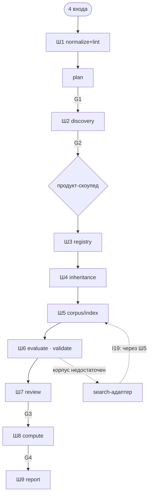

# coHound — архитектура: Итерация 0 — мастер-обзор

**Документ:** `docs/architecture/00-overview.md`
**Статус:** принято (ревью-гейт @oracle пройден 2026-10-08; правки K1–K7/S1–S13 интегрированы)
**Источник истины:** `cohound-spec-v2.md` (регламент v2.1). При расхождении — регламент главнее;
этот документ не вводит новой методологии, только её архитектурную развёртку.
**Смежное:** `05-dependency-stack.md` (реестр пакетов/лицензий/пинов), `06-implementation-strategy.md`
(стратегия и план реализации), `07-deployment-topology.md` (доверенные зоны/DMZ),
`09-product-onboarding-incremental-runs.md` (онбординг продукта, контейнеры, текстовые форматы,
durable `state.db`, benchmark оценщика), `10-extraction-pipeline-architecture.md` (стадии
извлечения и пост-извлечения: где живёт артефакт, что держит процесс, как размещение стадии
выражается конфигурацией), `11-production-architecture-strategy.md` (порядок доведения до
production-grade: фазы F0–F6, гейты, риски; пересматривает `10` §5 там, где та держалась
только ради обратной совместимости).

---

## 0. Назначение и границы проектирования

Проектируем **программную систему**, реализующую регламент coHound: CLI-инструмент, который по
четырём входам (якорь, каталог, когорта, фокус) проходит конвейер Ш1–Ш9, порождает пакеты
прогонов (`runs/{run_id}/`) и отчётные артефакты, обеспечивая инварианты I1–I23.

**В рамках этого документа:** слои, компоненты, зависимости, сквозные механизмы, план итераций.
**Вне рамок:** конкретные алгоритмы ретривала/чанкинга (итерация 2), схема CLI-флагов (итерация 3),
содержание ADR (итерация 4). **Выбор библиотек вынесен в `05-dependency-stack.md`** (снимок
версий/лицензий, проверки совместимости V1–V5).

---

## 1. Драйверы архитектуры (что диктует форму)

| # | Драйвер (из регламента) | Архитектурное следствие |
|---|---|---|
| AD1 | **A2:** moat — методология, commodity — заменимо | Порты/адаптеры (hexagonal): LLM, ретривал, хранилище, поиск — за интерфейсами; ядро не знает технологий |
| AD2 | **§1.3:** категорийная нейтральность `core/` | `core/` без предметных терминов; вся специфика — данные в `packages/{case_id}/`; CI-грепп-тест |
| AD3 | **I18/I19:** оценщик без поиска; внешний контент только через корпус | Жёсткое разделение контуров *evaluator* и *search-adapter*; единственный вход контента — Ш5 |
| AD4 | **I10/I15:** LLM не генерирует URL | Evidence всегда ссылается на `source_id`; резолв URL — детерминированный, в ядре |
| AD5 | **I16/I20:** симметрия ретривала; golden cut-off = pipeline-K | Ретривал-профиль как первоклассная конфигурация прогона; `retrieval_cutoff_K` в манифесте |
| AD6 | **I17:** ретривал продукт-скоупед | Индекс шардируется по продукту; оценка ищет только в партиции продукта+сателлитов |
| AD7 | **§13:** иммутабельные сборки, версионные границы | `index_store/{package}/{build}/{product_id}/` только на запись; смена версий инвалидирует diff |
| AD8 | **R7 / A3:** воспроизводимость и измеряемость дефолтов | Всё, что влияет на результат, пинится в манифесте прогона (строка БД; `run_manifest.yaml` — экспорт); эксперименты R0/R1/R2 — измерительный слой |
| AD9 | **§1.4:** одной политикой, два режима | Режим (`strict`/`preliminary`) — параметр прогона, а не ветка кода |
| AD10 | **A1:** минимальные средства | Стек дефолтов прост (SQLite, .npy, in-process); тяжёлое — по триггерам §14 |
| AD11 | **§10:** эшелонированная защита | Валидация как отдельный слой-конвейер, независимый от LLM |

> **Глоссарий нотации (разведение).** `AD1–AD11` — **драйверы архитектуры** (локальны для `00`).
> `D1–D4` — **журнал проектных решений** (в комментариях кода и доках): `D1` — контент-адресуемый
> `index_build_id`; `D2` — оси `fetch`/`extract` + `FetchPlan`; `D3` — durable-краул (сеанс
> `crawl_sessions`/`crawl_session_items`) + resume; `D4` — ось стратегии краула. Не путать с `AD#`.

---

## 2. Контекст системы (C4 уровень 1)

```mermaid
flowchart LR
    Analyst([Аналитик]) -->|CLI, ревью| SYS[coHound]
    Customer([Заказчик]) -->|отчёты| SYS
    SYS -->|краул, SERP| Web[(Публичные источники / интернет)]
    SYS -->|реестровые запросы| Reg[(Реестры: РРПО, ФСТЭК, ...)]
    SYS -->|инференс, без поиска| LLM[(LLM корп. облака: [OI]-совместимый API)]
    SYS -->|search grounding| SRCH[(Search-адаптер: Yandex/GLM)]
    SYS -->|артефакты| Out[(runs/, reports/, index_store/)]
```

**Акторы:** аналитик (управляет прогоном; G1/G2 — **внутренняя** аттестация профиля пакета,
G3/G4 — **точки интеграции**: решение приходит извне и записывается), заказчик (потребляет `battle_card`).
**Внешние системы:** публичный веб, реестры, LLM-инференс (корпоративное облако, [OI]-совместимый API), search-адаптер.
**Границы данных:** корпус не покидает контур (оценщик — на моделях корпоративного облака, без веб-тула); search-адаптер — единственный
внешний канал поисковых запросов, логируемый (`search_log`).

**Доверенные зоны (см. `07-deployment-topology.md`).** Система разворачивается в двух сетевых
зонах: **Z0 CORE** (доверенная, без веб-эгрессии: оркестрация, домен, store, ретривал, оценщик,
расчёт, отчёты) и **Z1 EDGE/DMZ** (веб-эгрессия: краул, поиск, реестры). Извлечение контента
сегодня исполняется **в ядре** (`extractor_zone` объявлено и не подключено — D-9, `07` §2);
зона **Z2 PARSE** (hardening парсинга недоверенного контента) — roadmap, её целевой контракт
описан в `10` §5.4. Взаимодействие — только через **application-layer firewall (L7)** по протоколу `/v1/*`:
8 POST-операций (`fetch`, `search`, `registry`, `crawl/submit`, `crawl/status`, `crawl/cancel`,
`crawl/collect`, `crawl/poll`) и 2 GET (`capabilities`, `health`); публикуемые схемы —
`contracts/seam/*.json` (+ `openapi.json`), тела запросов — `07` §3. Это усиливает **I18** (оценщик физически без маршрута в интернет) и
даёт явную границу для **I19**. Профиль `local` (один процесс) — дефолт для разработки (A1);
`split` (DMZ) — **опция уже в MVP** (M1, W13; `06`). Контракты шва — прозрачны для корпоративных
IDP/DLP/IDS (`07` §8).

---

## 3. Слои и правило зависимостей (C4 уровень 2)

**Пять слоёв (L0–L4)**, зависимости — строго **внутрь** (к домену). Ядро не импортирует адаптеры; адаптеры
и CLI зависят от ядра.

```
┌──────────────────────────────────────────────────────────────┐
│ L4. Интерфейс        cli/                                     │  CLI-команды, сборка зависимостей (wiring)
├──────────────────────────────────────────────────────────────┤
│ L3. Адаптеры         adapters/ · store/                       │  .npy, tantivy, LLM-API ([OI]-совместимый), Yandex/GLM, Scrapy, docling, SQLite
│      (реализуют порты)                                        │
├──────────────────────────────────────────────────────────────┤
│ L2. Порты            ports/                                   │  Protocol-интерфейсы (LLM, VectorIndex, Lexical, Search, Fetcher, Crawler, Poll, CrawlExecutor, Extractor, Container, Chunker, Embedder, IndexBuilder, Registry, Store/GateStore, State, Gateway)
├──────────────────────────────────────────────────────────────┤
│ L1. Сценарии         pipeline/                                │  Ш1–Ш9, гейты G1–G4, эксперименты
│      (use-cases)                                              │
├──────────────────────────────────────────────────────────────┤
│ L0. Домен            domain/                                  │  Модель, инварианты I1–I23, scoring, R-2 (чистый Python, без I/O)
└──────────────────────────────────────────────────────────────┘
            зависит от ──▲ (внутрь), никогда ▼
```

> `reports/` — не архитектурный слой, а каталог **выходных артефактов**; его писатель —
> L1-сценарий `pipeline/report.py` (openpyxl). В слое L4 живёт только `cli/`. Это снимает
> кажущееся противоречие «`reports/` в L4» vs «`pipeline/report.py` в L1».
>
> **Два composition root (07):** `cli/` собирает ядро (Z0), `edge/` собирает веб-адаптеры (Z1/DMZ).
> Оба — «корни сборки» и могут зависеть от `ports`+`adapters`; ни один не содержит домена. В
> профиле `local` `cli/` собирает всё in-process; в `split` ядро использует remote-прокси, а
> `edge/` публикует реальные адаптеры через gateway.

**Правило** (стрелка `→` = «зависит от»; матрица — `01` §1, проверяется статически
`tests/selfcheck.py::_import_graph` через `ast`): `cli` → `adapters`/`store` → `ports` → `domain`;
`pipeline` → `ports` → `domain`. `ports` и `adapters` **не** импортируют `pipeline` (в коде
0 совпадений), `pipeline` не импортирует `adapters`/`store`/`cli`/`edge`; `cli` не импортирует
`edge`; `edge` не импортирует `pipeline`/`store`/`domain`. `packages/` (данные) не импортируются
кодом как Python — читаются через порты загрузчиков (YAML/CSV).

---

## 4. Карта компонентов (C4 уровень 3)

### 4.1. Домен (L0)

| Компонент | Ответственность | Владеет инвариантами |
|---|---|---|
| `domain/enums.py` | Зеркало `docs/status-dictionary.yaml` (StrEnum) | — |
| `domain/models.py` | Cell, Evidence, Satellite, Passport, Package, Cohort, GoldenRow | Структурные |
| `domain/invariants.py` | Проверки I1–I23 для ячеек/evidence/сателлитов | I1–I14, I17–I19, I22 |
| `domain/scoring.py` | Resolved Capability, Coverage, failure_rate, Comparability, sensitivity | I5, I11, I13 |
| `domain/r2.py` | Маппинг сателлита на зачёт (§4.1) | Р-2 |
| `domain/anchors.py` | Stable slug, версионирование, `source_id`→URL резолв | I10, I15 |

`domain/anchors.resolve_source_url` не импортирует `ports/`: reader-протокол **`SourceResolver`**
объявляется внутри `domain/` (структурная типизация), конкретная реализация приходит из `store/`.
Так соблюдается матрица зависимостей (L0 не зависит от L2).

### 4.2. Сценарии (L1) — конвейер

| Компонент | Фаза | Выход | Гейт |
|---|---|---|---|
| `pipeline/normalize.py` + `lint.py` + `plan.py` | Ш1 | План прогона, валидированные входы | G1 (после `plan`) |
| `pipeline/discovery.py` | Ш2 | Кандидаты сателлитов/ролей | G2 |
| `pipeline/registry.py` | Ш3 | R-ячейки (`registry_facts`) | — |
| `pipeline/inheritance.py` | Ш4 | Унаследованные ячейки (`direct/conditional/blocked`) | — |
| `pipeline/corpus.py` | Ш5 | Индексная сборка + `content_hash` | — |
| `pipeline/evaluate.py` | Ш6 | Оценённые ячейки + evidence | — |
| `pipeline/validate.py` | Ш6 | Механическая валидация (эшелон §10) | — |
| `pipeline/review.py` | Ш7 | Strict-ревью / preliminary-стол | G3 |
| `pipeline/compute.py` | Ш8 | Capability/Coverage/Comparability | G4 |
| `pipeline/report.py` | Ш9 | Артефакты `battle_card` и др. | — |
| `pipeline/experiments.py` | M1 | R0/R1/R2, retrieval-golden | — |

**Операционный слой ингеста — указатели (здесь не дублируется).** Значительная часть Ш5 в
таблице не видна: спуск в контейнеры zip/7z/rar (`pipeline/archive_descent.py`,
`pipeline/artifact_probe.py`, `ports/container.py`) — `09` §6.7/§6.7.1; plain
text/markdown/EPUB как первый класс (`adapters/extract_text.py`, `adapters/extract_epub.py`,
`adapters/chunker_text.py`, реестр `util/document_formats.py`) — `09` §6.8; наблюдаемость
продукта (`product_start`/`product_end`/`product_skipped`, `--follow`, операторские заметки в
`results[].notes`) и статусы продукта в прогоне — `09` §13; durable
`state/{package_id}/state.db` и инкрементальные прогоны `--update` — `09` §4/§6.3; benchmark
моделей оценщика (`hound experiment evaluator-benchmark`) — `09` §20.

### 4.3. Порты (L2)

| Порт | Назначение | Гарантия |
|---|---|---|
| `ports/llm.py` | Инференс оценщика (constrained decoding) | **Без веб-тула** (I18) на уровне интерфейса |
| `ports/vector_index.py` | Векторный поиск по продукт-партиции | Продукт-скоупед (I17) |
| `ports/lexical_index.py` | BM25 поиск | Симметрия профиля (I16) |
| `ports/search.py` | Внешний поиск как источник контента | Логирование в `search_log` (I23) |
| `ports/crawler.py` | Краул страниц | Возвращает сырые байты (retention) |
| `ports/crawl_errors.py` | Таксономия сбоев краула (`CrawlError`/`CrawlUrlError`/`CrawlNotFound`/… ) | Контракт **ошибок** живёт в слое портов: адаптеры импортируют его, а не объявляют |
| `ports/extractor.py` | HTML / PDF / Office (docx/pptx/xlsx) / plain text / markdown / EPUB → текст или markdown | `extractor_version`; семейство — `ExtractedDoc.family` |
| `ports/chunker.py` | Текст → чанки с `heading_path` | `chunker_version` |
| `ports/embedder.py` | Текст → вектор (батч; локальная модель) | Модель не покидает контур; `embed_model_id` |
| `ports/index_builder.py` | Запись `.npy`-шардов и tantivy-индекса | `build()`/`commit()`; иммутабельная сборка (I17) |
| `ports/registry.py` | Реестровый факт | `source_url` обязателен (R1) |
| `ports/store.py` | Операционное хранилище (`StorePort`) + `GateStore` (`gate_decisions`) | Транзакционность; `gate_decisions` — аудит-след решений G1–G4 (I6/I7) |
| `ports/state.py` | Durable per-product состояние `state/{package}/state.db` (`ProductStatePort`) | Идемпотентные `upsert_*`; seed, исчезнувший из авторского файла, → `disabled`+`retired_at`, не удаление (см. `09` §4) |
| `ports/container.py` | Спуск в контейнеры zip/7z/rar: `list_members` (только индекс) и стримящий `open_member` | **Листинг ≠ извлечение**; члены становятся контентом только через corpus_raw→hash→index (I19); см. `09` §6.7 |
| `ports/poller.py` | Опрос фидов/каналов (`feed`/`channel`) → кандидаты-ссылки | Выход — **кандидаты, не evidence** (I19); SSRF-проверка каждой записи |
| `ports/crawl_executor.py` | Исполнение краула в `split`: `submit`/`status`/`cancel`/`collect` | `submit` идемпотентен по `idempotency_key` (по набору работ); `collect` отдаёт сырые байты (I19) |
| `ports/discovery_llm.py` | LLM-разведка ландшафта (`DiscoveryLLMPort`, кандидаты/гипотезы) | Отдельный порт от оценщика: выход — кандидаты (G2), не evidence; без веб-тула (I18/I21) |
| `ports/gateway.py` | Транспорт core↔edge (L7) | Только контент/кандидаты, не evidence (I19); см. 07 |
| `ports/types.py` | Общие value-объекты (`RawPage`, `ExtractedDoc`, `Chunk`, `FetchPlan`, `ExtractionRoute`) | Не порт: контракты данных на стыках |

`ports/gate_store.py` — transitional re-export-шим (`GateDecision`/`GateStore`); сам `GateStore`
объявлен в `ports/store.py`, доменный `GateDecision` — в `domain/models.py`.

### 4.4. Адаптeры (L3)

`adapters/vector_npy.py` (NpyVectorIndex, продукт-шарды) · `adapters/lexical_tantivy.py` ·
`adapters/llm_local.py` ([OI]-совместимый endpoint корп. облака; без тулов, I18) · `adapters/search_yandex.py` · `adapters/search_glm.py` ·
`adapters/crawl_scrapy.py` · `adapters/crawl_browser.py` (прямой Playwright/CDP, honest/hybrid) · `adapters/extract_html.py` (trafilatura) / `adapters/extract_document.py`
(docling: PDF + Office docx/pptx/xlsx, лёгкий путь без torch для Office) · `adapters/chunker_*.py` ·
`store/sqlite.py` (DDL) · **`core/config/paths.py`** (раскладка путей). Стек/пины/лицензии —
`05-dependency-stack.md`.

**Адаптеры-писатели индекса:** `adapters/index_npy.py` (`IndexBuilderPort`: запись `.npy`-шардов
и манифеста, `build()`/`commit()`; формат — `adapters/index_format.py`) и
`adapters/lexical_tantivy.py` (`LexicalIndexPort`). Векторный поиск — `adapters/vector_npy.py`
(`VectorIndexPort`); `adapters/embed_local.py` — `EmbedderPort`. `pipeline` не пишет `.npy`/tantivy
напрямую. Реализация `StorePort`/`GateStore` — `store/sqlite_store.py` поверх DDL `store/sqlite.py`;
бэкап/восстановление прогона — `store/backup.py`. Схема БД версионируется константой
`SCHEMA_VERSION` = **`3.13.0`** (версия SQLite-схемы прогона, **не** регламента), и файл с
другой версией **отвергается** с сообщением, а не читается молча (гейт `11` §2.6); durable
per-product состояние `state/{package_id}/state.db` версионируется отдельно —
`STATE_SCHEMA_VERSION` = **`"4"`** (`store/state_sqlite.py`, см. `09` §4); `runs.settings_provenance_json`
хранит провенанс настроек (A3), `runs.crawl_provenance_json` — провенанс краула (сеансы/движки/дайджест
источников, Phase 2), `runs.crawl_strategy`/`runs.crawl_rate_limit` — операционные оси краула
(границы `execution_change`, §13), `runs.crawl_config_digest`/`runs.registry_spec_digest` —
дайджесты разрешённой конфигурации контроля краула (N6) и package-scoped спецификаций реестров
(E2) — границы `execution_change` (§13), `runs.ranking_epsilon`/`runs.deploy_profile`/`runs.edge_schema_version`/
`runs.edge_capabilities_json` — порог ранжирования и деплой-провенанс (P1),
`corpus_chunks.extractor_version` и `index_manifest.extractor_version`/`content_digest` —
witness идентичности сборки (P2), `crawl_sessions`/`crawl_session_items` — первоклассный
сеанс краула (id/статус/прогресс/возобновляемость, фаза сеансов; legacy `crawl_attempts` удалена),
а `run_inputs` — снимок плановых входов (самодостаточность `runs/{run_id}`; `plan_inputs.json` —
производный экспорт, P1);
миграция additive/idempotent (`ALTER TABLE`/`CREATE TABLE IF NOT EXISTS` при отсутствии).

**Идентичность сборки — двухуровневая (не «build-id» в единственном числе).**
`partition_build_id` (`pb_…`) — иммутабельная продукт-партиция: выводится из версий
производства (`chunker_version`, `embed_model_id`, `extractor_version`,
`lexical_engine_version`, `vector_store`) и `content_digest`
(`corpus._derive_partition_build_id`); `params`/`snapshot_date` в формулу **намеренно не**
входят, поэтому смена фокуса/каталога переиспользует партицию. `composition_id` (`cb_…`) —
композиция партиций когорты по триплетам `(product_id, partition_build_id, content_digest)`
(`pipeline/composition.py`); это и есть `runs.index_build_id`. `{build}` в пути
`index_store/{package}/{build}/{product_id}/` — **партиция**, а не композиция; служебный
`{package}/_compositions/{composition_id}.json` — не сборка и не подлежит перечислению как
сборка (ADR 0021, `09` §8.1/§8.2).

**Реестровые фетчеры:** `ports/registry.py` — нейтральный порт; конкретные реестры (РРПО, ФСТЭК)
описываются данными в `packages/{case_id}/registries/*.yaml` и обслуживаются **generic config-driven HTTP/JSON/HTML
адаптером** вне `core/`, чтобы не нарушать §1.3.

---

## 5. Поток данных: Ш1–Ш9 и гейты



**Порядок фаз — код, не картинка:** `PHASES` (`pipeline/runner.py`) — 15 фаз
`normalize, lint, plan, g1, discovery, g2, registry, inheritance, corpus, evaluate, review, g3,
compute, g4, report`; гейты — **отдельные фазы** между рабочими, поэтому G1 стоит после
`plan` (аттестовать план, которого ещё нет, нельзя). Схема выше сжимает `normalize`+`lint` в
один узел и опускает `validate` (часть Ш6).

Ключевое: пунктирная петля — единственный легальный путь внешнего поиска. SERP не внутри оценщика,
а как **вход Ш5** (I18/I19). Каждый SERP-раунд порождает **новую иммутабельную сборку**
(`R0-base` → `R1-serp` → `R2-serp` → …), а не мутирует существующую; повторный Ш6 идёт **по новой
сборке**, инвалидируются только затронутые ячейки (`stale_reason='new_build'`), а не вся когорта.

---

## 6. Сквозные механизмы

| Механизм | Реализация | Инварианты |
|---|---|---|
| **Evidence integrity** | `source_id` → `source_url` резолв; цитата-подстрока `text`; `content_hash` | I1, I2, I10, I15, I19 |
| **Версионирование** | Манифест — строка БД прогона (`StorePort.persist_manifest`), экспорт — `run_manifest.yaml` в каталоге отчёта (вкл. `settings_provenance`, `ranking_epsilon`); иммутабельные сборки | §13 |
| **Воспроизводимость** | Пинить веса/движок/профиль/seed/железо + провенанс настроек (default\|measured); глобальный content-addressed кэш корпуса и SERP (ADR 0016) | R7, I16, I20 |
| **Нейтральность** | Правило: в `core/` нет предметных терминов; данные только в `packages/`. Автоматически проверяются **три слоя** — `core/domain`, `core/ports`, `core/pipeline` (`tests/selfcheck.py::_neutrality`); остальные слои держит правило (широкий грепп — подсказка, не гейт) | §1.3, §11.4 |
| **Детерминизм маршрутизации** | `scenario → {model_id,...}` таблицей, не решением LLM | I21 |
| **Валидация-эшелон** | Отдельный `pipeline/validate.py`, независимый от LLM | §10 |
| **Изоляция веб-контура** | Профиль `split`: веб-адаптеры в DMZ за L7-швом; ядро без эгрессии | I18, I19, §10 (07) |
| **Гейты как записанные решения** | G1/G2 — per-run строка `gate_decisions` (**рабочий путь**; второй путь — durable аттестация профиля `profile_attestation` в `state/{package}/state.db`, объявлена и проверяется гейтом, но **производителя в прогоне нет** — design-only); G3/G4 — экспорт предмета `runs/{run_id}/gates/{gate}-request.json` и запись вердикта (`subject_digest`, `source`, `external_ref`, `verdict`); `run.yaml:gates.{g3,g4}=waived` → `skipped` + видимый waiver | I6, I7 |

---

## 7. Модульная структура (фактическая)

```
core/
  __init__.py
  domain/      enums.py models.py invariants.py scoring.py r2.py anchors.py dictionary.py
  ports/       llm.py discovery_llm.py vector_index.py lexical_index.py search.py
               crawler.py crawl_errors.py poller.py crawl_executor.py extractor.py container.py
               chunker.py embedder.py index_builder.py registry.py
               store.py gate_store.py (шим) state.py gateway.py types.py
  pipeline/    runner.py phases.py composition.py normalize.py lint.py plan.py
               gates.py gate_subject.py profile_attestation.py
               discovery.py registry.py inheritance.py
               corpus.py crawl_frontier.py crawl_probe.py crawl_probe_driver.py
               crawl_session.py crawl_sources.py archive_descent.py artifact_probe.py
               fetch_plan.py
               evaluate.py retrieve.py validate.py review.py compute.py report.py
               experiments.py evaluator_benchmark.py extraction_eval.py golden.py
               adversarial.py serp_loop.py search_log.py prompt.py
               metrics.py observability.py
               incremental.py state_sync.py precedence.py idempotency.py digests.py
               run_identity.py eval_cache.py extract_cache.py onboarding.py
               package_{io,admin,discovery,candidates,scout}.py package_add_product.py
               passport_scout.py scout_common.py templates/*.txt
  adapters/    vector_npy.py index_npy.py index_format.py
               lexical_tantivy.py lexical_bm25.py
               embed_local.py embed_model2vec.py llm_local.py llm_discovery.py
               search_yandex.py search_glm.py
               crawl_scrapy.py crawl_http.py crawl_browser.py feed_poller.py
               extract_html.py extract_document.py extract_text.py extract_epub.py
               chunker_markdown.py chunker_text.py chunker_family.py
               container_zip.py container_7z.py container_rar.py container_any.py
               registry_generic.py gateway_validate.py
               remote_gateway.py remote_crawler.py remote_crawl_executor.py
               remote_search.py remote_registry.py remote_extractor.py
  store/       sqlite.py sqlite_store.py state_sqlite.py state_store.py backup.py
  config/      run_config.py deploy.py paths.py passports.py
               crawl_sources.py domain_profiles.py dotenv.py seeds.py
  cli/         main.py parser.py context.py errors.py output.py wiring.py
               execution_axes.py doctor.py package_commands.py __main__.py
               commands/* (реестр COMMANDS) package/* (hound package)   # composition root Z0
  edge/        server.py auth.py audit.py seam_schema.py scheduler.py config.py
               crawler_factory.py poller.py __main__.py               # composition root Z1 (DMZ)
  util/        ids.py hashing.py logging.py cache.py sanitize.py fusion.py
               security.py text_utils.py retrieval_eval.py agreement.py
               document_formats.py container_policy.py document_probe.py
               robots.py sitemap.py html_links.py feed.py rate_limit.py
               index_layout.py index_partition.py atomic_write.py memory.py
packages/{case_id}/, passports/, runs/, index_store/, corpus_raw/, state/, cache/
```

Операционные каталоги (раскладка — `core/config/paths.py`, переопределяется операторским
`config/paths.yaml` — его в репозитории нет, есть только образец `config/paths.example.yaml` —
или env):
`runs/{run_id}/` (SQLite прогона `cohound.db`, логи, `gates/*-request.json`; манифест
прогона — **строка БД**, а `run_manifest.yaml` выгружает фаза `report` в `outputs/`),
`state/{package_id}/state.db` (durable per-product, `09` §4), `index_store/{package}/{build}/`
(иммутабельные партиции + `_compositions/`), `corpus_raw/{product_id}/`, `cache/{serp,http}/`
(глобальный content-addressed, ADR 0016), а также отдельные `extract_cache/` (результаты
извлечения) и `eval_cache/` (вердикты оценщика) — у каждого свой жизненный цикл.

Монолит `core/schemas.py` расщеплён на `domain/{models,enums,invariants}.py` (T1.2, файл
**удалён**); DDL/триггеры `core/db.py` перенесены в `store/sqlite.py` + `ports/store.py` (T1.3,
файл **удалён**). `edge/` используется только при профиле `split` (07); в `local` не запускается.

---

## 8. План итераций

| Итерация | Содержание | Артефакт | Гейт |
|---|---|---|---|
| **0** | Мастер-обзор (этот документ) | `docs/architecture/00-overview.md` | — |
| **1** | Декомпозиция: модули, порты, контракты интерфейсов, правила зависимостей | `01-modules-and-contracts.md` | — |
| **2** | Детальный дизайн подсистем: конвейер, ретривал/индекс, LLM-контуры, реестры, отчёты | `02-subsystems.md` | — |
| **3** | Данные/хранилища, версионирование, конфигурация, CLI/UX | `03-data-config-cli.md` | — |
| **4** | Надёжность, наблюдаемость, CI, ADR-реестр, сверка с регламентом | `04-reliability-adr.md` | — |
| **R** | Независимое ревью архитектуры @oracle + интеграция | правки | ✅ пройден (2026-10-08) |
| **5** | Реестр зависимостей: пакеты, лицензии, пины, проверки V1–V5 | `05-dependency-stack.md` | — |
| **6** | Стратегия production-grade реализации + детальный план | `06-implementation-strategy.md` | — |
| **7** | Развёртывание: доверенные зоны, DMZ-шов (L7), профили | `07-deployment-topology.md` | — |
| **8** | Онбординг продукта и инкрементальные прогоны: durable `state.db`, seeds, `--update`, спуск в контейнеры, benchmark оценщика | `09-product-onboarding-incremental-runs.md` | — |

### 8.1. Вертикальный срез M0 (что реально в каркасе)

M0 должен давать **сквозной вертикальный срез** на детерминированных волнах;
всё остальное — заглушки за портами.

| Статус | Модули |
|---|---|
| **Реально в M0** | `domain/*` (enums, models, invariants, scoring, r2, anchors); `store/sqlite.py`; `pipeline/normalize.py` + `lint.py` + `plan.py`; `pipeline/gates.py`; CLI `resolve`/`plan`; реестровый generic-адаптер + `packages/{case_id}/registries/*.yaml`; golden-каркас |
| **Заглушки (stub)** | LLM-оценщик (`evaluate`); SERP/`search`-адаптер; crawler; vector/lexical-индексы (и `embedder`/`index_builder`); `edge/`-сервис (не запускается в `local`) |

Заглушки реализуют свои порты и дают детерминированный пустой ответ: конвейер собирается сквозь
них, но контуры Ш5/Ш6 в M0 рабочими не считаются. Сквозной результат M0 — мини-карта из
детерминированных волн (реестры + наследование) на 3 продуктах.

> **Стартовый актив (не greenfield).** К началу M0 уже существовали монолиты `core/schemas.py` / `core/db.py` (схемы + инварианты + DDL/триггеры), позже **расщеплены и удалены** (T1.2/T1.3);
> утилиты (`text_utils`, `security`, `fusion`, `retrieval_eval`) и адаптеры (`chunker_markdown`,
> `extract_document`, `lexical_bm25`), а также `tests/selfcheck.py` (автономная самопроверка) и
> пройденный браузерный smoke (V5). M0 — это **рефакторинг за порты**, а не написание с нуля.
> Полная инвентаризация и влияние на оценки — `06` §0.

---

## 9. Заготовки решений (ADR seeds) и открытые вопросы

**ADR-реестр (детально — `04-reliability-adr.md` §E):**
- 0001–0011 — accepted: порты/адаптеры (hexagonal) vs монолит; продукт-партиция + NpyVectorIndex;
  LLM без `tools`; контент только через Ш5; единый cut-off K; реестры как данные; SQLite+WAL;
  иммутабельные сборки; кэш внешних вызовов; `failed` как состояние ячейки; гейты как
  записанные решения (уточнён 0023).
- 0012 — accepted и **реализовано** (T1.2/T1.3): расщепление бывших `core/schemas.py`/`core/db.py`
  на слои (`domain/`, `store/`); transitional-шимы удалены.
- 0013–0017 — accepted (ревью-гейт): гранулярность индексной сборки и provenance ячеек; SERP-петля
  vs иммутабельность (append-only раунды); политика ранжирования/демотирования (requested vs
  computed); глобальный content-addressed кэш для R7; контракт derived-evidence наследования/сателлитов.
- **0018 — accepted:** доверенные зоны и DMZ-шов (веб-контур за application-layer firewall; remote-
  адаптеры + `ContentGateway`) — `07-deployment-topology.md`.
- **0019 — accepted:** инспектируемый контракт шва для корпоративных IDP/DLP/IDS (L7-JSON, публикуемые
  схемы, без pinning, OIDC/mTLS) — `07` §8.
- **0020 — accepted (v2.1):** Coverage по **вселенной scope** (§6/B-3a: `scope_universe`,
  `universe`/`completed`/`defined`, UNDEFINED) + разделение классов версий
  `methodology_version`/`EXECUTION_FIELDS` — `04` §E.
- **0021 — accepted:** двухуровневая идентичность индексной сборки — `partition_build_id` (`pb_`)
  на продукт-партицию и `composition_id` (`cb_`) на когорту (`runs.index_build_id` =
  композиция); `params`/`snapshot_date` в формулу партиции не входят — `09` §8.1/§8.2
  (уточняет 0013).
- **0022 — accepted:** память экстракции — операционный рычаг, вне `EXECUTION_CONTRACT_FIELDS`
  (`PDF_QUEUE_MAX_SIZE=1`, `malloc_trim` после документа, рециклинг воркеров, ленивый импорт
  docling); наблюдаемых значений не меняет — `04` §D.1.
- **0023 — accepted:** гейты G3/G4 — **точки интеграции**, а не внутренние решения: coHound
  экспортирует предмет (`runs/{run_id}/gates/{gate}-request.json` + `subject_digest`) и
  **записывает** вердикт внешней системы; `waived` — видимый waiver, не молчание —
  `04` §E (уточняет 0011).

**Открытые вопросы (для итераций):**
- Гранулярность транзакций SQLite при массовой записи ячеек (итерация 3).
- Формат и версионирование `prompt_hash` при смене шаблона (итерация 2).
- Механизм кэша SERP/корпуса для R7 — решён как глобальный content-addressed (ADR 0016, итерация 3 A.2).
- Где живёт реестр экспериментов R0/R1/R2 и как связывается с `index_build_id` (итерация 2).

---

## 10. Сверка с регламентом (traceability)

| Раздел регламента | Покрытие в этой итерации |
|---|---|
| §1.3 нейтральность | §3 слои, §7 структура |
| §3.1 компоненты | §4 карта компонентов |
| §3.2 стек | `05-dependency-stack.md` |
| §4.4 БД | §4.4 адаптеры (store), итерация 3 |
| §5 конвейер | §5 поток данных |
| §7 LLM-контуры | §4.3 порт LLM, §5 петля SERP |
| §10 защита | §6 валидация-эшелон; `07` (изоляция веб-контура) |
| §13 версионирование | §6; двухуровневая идентичность сборки — §4.4 |
| I1–I23 | §4.1 владение, §6 |
| §4/§6.3/§6.7/§6.8/§13/§20 (онбординг, инкремент, контейнеры, текстовые форматы, benchmark) | `09`; указатели — §4.2 |
