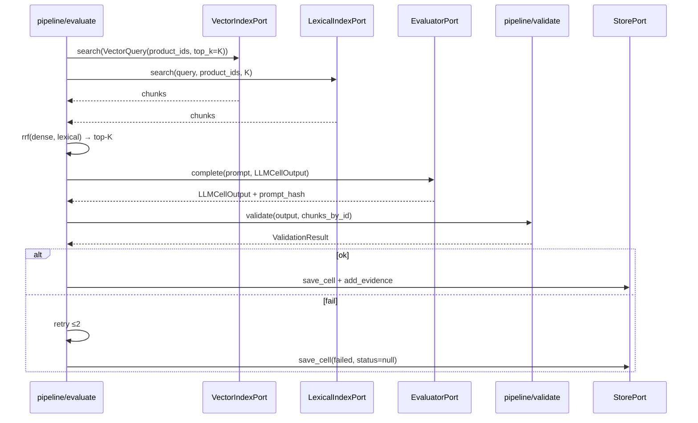
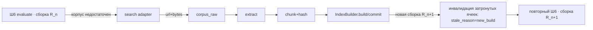

# coHound — архитектура: Итерация 2 — подсистемы

**Документ:** `docs/architecture/02-subsystems.md`
**Статус:** принято (ревью-гейт @oracle пройден 2026-10-08)
**Опирается на:** `00-overview.md`, `01-modules-and-contracts.md`
**Источник истины:** `cohound-spec-v2.md`
**Смежное:** `05-dependency-stack.md` (стек/пины), `06-implementation-strategy.md` (план).

Детальный дизайн: (A) конвейер и гейты, (B) корпус/индекс/ретривал, (C) LLM-контуры,
(D) реестры и наследование, (E) отчёты. Алгоритмы даны до уровня «достаточно для реализации».

---

## A. Конвейер и гейты

### A.1. Оркестратор `pipeline/runner.py`

Прогон — идемпотентная последовательность фаз с персистентным состоянием `runs.state`.
Фаза не начинается, пока предыдущая не завершена. Гейты останавливают и ждут человека.

```python
class Runner:
    def __init__(self, store: StorePort, ports: Ports, clock: Clock): ...
    def run(self, run_cfg: RunConfig, until: Phase | None = None) -> RunReport:
        # фазы: NORMALIZE, LINT, PLAN, DISCOVERY, REGISTRY, INHERITANCE,
        #       CORPUS, EVALUATE, REVIEW, COMPUTE, REPORT
```

**Персистентность состояния.** Каждая фаза пишет `run.phase_state` и частичные результаты.
Прерывание не теряет прогресс (важно: краул и эмбеддинги дороги). Повторный запуск продолжает
с фазы после последней завершённой (resume), если изменились только входы non-pinned.

**Идемпотентность.** Фазы Ш3/Ш4/Ш6 перезаписывают ячейки по ключу `(run_id, product_id, param_id)`
через upsert; Ш5 — иммутабельная контент-адресуемая сборка (новая `index_build_id` при любом
изменении входов **или содержимого** батча; P2).
Evidence пишется по **детерминированному** `evidence_id = H(run_id, product_id, param_id,
source_id, source_kind, seq)` (S8) — resume не порождает дублей.

**SERP-раунды и append-only (K2).** Корпус append-only и версионируется по раундам: базовый раунд
(`R0-base`) и каждый SERP-раунд (`R1-serp`, …) порождают **новую** иммутабельную сборку; существующая
сборка не мутируется. После долива раунда инвалидируются только **затронутые** ячейки
(`stale_reason='new_build'`) и переоцениваются на новой сборке; повторный Ш6 идёт по уже
проиндексированному контенту.

### A.2. Гейты (`pipeline/gates.py`)

| Гейт | Вход | Решение | Хранение |
|---|---|---|---|
| G1 | план (когорта, роли, перенормировка, объём) | accept / edit / abort | `runs.state='g1_approved'` + `cohort.yaml` заморожен |
| G2 | матрица роль×продукт (`relationship_evidence`) | approve / reject per satellite | паспорта `state=approved` |
| G3 | strict-ревью (⚠️/❌/❓/failed/Кр/аномалии) + preliminary-стол | set-status / promote / fix-evidence / reject | ячейки, `reviewed_by` |
| G4 | ScoreBundle + Coverage + Comparability | publish / hold | `reports/` |

**GateDecision** — доменный объект: `target` (что подтверждается), `actor` (человек),
`ts`, `notes`. Гейты **никогда автоматические** (I6/I7, N/A человеком). Оркестратор не «проходит»
гейт сам — только регистрирует решение, поданное через CLI. Каждое решение записывается в
**`gate_decisions`** (S9) через `GateStore`; гейт не считается пройденным без строки в
`gate_decisions` (носитель `reviewed_by`).

### A.3. Псевдокод прогона

```
inputs = normalize(run_yaml, package_dir)
report = lint(inputs); if report.blocking: stop
plan = plan(inputs)                       # scope, роли, когорта, перенормировка
gate(G1, plan)                            # человек
passports = discovery(plan, search)       # Ш2, кандидаты
gate(G2, passports)                       # человек: relationship
registry_wave(plan)                       # Ш3 (без LLM)
inheritance_wave(plan)                    # Ш4 (без LLM)
index = corpus(plan)                      # Ш5 (краул/SERP → extract → chunk → embed)
evaluate(plan, index)                     # Ш6 (оценщик без поиска) → validate
review_queue(run_id)                      # Ш7
gate(G3, review)
bundle = compute(run_id)                  # Ш8
gate(G4, bundle)
report(run_id)                            # Ш9
```

Петля SERP: если по ячейке `корпус недостаточен` → `search_adapter` собирает контент → **в Ш5**
(chunk+hash+index) как **новая сборка раунда** (`R1-serp`, …) → повторный Ш6 **по новой сборке**;
инвалидируются только затронутые ячейки (`stale_reason='new_build'`). Никогда «на лету» внутри
оценщика (I18/I19), никогда с мутацией существующей сборки (K2).

---

## B. Корпус, индекс, ретривал

### B.1. Ш5 — сборка корпуса (`pipeline/corpus.py`)

```
build_corpus(plan, crawler, extractor, chunker, embedder: EmbedderPort,
             index_builder: IndexBuilderPort, store)         # K3
products × doc_domains
  Pass A (ingest):
    → resolve_fetch_plan(url, domain_profiles, explicit)  # pipeline: FetchPlan (fetch/extract/wait_for)
    → CrawlerPort.fetch(url, plan)             # сырые байты → corpus_raw/{product}/{hash}.bin
    → ExtractorPort.extract(page, plan.extract)  # auto | html (trafilatura) | document (docling)
    → dedup(content_hash)                      # повтор перепечаток не индексируется
    → ChunkerPort.chunk(doc)                   # heading_path, context_prefix
    ── corpus_docs персистятся (retention); build_id чанков ещё None
  финализация index_build_id: декларированные входы + content_token всех партиций
  Pass B (index):
    → EmbedderPort.embed(chunks)               # батч, локальная модель
    → IndexBuilderPort.build(chunks, vectors, meta) -> build_id
    → IndexBuilderPort.commit()                # .npy-шарды + tantivy (атомарно)
    → corpus_chunks + index_manifest (одна запись на продукт-партицию)
```

`pipeline` **не работает с файлами индекса напрямую**: за запись `.npy`-шардов и tantivy отвечает
`IndexBuilderPort`, за эмбеддинги — `EmbedderPort` (K3).

**Граница доверенных зон (07).** В профиле `split` шаги `CrawlerPort.fetch` и `ExtractorPort.extract`
исполняются **в DMZ** (`edge/`), а ядро вызывает их через `ContentGateway` (remote-прокси). Сырые
байты и очищенный текст возвращаются в ядро **как ответ edge** (не как evidence); ядро **повторно
хеширует и валидирует** входящее, пишет `corpus_raw` (retention) и только затем `chunk → embed →
index`. Это делает DMZ-шов физической границей **I19**. В профиле `local` те же шаги идут in-process
(порт тот же — код ядра не меняется).

**Retention.** `corpus_docs.raw_path` → байты хранятся; `extractor_version` позволяет
ре-извлечение без ре-фетча (A/B экстракторов). `content_hash` — с первого дня (I19).

**Durable-краул (D3): аудит + очередь + resume.** Per-URL состояние попытки живёт в
`crawl_attempts` (`PK (run_id, product_id, url)`, `FetchStatus`): `pending` → `fetched`
(байты сохранены, retention) → `done`; сбой краула → `failed`/`source_unavailable`, сбой
извлечения → `failed`/`parser_failed` с сохранённым `raw_path`. При наличии `store` и `run_id`
Ш5 перед фетчем читает durable-записи и **не фетчит повторно** URL, у которого уже есть
retained-байты: `RawPage` реконструируется из `corpus_raw` (I19: raw — источник), затем идёт
ре-экстракция. `hound run --reset` очищает `crawl_attempts` (`clear_crawl_attempts`); глобальный
R7-кэш при этом может всё ещё дедуплицировать идентичные байты (живой фетч не гарантирован).
Ошибки записи изолируются (фаза остаётся `ok`-с-ошибками); счётчики `pending/fetched/done/failed`
идут в `IndexBuild` (наблюдаемость).

**Иммутабельность (контент-адресуемая, P2).** `index_build_id` = hash(schema-версия формулы +
пакет корпуса + params + `snapshot_date` + `chunker_version` + `embed_model_id` +
`extractor_version` + `lexical_engine_version` + `vector_store` + content-token). content-token —
отпечаток содержимого **всех** продукт-партиций (sorted `(chunk_id, content_hash)`), поэтому
разный контент при тех же декларированных входах даёт разные id (коллизия
same-id/different-content устранена). Два прохода: ingest → финализация id → index.
`retrieval_*` в id **не** входят. Любое изменение → новая сборка; старые не удаляются (§13).

**SERP как вход Ш5.** Результаты search-адаптера (Ш5/SERP-фаза) проходят тот же путь:
`SearchResult.raw_bytes → corpus_raw → extract → chunk → hash → index`. Это и есть I19:
внешне найденное становится evidence только после этой нормализации.

### B.2. Индексный контур (продукт-партиции, I17)

```
index_store/{package}/{build}/
  {product_id}/
    vectors.fp16.npy      # shape (N, dim)
    chunk_ids.jsonl       # строка i ↔ chunk_id
    manifest.json         # embed_model_id, dim, chunker_version, stats
```

Поиск — brute-force cosine по шардам переданных `product_ids` (продукт + его сателлиты).
Оценка продукта **не видит** чужие партиции (I17). При росте — триггеры §14 (квантизация, Qdrant).

**Сателлиты как партиции продукта-владельца (K5/I17).** Сателлит — `component` с ролью, а не
самостоятельный `product_id`. Документы сателлита индексируются **в партицию продукта-владельца**
(того, у которого он в паспорте), с привязкой `role` в метаданных чанка; `VectorQuery.product_ids`
для продукта = его партиция + партиции сателлитовых доменов. `relationship_evidence` сателлита —
паспортный объект, но подчиняется тем же правилам provenance (резолв + hash). Derived-evidence
наследования и сателлитов — по контракту §4.2 регламента (`check_derived_evidence`, K5).

### B.3. Ретривал-профиль и фьюжн (I16, I20)

Профиль — часть `RunConfig`, зафиксированная **до** прогона (симметрия I16):

| Профиль | Состав |
|---|---|
| R0 | только BM25 (lexical) |
| R1 | только dense (vector) |
| R2 | RRF-гибрид (BM25 + dense) |

```python
def retrieve(q_text: str, q_vec, product_ids, profile, k, lindex, vindex) -> list[RetrievedChunk]:
    if profile is R0: hits = lindex.search(q_text, product_ids, k)
    elif profile is R1: hits = vindex.search(VectorQuery(product_ids, vector=q_vec, top_k=k))
    else: hits = rrf(lindex.search(...), vindex.search(...), k=self.rrf_k)
    return hits
```

`retrieval_cutoff_K` — единый для golden и pipeline (I20). Каждый запрос → строка `search_log`
(`phase='corpus'`, lexical/dense/fused ranks). Оценщику отдаётся ровно `top_k=K` чанков.

Fusion-параметры (включая `rrf_k`) входят в `retrieval_params_json` и **версионируются** (§13, S1):
смена `rrf_k` меняет результаты → новая сборка + retrieval-golden. Поле `search_log.kind` различает
внутренний ретривал (`retrieval`) и внешние SERP-вызовы (`external`) (S12).

**Provenance и инвалидация ячеек (gaps).** Ячейка хранит `index_build_id` и `retrieval_profile` —
сборку и профиль, на которых получен вердикт. Смена сборки или prompt-шаблона помечает ячейку
`stale` (`stale_reason ∈ {new_build, prompt_template}`); `stale`-ячейки исключаются из расчёта до
переоценки/ревью (R15).

**Эксперимент R0/R1/R2 (`pipeline/experiments.py`).** Прогон на retrieval-golden, метрика
`recall@K`, выбор профиля — по R9/R10 (A3: дефолт фиксируется измерением).

### B.4. Запросы к оценщику (Ш6)

```
для (product × param):
  queries = [param.title] + concept_terms[ru] + concept_terms[en]   # ≤3
  chunks = union(retrieve(q_i) for q_i in queries)                   # top-K каждая
  dedup(chunks); сортировка по fused-рангу; обрезка до K
  prompt = compile(param.rule, param.absence_rule, relevant_satellites, chunks)
  resp = evaluator.complete(LLMRequest(prompt, LLMCellOutput, ...))
  validate(resp, chunks)   # эшелон §10
```

---

## C. LLM-контуры

### C.1. Оценщик (`pipeline/evaluate.py` + `adapters/llm_local.py`)

- **Вход:** компилированный промпт + `chunks_by_id` (для последующей валидации).
- **Выход:** `LLMCellOutput` (status, justification, evidence[{source_id, quote}]).
- **Схема:** constrained decoding (xgrammar/XGrammar) — гарантия **формы**; семантика проверяется
  эшелоном.
- **Детерминизм:** greedy или seed; `temperature`/`seed` из `ScenarioBinding`; фиксируется
  в `run_manifest.yaml` (R7).
- **I18 физически:** порт не принимает `tools`; адаптер подключается к [OI]-совместимому endpoint
  корп. облака без веб-тула. Веб-поиск —
  отдельный порт, к оценщику не подключён.

**Компиляция промпта (`pipeline/prompt.py`).**
```
template_version + rule + absence_rule
  + satellites[relevant roles]  (origin/relationship/evidence_state — как контекст, не доказательство)
  + "--- DATA ---" + chunks в делимитерах + "[source: chunk_id]"
prompt_hash = H(template_version, rule, absence_rule, sorted(chunk_ids))
```
`prompt_hash` в ячейке (воспроизводимость + инвалидация при смене шаблона).

### C.2. Эшелон валидации (`pipeline/validate.py`, §10)

```
(1) source_id существует и резолвится в URL       # I10/I15
(2) цитата — подстрока чистого text чанка          # strict; context_prefix не входит
(3) достаточность: over-claim → аномалия
(4) аномалии: ✅ при слабом retrieval-скоре; расхождения по группе → ревью
```

Каждый шаг возвращает `ValidationResult(ok, failure_kind, notes)`. Провал → `failure_kind` →
retry ≤2 → `failed` (status=null, I4). В preliminary невалидная цитата → кандидат + `validation_notes`.

**Evidence-объект.** По итогу валидации создаётся `CellEvidence` (`source_id`, `source_url` из
резолва, `citation_quote`, `content_hash` чанка, `source_scope`/`scope_attested_by` для absence).
Валидация цитат — **по чистому `text`**, `context_prefix` не участвует (§4.4).

### C.3. Search-адаптер (Ш5, §7.2)

- **Провайдеры:** `search_yandex.py` (Yandex Search API — провайдер **по умолчанию**, режим `async` —
  тоже дефолт), `search_glm.py` (GLM Web Search API / Z.ai Web Search API) — оба за `ports/search.py`.
  В профиле `split` исполняются в DMZ (`edge/`),
  ядро вызывает через `gateway` (07).
- **Бюджет:** фиксирован (≤5 RU + ≤5 EN на параметр-продукт по умолчанию), симметричен (I16).
- **Логирование:** каждый вызов → `search_log` (`adapter_kind`, provider, query, results, termination);
  инициатор — ядро (I23), edge ведёт свой аудит.
- **Цитаты заземления — кандидаты, не доказательства:** URL результата проходит corpus_raw →
  hash → index (I19); только после этого цитата может стать evidence.
- **Discovery/concept scout:** могут использовать search-enabled модель; выход — кандидаты,
  G2/human-ревью. Логируются той же таблицей.

### C.4. Маршрутизация моделей (I21)

```yaml
# в run_manifest.yaml
llm_scenarios:
  evaluator:      {model_id: ..., model_version: ..., endpoint_kind: api,
                   web_tool: false, decoder: xgrammar, seed: 0, temperature: 0.0}
  search_adapter: {provider: yandex, adapter_kind: serp}
  discovery:      {model_id: ..., endpoint_kind: api, web_tool: true}
  concept_scout:  {model_id: ..., endpoint_kind: api, web_tool: true}
```

Маршрут задан **таблицей и фазой**, не решением LLM. `endpoint_kind` по умолчанию — `api` (модели
корпоративного облака, [OI]-совместимый API). Смена значения → версионная граница (§13).

---

## D. Реестры и наследование

### D.1. Реестровая волна (Ш3, без LLM)

`pipeline/registry.py` по каталогу определяет, какие параметры покрываются реестрами
(`role_binding` + `registries` пакета). Для каждого — `RegistryFetcherPort.fetch()` →
`RegistryFact(fact_json, source_url, fetched_at)`. **R1: 100% имеют `source_url`.**
Результат → R-ячейки (`source_kind=registry`).

**Нейтральность.** Нет кода под конкретный реестр: `adapters/registry_generic.py` +
`registries/*.yaml` (endpoint, формат `json|html`, JSONPath-маппинг). См. итерацию 1 §7.

**Зона (07).** Реестровые фетчеры — веб-функция: в профиле `split` `registry_generic.py` исполняется
в DMZ (`edge/`), ядро вызывает через `gateway` (`/v1/registry`). Результат (`RegistryFact` с
`source_url`) возвращается в ядро и резолвится/валидируется там (R1/I10/I15).

### D.2. Волна наследования (Ш4, без LLM)

`pipeline/inheritance.py` по `baselines.csv` и upstream-совпадению паспорта:

| mode | действие |
|---|---|
| `direct` | upstream-факт переносится как статус (правило выполнено, I8) |
| `conditional` | уходит в ревью/кандидат |
| `blocked` | пропуск (upstream-факт не используется) |

Нет строки = кросс-линейный параметр (архетип B) — только корпус. Правило **П>В**: прямое
доказательство на Ш6 поверх унаследованного статуса может понизить → ревью.

### D.3. Порядок и приоритет источников

Детерминированное раньше поиска (§2.2 п.7): реестры → наследование → дистрибутив → корпус → SERP.
Каждый этап может «заполнить» ячейку; Ш6 работает поверх с правилом П>В.

---

## E. Отчёты и расчёт

### E.1. Расчёт (`pipeline/compute.py` → `domain/scoring.py`)

```
scope = scope_universe(catalog, cohort_product_ids)         # (product × param) — вселенная §6/B-3a
bundle = {
  capability: resolved_capability(cells, params, weights),   # ✅=1 ⚠️=0.5 ❌=0; ❓/failed вне числителя
  coverage: evidence_coverage(cells, params, weights, universe=scope),  # Σresolved / Σ w(scope)
  failure_rate: ...,                                          # R13
  modules: module_scores(cells, params, weights, universe=scope),
  comparability: comparability(cohort, per_product, alignment),
  sensitivity: sensitivity(cells, params, weights, axes={warn, unknown_policy, weights},
                           requested_ranking=run_cfg.ranking_policy,
                           ranking_epsilon=run_cfg.ranking_epsilon),  # §6/B-1 предикат устойчивости
  requested_ranking: run_cfg.ranking_policy,                  # K6: запрошенный режим отображения
  computed_ranking: join(requested, computed),                # K6: min; unranked не повышается
}
```

**Coverage по вселенной scope (v2.1, §6/B-3a).** Знаменатель universe-режима — `Σ w(universe)`, где
`universe = scope_universe(catalog, products)` (`core/pipeline/compute.py`) — декартово произведение
scope-параметров на продукты когорты, а не только существующие ячейки. `pending`/отсутствующая ячейка
входит в знаменатель как **неразрешённая**; `N/A` и `preliminary` — **вне** знаменателя (I7/I13);
`failed` — в знаменателе (I5). Возвращаемый `Co` (`Coverage`) несёт `universe` (вес вселенной),
`completed` (взвешенный числитель **завершённых** измерений: `evaluated/reviewed` без N/A + `failed`) и
`defined`; опубликованная доля завершённости — `completed / universe`. При `universe = 0` →
`value = None`, `defined = False` (UNDEFINED): Capability не публикуется (I11/G4). Legacy-режим
(`universe=None`) сохранён — знаменатель по существующим ячейкам.

**Запрошенный vs вычисленный ранг (K6/C-1).** `ranking_policy` во входе — запрошенный режим; он **не
переопределяет** демотирование по sensitivity. Итог — **join** `requested × computed = min` по порядку
`capability_ranked ⊐ coverage_fallback ⊐ unranked`: неустойчивое ранжирование демотируется до
`coverage_fallback` независимо от запрошенного, а запрос `unranked` не повышается. Предикат
устойчивости (`sensitivity`, §6/B-1) учитывает `ranking_epsilon` — порог неразличимости пар (доля
диапазона агрегата; разность в пределах порога в подсчёт не входит, дефолт 0 — точное равенство). В
манифест пишутся **оба** поля (`requested_ranking`, `computed_ranking`) и `ranking_epsilon`; расхождение
— ожидаемый и явно отображаемый случай (A3).

`alignment` (Comparability, §6): единый snapshot_date, retrieval_profile+K, embed/index build,
package/catalog version, edition/jurisdiction. Нарушено → `cross-cycle`, понижение на уровень.

### E.2. Артефакты (`pipeline/report.py`)

| Артефакт | Писатель | Содержание |
|---|---|---|
| `battle_card.xlsx` | `report.py` (openpyxl) | шапка (capability/coverage + `coverage_defined`/`coverage_universe`/`coverage_n_used`, comparability), матрица, сателлиты, модульное покрытие, sensitivity |
| `preliminary_findings.xlsx` | `report.py` | кандидаты + validation_notes (маркер «не публикация») |
| `nda_questions.csv` | `report.py` | все ❓ + `protocol_status` (`complete`/`incomplete`/`unknown`) и `i3_anomaly` (§5/I3) |
| `diff.md` | `report.py` | изменённые статусы + evidence_id (запрещён через major) |
| `run_manifest.yaml` | `runner.py` | все версии, модели, index_build, профиль+K, бюджет, scoring-политика, `ranking_epsilon`, `settings_provenance` |

**Отчётный контур I3 (v2.1, §5).** `report.py` собирает `i3_anomalies` (`collect_i3_anomalies`):
strict-`❓` без **полного** протокола исчерпания (`corpus`+`serp`+`registry`+`inheritance`). Это
**наблюдение**, а не изменение статуса: `❓` остаётся `❓` (I12), `status` не трогается. Те же
аномалии отражаются колонками `protocol_status`/`i3_anomaly` в `nda_questions.csv`.

**G4-инвариант:** `battle_card` не пишется без Coverage (I11); при `INSUFFICIENT` — приглушение;
при `UNDEFINED` (вселенная scope пуста) — публикация **блокируется**; при демотировании —
fallback-порядок по Coverage с пометкой.

---

## F. Подсистемы авторства пакета и экспериментов (обзор)

Помимо конвейера Ш1–Ш9, в `core/pipeline/` выделены две вспомогательные подсистемы; их CLI-фасад —
`03-data-config-cli.md` §E.1 (источник истины по CLI — код `core/cli/`).

**Авторство пакета.** `package_io.py` (чтение/запись артефактов пакета), `package_admin.py`
(CRUD модулей/ролей/параметров/baselines, перенормировка весов), `package_discovery.py` и
`package_candidates.py` (план и применение кандидатов), `package_scout.py` (веб-заземлённая
разведка пакета: pipeline сам делает SERP→краул→extract, tool-less LLM синтезирует гипотезы).
Авто-генерация черновика паспорта продукта — `passport_scout.py`; общие scout-хелперы (краул/
экстракция, разбор ответа) — `scout_common.py`. Выход подсистемы — **кандидаты** и черновики
(`needs_human=True`), не evidence: auto-approve нет (I18/I19, A3).

**Эксперименты.** `adversarial.py` (R8: проверка устойчивости), `serp_loop.py` (append-only
раунды сборок `R0-base`/`R1-serp`/…, K2) и golden (`golden.py` + `packages/{case_id}/golden.csv`,
тир fast/full) — см. `03 §E.1`, а также §B.3 и `06` (W8/W12).

---

## G. Диаграммы

### G.1. Последовательность Ш6



### G.2. Петля SERP (I18/I19) — append-only раунды (K2)



**Профиль `split` (07):** шаг `SA` (search adapter) и `CR` (краул) исполняются в DMZ; ядро↔edge —
через `/v1/search` и `/v1/fetch`. Сборка индекса (`CH`/`IX`) остаётся в ядре. Граница не меняет
семантику петли (append-only раунды, K2), а лишь размещает веб-часть в изолированной зоне.

---

## H. Traceability и открытые вопросы

| Регламент | Покрытие |
|---|---|
| §5 конвейер Ш1–Ш9 | A |
| §6 расчёт | E.1 |
| §7 LLM-контуры | C |
| §10 эшелон | C.2; `07` (изоляция веб-контура) |
| §11 golden/эксперименты | B.3 |
| I16–I23 | A–E |

**Открытые вопросы к итерации 3:** формат `runs/{run_id}/` (раскладка файлов); версионирование
`prompt`-шаблонов; глобальный content-addressed кэш для R7 (ADR 0016); политика ретраев и backoff;
гранулярность транзакций SQLite при массовой записи.
