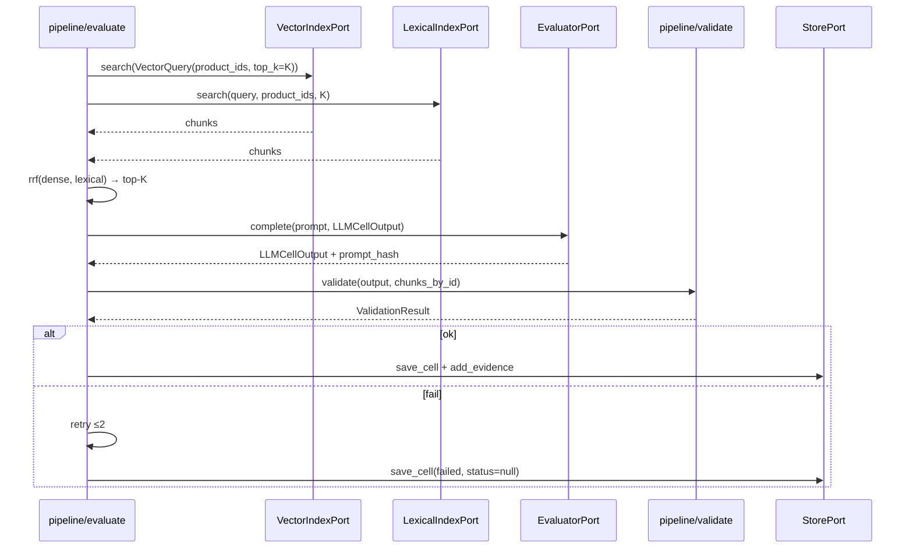
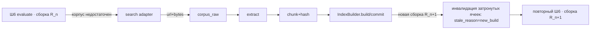

# coHound — архитектура: Итерация 2 — подсистемы

> **Статус открытых вопросов на 2026-10-28** (HEAD `f6100c7`): 5 закрыто, 0 открыто.
> У каждого пункта в §H маркер ✅/⬜/➖/❔ с доказательством.

**Документ:** `docs/architecture/02-subsystems.md`
**Статус:** принято (ревью-гейт @oracle пройден 2026-10-08)
**Опирается на:** `00-overview.md`, `01-modules-and-contracts.md`
**Источник истины:** `cohound-spec-v2.md`
**Смежное:** `05-dependency-stack.md` (стек/пины), `06-implementation-strategy.md` (план).

Детальный дизайн: (A) конвейер и гейты, (B) корпус/индекс/ретривал, (C) LLM-контуры,
(D) реестры и наследование, (E) отчёты. Алгоритмы даны до уровня «достаточно для реализации».

**Граница с `09`.** Этот документ — дизайн подсистем; операционные контракты, выросшие
после M1, описаны в `09-product-onboarding-incremental-runs.md` и здесь только
указываются: спуск в контейнеры — `09 §6.7`/§6.7.1, оси допуска артефактов — `09 §6.6`,
двухуровневая идентичность сборки — `09 §8.1-8.2`, ревалидация — `09 §6.3`/§8.7,
benchmark оценщика — `09 §20`.

---

## A. Конвейер и гейты

### A.1. Оркестратор `pipeline/runner.py`

Прогон — идемпотентная последовательность фаз с персистентным состоянием `runs.state`.
Фаза не начинается, пока предыдущая не завершена. Гейты останавливают и ждут человека.
`runs.state` — **JSON-карта** `{"phase_state": {phase: "ok"|"blocked"|"failed"}}`
(`sqlite_store.py`): прохождение гейта в ней **не** хранится (значения вида
`g1_approved` не существует) — гейт пройден тогда и только тогда, когда в
`gate_decisions` есть одобрение текущего предмета (A.2).

```python
class Runner:
    def __init__(self, store: StorePort, ports: Ports, clock: Clock): ...
    def run(self, run_cfg: RunConfig, until: Phase | None = None) -> RunReport:
        # фазы (15, порядок — `runner.PHASES`): NORMALIZE, LINT, PLAN, G1, DISCOVERY,
        #       G2, REGISTRY, INHERITANCE, CORPUS, EVALUATE, REVIEW, G3, COMPUTE, G4, REPORT
```

Гейты — **отдельные фазы** (`g1`/`g2`/`g3`/`g4`, `GATE_PHASES`), а не пометки на
соседних: `g1` стоит после `plan`, `g2` — после `discovery`, `g3` — между `review` и
`compute`, `g4` — между `compute` и `report`. Поэтому «остановился на g1» — это позиция в
той же последовательности, что и остальные фазы, и resume с неё работает так же.

**Персистентность состояния.** Каждая фаза пишет состояние в `runs.state` (карта
`phase_state`) и частичные результаты.
Прерывание не теряет прогресс (важно: краул и эмбеддинги дороги). Повторный запуск продолжает
с фазы после последней завершённой (resume), если изменились только входы non-pinned.

**Идемпотентность.** Фазы Ш3/Ш4/Ш6 перезаписывают ячейки по ключу `(run_id, product_id, param_id)`
через upsert; Ш5 — иммутабельная контент-адресуемая сборка (новая `partition_build_id` при
изменении входов партиции **или её содержимого**, новая `cb_`-композиция при изменении состава
или дайджеста члена; P2, `09 §8.1`).
Evidence пишется по **детерминированному** `evidence_id = H(run_id, product_id, param_id,
source_id, source_kind, seq)` (S8) — resume не порождает дублей.

**SERP-раунды и append-only (K2).** Корпус append-only и версионируется по раундам: базовый раунд
(`R0-base`) и каждый SERP-раунд (`R1-serp`, …) порождают **новую** иммутабельную сборку; существующая
сборка не мутируется. После долива раунда инвалидируются только **затронутые** ячейки
(`stale_reason='new_build'`) и переоцениваются на новой сборке; повторный Ш6 идёт по уже
проиндексированному контенту.

### A.2. Гейты (`pipeline/gates.py`)

**Два типа гейтов, один механизм.**

| Гейт | Вход (предмет решения) | Кто решает | Хранение |
|---|---|---|---|
| G1 | план (когорта, роли, перенормировка, объём) | **внутренняя аттестация**: человек в coHound | строка `gate_decisions` (рабочий путь) + `profile_attestation` профиля (durable, `state/{package}/state.db`; design-only — нет писателя) |
| G2 | матрица роль×продукт (`relationship_evidence`) | **внутренняя аттестация**: человек в coHound | строка `gate_decisions` + `Satellite.state=approved` в паспорте |
| G3 | strict-ревью (⚠️/❌/❓/failed/Кр/аномалии) + preliminary-стол | **точка интеграции**: внешняя система ревью | строка `gate_decisions` (`source=external`) + `reviewed_by` |
| G4 | ScoreBundle + Coverage + Comparability | **точка интеграции**: внешняя система публикации | строка `gate_decisions` (`source=external`) + `reports/` |

**`GateDecision` — доменный объект** (`domain/models.py`): `decision_id`, `run_id`,
`gate`, `target` (что подтверждается), `actor` (человек или система), `decided_at`,
`notes`, и интеграционная часть — `subject_digest` (отпечаток предмета), `source`
(`internal|external`), `external_ref` (идентификатор решения во внешней системе),
`verdict` (`approved|rejected`). Вид решения в свободном виде («accept/edit/abort»,
«publish/hold») отдельным полем **не** выражается — он живёт в `notes`; машиночитаемы
только `verdict` и привязка к предмету. Гейты **никогда автоматические** (I6/I7, N/A
человеком). Оркестратор не «проходит» гейт сам — только регистрирует решение, поданное
через CLI (`hound gate`). Каждое решение записывается в **`gate_decisions`** (S9) через
`GateStore`; гейт не считается пройденным без строки в `gate_decisions`, **привязанной к
текущему предмету** (носитель `reviewed_by`).

**Привязка к предмету (`subject_digest`).** Отпечаток того, о чём решали: профиль для
G1/G2, очередь ревью для G3, Coverage/Capability/артефакты для G4. Устаревшее одобрение
(предмет изменился) гейт **не** проходит, и сообщение называет изменившийся компонент
(`describe_subject_diff`); явный `verdict='rejected'` блокирует с отдельным сообщением
(кто отказал и почему) — молчание внешней системы не выдаётся ни за отказ, ни за
одобрение. Решения **без** отпечатка (legacy-строки) проходят только при сверке без
привязки — новый код обязан привязывать.

**G1/G2 — аттестация профиля (объявлена, производителя в прогоне нет).** Профиль
пакета-якоря квази-константен (2–5 правок в год при еженедельных прогонах), поэтому
задуман второй путь прохождения: человек аттестует **содержимое** профиля, durable-строка
живёт в `profile_attestation` (`state/{package}/state.db`, `STATE_SCHEMA_VERSION = "4"`), и
прогон проходит G1/G2, пока профиль совпадает с аттестованным. Проверка **подключена**
(`make_profile_gate` → `_profile_gate_resolver` в CLI, `runner._gate_phase` её спрашивает),
но **писателя в прогоне нет**: строку `profile_attestation` сегодня пишут только тесты, а
CLI-команды аттестации нет — это отдельная полоса. То есть as-built рабочий путь один —
per-run строка в `gate_decisions` (аудит-след и override); аттестация профиля —
design-only, и описывать её как работающий механизм нельзя. Гейт per-run: новый `run_id`
не наследует решение прошлого прогона.

**G3/G4 — точки интеграции.** coHound не решает ревью и публикацию, а **получает**
решение и записывает его. На блоке пишется `runs/{run_id}/gates/{gate}-request.json` —
детерминированный предмет (без меток времени) + `subject_digest`, который внешняя система
обязана вернуть в решении. `hound gate` берёт `--subject-digest` из request-файла, если он
не задан явно; `--source external` требует `--external-ref` и `--notes`.

**Делегирование (`run.yaml: gates.{g3,g4}: external|waived`, дефолт `external`).**
`waived` → фаза `skipped` с `skip_reason=gate_delegated_external`, waiver-строка в
`gate_decisions` (`source=external`, `external_ref='waiver:…'`) и `gate_waivers` в
манифесте прогона (манифест — строка `cohound.db`; файл `run_manifest.yaml` выгружает
`hound report`). Невидимый waiver запрещён; waiver-строки гейт не проходят (это запись
делегирования, а не одобрение). Политика гейтов — **процесс**, а не условие измерения,
поэтому в `EXECUTION_CONTRACT_FIELDS` её нет.

### A.3. Псевдокод прогона

```
inputs = normalize(run_yaml, package_dir)
report = lint(inputs); if not report.ready: stop   # ready = нет blocking и нет incomplete (A3)
plan = plan(inputs)                       # scope, роли, когорта, перенормировка
gate(G1, plan)                            # человек
passports = discovery(plan, search)       # Ш2, кандидаты
gate(G2, passports)                       # человек: relationship
registry_wave(plan)                       # Ш3 (без LLM)
inheritance_wave(plan)                    # Ш4 (без LLM)
index = corpus(plan)                      # Ш5 (краул/SERP → extract → chunk → embed)
evaluate(plan, index)                     # Ш6 (оценщик без поиска) → validate
review_queue(run_id)                      # Ш7
gate(G3, review)
bundle = compute(run_id)                  # Ш8
gate(G4, bundle)
report(run_id)                            # Ш9
```

Петля SERP: если по ячейке `корпус недостаточен` → `search_adapter` собирает контент → **в Ш5**
(chunk+hash+index) как **новая сборка раунда** (`R1-serp`, …) → повторный Ш6 **по новой сборке**;
инвалидируются только затронутые ячейки (`stale_reason='new_build'`). Никогда «на лету» внутри
оценщика (I18/I19), никогда с мутацией существующей сборки (K2).

---

## B. Корпус, индекс, ретривал

### B.1. Ш5 — сборка корпуса (`pipeline/corpus.py`)

```
build_corpus(plan, crawler, extractor, chunker, embedder: EmbedderPort,
             index_builder: IndexBuilderPort, store)         # K3
products × doc_domains
  Pass A (ingest) по продукту:
    → resolve_fetch_plan(url, domain_profiles, explicit)  # pipeline: FetchPlan (fetch/extract/strategy/wait_for/rate_limit)
    → CrawlerPort.fetch(url, plan)             # сырые байты → corpus_raw/{product}/{hash}.bin
    → ExtractorPort.extract(page, plan.extract)  # auto | html (trafilatura) | text/md | epub | document (docling)
    → dedup(content_hash)                      # повтор перепечаток не индексируется
    → ChunkerPort.chunk(doc)                   # heading_path, context_prefix
    ── corpus_docs персистятся (retention); build_id чанков ещё None
  Pass B (index) на границе продукта (09 §8.1):
    → partition_build_id продукта (pb; продукт-скоупед, I17)
    → EmbedderPort.embed(chunks)               # весь продукт одним вызовом (не порциями — 10 §5.2)
    → IndexBuilderPort.build(chunks, vectors, meta) -> partition_build_id
    → corpus_chunks                            # сразу, «сначала диск, потом БД»
  после всех продуктов:
    → IndexBuilderPort.commit()                # .npy-шарды + tantivy (атомарно)
    → composition_id + index_manifest (одна запись на продукт-партицию) + композиция на диске
```

`pipeline` **не работает с файлами индекса напрямую**: за запись `.npy`-шардов и tantivy отвечает
`IndexBuilderPort`, за эмбеддинги — `EmbedderPort` (K3).

**Память и durability стадий.** Что каждая стадия обязана держать в памяти, что теряется при
гибели процесса и почему `split` не паритетен по извлечению — `10-extraction-pipeline-architecture.md`
(§2 — as-built по шагам, §4 — дефекты, §5 — целевая форма). Здесь поток описан как он есть;
`10` описывает, каким он должен быть.

**Путь краула (§3.2).** За `CrawlerPort` стоят **три** адаптера, выбор — сменой адаптера
(сам порт не меняется):

| адаптер | что | роль |
|---|---|---|
| `crawl_http.py` (`HttpCrawler`) | `httpx` + content-addressed кэш, условный GET (`etag`/`last_modified` → `304`) | **дефолт для HTTP-доменов**; `supports_browser = False` — `fetch: browser` честно падает, а не подменяется на HTTP |
| `crawl_scrapy.py` (`ScrapyCrawler`) | Scrapy + scrapy-playwright | SPA/JS-страницы, honest/hybrid |
| `crawl_browser.py` (`BrowserCrawler`) | прямой Playwright/CDP | honest/hybrid без Scrapy |

Отдельный путь — **источники-каталоги** (`feed`/`channel`) через `PollPort`
(`adapters/feed_poller.py`, см. ниже): там `CrawlerPort` добывает только документ каталога,
а записи разворачиваются в обычные URL. **Единственный владелец politeness-пейсинга —
`corpus`**: перед каждым **живым** фетчем он вызывает `RateLimiter.wait(host,
plan.rate_limit)` (адаптерный `rate_limiter` — опц. хук для прямого/DMZ-использования, по
умолчанию `None`, двойного сна нет).

#### Операционные оси краула

Конкурентность краула — **две независимые оси**, и они не складываются в «число потоков
прогона»:

| ось (`CrawlLimits`) | что регулирует | где создаётся | масштаб |
|---|---|---|---|
| `max_workers` | **сетевой** fetch-пул (`httpx`) | внутри `_drain_root` (`core/pipeline/corpus.py:3082-3094`), `None`/`1` ⇒ пула нет | **на seed-root**, не на прогон |
| `extract_workers` | **экстракция** (CPU: docling/trafilatura) | фазовый пул по ключу `(DocumentLevel, extract_window)` (`core/pipeline/corpus.py:2182-2231`) | один на прогон, переиспользуется всеми корнями/продуктами |
| `extract_max_tasks_per_child` | рециклинг воркер-процесса после N заданий | тот же процессный пул | на воркер |
| `document_level` | `off` / `text` / `layout` / `layout_tables` / `full` | резолвится **на seed-root** (один корень = один уровень) | на корень |
| `robots` | эффективная egress-политика `robots.txt` | вычисляется ядром **на корень** (явная ось переопределяет автодетект) | на корень |

Следствия, которые легко проглядеть:

- **Конкурентность per-root, а не per-run.** Сетевой пул создаётся и закрывается внутри
  дренажа одного корня; два корня не делят пул и не дают `2 × max_workers` одновременно
  (корни обрабатываются последовательно).
- **Пул экстракции фазовый**, а не корневой: он один на прогон, поэтому `forkserver` и
  веса конвертера платятся один раз, а не на каждый корень. Окно упреждения — та же ось
  `extract_workers`; `None`/`1` ⇒ экстракция inline (байт-в-байт прежний путь).
- **`extract_max_tasks_per_child` работает только на процессном пуле** (`local`).
  Потоковый пул `split` воркеров не пересоздаёт — ось игнорируется **видимо** (запись в
  `errors`), а не тихо. При её наличии экстракция идёт пулом даже при `extract_workers == 1`
  (окно = 1).
- **Браузерный фетч в пул не идёт никогда** — он inline на главном потоке (адаптеры с
  `supports_browser`), поэтому `max_workers` его не параллелит.
- **`document_level`** применяется только к документным форматам (PDF/Office); HTML не
  затрагивается ни при каком значении. `off` отсекает суффикс-детектируемые документы до
  фетча (видимая запись `document_skips`), остальные — по `Content-Type` после фетча.

Оси из таблицы входят в `CrawlLimits.as_dict()` → `crawl_config_digest` →
`EXECUTION_CONTRACT_FIELDS`, то есть их смена даёт **новый `run_id`**: прогон помнит, каким
бюджетом и на каком уровне добыт корпус. Исключение — `extract_max_tasks_per_child`: он
попадает в дайджест только при явном задании (прогон без оси не меняет дайджест; обратная
совместимость §13). Класс diff-причины у всех этих осей один — **`execution_change`**
(меняются условия исполнения, правило измерения — нет), но последствия разной глубины:

- оси конкурентности и лимитов (`max_workers`, `extract_workers`,
  `extract_max_tasks_per_child`, `max_depth`/`max_documents`/`exclude_*`) меняют только
  бюджет обхода: та же сборка получится из того же корпуса;
- `robots` (D-5) решает, **какие документы вообще допущены** в корпус, поэтому входит в
  `crawl_config_digest` всегда (как `max_depth`), а не только когда задан явно;
- `document_level` тоже входит в дайджест **безусловно** (дефолт `full` присутствует
  всегда), а дополнительно кодируется в наблюдаемой версии экстрактора
  (`extract_document.py:128` — `docling-doc-3:{level}`): он меняет извлечённый текст
  (замер: `layout_tables → text` дал 154 678 → 138 598 символов) и влечёт новую
  `partition_build_id`. Класс от этого не меняется — идентичность прогона разошлась уже на
  дайджесте; новая сборка лишь следствие.

Опциональные оси (`extract_max_tasks_per_child`, `revalidate_max_documents`,
`max_response_bytes`, `archive_*`) включаются в дайджест **только когда заданы явно** —
это осознанная обратная совместимость: прогон без них не меняет дайджест, а с ними —
честно меняет.

#### Scope краула: только объявленные хосты

URL ставится в очередь, если он (1) проходит SSRF-валидацию, (2) принадлежит
**объявленному** хосту, (3) укладывается в path-prefix корня по границе сегмента, (4) не в
блэклисте. SSRF-проверка — не проверка scope, это разные предикаты.

- `Frontier.host_in_scope` (`crawl_frontier.py:682-706`): хост корня — всегда, `www.`-
  вариант эквивалентен базовому (`normalize_scope_host`); поддомен — **только если
  объявлен** (`scope_hosts`: seed-корень продукта или ключ `domain_profiles.yaml`); чужой
  хост и необъявленный поддомен — вне scope.
- Отказ **видим**: `out_of_scope_subdomains` (точный счётчик по хостам + ограниченные
  примеры) и `accepted_foreign_hosts` (сколько бюджета корня ушло на объявленный чужой
  хост).
- Хосты, объявленные **собственным** seed-корнем продукта, в `scope_hosts` предка не
  передаются: у такого хоста свой корень и свой бюджет.
- Терминальный артефакт (документ/контейнер) — исключение **только** из path-prefix (он не
  продолжает навигацию); host-scope, SSRF и блэклист остаются обязательными.

> **Не путать два предиката.** `fetch_plan._host_matches` (`fetch_plan.py:62-74`) — это
> семантика **профиля**: поддомен **наследует оси** родительского ключа
> (`fetch`/`extract`/лимиты). Это верно и нужно. Но наследование осей **не** даёт права
> тратить бюджет корня — за это отвечает `host_in_scope`. Слияние двух предикатов в один и
> есть дефект, из-за которого поддомен без объявления затягивался в обход корня (замер:
> `edu.postgrespro.ru` — 563 элемента из 682).

**Граница доверенных зон (07).** В профиле `split` шаги `CrawlerPort.fetch` и `ExtractorPort.extract`
исполняются **в DMZ** (`edge/`), а ядро вызывает их через `ContentGateway` (remote-прокси). Сырые
байты и очищенный текст возвращаются в ядро **как ответ edge** (не как evidence); ядро **повторно
хеширует и валидирует** входящее, пишет `corpus_raw` (retention) и только затем `chunk → embed →
index`. Это делает DMZ-шов физической границей **I19**. В профиле `local` те же шаги идут in-process
(порт тот же — код ядра не меняется).

**Retention.** `corpus_docs.raw_path` → байты хранятся; `extractor_version` позволяет
ре-извлечение без ре-фетча (A/B экстракторов). `content_hash` — с первого дня (I19).

**Durable-краул: сеанс (аудит + очередь + resume).** Краул представлен **сеансом**
(`crawl_sessions`) и per-URL элементами (`crawl_session_items`, `PK (session_id, product_id, url)`,
`CrawlItemStatus`): `pending` → `running` → `fetched` (байты сохранены, retention) / `cancelled`;
сбой краула → `failed`/`source_unavailable`, сбой извлечения → `failed`/`parser_failed` с
сохранённым `raw_path`.
**Статус сеанса `CrawlSessionStatus`** — `created`, `running`, `paused`, `cancelled`,
`completed`, `partial`, `failed`; терминальные — `completed|partial|cancelled|failed`.
`completed` — при отсутствии failed/cancelled, иначе `partial`. При наличии `store` и `run_id` Ш5 перед фетчем читает
durable-элементы сеанса и **не фетчит повторно** URL, у которого уже есть retained-байты:
`RawPage` реконструируется из `corpus_raw` (I19: raw — источник), затем идёт ре-экстракция;
recovery-on-open переводит «зависшие» `running` обратно в `pending`. Источник краула (движок/оси)
резолвится послойно (`crawl_sources.yaml` site/product → `domain_profiles` → `run.yaml ⊢crawl⊣`),
а движок выбирается из `Ports.crawlers`. `hound run --reset` очищает сеанс краула
(`clear_crawl_session`); глобальный R7-кэш при этом может всё ещё дедуплицировать идентичные байты
(живой фетч не гарантирован). Ошибки записи изолируются (фаза остаётся `ok`-с-ошибками); счётчики
`pending/fetched/failed` идут в `IndexBuild` (наблюдаемость).

**Источники-каталоги (`feed`/`channel`) — развёртка в записи.** Помимо обычных страниц, Ш5
поддерживает **директорные** источники (`kind ∈ _DIRECTORY_KINDS = {feed, channel}`,
`core/pipeline/corpus.py`): такой URL не индексируется напрямую, а разворачивается в список
ссылок-записей. Развёртка делегируется порту `ports/poller.py::PollPort`
(`poll(url, *, kind, params, plan) → list[FeedEntry]`, `validate_params`): в профиле `local` —
`LocalFeedPoller` (in-process `CrawlerPort` + чистые парсеры `core/util/feed.py`), в профиле
`split` — `RemoteFeedPoller` через op шва **`crawl/poll`** (DMZ добывает **только документ
каталога**, записи возвращаются как ссылки). Поддержаны форматы лент `feed` (XML: RSS/Atom/RDF) и
`channel` (JSON/JSON-lines/список URL). Ограничения выборки `params` (`limit`/`since`/`token_env`)
валидируются `PollPort.validate_params` **до** опроса; секреты — только по ссылке на env
(`token_env`). **Сам каталог не ретейнится и не ингестится** (I19): его элемент сеанса помечается
`fetched` **без** `raw_path`; `feed`/`channel` — кандидаты, не evidence. Записи становятся
**обычными retained-страницами** (retention `corpus_raw` → extract → chunk → index) с провенансом
каталога (`kind`); это **один уровень** развёртки (записи повторно не расширяются). SSRF-политика
(`validate_url`) проверяется на входе (URL ленты) и на **каждой** записи; небезопасная запись
отбрасывается. Сбой каталога (нет поллера / плохие `params` / ошибка опроса) → терминальный
`failed`/`source_unavailable` → сеанс `partial` (не «тихо пусто»). В `executor`-режиме (`split`)
развёртка каталогов исполняется **отдельной волной** с собственным `idempotency_key`: волна 1 —
top-level URL, затем опрос каталогов, волна 2 — записи (`_run_executor_waves`, `work_by_product`).

#### Контейнеры: спуск

Заявленный контейнер (`zip`/`7z`/`rar`, ось
`crawl.attachment_formats`) — не терминальный документ, а источник членов. Спуск живёт в
`pipeline/archive_descent.py` (`ArchiveDescentWalker`) и `pipeline/artifact_probe.py`
(классификация артефакта и листинг **по индексу**, без чтения тел); порт —
`ports/container.py` (`list_members`/`open_member`, стримящий итератор), адаптеры —
`container_{zip,7z,rar,any}`. Полный контракт — `09 §6.7` и §6.7.1; здесь только то, что
определяет поведение Ш5:

- **Потолка глубины нет** — конечность дают два независимых механизма: цикл по хешу
  содержимого (`archive_cycle`: архив, содержащий копию себя, не разворачивается) и
  **кумулятивный бюджет корня** `archive_max_total_uncompressed_bytes` (сумма фактически
  прочитанных байтов по всем уровням; исчерпание — видимый
  `ArchiveDescentStatus.BUDGET_EXHAUSTED`, а не тихое завершение). Оси `archive_max_*`
  ограничивают **один** контейнер.
- **Наблюдаемость**: `corpus_members` (PK `(archive_content_hash, member_path, product_id)`, исход
  члена в `doc_id`/`skip_reason`) и `archive_observations` (прогноз **до** извлечения +
  исход, `stopped_reason`/`cycle_stops`/`bytes_written`). Запись есть для **каждого**
  контейнера, включая пустой и нечитаемый: «внутри нет ингестируемого» — это наблюдение,
  а не отсутствие данных.
- **Члены извлекаются через фазовый пул экстракции**, с окном упреждения
  `K = extract_window` и **строгой FIFO-доводкой** (`core/pipeline/corpus.py:2431-2535`,
  `ArchiveDescentWalker(defer_member=…, window=…)`). Это не оптимизация порядка, а условие
  корректности: `_content_digest` сборки склеивает чанки **в порядке вставки**, а
  `partition_build_id` от порядка **не** зависит. Коммит в порядке завершения дал бы тот же
  build id при другом digest → `ImmutableBuildError` → молча незаписанные
  `corpus_chunks`/`index_manifest`. Отсюда правило: любая запись в видимые списки
  (`errors`, `members`, `skipped`) и любой вложенный спуск начинаются только на пустом
  окне. При `K = 1` и без пула (`split`, `defer_extract=False`) путь тождествен прежнему
  inline — наблюдаемые артефакты совпадают байт-в-байт.
- **Байты членов не ретейнятся**: архив — сырьё (I19), член — производный вид; член
  стримится в один временный файл и удаляется после доводки, а в БД остаётся идентичность
  `(archive_content_hash, normalized_member_path)`.
- **Покрытие — честная граница**: нечитаемый контейнер (индекс не прочитан) помечается
  `parser_failed` (`complete=False`); читаемый контейнер с нулём ингестнутых членов остаётся
  `fetched`. Отсутствие читателя — тоже видимый пропуск (`container_reader_unavailable`,
  `backend_unavailable`), а не «тихо пусто»: `zip` читается stdlib, `7z`/`rar` требуют extra
  `extract-archives`.

#### Наблюдаемость продукта

Продукт-цикл строго последователен, и один продукт может идти часами, поэтому «продукт ещё
в очереди» и «продукт потерян» обязаны быть различимы:

- `product_start` — до первого корня (`roots`/`seeds_declared`); `product_end` — после
  доводки хвостов (`roots`/`seeds_enqueued`/`session_items`/`fetched`/`failed`/`docs`/
  `elapsed_seconds`/`reason`), пишется **и при нулевом выходе** — именно этот случай раньше
  был немым; `product_skipped` — продукт плана, вообще не попавший в цикл
  (`--only-product`/`--only-failed`/пустой seed-набор).
- `log_entries` фазы никуда не сериализуется, поэтому CLI дублирует границы продуктов
  **строками** в `results[].notes` (`_product_notes`): сколько корней/seed'ов/элементов/
  документов и сколько это заняло. Это не `errors`: продукт с бюджетом `N` и нулём отказов —
  норма.
- `--follow`/`--watch` печатают живьём: агрегат сеанса (`crawl_progress`) и
  **продукт-скоуп** (`crawl_product`, событие `crawl_product` в `--json`) — агрегат не
  отличает «ещё в очереди» от «потерян».
- **Нулевой источник называет причину**: `corpus_coverage.reason` — `no_seeds`,
  `all_seeds_rejected` или `no_urls_entry`; продукт получает `expected_sources=0`,
  `complete=False`, ячейки идут в `failed` (не `❌`), а не тихий `ok`. Такие продукты
  попадают в `PhaseResult.pending` уже на выходе Ш5 — до дорогой Ш6.

**Иммутабельность: идентичность сборки двухуровневая (P2, `09 §8.1-8.2`).** Один
`index_build_id` больше не описывает всё: есть **партиция** и **композиция**.

- `partition_build_id` = `"pb_" + short_hash(_PARTITION_SCHEMA, package_id, product_id,
  chunker_version, embed_model_id, extractor_version, lexical_engine_version, vector_store,
  product_content_token)` (`_derive_partition_build_id`, `core/pipeline/corpus_index.py:80-139`).
  `product_content_token` — отпечаток содержимого партиции, sorted `(chunk_id,
  content_hash)`: порядко-независим и чувствителен к любому изменению контента.
  **`params_token` (каталог/фокус) и `snapshot_date` намеренно исключены** — каталог и фокус
  не меняют чанки/векторы, а снимок это провенанс, не содержимое. Именно это позволяет
  **переиспользовать партицию** при смене фокуса/каталога. `retrieval_*` тоже не входят.
- `index_build_id` = `"cb_" + short_hash(schema, package_id, sorted triples)` —
  композиция над `(product_id, partition_build_id, content_digest)` (`composition.py:93-119`).
  Сортировка делает id независимым от порядка членов; `content_digest` входит, поэтому
  коллизия same-id/different-content закрыта на уровне композиции. `index_build_id` — тот
  id, который читают ячейки и `hound diff`; «сборка» в отчётах — это он, а не `pb_`.
- Два прохода: ingest → финализация id → index. Любое изменение входов **или содержимого**
  → новая сборка; старые не удаляются (§13).

**SERP как вход Ш5.** Результаты search-адаптера (Ш5/SERP-фаза) проходят тот же путь:
`SearchResult.raw_bytes → corpus_raw → extract → chunk → hash → index`. Это и есть I19:
внешне найденное становится evidence только после этой нормализации.

### B.2. Индексный контур (продукт-партиции, I17)

```
index_store/{package}/{partition_build_id}/     # pb_… — одна продукт-партиция
  {product_id}/
    vectors.fp16.npy      # shape (N, dim)
    chunk_ids.jsonl       # строка i ↔ chunk_id
    manifest.json         # embed_model_id, dim, chunker_version, stats
index_store/{package}/_compositions/{composition_id}.json   # cb_… — манифест композиции
```

`{partition_build_id}` в раскладке — партиция продукта, а не прежний единый build id.
Служебный каталог `_compositions/` (`COMPOSITIONS_DIR`, `util/index_layout.py`) —
**не сборка**: его нельзя перечислять как build и нельзя удалять GC (иначе пропадут
манифесты композиций, на которые ссылаются ячейки).

Поиск — brute-force cosine по шардам переданных `product_ids` (продукт + его сателлиты).
Оценка продукта **не видит** чужие партиции (I17). При росте — триггеры §14 (квантизация, Qdrant).

**Сателлиты как партиции продукта-владельца (K5/I17).** Сателлит — `component` с ролью, а не
самостоятельный `product_id`. Документы сателлита индексируются **в партицию продукта-владельца**
(того, у которого он в паспорте), с привязкой `role` в метаданных чанка; `VectorQuery.product_ids`
для продукта = его партиция + партиции сателлитовых доменов. `relationship_evidence` сателлита —
паспортный объект, но подчиняется тем же правилам provenance (резолв + hash). Derived-evidence
наследования и сателлитов — по контракту §4.2 регламента (`check_derived_evidence`, K5).

### B.3. Ретривал-профиль и фьюжн (I16, I20)

Профиль — часть `RunConfig`, зафиксированная **до** прогона (симметрия I16):

| Профиль | Состав |
|---|---|
| R0 | только BM25 (lexical) |
| R1 | только dense (vector) |
| R2 | RRF-гибрид (BM25 + dense) |

```python
def retrieve(q_text: str, q_vec, product_ids, profile, k, lindex, vindex) -> list[RetrievedChunk]:
    if profile is R0: hits = lindex.search(q_text, product_ids, k)
    elif profile is R1: hits = vindex.search(VectorQuery(product_ids, vector=q_vec, top_k=k))
    else: hits = rrf(lindex.search(...), vindex.search(...), k=self.rrf_k)
    return hits
```

`retrieval_cutoff_K` — единый для golden и pipeline (I20). Каждый запрос → строка `search_log`
(`phase='corpus'`, lexical/dense/fused ranks). Оценщику отдаётся ровно `top_k=K` чанков.

Fusion-параметры (включая `rrf_k`) входят в `retrieval_params_json` и **версионируются** (§13, S1):
смена `rrf_k` меняет результаты → новая сборка + retrieval-golden. Поле `search_log.kind` различает
внутренний ретривал (`retrieval`) и внешние SERP-вызовы (`external`) (S12).

**Provenance и инвалидация ячеек (gaps).** Ячейка хранит `index_build_id` и `retrieval_profile` —
сборку и профиль, на которых получен вердикт. Смена сборки или prompt-шаблона помечает ячейку
`stale` (`stale_reason ∈ {new_build, prompt_template}`); `stale`-ячейки исключаются из расчёта до
переоценки/ревью (R15).

**Эксперимент R0/R1/R2 (`pipeline/experiments.py`).** Прогон на retrieval-golden, метрика
`recall@K`, выбор профиля — по R9/R10 (A3: дефолт фиксируется измерением).

### B.4. Запросы к оценщику (Ш6)

```
для (product × param):
  queries = [param.title] + concept_terms[ru] + concept_terms[en]   # ≤3
  chunks = union(retrieve(q_i) for q_i in queries)                   # top-K каждая
  dedup(chunks); сортировка по fused-рангу; обрезка до K
  prompt = compile(param.rule, param.absence_rule, relevant_satellites, chunks)
  resp = evaluator.complete(LLMRequest(prompt, LLMCellOutput, ...))
  validate(resp, chunks)   # эшелон §10
```

---

## C. LLM-контуры

### C.1. Оценщик (`pipeline/evaluate.py` + `adapters/llm_local.py`)

- **Вход:** компилированный промпт + `chunks_by_id` (для последующей валидации).
- **Выход:** `LLMCellOutput` (status, justification, evidence[{source_id, quote}]).
- **Схема:** constrained decoding (xgrammar/XGrammar) — гарантия **формы**; семантика проверяется
  эшелоном.
- **Детерминизм:** greedy или seed; `temperature`/`seed` из `ScenarioBinding`; **намерены**
  фиксировать в `run_manifest.yaml` (R7) — фактически колонки `seed`/`temperature`/
  `constrained_decoding` сейчас пишутся `NULL` (`_resolve_llm_scenarios` их не заполняет),
  то есть манифест условия генерации не подтверждает. Провайдер может игнорировать
  `seed`: замер — 4.2 % (5 из 119) ячеек меняют вердикт при идентичном `prompt_hash`
  (`docs/reports/measurements/2026-10-26-verdict-reproducibility.md`). Это остаточный
  недетерминизм, а не гарантия.
- **I18 физически:** порт не принимает `tools`; адаптер подключается к [OI]-совместимому endpoint
  корп. облака без веб-тула. Веб-поиск —
  отдельный порт, к оценщику не подключён.

**Компиляция промпта (`pipeline/prompt.py`).**
```
template_version + rule + absence_rule
  + satellites[relevant roles]  (origin/relationship/evidence_state — как контекст, не доказательство)
  + "--- ДАННЫЕ ---" + фрагменты со структурной шапкой:
      [фрагмент N]
      source_id: <chunk_id>
      document: <document_id>          (обратный разбор chunk_id; непознанный формат — строки нет)
      heading: <heading_path>          (пустое значение не печатается)
      context: <context_prefix>        (не дублируется, если равен heading)
      текст:
      <дословный chunk.text>
  | "(нет фрагментов)"                 (пустой срез)
prompt_hash = H(template_version, rule, absence_rule, sorted(chunk_ids))
```
`prompt_hash` в ячейке (воспроизводимость + инвалидация при смене шаблона).

**Шапка — метаданные, а не текст.** Шаблон отдельным правилом запрещает её цитировать: I22 требует непустой `citation_quote`, и цитата `heading: …` формально пройдёт проверку, будучи не доказательством, а эхом метаданных. Текст чанка остаётся дословной подстрокой промпта — это проверяется тестом, а не соглашением. (Присутствие цитаты **в тексте** фрагмента не проверяется ни доменом, ни отчётом — это известный пробел V1, см. `docs/architecture/15-external-review-findings-plan.md` §2.)

**Композиция — часть идентичности, а не деталь рендера.** Отрендеренный промпт собирается из трёх текстов: файла шаблона, подсказки по правилу отсутствия (`ABSENCE_GUIDANCE` живёт в **коде** `prompt.py`) и JSON-схемы ответа. Поэтому `prompt_template` — композит «имя + хеш» от всех трёх (`run_identity._prompt_template_identity`): правка подсказки в коде меняет промпт у всех ячеек, и хешировать только файл значило бы дать ей пройти под прежним `run_id`.

**Пустой срез модель не вызывает.** `chunks == ()` — факт о ретривале, а не вопрос: ячейка получает `evaluated`/`❓` с первоклассной заметкой `no_fragments` в `cells.validation_notes`, `relevant_evidence_coverage=None` («0 из 0» — не измерено), `model_id=None` (модель не работала) и `prompt_hash` (промпт скомпилирован). Ответ модели на пустом входе («не установлено») неотличим от честного «прочитал фрагменты, утверждения нет», и при этом оплачивается.

**Сбой ретривала — `failed`, а не пустой срез.** Отсутствие ключа в карте «параметр → чанки» означает «прибор не сработал», а не «ничего не нашёл»: `evaluate_batch` отвергает такое явной ошибкой, а фаза строит `failed`-ячейку с `instrument_failed` и причиной в `validation_notes` (I4). Подстановка `()` превращала бы отказ инструмента в измеренное «вендор не заявил».

### C.2. Эшелон валидации (`pipeline/validate.py`, §10)

```
(1) source_id существует и резолвится в URL       # I10/I15
(2) цитата — подстрока чистого text чанка          # strict; context_prefix не входит
(3) достаточность: over-claim → аномалия           # НЕ реализовано как шаг эшелона
(4) аномалии: ✅ при слабом retrieval-скоре; расхождения по группе → ревью
```

**Про шаг (3) — честно.** Эшелон `pipeline/validate.py` его не исполняет: там восемь проверок
(`validate.py:300-381`), и ни одна не спрашивает, **следует ли заявленный статус из цитаты**.
Регламент (§7.1) разрешает «частично механически» и требует следствия-*аномалии*, поэтому
шаг присутствует в норме, но не в коде. Что существует вместо него: замер
`support_subject_overlap` (`core/pipeline/evaluate.py:1156-1194`) — пересечение стемов параметра и цитаты
для ✅/⚠️; он **не меняет вердиктов**, пишет `cells.validation_notes`/`review_reason` и
агрегируется в `outputs/support_quality.yaml`. Измеренный масштаб — в
`docs/reports/measurements/2026-10-27-support-not-about-subject.md`: v2 публиковал 45 `✅`
из 70 без доказательства о предмете. Механизм проверки класса утверждения — открытая работа
(`docs/architecture/15-external-review-findings-plan.md`, V1).

Каждый шаг возвращает `ValidationResult(ok, failure_kind, notes)`. Провал → `failure_kind` →
retry ≤2 → `failed` (status=null, I4). В preliminary невалидная цитата → кандидат + `validation_notes`.

**Evidence-объект.** По итогу валидации создаётся `CellEvidence` (`source_id`, `source_url` из
резолва, `citation_quote`, `content_hash` чанка, `source_scope`/`scope_attested_by` для absence).
Валидация цитат — **по чистому `text`**, `context_prefix` не участвует (§4.4).

### C.3. Search-адаптер (Ш5, §7.2)

- **Провайдеры:** `search_yandex.py` (Yandex Search API — провайдер **по умолчанию**, режим `async` —
  тоже дефолт), `search_glm.py` (GLM Web Search API / Z.ai Web Search API) — оба за `ports/search.py`.
  В профиле `split` исполняются в DMZ (`edge/`),
  ядро вызывает через `gateway` (07).
- **Бюджет:** фиксирован (≤5 RU + ≤5 EN на параметр-продукт по умолчанию), симметричен (I16).
- **Логирование:** каждый вызов → `search_log` (`adapter_kind`, provider, query, results, termination);
  инициатор — ядро (I23), edge ведёт свой аудит.
- **Цитаты заземления — кандидаты, не доказательства:** URL результата проходит corpus_raw →
  hash → index (I19); только после этого цитата может стать evidence.
- **Discovery/concept scout:** могут использовать search-enabled модель; выход — кандидаты,
  G2/human-ревью. Логируются той же таблицей.

### C.4. Маршрутизация моделей (I21)

```yaml
# в run_manifest.yaml
llm_scenarios:
  evaluator:      {model_id: ..., model_version: ..., endpoint_kind: api,
                   web_tool: false, decoder: xgrammar, seed: 0, temperature: 0.0}
  search_adapter: {provider: yandex, adapter_kind: serp}
  discovery:      {model_id: ..., endpoint_kind: api, web_tool: true}
  concept_scout:  {model_id: ..., endpoint_kind: api, web_tool: true}
```

Маршрут задан **таблицей и фазой**, не решением LLM. `endpoint_kind` по умолчанию — `api` (модели
корпоративного облака, [OI]-совместимый API). Смена значения → версионная граница (§13).

**Источник `evaluator.model_id` — объявленный вход, не env (§7.4/I21).** `llm_scenarios` входят в
`execution_contract_digest` (→ `run_id`), поэтому модель оценщика резолвится только из
объявленных входов: `--llm-model` > `deploy.llm.<slot>.model_id` > **ошибка** (`llm`,
`EXIT_USAGE`); дефолтной модели нет. `decoder` — из аргумента/слота > дефолт модуля
(`EVALUATOR_DEFAULT_DECODER`): у него дефолт наблюдаем и объявлен, у модели — нет.
Env `COHOUND_LLM_MODEL`/`COHOUND_LLM_DECODER` действуют **только** на
LLM-разведку (`build_discovery_llm`): её выход — кандидаты/гипотезы (G2, human-ревью), а не
evidence, поэтому её модель — операционная настройка. Асимметрия осознанная: смешать
«кандидатов» и «доказательства» в одну политику значило бы позволить окружению переписывать
провенанс вердиктов. Операционные поля оценщика (endpoint/ключ/таймаут) по-прежнему берутся из
env; endpoint из env оставляет `llm_scenarios` пустой (env не входит в `run_id`) и это явно
сообщается в `logs/wiring.jsonl` + `warnings` payload — «оценщик вне execution contract».
Молчаливая подстановка модели дала бы ложную провенанс-запись в манифесте.

---

## D. Реестры и наследование

### D.1. Реестровая волна (Ш3, без LLM)

`pipeline/registry.py` по каталогу определяет, какие параметры покрываются реестрами
(`role_binding` + `registries` пакета). Для каждого — `RegistryFetcherPort.fetch()` →
`RegistryFact(fact_json, source_url, fetched_at)`. **R1: 100% имеют `source_url`.**
Результат → R-ячейки (`source_kind=registry`).

**Нейтральность.** Нет кода под конкретный реестр: `adapters/registry_generic.py` +
`packages/{case_id}/registries/*.yaml` (endpoint, формат `json|html`, JSONPath-маппинг). См. итерацию 1 §7.

**Зона (07).** Реестровые фетчеры — веб-функция: в профиле `split` `registry_generic.py` исполняется
в DMZ (`edge/`), ядро вызывает через `gateway` (`/v1/registry`). Результат (`RegistryFact` с
`source_url`) возвращается в ядро и резолвится/валидируется там (R1/I10/I15).

### D.2. Волна наследования (Ш4, без LLM)

`pipeline/inheritance.py` по `baselines.csv` и upstream-совпадению паспорта:

| mode | действие |
|---|---|
| `direct` | upstream-факт переносится как статус (правило выполнено, I8) |
| `conditional` | уходит в ревью/кандидат |
| `blocked` | пропуск (upstream-факт не используется) |

Нет строки = кросс-линейный параметр (архетип B) — только корпус. Правило **П>В**: прямое
доказательство на Ш6 поверх унаследованного статуса может понизить → ревью.

### D.3. Порядок и приоритет источников

Детерминированное раньше поиска (§2.2 п.7): реестры → наследование → дистрибутив → корпус → SERP.
Каждый этап может «заполнить» ячейку; Ш6 работает поверх с правилом П>В.

---

## E. Отчёты и расчёт

### E.1. Расчёт (`pipeline/compute.py` → `domain/scoring.py`)

```
scope = scope_universe(catalog, cohort_product_ids)         # (product × param) — вселенная §6/B-3a
bundle = {
  capability: resolved_capability(cells, params, weights),   # ✅=1 ⚠️=0.5 ❌=0; ❓/failed вне числителя
  coverage: evidence_coverage(cells, params, weights, universe=scope),  # Σresolved / Σ w(scope)
  failure_rate: ...,                                          # R13
  modules: module_scores(cells, params, weights, universe=scope),
  comparability: comparability(cohort, per_product, alignment),
  sensitivity: sensitivity(cells, params, weights, axes={warn, unknown_policy, weights},
                           requested_ranking=run_cfg.ranking_policy,
                           ranking_epsilon=run_cfg.ranking_epsilon),  # §6/B-1 предикат устойчивости
  requested_ranking: run_cfg.ranking_policy,                  # K6: запрошенный режим отображения
  computed_ranking: join(requested, computed),                # K6: min; unranked не повышается
  publishability: publishability_profile(cells, params, weights, coverage=coverage, universe=scope),  # A1: класс + разложение неизвестности по причинам
}
```

**Coverage по вселенной scope (v2.1, §6/B-3a).** Знаменатель universe-режима — `Σ w(universe)`, где
`universe = scope_universe(catalog, products)` (`core/pipeline/compute.py`) — декартово произведение
scope-параметров на продукты когорты, а не только существующие ячейки. `pending`/отсутствующая ячейка
входит в знаменатель как **неразрешённая**; `N/A` и `preliminary` — **вне** знаменателя (I7/I13);
`failed` — в знаменателе (I5). Возвращаемый `Co` (`Coverage`) несёт `universe` (вес вселенной),
`completed` (взвешенный числитель **завершённых** измерений: `evaluated/reviewed` без N/A + `failed`) и
`defined`; опубликованная доля завершённости — `completed / universe`. При `universe = 0` →
`value = None`, `defined = False` (UNDEFINED): Capability не публикуется (I11/G4). Legacy-режим
(`universe=None`) сохранён — знаменатель по существующим ячейкам.

**Запрошенный vs вычисленный ранг (K6/C-1).** `ranking_policy` во входе — запрошенный режим; он **не
переопределяет** демотирование по sensitivity. Итог — **join** `requested × computed = min` по порядку
`capability_ranked ⊐ coverage_fallback ⊐ unranked`: неустойчивое ранжирование демотируется до
`coverage_fallback` независимо от запрошенного, а запрос `unranked` не повышается. Предикат
устойчивости (`sensitivity`, §6/B-1) учитывает `ranking_epsilon` — порог неразличимости пар (доля
диапазона агрегата; разность в пределах порога в подсчёт не входит, дефолт 0 — точное равенство). В
манифест пишутся **оба** поля (`requested_ranking`, `computed_ranking`) и `ranking_epsilon`; расхождение
— ожидаемый и явно отображаемый случай (A3).

`alignment` (Comparability, §6): единый snapshot_date, retrieval_profile+K, embed/index build,
package/catalog version, edition/jurisdiction. Нарушено → `cross-cycle`, понижение на уровень.

### E.2. Артефакты (`pipeline/report.py`)

| Артефакт | Писатель | Содержание |
|---|---|---|
| `battle_card.xlsx` | `report.py` (openpyxl) | шапка (capability/coverage + `coverage_defined`/`coverage_universe`/`coverage_n_used`, comparability), матрица, сателлиты, модульное покрытие, sensitivity |
| `preliminary_findings.xlsx` | `report.py` | кандидаты + validation_notes (маркер «не публикация») |
| `nda_questions.csv` | `report.py` | все ❓ + `protocol_status` (`complete`/`incomplete`/`unknown`) и `i3_anomaly` (§5/I3) |
| `diff.md` | `report.py` | изменённые статусы + evidence_id (запрещён через major) |
| `run_manifest.yaml` | фаза `report` (`build_manifest` → строка `runs` через `persist_manifest`); файл `runs/{run_id}/run_manifest.yaml` — из `write_reports` | все версии, модели, `index_build_id`/`partition_build_id`, профиль+K, бюджет, scoring-политика, `ranking_epsilon`, `settings_provenance`, `gate_waivers` |

**Отчётный контур I3 (v2.1, §5).** `report.py` собирает `i3_anomalies` (`collect_i3_anomalies`):
strict-`❓` без **полного** протокола исчерпания (`corpus`+`serp`+`registry`+`inheritance`). Это
**наблюдение**, а не изменение статуса: `❓` остаётся `❓` (I12), `status` не трогается. Те же
аномалии отражаются колонками `protocol_status`/`i3_anomaly` в `nda_questions.csv`.

**G4-инвариант:** `battle_card` не пишется без Coverage (I11); при `INSUFFICIENT` — приглушение;
при `UNDEFINED` (вселенная scope пуста) — публикация **блокируется**; при демотировании —
fallback-порядок по Coverage с пометкой.

---

## F. Подсистемы авторства пакета и экспериментов (обзор)

Помимо конвейера Ш1–Ш9, в `core/pipeline/` выделены две вспомогательные подсистемы; их CLI-фасад —
`03-data-config-cli.md` §E.1 (источник истины по CLI — код `core/cli/`).

**Авторство пакета.** `package_io.py` (чтение/запись артефактов пакета), `package_admin.py`
(CRUD модулей/ролей/параметров/baselines, перенормировка весов), `package_discovery.py` и
`package_candidates.py` (план и применение кандидатов), `package_scout.py` (веб-заземлённая
разведка пакета: pipeline сам делает SERP→краул→extract, tool-less LLM синтезирует гипотезы).
Авто-генерация черновика паспорта продукта — `passport_scout.py`; общие scout-хелперы (краул/
экстракция, разбор ответа) — `scout_common.py`. Выход подсистемы — **кандидаты** и черновики
(`needs_human=True`), не evidence: auto-approve нет (I18/I19, A3).

**Эксперименты.** `adversarial.py` (R8: проверка устойчивости), `serp_loop.py` (append-only
раунды сборок `R0-base`/`R1-serp`/…, K2) и golden (`golden.py` + `packages/{case_id}/golden.csv`,
тир fast/full) — см. `03 §E.1`, а также §B.3 и `06` (W8/W12).

---

## G. Диаграммы

### G.1. Последовательность Ш6



### G.2. Петля SERP (I18/I19) — append-only раунды (K2)

**Что исполняется и что нет — читать до схемы.** На схеме — **K2**, отдельный раунд-цикл с
доливом сборки (`R_n → R_n+1`). **Производителя у K2 нет**: это спроектированный, но не
исполняемый механизм. Тот SERP-контур, который работает сегодня, устроен иначе и в схеме не
нарисован: проход выпускается **внутри** фазы `corpus`, до дренажа очереди, а находки входят в
**ту же** сборку (I19: кандидат становится контентом только через `corpus_raw` → hash → index).
Поэтому «корпус недостаточен» — не условие запуска: контур решает, **расширять ли seed-набор**,
а не пересобирать индекс после оценки. Признак «поиск ничего не принёс» при этом виден в
наблюдении (`yield`/`query_outcomes`/`errors`, 03 §D.2.1), и протокол исчерпания I3 называет
контур исполненным только по факту вызова.

Смешивать эти два чтения нельзя: K2 меняет `run_id` (новая сборка), а проход внутри `corpus`
входит в идентичность только осью `serp_rounds`.



Историческая справка: спека §5 называет этот цикл «append-only раундами», и в этом смысле
схема верна — сборки не мутируются, долив создаёт новую. Отсутствие производителя относится не
к идее, а к её реализации: сейчас долива сборки не делает никто.

**Профиль `split` (07):** шаг `SA` (search adapter) и `CR` (краул) исполняются в DMZ; ядро↔edge —
через `/v1/search` и `/v1/fetch` (поле `strategy` выбирает honest/hybrid для `BrowserCrawler`).
Сборка индекса (`CH`/`IX`) остаётся в ядре. Граница не меняет
семантику петли (append-only раунды, K2), а лишь размещает веб-часть в изолированной зоне.

---

## H. Traceability и открытые вопросы

| Регламент | Покрытие |
|---|---|
| §5 конвейер Ш1–Ш9 | A |
| §6 расчёт | E.1 |
| §7 LLM-контуры | C |
| §10 эшелон | C.2; `07` (изоляция веб-контура) |
| §11 golden/эксперименты | B.3 |
| I16–I23 | A–E |

**Открытые вопросы к итерации 3:** формат `runs/{run_id}/` (раскладка файлов) — ✅ сделано
(раскладка и её код: `docs/architecture/03-data-config-cli.md` §A.2, `core/pipeline/report.py:2674`,
`core/pipeline/gate_subject.py:427`); версионирование `prompt`-шаблонов — ✅ сделано
(`core/pipeline/prompt.py:117`, `TEMPLATE_VERSION = "evaluator_v5"`, файлы
`core/pipeline/templates/evaluator_v{1..5}.txt`; версия входит в `prompt_hash` —
`core/util/hashing.py:45`); глобальный content-addressed кэш для R7 (ADR 0016) — ✅ сделано
(`core/util/cache.py:133`, проводка `core/cli/context.py:1556`); политика ретраев и backoff —
✅ сделано (общая политика `core/util/retry.py:1`, потребитель — `core/adapters/search_glm.py:66`);
гранулярность транзакций SQLite при массовой записи — ✅ сделано (`core/store/sqlite.py:21` WAL +
`core/store/sqlite_store.py:90` `DEFAULT_BATCH_SIZE = 200`, `save_cells_batch` `:626` — одна
транзакция на пачку).
