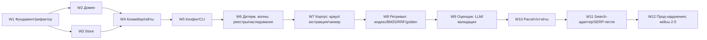

# coHound — стратегия реализации production-grade и детальный план

**Документ:** `docs/architecture/06-implementation-strategy.md`
**Статус:** принято (план реализации; итерация 6)
**Опирается на:** `00`–`05`; источник истины — `cohound-spec-v2.md` (регламент v2.0).
**Назначение:** превратить принятую архитектуру (`00`–`04`) и реестр стека (`05`) в исполнимый,
проверяемый план производства: вертикальные срезы, приоритеты, критерии готовности, риски.

> Этот документ не вводит новой методологии. Он упорядочивает **как** строить систему, не меняя
> **что** она делает. При расхождении с регламентом — регламент главнее.

---

## 1. Что значит «production-grade» для coHound

«Production-grade» здесь определяется **аксиомами A1–A3**, а не индустриальными шаблонами.
Продакшн-качество = воспроизводимость, аудируемость и доказуемость — *при минимальных средствах*.

**Продакшн-мы считаем систему, которая:**

| # | Свойство | Проверяемый критерий |
|---|---|---|
| P1 | **Воспроизводима** | `hound run` дважды на идентичных входах+кэше → ≥95% совпадений `status` (R7); всё влияющее — в `run_manifest.yaml` |
| P2 | **Аудируема** | у каждой ячейки прослеживается `evidence → source_id → source_url → content_hash → build_id`; промпт сохранён по hash |
| P3 | **Инвариантна** | I1–I23 — это код (Pydantic + SQL-триггеры + чистые функции), а не комментарии; нарушение ловится тестом/триггером |
| P4 | **Восстанавливаема** | прерывание прогона не теряет прогресс (resume); ошибка одного продукта/документа не роняет остальные |
| P5 | **Наблюдаема** | структурные логи по фазам; метрики прогона (`cells_by_state`, `failure_rate`, `coverage`, `tokens`) в манифесте/БД |
| P6 | **Проверена** | тест-пирамида: чистое ядро (property-based) → контрактные тесты портов → фейки → golden |
| P7 | **Упакована и портируема** | `pyproject.toml` + extras + `uv.lock`; изолированные окружения для тяжёлых контуров; `python3 tests/selfcheck.py` без pytest |
| P8 | **Безопасна и в контуре** | SSRF-защита, санитайзинг, robots=obey; корпус не покидает РФ-контур; оценщик без веб-поиска (I18) |
| P9 | **Эксплуатируема** | CLI с явными гейтами G1–G4, понятными ошибками (код инварианта), `--dry-run`/`--json` |

**Антипаттерны, которые для coHound — дефект, а не «упрощение» (A1/A2):**

- вводить фреймворк-оркестратор (LangChain/LlamaIndex/LangGraph) — дублирует порты, ломает I18 (§05);
- поднимать сервисы «на вырост» (Qdrant, PostgreSQL, отдельная корпусная БД) без триггера §15;
- прятать предметную специфику в `core/` — нарушает §1.3;
- автоматизировать гейты/статусы `N/A` — нарушает I6/I7;
- тянуть облачные парсеры/инференс — нарушает контур данных (§10).

**Вывод:** план строится так, чтобы **каждое** продвижение было обратимым, измеримым и
изолированным за портом. Тяжёлое и внешнее подключается последним.

---

## 2. Стратегия: как строим

### 2.1. Принципы (обязательные к соблюдению)

1. **Seam-first (сначала швы).** Порты и домен фиксируются и тестируются до адаптеров. Адаптер —
   заменяемая деталь (A2); контракт — актив.
2. **Вертикальный срез, а не горизонтальный слой.** «Walking skeleton» проходит сквозь все фазы
   на заглушках (00 §8.1), затем заглушки заменяются по одной. Система интегрируется непрерывно.
3. **Один адаптер — один порт — один контрактный тест — один фейк.** Никакой адаптер не входит
   в ядро напрямую; все внешние системы (LLM, SERP, краул, индексы, реестры) — за портами.
4. **Детерминированное раньше вероятностного.** Сначала Ш1/Ш3/Ш4 (реестры+наследование, без LLM),
   потом Ш5 (корпус), потом Ш6 (LLM). Оценщик подключается последним — он самое дорогое и рискованное.
5. **Golden с первого дня.** Регрессионная сеть создаётся в M0 (каркас) и наполняется по мере
   появления компонентов; смена версии/профиля прогоняется против неё (§13).
6. **Измерение, а не предвидение (A3).** Дефолты (профиль ретривала, K, модель, чанкер) фиксируются
   экспериментом R0/R1/R2/R9/R10, не решением заранее.
7. **Контур данных — с первого коммита.** SSRF/санитайзинг/robots и запрет исходящего контента
   закладываются в адаптеры Ш5/Ш6, а не добавляются «потом».
8. **Два окружения.** Лёгкое CLI-ядро (везде, включая py3.14) и тяжёлые контуры (PDF-torch, GPU-LLM,
   индекс-torch) — изолированы (05 §1). Ядро не тянет torch.
9. **Непрерывная зелёность.** `tests/selfcheck.py` + грепп-нейтральность + импорт-граф проходят на
   каждом коммите; рефакторинги идут с transitional re-export-шимами.
10. **Непрерывная интеграция документов.** Изменение контракта/инварианта — правка `00`–`06` в том
    же коммите (документация = часть DoD).

### 2.2. Форма поставки (definition of «готово к использованию»)

Система поставляется как **один CLI-пакет** (`cohound`) с extras по контурам. Минимальный рабочий
прогон (M1) уже даёт: `resolve → plan → [G1] → registry → inheritance → corpus → evaluate → review
→ [G3] → compute → [G4] → report`, с возобновляемым состоянием и артефактами. «Продакшн» для
первого пользователя (один аналитик) достигается на M1–M2; масштаб на 5 кейсов — на M3.

### 2.3. Порядок работ (карта)



---

## 3. Рабочие потоки (workstreams)

| W | Поток | Ключевые артефакты | Зависит от |
|---|---|---|---|
| **W1** | Фундамент и рефактор | `ports/*.py` (Protocol), расщепление `core/schemas.py`→`domain/`, `core/db.py`→`store/`+`ports/`, CI импорт-граф/нейтральность, pytest+hypothesis, `uv.lock` | — |
| **W2** | Домен | `domain/{models,invariants,scoring,r2,anchors}.py`, property-тесты | W1 |
| **W3** | Store | `ports/store.py`, `store/sqlite.py`, `GateStore`, тесты DDL/триггеров/транзакций | W1 |
| **W4** | Конвейер и гейты | `pipeline/runner.py`, `phase_state`, `gates.py`, `PhaseResult`, resume | W2, W3 |
| **W5** | Конфиг и CLI | `config/run_config.py`, `pipeline/normalize.py`, `lint.py`, `cli/` (wiring) | W2–W4 |
| **W6** | Детерм. волны | `adapters/registry_generic.py`, `registries/*.yaml`, `pipeline/registry.py`, `inheritance.py` | W4, W5 |
| **W7** | Корпус | `ports/{crawler,extractor,chunker}.py` + адаптеры (Scrapy/trafilatura/docling/чанкер), `pipeline/corpus.py`, retention, кэш | W5 |
| **W8** | Ретривал и индекс | `embedder`/`index_builder`/`vector_index`/`lexical_index` + адаптеры (bge-m3, .npy, tantivy, RRF), эксперименты R0/R1/R2, retrieval-golden | W7 |
| **W9** | Оценщик | `ports/llm.py`, `adapters/llm_local.py` (vLLM/SGLang), `pipeline/{prompt,evaluate,validate}.py`, `CellEvidence` | W8 |
| **W10** | Расчёт и отчёты | `pipeline/compute.py`→`domain/scoring`, `report.py`, `run_manifest.yaml` | W2, W9 |
| **W11** | Search-адаптер | `ports/search.py`, `adapters/search_yandex.py`/`search_glm.py`, SERP-петля (append-only), `search_log` | W7, W9 |
| **W12** | Прод-хардненинг | наблюдаемость, backup/GC, adversarial (R8), golden-full, кейсы 2–5, portability | W1–W11 |

**Cross-cutting (сквозные, ведутся постоянно):** нейтральность `core/` (§1.3), контур данных (§10),
воспроизводимость/R7, документация-в-коммите.

---

## 4. Майлстоуны (связь с §14 регламента)

Оценки — в **разработческих днях (дд)** одного разработчика; календарь зависит от занятости
(side-project — кратно больше). Регламент §14 оценивает M0≈3 нед, M1≈5–6 нед, M2≈5–6 нед,
кейсы 2–5 по 3–4 нед.

### M0 — Каркас (вертикальный срез на заглушках)
**Цель:** сквозной прогон на детерминированных волнах (реестры+наследование) для 3 продуктов;
LLM/SERP/краул — заглушки за портами.

**Состав:** W1 (полностью), W2, W3, W4, W5, W6; extraction-тест docling (PDF+Office) на 3–5
мануалах — **блокер**; golden-каркас; PG-пакет (catalog 50 params, baselines, cohort).

**Выход (Acceptance):**
- расщепление слоёв завершено, selfcheck зелёный, импорт-граф CI работает;
- `hound resolve`/`hound plan` + линт блокируют некорректные пакеты;
- мини-карта из 3 продуктов на детерминированных волнах;
- тест docling PDF+Office пройден на реальных мануалах; офлайн-бандл весов + аудит лицензий (V4);
- риски R1/R3/R4/R5/R13 закрыты в каркасе.

### M1 — Конвейер (Strict-карта кейса 1 + preliminary-слой)
**Цель:** реальный корпус, ретривал, self-host оценщик без поиска, двухрежимная валидация.

**Состав:** W7, W8, W9, W10 (частично); эксперимент R0/R1/R2 + фиксация профиля/K; preliminary-стол;
xlsx; оценка стоимости (токены).

**Выход:** Strict-карта кейса 1 + preliminary-слой; R2/R8/R9/R10/R14; профиль и K зафиксированы
измерением; стоимость одного кейса измерена.

### M2 — Приёмка кейса 1
**Состав:** W11 (SERP), полный golden (со стратой ❌) + adversarial, NDA-вопросник, diff, manifest,
ручной baseline-эксперимент (2 аннотатора, §11.5), полная метрика (R6/R7/R11/R12, critical=0,
preliminary-yield), калибровка порогов.

**Выход:** приёмка кейса 1.

### M3 — Кейсы 2–5 (portability)
**Состав:** авторство 5 пакетов категорий (доменная работа) + корпус + прогон; portability gate ×5.

**Выход:** portability ×5, метрики зелёные.

> **Реалистичность.** Самое дорогое — **калибровка методологии (§11.5) и авторство категорий**, а
> не код. Поэтому W1–W10 (код) и авторство пакетов (домен, 0.3–0.5 FTE аналитика) идут параллельно,
> а не последовательно.

---

## 5. Детальный план: задачи, зависимости, приёмка

Формат: `ID · задача · поток · дд · зависит · критерий приёмки (DoD)`.

### W1 — Фундамент и рефактор

| ID | Задача | дд | Зависит | DoD |
|---|---|---|---|---|
| T1.1 | Пакет `core/ports/`: `Protocol`-контракты (llm, vector_index, lexical_index, search, crawler, extractor, chunker, embedder, index_builder, registry, store, gate_store) с docstring-гарантиями | 2 | — | импортируются без циклов; mypy/pyright-чисто (опц.); контракт-тесты-заготовки |
| T1.2 | Расщепить `core/schemas.py` → `core/domain/{enums,models,invariants,r2,anchors}.py` + re-export-шим | 3 | T1.1 | `tests/selfcheck.py` зелёный; старые импорты работают |
| T1.3 | Расщепить `core/db.py` → `core/store/sqlite.py` (DDL+триггеры) + контракт `ports/store.py` | 2 | T1.1 | DDL-тест + триггеры I4/I6/I7/I13/I18 зелёные |
| T1.4 | CI: импорт-граф (`ast`-матрица 01 §1), грепп-нейтральность `core/domain|ports|pipeline`, `uv pip compile` на 3.11/3.14 | 2 | T1.2,T1.3 | гейты краснеют на учебном нарушении |
| T1.5 | pytest+hypothesis в dev; обёртка над selfcheck; фикстуры; порог покрытия ядра | 1.5 | T1.2 | `pytest -q` зелёный; selfcheck остаётся автономным |
| T1.6 | `uv.lock` + документация окружений (CLI-light / pdf / gpu / index) | 1 | T1.5 | lock воспроизводим; extras резолвятся |

**Итого W1 ≈ 11.5 дд.**

### W2 — Домен

| ID | Задача | дд | Зависит | DoD |
|---|---|---|---|---|
| T2.1 | `domain/models.py` — Pydantic, `extra="forbid"`; `RunManifest`, `CellEvidence`, `SearchLogEntry`, `ScenarioBinding`, `ProtocolExhaustion`, `RegistryFact` | 3 | T1.2 | selfcheck + валидация моделей |
| T2.2 | `domain/invariants.py` — чистые `check_*` (cell/evidence/inheritance/derived/satellite) | 2 | T2.1 | property-тесты (hypothesis) на I1/I2/I2b/I4/I8/I22 |
| T2.3 | `domain/scoring.py` (capability/coverage/failure_rate/comparability/sensitivity/modules) | 3 | T2.1 | юнит-кейсы §6; failed в знаменателе (I5) |
| T2.4 | `domain/anchors.py` — `resolve_source_url` + `SourceResolver` (без сети) | 1.5 | T2.1 | детерминированный резолв; сверка `content_hash` (I19) |
| T2.5 | `domain/r2.py` — перенос `apply_r2` + словарь | 1 | T1.2 | selfcheck Р-2 зелёный |

**Итого W2 ≈ 10.5 дд.**

### W3 — Store

| ID | Задача | дд | Зависит | DoD |
|---|---|---|---|---|
| T3.1 | `SqliteStore`: CRUD (products/run/cells/evidence/search/exhaustion/gates/facts/scenarios) | 4 | T1.3 | контрактные тесты `StorePort` |
| T3.2 | Батчевые транзакции (`save_cells_batch`, `add_evidence_batch`), WAL, индексы | 1.5 | T3.1 | нагрузочный тест 10k ячеек без деградации |
| T3.3 | `GateStore` + `gate_decisions` (носитель `reviewed_by`) | 1 | T3.1 | тест I6/I7 |
| T3.4 | `resolve_source_url` в store (реализация `SourceResolver`) | 1 | T3.1, T2.4 | сверка hash; тест I10/I15/I19 |

**Итого W3 ≈ 7.5 дд.**

### W4 — Конвейер и гейты

| ID | Задача | дд | Зависит | DoD |
|---|---|---|---|---|
| T4.1 | `pipeline/runner.py`: фазы, `phase_state`, resume, `PhaseResult` | 3 | T3.1 | прерывание→resume без потери; тест |
| T4.2 | `pipeline/gates.py` G1–G4 + запись в `gate_decisions` | 2 | T3.3, T4.1 | гейт не пройден без строки; тест |
| T4.3 | `tests/fakes/` — заглушки портов (LLM/SERP/краул/индексы), детерминированные | 2 | T4.1 | сквозной прогон на фейках |
| T4.4 | Инвалидация/идемпотентность: `evidence_id`, `stale_reason`, upsert-ключи (S8/R15) | 2 | T4.1 | повторный прогон не порождает дублей; тест |

**Итого W4 ≈ 9 дд.**

### W5 — Конфиг и CLI

| ID | Задача | дд | Зависит | DoD |
|---|---|---|---|---|
| T5.1 | `config/run_config.py` + загрузчики пакета (package/catalog/baselines/cohort/golden/domain_profiles) | 3 | T2.1 | валидация `RunConfig`; products=проекция cohort (S11) |
| T5.2 | `pipeline/lint.py` (§4.2 + новые правила) | 2 | T5.1 | блокирует корректно; тесты на каждый rule |
| T5.3 | `cli/` — `resolve`, `plan`, wiring (ручной DI), `--dry-run`/`--json` | 3 | T4.1, T5.1 | команды работают; ошибки с кодом инварианта |
| T5.4 | `pipeline/normalize.py` + `plan.py` (scope/роли/когорта/перенормировка) | 2 | T5.1 | план воспроизводим; S11 |

**Итого W5 ≈ 10 дд.**

### W6 — Детерминированные волны

| ID | Задача | дд | Зависит | DoD |
|---|---|---|---|---|
| T6.1 | `adapters/registry_generic.py` (config-driven json/html + маппинг) | 3 | T1.1 | юнит на фикстурах; нет предметных терминов в ядре |
| T6.2 | `registries/{rrp,fstec}.yaml` + данные/маппинг | 2 | T6.1 | R1: 100% фактов с `source_url` |
| T6.3 | `pipeline/registry.py` (R-ячейки) | 1.5 | T6.1, T3.1 | тест I1/R1 |
| T6.4 | `pipeline/inheritance.py` (direct/conditional/blocked + derived-evidence) | 2.5 | T2.2, T2.4 | тест I8 + `check_derived_evidence` |
| T6.5 | PG-пакет: `catalog.csv` (50 params), `baselines.csv`, `cohort.yaml` | дом. | T5.1 | линт зелёный; когорта заморожена G1 |

**Итого W6 ≈ 9 дд (код) + доменная работа.**

### W7 — Корпус

| ID | Задача | дд | Зависит | DoD |
|---|---|---|---|---|
| T7.1 | `ports/crawler.py` + `adapters/crawl_scrapy.py` (per-domain профили, robots=obey, playwright per-request, retries/backoff, content-addressed кэш) | 4 | T1.1 | smoke V5 зелёный; robots соблюдён; кэш работает |
| T7.2 | `ports/extractor.py` + `extract_html.py` (trafilatura) + обёртка над `extract_document.py` | 2.5 | T1.1 | формат из url/content-type; `content_hash` |
| T7.3 | `ports/chunker.py` + обёртка чанкера (`heading_path`, `context_prefix`) | 1.5 | T1.1 | детерминированный чанкинг; тест |
| T7.4 | `pipeline/corpus.py`: raw retention → extract → dedup(hash) → chunk; `index_manifest` | 3 | T7.1–T7.3, T3.1 | retention+extractor_version; I19 |
| T7.5 | Санитайзинг (nh3/defusedxml) на границе экстракции; SSRF-защита краула | 1.5 | T7.2 | инъекции вырезаны, текст не мутирован (§10/C.2) |
| T7.6 | Глобальный content-addressed кэш (`cache/http`, `cache/serp`) | 1.5 | T7.1 | R7 между run_id; тест ADR 0016 |

**Итого W7 ≈ 14 дд.**

### W8 — Ретривал и индекс

| ID | Задача | дд | Зависит | DoD |
|---|---|---|---|---|
| T8.1 | `ports/embedder.py` + `adapters/embed_local.py` (bge-m3) + изолированное окружение | 2.5 | T1.6, T7.4 | батч; `embed_model_id` в манифест |
| T8.2 | `ports/index_builder.py` + `index_npy.py` (продукт-партиции, .npy+jsonl+manifest, атомарный commit) | 3.5 | T8.1 | иммутабельность; `build_id`=hash входов |
| T8.3 | `ports/lexical_index.py` + `index_tantivy.py`/`lexical_tantivy.py` (RU/EN-стеммер + raw/ngram-профиль) | 4 | T1.6 | V1 подтверждён на golden; двойной профиль |
| T8.4 | `ports/vector_index.py` + `vector_npy.py` (brute-force cosine по шардам) | 2 | T8.2 | продукт-скоупед (I17); тест |
| T8.5 | RRF-фьюжн (обёртка `util/fusion`) + формирование `RetrievedChunk` с provenance | 1.5 | T8.3, T8.4 | фьюжн явный в pipeline; tie-break по `chunk_id` |
| T8.6 | `retrieval-golden` (30–40 пар) + `pipeline/experiments.py` R0/R1/R2 (recall@K, cut-off=pipeline-K) | 3.5 | T8.5 | профиль и K зафиксированы измерением (R9/R10) |
| T8.7 | `extraction-golden` (PDF+Office) + A/B экстракторов | 2 | T7.2 | смена `extractor_version` триггерит прогон |

**Итого W8 ≈ 19 дд.**

### W9 — Оценщик

| ID | Задача | дд | Зависит | DoD |
|---|---|---|---|---|
| T9.1 | `pipeline/prompt.py` (template_version+rule+absence_rule+сателлиты+чанки; `prompt_hash`) | 2 | T2.1 | механическая компиляция; `prompts/{hash}.json` |
| T9.2 | `ports/llm.py` + `adapters/llm_local.py` (vLLM/SGLang, xgrammar, seed/greedy) | 3.5 | T1.6 | constrained JSON валиден; детерминизм-тест |
| T9.3 | `pipeline/evaluate.py` (≤3 запроса, ретривал, вызов, retry≤2, `failed` при исчерпании) | 3 | T8.5, T9.1, T9.2 | I16/I17/I20; `failed`≠status (I4) |
| T9.4 | `pipeline/validate.py` (source_id→url, цитата-подстрока, достаточность, аномалии) | 2.5 | T2.4, T9.3 | эшелон §10; preliminary-ветка |
| T9.5 | `CellEvidence` + детерминированный `evidence_id`; `source_scope`/`scope_attested_by` | 2 | T9.4 | I1/I2/I2b/I19; тест |
| T9.6 | `llama-cpp-python` fallback-путь (CPU/GGUF) для тестов порта | 1 | T9.2 | интеграционный тест без GPU |

**Итого W9 ≈ 14 дд.**

### W10 — Расчёт и отчёты

| ID | Задача | дд | Зависит | DoD |
|---|---|---|---|---|
| T10.1 | `pipeline/compute.py` → scoring; `requested` vs `computed` ranking (K6) | 2 | T2.3, T9.5 | I5/I11/I13; демотирование sensitivity |
| T10.2 | `run_manifest.yaml` (все версии/модели/build/профиль+K/бюджет) | 1.5 | T10.1 | воспроизводимость R7; I16/I20/I21 |
| T10.3 | `pipeline/report.py` — `battle_card.xlsx`, `preliminary_findings.xlsx`, `nda_questions.csv`, `diff.md` | 4 | T10.1 | G4-инвариант (I11); «не публикация» маркер |
| T10.4 | CLI `run/review/report/golden/sensitivity/diff/promote` | 3 | T5.3, T10.3 | команды полные; resume |

**Итого W10 ≈ 10.5 дд.**

### W11 — Search-адаптер и SERP-петля

| ID | Задача | дд | Зависит | DoD |
|---|---|---|---|---|
| T11.1 | `ports/search.py` + `adapters/search_yandex.py` (+`search_glm.py`) | 3 | T1.1 | только URL+bytes; не evidence (I19) |
| T11.2 | `search_log` (kind=external, бюджет, termination) | 1 | T11.1, T3.1 | I23; бюджет симметричен (I16) |
| T11.3 | SERP-петля: append-only раунды сборок + инвалидация затронутых ячеек (K2) | 3 | T11.2, T8.2, T4.4 | новая сборка R_n+1; `stale_reason='new_build'` |
| T11.4 | Discovery / concept scout (search-enabled, выход=кандидаты, G2) | 2 | T11.1 | G2-ревью; не пишет evidence |

**Итого W11 ≈ 9 дд.**

### W12 — Прод-хардненинг и кейсы

| ID | Задача | дд | Зависит | DoD |
|---|---|---|---|---|
| T12.1 | Наблюдаемость: JSON-logs по фазам, метрики (§B.2) | 2.5 | T4.1 | логи/метрики в `runs/`; `tokens`/`llm_calls` |
| T12.2 | Backup/restore прогона; GC-политика индексных сборок (§13) | 2 | T3.1 | восстановление из бэкапа; лимит сборок |
| T12.3 | Adversarial-набор (R8) + регрессионный gate | 2.5 | T9.4 | 0 известных инъекций |
| T12.4 | golden-full (100–200, страта ❌) + калибровка порогов | 4 | W8–W10 | R6/R11/R12; critical=0 |
| T12.5 | Ручной baseline-эксперимент (2 аннотатора, §11.5) | дом. | T12.4 | протокол §11.5 |
| T12.6 | Кейсы 2–5: авторство пакетов + прогон + portability gate | дом. | T12.4 | portability ×5 |

**Итого W12 ≈ 11 дд (код) + доменная работа + кейсы.**

### Сводка по коду (без доменной работы)

| Поток | дд |
|---|---|
| W1 | 11.5 |
| W2 | 10.5 |
| W3 | 7.5 |
| W4 | 9 |
| W5 | 10 |
| W6 | 9 |
| W7 | 14 |
| W8 | 19 |
| W9 | 14 |
| W10 | 10.5 |
| W11 | 9 |
| W12 | 11 |
| **Итого** | **≈ 135 дд** кода + доменная работа (авторство категорий, golden-аннотация, калибровка) |

Это согласуется с §14 регламента (M0–M2 ≈ 13–15 нед чистого кода при 5 дд/нед) и подтверждает:
**код — не самое дорогое; основная стоимость — калибровка методологии и авторство категорий.**

---

## 6. Тест-стратегия (пирамида)

```
        ▲ golden-full (M2, релиз/смена версий) — 100–200, страта ❌, adversarial
       ▲▲ retrieval-golden / extraction-golden — recall@K, A/B экстракторов
      ▲▲▲ контрактные тесты портов + tests/fakes — сквозной конвейер без внешних систем
     ▲▲▲▲ юнит/свойства домена (invariants, scoring, r2, anchors) — hypothesis
    ▲▲▲▲▲ selfcheck (stdlib+pydantic, без pytest) + грепп-нейтральность + импорт-граф + DDL
```

**Правила:**
- **Ни один адаптер** не считается готовым без: (a) контрактного теста против порта, (b) фейка,
  (c) интеграционного smoke (сеть/браузер/модель — где применимо).
- **Домен** покрывается property-тестами на инварианты и scoring (граничные значения, мутации).
- **selfcheck** остаётся автономным (без pytest/сети) и всегда зелёным; pytest-пирамида — рядом.
- **Сети нет в CI ядра**: внешнее — только в smoke/full-CI (`smoke_scrapy_playwright.py`, LLM-порт).
- **Регрессия версий**: любая смена модели/профиля/K/чанкера/шаблона → golden (§13).

---

## 7. Окружения и воспроизводимость

| Окружение | Содержимое | Где |
|---|---|---|
| **cli-light** | ядро + `retrieval`(numpy/tantivy) + `crawl` + `extract` + `safety` + `ops` | везде, py3.11–3.14 |
| **pdf** | `docling-slim[standard]` (+torch/CUDA) | отдельно (PDF-layout) |
| **index** | `sentence-transformers` (+torch) | отдельно (эмбеддинги) |
| **gpu** | `vLLM`/`SGLang` | Docker на GPU |
| **test** | `pytest`/`hypothesis`/`respx` | dev/CI |

**Пины:** `pyproject.toml` + `uv.lock` (T1.6). Всё, что влияет на результат, пинится в
`run_manifest.yaml` (§13, R7). Офлайн-бандл docling-весов (V4). Браузерные бинари — зеркало
(`PLAYWRIGHT_DOWNLOAD_HOST`). `HF_HUB_OFFLINE=1` в контуре.

---

## 8. Риски и меры

| Риск | Вероятн. | Влияние | Мера | Триггер пересмотра |
|---|---|---|---|---|
| Качество экстракции PDF-таблиц (фич-матрицы) | ср. | высокое | тест на реальных мануалах (блокер M0); extraction-golden; fallback markitdown/pdfplumber | расхождение таблиц > допустимого |
| Оценщик не достигает golden-порогов | ср. | высокое | лёгкий класс → флагман (DeepSeek/GLM), отложено §15 | R6/R12 ниже порога |
| Стоимость авторства категорий | выс. | высокое | доменный аналитик 0.3–0.5 FTE; шаблоны пакетов | >4 нед на пакет |
| Python 3.14-совместимость тяжёлых колёс | низк. | среднее | V2 закрыт; изоляция окружений | отсутствие cp314-колёс |
| bus-factor scrapy-playwright | низк. | среднее | изоляция за портом `crawler`; прямой playwright как fallback | плагин застрял/архив |
| Утечка контента за контур | низк. | критич. | SaaS запрещён; self-host; SSRF/санитайзинг; robots | любой исходящий контент-канал |
| Prompt-injection в корпусе | ср. | высокое | nh3/defusedxml; adversarial R8; оценщик без тулов | новая инъекция в adversarial |
| Масштаб SQLite/индекса | низк. | среднее | WAL+батчи; продукт-партиции; триггеры §15 (ANN/PG) | p95>300–500мс; >3–5М чанков |
| Дрейф контрактов портов | ср. | среднее | contract-tests + импорт-граф CI | расхождение адаптер/порт |

---

## 9. Definition of Done (по слоям)

- **Domain:** модели `extra="forbid"`; инварианты — чистые функции + property-тесты; нулевой I/O.
- **Ports:** `Protocol` без наследования; docstring-гарантии (в т.ч. I18 в `llm.py`); контракт-тест.
- **Store:** DDL+триггеры; батчи; идемпотентность; FK сохранены (единая БД).
- **Pipeline:** фаза возвращает `PhaseResult`; resume; гейты только через `gate_decisions`.
- **Adapters:** за портом; контракт-тест + фейк + smoke; секреты не логируются; SSRF/sanitize.
- **CLI:** команды из §3.1; `--dry-run`/`--json`; ошибки с кодом инварианта.
- **Docs:** правка контракта/инварианта — правка `00`–`06` в том же коммите.

---

## 10. Открытые решения (влияют на порядок работ)

1. **Формат импорт-графа CI** (T1.4): `ast`-матрица vs отдельный линтер (import-linter).
2. **`ProtocolExhaustion`/`AlignmentReport`** — зафиксировать структуру в M0 (W2/W4).
3. **Версионирование prompt-шаблонов** (T9.1): по файлу-версии vs по hash содержимого.
4. **Retention/GC сборок** (T12.2): лимит по числу/времени; что с golden-зависимыми.
5. **Backup/restore** (T12.2): снапшот `cohound.db` + `index_store`/`corpus_raw` (или только БД+хэши).
6. **Публикация отчётов** (T10.3): адресация в `reports/`, признак «не публикация».
7. **Выбор инференс-стека** (T9.2): vLLM vs SGLang; стратегия детерминизма.
8. **Процедура/владелец `scope_attested_by`** для `exhaustive`-absence (W9).

---

## 11. Traceability

| Артефакт | Покрытие |
|---|---|
| Регламент §3.2 стек | `05-dependency-stack.md` |
| Регламент §5 конвейер | W4, W6–W11; `02` A–E |
| Регламент §6 расчёт | W2 (scoring), W10 |
| Регламент §7 LLM-контуры | W9, W11 |
| Регламент §10 защита | W7 (T7.5), W9 (T9.4) |
| Регламент §11 golden/CI | W8 (T8.6/T8.7), W12; `04` C |
| Регламент §14 план | §4 (майлстоуны) этого документа |
| Регламент §15 отложенное | `05` §2.3/§2.5, §8 (риски) |
| I1–I23 | `01` §6, `02`, W2/W3/W9; `04` §A/F |
