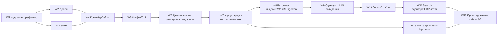

# coHound — стратегия реализации production-grade и статус

**Документ:** `docs/architecture/06-implementation-strategy.md`
**Статус:** актуализировано as-built (план реализации итерации 6, сверен с кодом)
**Опирается на:** `00`–`05`; источник истины — `cohound-spec-v2.md` (регламент v2.1).
**Назначение:** зафиксировать, **что уже построено** (с указанием кода-носителя), и **что
остаётся**, не выдавая желаемое за сделанное.

> Этот документ не вводит новой методологии. Он упорядочивает **как** строить систему, не меняя
> **что** она делает. При расхождении с регламентом — регламент главнее.
>
> **Историческое примечание.** Разделы 2–5 выросли из плана (потоки W1–W13, майлстоуны M0–M3).
> После того как почти все потоки приземлились, документ переписан **as-built**: там, где раньше
> стояли сроки и критерии, теперь стоит фактический статус и путь к коду. Оценки в разработческих
> днях при переписывании опущены — они были плановыми, а не фактическими.

---

## 0. Текущее состояние (as-built)

Проект **не greenfield с нуля**: фундамент, домен, хранилище, конвейер Ш1–Ш9, корпус, ретривал,
оценщик, детерминированные волны, DMZ-шов, планировщик краула и подсистема авторства пакета
**реализованы**. Ниже — карта «артефакт → где живёт сегодня». Пост-хок-фазы P1–P4b (самодостаточность
прогона, словарь фаз, целостность авторства/линт, фиксация ретривала) уже влиты; см. §5.

| Артефакт | Состояние | Роль в плане |
|---|---|---|
| `core/schemas.py` (был) | ✅ расщеплён в W1/T1.2 → `core/domain/`; монолит **удалён** | источник доменных моделей/инвариантов |
| `core/db.py` (был) | ✅ переехал в W1/T1.3 → `core/store/sqlite.py`; монолит **удалён** | DDL §4.4 + триггеры |
| `core/util/text_utils.py` | готово (W1/W2/W8) | RU/EN-нормализация |
| `core/util/security.py` | готово (W2/W7) | SSRF-защита URL, `sanitize_slug` |
| `core/util/fusion.py` | готово; обёрнуто в ретривал W8 | RRF-слияние |
| `core/util/retrieval_eval.py` | готово; основа W8/T8.6 | retrieval-метрики |
| `core/adapters/chunker_markdown.py` | готово; за портом W7/T7.3 | чанкер с `heading_path` |
| `core/adapters/extract_document.py` | готово (PDF+Office); за портом W7/T7.2 | docling-экстрактор |
| `core/adapters/lexical_bm25.py` | готово; прототип/базлайн W8 | BM25 |
| `tests/selfcheck.py` | готово, автономный (без pytest) | словарь/схемы/DDL/инварианты/матрица слоёв |
| `tests/smoke_scrapy_playwright.py` | пройден (V5) | браузерный smoke |
| `docs/status-dictionary.yaml` | источник истины перечислений (§4.1) | словарь |
| `pyproject.toml` + `uv.lock` | готово (Python 3.14 базлайн) | пины/extras/резолв |

**Следствия:** поток W1–W13 (код) практически завершён; незакрытое — это **измерительные прогоны**
и **доменная работа** (кейсы 2–5, golden-full, baseline §11.5), а не отсутствующие подсистемы.
Полный статус — §4/§5.

*Категорийная нейтральность `core/` проверяется грепп-тестом и матрицей слоёв в selfcheck на каждом коммите.*

---

## 1. Что значит «production-grade» для coHound

«Production-grade» здесь определяется **аксиомами A1–A3**, а не индустриальными шаблонами.
Продакшн-качество = воспроизводимость, аудируемость и доказуемость — *при минимальных средствах*.

**Продакшн-мы считаем систему, которая:**

| # | Свойство | Проверяемый критерий |
|---|---|---|
| P1 | **Воспроизводима** | `hound run` дважды на идентичных входах+кэше → ≥95% совпадений `status` (R7); всё влияющее — в `run_manifest.yaml`; плановые входы в `run_inputs` (самодостаточность прогона) |
| P2 | **Аудируема** | у каждой ячейки прослеживается `evidence → source_id → source_url → content_hash → build_id`; промпт сохранён по hash |
| P3 | **Инвариантна** | I1–I23 — это код (Pydantic + SQL-триггеры + чистые функции), а не комментарии; нарушение ловится тестом/триггером |
| P4 | **Восстанавливаема** | прерывание прогона не теряет прогресс (resume); ошибка одного продукта/документа не роняет остальные; сеанс краула durable (`crawl_sessions`) |
| P5 | **Наблюдаема** | структурные логи по фазам; метрики прогона (`cells_by_state`, `failure_rate`, `coverage`, `tokens`) в манифесте/БД |
| P6 | **Проверена** | тест-пирамида: чистое ядро (property-based) → контрактные тесты портов → фейки → golden |
| P7 | **Упакована и портируема** | `pyproject.toml` + extras + `uv.lock`; изолированные окружения для тяжёлых контуров; `python3 tests/selfcheck.py` без pytest |
| P8 | **Безопасна и в контуре** | SSRF-защита, санитайзинг, robots-энфорсмент (свойство **Scrapy-пути**; для прямого/браузерного пути — ответственность egress-слоя, 07 §5); корпус не покидает РФ-контур; оценщик без веб-поиска (I18); веб-контур изолируем в DMZ за L7 (07) |
| P9 | **Эксплуатируема** | CLI с явными гейтами G1–G4, понятными ошибками (код инварианта), `--dry-run`/`--json` |

**Антипаттерны, которые для coHound — дефект, а не «упрощение» (A1/A2):**

- вводить фреймворк-оркестратор (LangChain/LlamaIndex/LangGraph) — дублирует порты, ломает I18 (§05);
- поднимать сервисы «на вырост» (Qdrant, PostgreSQL, отдельная корпусная БД) без триггера §14;
- прятать предметную специфику в `core/` — нарушает §1.3;
- автоматизировать гейты/статусы `N/A` — нарушает I6/I7;
- тянуть внешние SaaS-парсеры/инференс **вне** корпоративного контура — нарушает контур данных (§10).

**Вывод:** каждое продвижение было обратимым, измеримым и изолированным за портом. Тяжёлое и внешнее
подключалось последним.

---

## 2. Стратегия: как строим

### 2.1. Принципы (обязательные к соблюдению)

1. **Seam-first (сначала швы).** Порты и домен фиксируются и тестируются до адаптеров. Адаптер —
   заменяемая деталь (A2); контракт — актив.
2. **Вертикальный срез, а не горизонтальный слой.** «Walking skeleton» проходит сквозь все фазы
   на заглушках (00 §8.1), затем заглушки заменяются по одной. Система интегрируется непрерывно.
3. **Один адаптер — один порт — один контрактный тест — один фейк.** Никакой адаптер не входит
   в ядро напрямую; все внешние системы (LLM, SERP, краул, индексы, реестры) — за портами.
4. **Детерминированное раньше вероятностного.** Сначала Ш1/Ш3/Ш4 (реестры+наследование, без LLM),
   потом Ш5 (корпус), потом Ш6 (LLM). Оценщик подключается последним — он самое дорогое и рискованное.
5. **Golden с первого дня.** Регрессионная сеть создаётся в M0 (каркас) и наполняется по мере
   появления компонентов; смена версии/профиля прогоняется против неё (§13).
6. **Измерение, а не предвидение (A3).** Дефолты (профиль ретривала, K, модель, чанкер) фиксируются
   экспериментом R0/R1/R2/R9/R10, не решением заранее.
7. **Контур данных — с первого коммита.** SSRF/санитайзинг/robots и запрет исходящего контента
   закладываются в адаптеры Ш5/Ш6, а не добавляются «потом».
8. **Два окружения.** Лёгкое CLI-ядро (Python 3.14 базлайн, 05 §1) и тяжёлые контуры (PDF-torch,
   индекс-torch) — изолированы. Ядро не тянет torch; LLM-инференс — внешний (корп. облако,
   [OI]-совместимый API).
9. **Непрерывная зелёность.** `tests/selfcheck.py` + грепп-нейтральность + импорт-граф проходят на
   каждом коммите; рефакторинги идут с transitional re-export-шимами (шимы `core.schemas`/`core.db`
   уже удалены; публичный контракт — `core.domain`/`core.store.sqlite`).
10. **Непрерывная интеграция документов.** Изменение контракта/инварианта — правка `00`–`06` в том
    же коммите (документация = часть DoD).

### 2.2. Форма поставки (definition of «готово к использованию»)

Система поставляется как **один CLI-пакет** (`cohound`) с extras по контурам. Сквозной прогон
`resolve → plan → [G1] → registry → inheritance → corpus → evaluate → review → [G3] → compute
→ [G4] → report` реализован с возобновляемым состоянием и артефактами. «Продакшн» для первого
пользователя (один аналитик) достигается на M1–M2; масштаб на 5 кейсов — на M3.

### 2.3. Порядок работ (историческая карта зависимостей)



Карта отражает **порядок зависимостей**; фактический статус каждого потока — §5.

**W13 (DMZ/шов)** — **входит в MVP (M1)**: профиль `split` нужен как опция уже в MVP (решение
владельца, 2026-10-08), а не как поздняя прод-надстройка. W13 идёт параллельно корпусу/ретривалу;
он не блокирует `local`-профиль (дефолт), но оба профиля должны проходить один и тот же прогон.
Дополнительно W13 обеспечивает **прозрачность контрактов шва для корпоративных IDP/DLP/IDS** (07 §8):
L7-инспектируемый JSON, публикуемые схемы, атрибуция запросов, отсутствие пиннинга сертификатов,
блокирующего TLS-инспекцию. *Аттестация конкретных корпоративных средств — вне рамок этой работы.*

---

## 3. Рабочие потоки (workstreams): статус

| W | Поток | Ключевые артефакты (код-носитель) | Статус |
|---|---|---|---|
| **W1** | Фундамент и рефактор | `core/ports/*.py`, `core/domain/*`, `core/store/sqlite.py`, `uv.lock`, selfcheck-гейты | ✅ done |
| **W2** | Домен | `core/domain/{models,enums,invariants,scoring,r2,anchors,dictionary}.py`, property-тесты | ✅ done |
| **W3** | Store | `core/ports/store.py`, `core/ports/gate_store.py`, `core/store/{sqlite,sqlite_store,backup}.py` | ✅ done |
| **W4** | Конвейер и гейты | `core/pipeline/{runner,phases,gates,observability,metrics,idempotency}.py` | ✅ done |
| **W5** | Конфиг и CLI | `core/config/run_config.py`, `core/pipeline/{normalize,lint,plan}.py`, `core/cli/` | ✅ done |
| **W6** | Детерм. волны | `core/adapters/registry_generic.py`, `core/pipeline/{registry,inheritance}.py`, package-scoped `registries/` | ✅ done (спецификации — package-scoped, P3) |
| **W7** | Корпус | `core/ports/{crawler,extractor,chunker}.py` + `crawl_*`/`extract_*`, `core/pipeline/{corpus,fetch_plan,crawl_session,crawl_sources}.py`, `core/util/{cache,sanitize,feed,rate_limit}.py` | ✅ done (+ source routing, Phase 5) |
| **W8** | Ретривал и индекс | `core/adapters/{embed_local,embed_model2vec,index_npy,index_format,vector_npy,lexical_tantivy,lexical_bm25}.py`, `core/pipeline/{retrieve,experiments,extraction_eval}.py` | ✅ код done; ✅ **реальная фиксация выполнена** (2026-10, `runs/ru-pg-dbms-fixation`, K=3, профиль R1, bge-m3) — на **авторском** golden из 18 пар и малом корпусе (34 чанка) |
| **W9** | Оценщик | `core/ports/llm.py`, `core/adapters/llm_local.py`, `core/pipeline/{prompt,evaluate,validate}.py` | ✅ код done; ⏳ живой прогон оценщика не выполнялся; T9.6 снят (§5.W9) |
| **W10** | Расчёт и отчёты | `core/pipeline/{compute,report}.py`, `run_manifest.yaml` | ✅ done |
| **W11** | Search-адаптер | `core/adapters/{search_yandex,search_glm}.py`, `core/pipeline/{serp_loop,search_log,discovery}.py` | ✅ код done; ⏳ живой SERP-раунд в прогоне кейса не выполнялся |
| **W12** | Прод-хардненинг | `core/pipeline/{observability,metrics,adversarial,golden}.py`, `core/store/backup.py`, `tests/e2e/` | 🟡 partial: код done; ⏳ golden-full, §11.5-baseline, кейсы 2–5 не выполнены |
| **W13** | DMZ / шов | `core/ports/gateway.py`, `core/adapters/remote_*.py`, `core/edge/*`, `core/config/deploy.py`, `contracts/seam/*` | ✅ done (+ планировщик краула, Phase 3) |

**Cross-cutting (сквозные, ведутся постоянно):** нейтральность `core/` (§1.3), контур данных (§10),
воспроизводимость/R7, документация-в-коммите.

---

## 4. Майлстоуны: статус

Объём и уровни (A1). Портфель — 5 кейсов (якорь + 6–10 аналогов, 100–300 параметров). Уровни:
**PoV** = M0 (мини-карта на 3 продуктах из детерминированных волн, без LLM/SERP); **MVP** = M1+M2
(strict-карта кейса 1 + приёмка); **портфель** = 5 кейсов (переносимость).

### M0 — Каркас (вертикальный срез) — 🟡 частично

Код потоков W1–W6 приземлён; сквозной прогон на детерминированных волнах (реестры + наследование)
покрыт `tests/e2e/test_walking_skeleton.py`. `hound resolve`/`hound plan` + линт блокируют
некорректные пакеты; детерминированная мини-карта строится.

⏳ **Открытый блокер M0:** тест docling на 3–5 реальных мануалах РФ-вендоров (PDF + Office) не
выполнен — в репозитории нет PDF/Office-фикстур и приёмочного теста экстракции
(`cohound-spec-v2.md` §3.2/§15, `05-dependency-stack.md` §7). Поэтому M0 не закрыт целиком:
каркас и детерминированные волны готовы, PDF-контур — нет.

### M1 — Конвейер (strict-карта кейса 1 + preliminary + профиль `split`) — 🟡 код готов, прогон не завершён

- ✅ W7 (корпус), W8 (ретривал/индекс), W9 (оценщик), W10 (расчёт/отчёты), **W13 (DMZ/шов)** — код.
- ✅ Оба профиля развёртывания (`local`/`split`) поддержаны; шов публикует `/v1/*`-схемы (07 §8).
- ⏳ **Не выполнено:** живой прогон оценщика против внутреннего [OI]-endpoint. ✅ Фиксация ретривала
  (R0/R1/R2+K) **выполнена** на реальном индексе — см. §5.W8 и §12; ограничения: авторский golden
  (18 пар), малый корпус (34 чанка), из-за чего `recall@10` насыщается и зафиксирован K=3.

### M2 — Приёмка кейса 1 — 🟡 частично (код-инструменты готовы, приёмка не проведена)

- ✅ W11 (SERP-петля) — код; golden-харнесс и adversarial-набор — код.
- ✅ NDA-вопросник, `diff`, `run_manifest` — код (`report.py`).
- ⏳ **Не проведено:** полный golden (со стратой ❌) и adversarial как приёмочный прогон; ручной
  baseline-эксперимент (2 аннотатора, §11.5); полная метрика приёмки (R6/R7/R11/R12, critical=0,
  preliminary-yield) на реальных данных; калибровка порогов. Приёмка кейса 1 **не заявлена**.

### M3 — Кейсы 2–5 (portability) — ⛔ не начат

Авторство пакетов категорий 2–5 не выполнялось; в репозитории есть один доменный пакет кейса 1
(`packages/ru-pg-dbms/`) и нейтральный `packages/_template/`. Portability gate ×5 не проводился.

> **Реалистичность.** Самое дорогое — **калибровка методологии (§11.5) и авторство категорий**,
> а не код. W1–W13 (код) практически завершены; незакрытое — измерительные прогоны и домен.

---

## 5. Детальный статус: потоки W1–W13 (as-built)

Формат: краткий статус · **что приземлилось (с кодом)** · **что остаётся**. Оценки ТЗ из исходного
плана (в дд) в этой редакции опущены как исторические; где критерий приёмки (DoD) уже проверяется
тестом — это отмечено.

### W1 — Фундамент и рефактор — ✅ done

- `core/ports/*.py` — `typing.Protocol`-контракты без наследования (llm, vector_index,
  lexical_index, search, crawler, extractor, chunker, embedder, index_builder, registry, store,
  gate_store, gateway, crawl_executor, poller, discovery_llm, types).
- `core/domain/{models,enums,invariants,scoring,r2,anchors,dictionary}.py` — расщепление прежнего
  монолита; transitional re-export-шимы `core.schemas`/`core.db` **удалены**.
- CI-гейты: `tests/selfcheck.py` включает матрицу слоёв/импорт-граф и грепп-нейтральность
  `core/domain|ports|pipeline` (§1.3).
- `pytest`+`hypothesis` в extra `dev`; `uv.lock` — воспроизводимый резолв.

### W2 — Домен — ✅ done

- Модели Pydantic с `extra="forbid"`, `StrEnum`-перечисления, чистые `check_*`-инварианты,
  `scoring` (capability/coverage/failure_rate/comparability/sensitivity/modules), `r2`, `anchors`
  (`SourceResolver`), `dictionary`.
- Property-тесты домена — `tests/domain/`.

### W3 — Store — ✅ done

- `core/store/sqlite.py` — DDL §4.4 + триггеры I4/I6/I7/I13/I18, `SCHEMA_VERSION = 3.4.0`.
- `core/store/sqlite_store.py` — реализация `StorePort`/`GateStore`; батчевые транзакции, WAL.
- `core/store/backup.py` — backup/restore прогона + GC иммутабельных индексных сборок (T12.2).
- `run_inputs` — снимок плановых входов (самодостаточность `runs/{run_id}`, P1).

### W4 — Конвейер и гейты — ✅ done

- `core/pipeline/runner.py` — фазы, `PhaseResult`, resume; `core/pipeline/phases.py` — сборка фаз
  Ш1–Ш9; `gates.py` G1–G4 (только через `gate_decisions`); `observability.py`/`metrics.py`;
  `idempotency.py` (`evidence_id`, `stale_reason`, upsert).
- **Словарь фаз (P2a/P2b):** `PhaseResult(status: ok|skipped|blocked|failed, …)`; `skipped` несёт
  машинную `skip_reason` (`SkipReason`, зеркало `docs/status-dictionary.yaml`) и `pending` (advisory,
  I6/I7 не затронуты). Прогон продолжают только `blocked`/`failed`; **echo-заглушка удалена** —
  незарегистрированная фаза даёт `failed`, а не фиктивный `ok`. Resume-короткое-замыкание —
  ключ `resumed_skipped` (отличать от `PhaseStatus.skipped`). Ш7 (review) присоединяет очередь
  ревью как advisory-`pending` и **ничего не решает** за человека.

### W5 — Конфиг и CLI — ✅ done

- `core/config/run_config.py` + загрузчики пакета (`core/pipeline/normalize.py`), `lint.py`,
  `plan.py`; `core/config/paths.py` (раскладка операционных каталогов).
- `core/cli/` — composition root Z0: `main.py`, `parser.py`, `context.py`, `errors.py`, `output.py`,
  `wiring.py`, `doctor.py`, команды `commands/*` (реестр `COMMANDS`), подкоманды `hound package` —
  `package/*`.
- **Линт (P3):** `LintReport(blocking, warnings, incomplete)`; `Severity = blocking|warning|incomplete`;
  `ready` (= нет blocking и нет incomplete) гейтит `run`/`plan`/`crawl` и `package validate`,
  а `incomplete` **не** блокирует авторство. Незаполненные авторские поля — `None` (никогда не
  литеральный `TODO:`).

### W6 — Детерминированные волны — ✅ done

- `core/adapters/registry_generic.py` (config-driven json/html + маппинг), `core/pipeline/registry.py`
  (R-ячейки), `core/pipeline/inheritance.py` (direct/conditional/blocked + derived-evidence).
- **Реестры (P3):** спецификации **package-scoped** — `packages/{case_id}/registries/{registry_id}.yaml`,
  перечислены в `package.yaml` (`PackageManifest.registries`); корневого `registries/` нет, нейтральные
  шаблоны — `docs/templates/registries/`. Секретные заголовки — через `headers_env`
  (значение из env, не из файла). Операционный knob `paths.registries`/`COHOUND_REGISTRIES_DIR` удалён.

### W7 — Корпус — ✅ done

- Порты: `core/ports/{crawler,extractor,chunker}.py`. Адаптеры: `crawl_scrapy.py` (robots=obey —
  **Scrapy-путь**), `crawl_http.py`, `crawl_browser.py` (прямой Playwright/CDP, honest/hybrid),
  `extract_html.py` (trafilatura), `extract_document.py` (docling PDF+Office), `chunker_markdown.py`.
- `core/pipeline/corpus.py` (raw retention → extract → dedup(hash) → chunk → `index_manifest`, I19),
  `fetch_plan.py` (резолв `fetch × extract × strategy`), `core/util/{cache,sanitize,feed,rate_limit}.py`.
- **Source routing (Phase 5):** `core/pipeline/crawl_sources.py` + `core/config/crawl_sources.py`
  (`crawl_sources.yaml`), директорные источники `feed`/`channel` разворачиваются через `PollPort`
  (`core/ports/poller.py`, `core/adapters/feed_poller.py`; split — op шва `crawl/poll`).
- **Сеанс краула:** `core/pipeline/crawl_session.py` + `crawl_sessions`/`crawl_session_items` —
  durable-очередь/resume без сетевого ре-фетча; CLI `hound crawl {run,status,list,resume,restart,cancel}`.

### W8 — Ретривал и индекс — ✅ код done; ⏳ измерение не прогонялось

- Порты: `embedder`/`index_builder`/`vector_index`/`lexical_index`. Адаптеры: `embed_local.py`
  (bge-m3, extra `embed`), **`embed_model2vec.py`** (лёгкий офлайн-путь, extra `embed-lite` без torch;
  дефолт `minishlab/potion-multilingual-128M`, dim=256), `index_npy.py`/`index_format.py`,
  `vector_npy.py`, `lexical_tantivy.py`, `lexical_bm25.py`.
- `core/pipeline/retrieve.py` (RRF-фьюжн, `RetrievedChunk` с провенансом), `core/util/{fusion,retrieval_eval}.py`,
  `core/pipeline/extraction_eval.py` (extraction-golden / A-B экстракторов).
- **Фиксация (P4a/P4b):** `vector_index`/`chunk_lookup` и seeded-лексический индекс конструируются
  из персистентной сборки; команда **`hound experiment retrieval`** прогоняет R0/R1/R2 и персистит
  измеренные `retrieval_profile`/`retrieval_cutoff_K`/`embed_model_id`/`rrf_k` как `settings_provenance`
  со `source: measured` — **и только профиль, и только при полном сравнении** (иначе `source: default`).
- ✅ **Фиксация выполнена (2026-10)** на прогоне `runs/ru-pg-dbms-fixation` (сборка
  `ib_89238aaa1352987d3539956b`, эмбеддер `BAAI/bge-m3`): зафиксированы профиль **R1** и **K=3**
  (`settings_provenance.retrieval_profile.source = measured`; `retrieval_cutoff_K`/`rrf_k`/
  `embed_model_id` — `default`, т.к. это входы, а не измерение). K=3 выбран по K-свипу
  (`runs/ru-pg-dbms-fixation/retrieval_ksweep.txt`): при K=10 `recall@10` насыщается у всех профилей
  и выбор решается тай-брейком, при K≤3 профили различаются (R1 recall 1.000 vs R0 0.944).
- ⏳ **Осталось:** заменить авторский golden (18 пар) на полноценный retrieval-golden кейса;
  живой прогон оценщика; вендорного снапшота модели в репозитории нет (снапшот лежит вне репо).

### W9 — Оценщик — ✅ код done; ⏳ живой прогон не выполнялся

- `core/ports/llm.py` (без `tools`, I18 структурно), `core/adapters/llm_local.py` — клиент
  [OI]-совместимого endpoint корп. облака (constrained decoding, seed/greedy);
  `core/pipeline/{prompt,evaluate,validate}.py`; `CellEvidence`/детерминированный `evidence_id`.
- **T9.6 — снят (retracted).** Офлайн-fallback `llama-cpp-python` (CPU/GGUF) для тестов порта
  **не реализован и снят с плана как superseded**: контур оценщика замкнут на [OI]-совместимый API
  **внутри корпоративного периметра** (`core/adapters/llm_local.py`), и отдельный локальный
  GGUF-инференс дублировал бы адаптер вне принятой архитектуры. Реестр стека (`05`) всё ещё несёт
  строку `llama-cpp-python` как «опц. CPU-инференс» — это **не** часть конвейера; см. §5.13 (реестр).
- ⏳ **Осталось:** живой прогон оценщика против внутреннего endpoint (требует доступного
  `COHOUND_LLM_BASE_URL`/`COHOUND_LLM_API_KEY`).

### W10 — Расчёт и отчёты — ✅ done

- `core/pipeline/compute.py` → `core/domain/scoring.py`; `requested` vs `computed` ranking (K6).
- `core/pipeline/report.py` — `battle_card.xlsx`/`preliminary_findings.xlsx`/`nda_questions.csv`/`diff.md`
  (в `runs/{run_id}/outputs/`), `run_manifest.yaml` (все версии/модели/build/профиль+K/бюджет, R7).
- CLI `run/review/report/golden/sensitivity/diff/promote` + `gate` (S9) реализованы.

### W11 — Search-адаптер и SERP-петля — ✅ код done; ⏳ живой раунд не выполнялся

- `core/ports/search.py`; адаптеры `core/adapters/search_yandex.py` (дефолт) и `search_glm.py`
  (список поддержанных — `SUPPORTED_SEARCH_ADAPTERS` в `core/cli/wiring.py`).
- `core/pipeline/search_log.py` (бюджет, `termination_reason`, `kind=external`, I23) и
  `core/pipeline/serp_loop.py` (append-only раунды сборок `R0-base`/`R1-serp`/…, инвалидация
  затронутых ячеек `stale_reason='new_build'`, K2).
- `core/pipeline/discovery.py` / concept scout: выход — кандидаты/гипотезы (G2), не evidence.
- ⏳ **Осталось:** живой SERP-раунд в реальном прогоне кейса.

### W12 — Прод-хардненинг и кейсы — 🟡 partial

- Наблюдаемость (`observability.py`/`metrics.py`), backup/restore + GC (`store/backup.py`),
  adversarial-набор (`adversarial.py`, R8), golden-харнесс (`golden.py`), e2e-регрессии
  (`tests/e2e/{test_walking_skeleton,test_reproducibility}.py`) — ✅ код.
- ⏳ **Осталось (приёмочный контур):** golden-full (100–200, страта ❌) как реальный прогон;
  adversarial как регрессионный gate на реальных данных; ручной baseline-эксперимент §11.5;
  авторство и прогон кейсов 2–5.

### W13 — DMZ / application-layer шов — ✅ done

- `core/ports/gateway.py` (`ContentGateway`), `core/adapters/remote_{gateway,crawler,search,registry,extractor}.py`
  (httpx, TLS без пиннинга, retry ≤2, лимит ответа, клиентская валидация).
- `core/edge/*` — composition root Z1: `server.py`, `auth.py`, `audit.py`, `seam_schema.py`,
  `config.py` (`EdgeRuntimeConfig`), `__main__.py` (launcher `python -m core.edge serve`).
- `core/config/deploy.py` + `config/deploy.yaml`; wiring профилей `local`/`split`;
  `deploy_profile`/edge-версии в манифест (R7). Публикуемые схемы — `contracts/seam/*` (`/v1/*`,
  `schema_version`). `hound deploy-check` — диагностика достижимости и версий.
- **Phase 3 — долгоиграющий краул за швом:** `core/edge/scheduler.py` (`EdgeScheduler`): SQLite-очередь
  (`edge_jobs.db`, WAL) + content-addressed блоб-хранилище; воркеры (потоки `http`, процессы
  `scrapy`/`browser`); back-pressure; идемпотентный `submit`; recovery-on-start. Порт-исполнитель
  `core/ports/crawl_executor.py` + `core/adapters/remote_crawl_executor.py`; ветка `executor` в
  `core/pipeline/corpus.py` (split → шов, local → in-process). Операции `crawl/{submit,status,cancel,collect}`
  + `crawl/poll` — аддитивны (`schema_version` остаётся `"1"`, scope `crawl`).

### 5.13. Реестр стека: устаревшая строка `llama-cpp-python`

Строка о `llama-cpp-python` в `docs/architecture/05-dependency-stack.md` (§решения/§опц. инференс)
описывает **отклонённый** путь и не является зависимостью конвейера. Оценщик работает через
[OI]-совместимый API внутри периметра (§W9). Реестр `05` не переписывается в этой фазе (вне задачи
P5), но строка помечена здесь как неактуальная — **residual doc debt**, см. §12.

---

## 5.1. Подсистемы без отдельного W-потока (as-built)

Эти подсистемы приземлились вне исходной карты W1–W13 и не имеют собственной строки в §3:

- **Source routing краула** (`crawl_sources` + `crawl_sources.yaml`). `core/config/crawl_sources.py`
  (загрузка/валидация `CrawlSourcesConfig`, слои defaults/products/sites), `core/pipeline/crawl_sources.py`
  (`resolve_crawl_target`, `crawl_sources_digest`). Директорные источники `feed`/`channel`
  разворачиваются в записи через `PollPort`; документ каталога не ретейнится (I19).
  См. `02 §B.1`, `03 §D.2.1`.
- **`serp_loop` / `search_log`.** `core/pipeline/serp_loop.py` (append-only раунды сборок, K2) и
  `core/pipeline/search_log.py` (бюджет, `kind=external`, `termination_reason`, I23). `search_log` —
  единственное место логирования поисковых вызовов (§4.4).
- **Авторство пакета** (`package_*`). `core/pipeline/package_io.py` (чтение/запись артефактов),
  `package_admin.py` (CRUD модулей/ролей/параметров/baselines/cohort/scope, перенормировка,
  `validate_package`), `package_discovery.py`/`package_candidates.py` (план и применение кандидатов),
  `package_scout.py` (веб-заземлённая разведка пакета), `passport_scout.py` (черновик паспорта),
  `scout_common.py` (общие хелперы). CLI-фасад — `core/cli/package/*` (`hound package {module|role|param|
  baseline|scope|golden|run|artifact} {get|list|show}`, `scout`, `validate`). Выход — кандидаты/
  черновики (`needs_human=True`), не evidence (I18/I19/A3).
- **`edge/scheduler`.** `core/edge/scheduler.py` (`EdgeScheduler`) + `edge/crawler_factory.py`/
  `edge/poller.py` — durable-очередь краула/опроса за швом (§W13, Phase 3/5).
- **`config/{paths,domain_profiles,passports,crawl_sources}`.** `core/config/paths.py` (раскладка
  операционных каталогов, `COHOUND_HOME`/`COHOUND_*_DIR`), `domain_profiles.py` (три оси получения
  контента `fetch`/`extract`/`strategy`), `passports.py` (загрузка `passports/{product_id}/{date}.yaml`),
  `crawl_sources.py` (см. выше).

### Сводка статуса (вместо дневных оценок)

| Поток | Статус | Незакрытое |
|---|---|---|
| W1–W6 | ✅ done | — |
| W7 | ✅ done | — |
| W8 | ✅ код | полный retrieval-golden кейса (сейчас — авторский, 18 пар, малый корпус); вендорный снапшот эмбеддера |
| W9 | ✅ код | живой прогон оценщика (внутренний endpoint) |
| W10 | ✅ done | — |
| W11 | ✅ код | живой SERP-раунд в прогоне кейса |
| W12 | 🟡 partial | golden-full, §11.5-baseline, кейсы 2–5 |
| W13 | ✅ done | — |
| Подсистемы §5.1 | ✅ done | — |

**Вывод:** код — не самое дорогое; основная стоимость — калибровка методологии и авторство категорий.

---

## 6. Тест-стратегия (пирамида)

```
        ▲ golden-full (M2, релиз/смена версий) — 100–200, страта ❌, adversarial
       ▲▲ retrieval-golden / extraction-golden — recall@K, A/B экстракторов
      ▲▲▲ контрактные тесты портов + tests/fakes — сквозной конвейер без внешних систем
     ▲▲▲▲ юнит/свойства домена (invariants, scoring, r2, anchors) — hypothesis
    ▲▲▲▲▲ selfcheck (stdlib+pydantic, без pytest) + грепп-нейтральность + импорт-граф + DDL
```

**Правила:**
- **Ни один адаптер** не считается готовым без: (a) контрактного теста против порта, (b) фейка,
  (c) интеграционного smoke (сеть/браузер/модель — где применимо).
- **Домен** покрывается property-тестами на инварианты и scoring (граничные значения, мутации).
- **selfcheck** остаётся автономным (без pytest/сети) и всегда зелёным; pytest-пирамида — рядом.
- **Сети нет в CI ядра**: внешнее — только в smoke/full-CI (`smoke_scrapy_playwright.py`, LLM-порт).
- **Регрессия версий**: любая смена модели/профиля/K/чанкера/шаблона → golden (§13).

**Статус:** нижние слои (selfcheck, property-тесты домена, контрактные тесты/фейки, e2e
walking skeleton + reproducibility) — **заполнены и зелёные**. Верхние слои (retrieval-/extraction-golden,
golden-full, adversarial как приёмочный прогон) — **харнессы реализованы, реальные прогоны M2 не
проведены**.

---

## 7. Окружения и воспроизводимость

| Окружение | Содержимое | Где |
|---|---|---|
| **cli-light** | ядро + `retrieval`(numpy/tantivy) + `crawl` + `extract` + `safety` + `ops` | везде, py3.14 |
| **pdf** | `docling-slim[standard]` (+torch/CUDA) | отдельно (PDF-layout) |
| **index** | `sentence-transformers` (+torch) — bge-m3; либо `embed-lite` (model2vec, без torch) | отдельно |
| **edge** | те же `crawl`+`extract` extras (веб-адаптеры) | DMZ/Z1 (профиль `split`, 07) |
| **test** | `pytest`/`hypothesis`/`respx` | dev/CI |

**Пины:** `pyproject.toml` + `uv.lock`. Всё, что влияет на результат, пинится в
`run_manifest.yaml` (§13, R7). Офлайн-бандл docling-весов (V4). Браузерные бинари — зеркало
(`PLAYWRIGHT_DOWNLOAD_HOST`). `HF_HUB_OFFLINE=1` в контуре.

**Установка (extras из `pyproject.toml`).** Базлайн — Python 3.14; воспроизводимость — `uv.lock`
(`uv sync --frozen --extra <name>`). Тяжёлые контуры (`pdf`/`index`) — в изолированных venv/образах,
ядро их не тянет (P7/A1).

```bash
# cli-light — рабочее окружение: ядро + retrieval + crawl + extract(office/html) + safety + ops
uv sync --frozen --extra retrieval --extra crawl --extra extract --extra safety --extra ops

# edge (DMZ/Z1) — только веб-экстракторы (профиль split, 07)
uv sync --frozen --extra crawl --extra extract

# pdf — отдельное окружение с layout-моделями (torch/CUDA); блокер M0, §3.2/§15
uv sync --frozen --extra extract-pdf

# index — локальные эмбеддинги bge-m3 (torch, CPU/GPU); изолированно от ядра
uv sync --frozen --extra embed        # bge-m3 (sentence-transformers); или --extra embed-lite (model2vec, без torch)

# ann — подмена NpyVectorIndex при росте (триггер §14)
uv sync --frozen --extra ann

# test/dev — pytest + hypothesis + respx + coverage
uv sync --frozen --extra dev

# LLM-инференс — вне uv.lock: модели корп. облака по [OI]-совместимому API (05 §2.3)
```

Браузерные бинари (crawl): `playwright install chromium firefox` (зеркало — `PLAYWRIGHT_DOWNLOAD_HOST`).

---

## 8. Риски и меры

| Риск | Вероятн. | Влияние | Мера | Триггер пересмотра |
|---|---|---|---|---|
| Качество экстракции PDF-таблиц (фич-матрицы) | ср. | высокое | тест на реальных мануалах (блокер M0); extraction-golden; fallback markitdown/pdfplumber | расхождение таблиц > допустимого |
| Оценщик не достигает golden-порогов | ср. | высокое | лёгкий класс → флагман (DeepSeek/GLM), отложено §14 | R6/R12 ниже порога |
| Стоимость авторства категорий | выс. | высокое | доменный аналитик 0.3–0.5 FTE; шаблоны пакетов | >4 нед на пакет |
| Python 3.14-совместимость тяжёлых колёс | низк. | среднее | V2 закрыт; изоляция окружений | отсутствие cp314-колёс |
| bus-factor scrapy-playwright | низк. | среднее | изоляция за портом `crawler`; прямой playwright как fallback | плагин застрял/архив |
| Утечка контента за контур | низк. | критич. | SaaS вне контура запрещён; LLM — endpoint корп. облака ([OI]); SSRF/санитайзинг; robots | любой исходящий контент-канал |
| Prompt-injection в корпусе | ср. | высокое | nh3/defusedxml; adversarial R8; оценщик без тулов | новая инъекция в adversarial |
| Масштаб SQLite/индекса | низк. | среднее | WAL+батчи; продукт-партиции; триггеры §14 (ANN/PG) | p95>300–500мс; >3–5М чанков |
| Дрейф контрактов портов | ср. | среднее | contract-tests + импорт-граф CI | расхождение адаптер/порт |
| Компрометация DMZ (edge) | ср. | высокое | edge считается подозрительным: ядро валидирует вход (схема/лимиты/re-hash/санитайзинг); секреты эгрессии только в edge; L7-allowlist | аномалия на шве; инъекция из edge |
| Шов ломает `local`-опыт | низк. | среднее | профиль `local` — дефолт без шва; `split` — опция | overhead в `local` |
| Несовместимость шва с корп. IDP/DLP/IDS | ср. | высокое | L7-JSON, публикуемые схемы, TLS без пиннинга, OIDC/mTLS-идентичность, SIEM-аудит (07 §8). *Аттестация у заказчика — вне рамок этой работы* | средство не инспектирует/ломает шов |

---

## 9. Definition of Done (по слоям)

- **Domain:** модели `extra="forbid"`; инварианты — чистые функции + property-тесты; нулевой I/O.
- **Ports:** `Protocol` без наследования; docstring-гарантии (в т.ч. I18 в `llm.py`); контракт-тест.
- **Store:** DDL+триггеры; батчи; идемпотентность; FK сохранены (единая БД).
- **Pipeline:** фаза возвращает `PhaseResult` (`ok|skipped|blocked|failed`); resume; гейты только
  через `gate_decisions`.
- **Adapters:** за портом; контракт-тест + фейк + smoke; секреты не логируются; SSRF/sanitize.
- **CLI:** команды из §3.1 (актуальный список — `docs/03 §E.1`/код `core/cli/`); `--dry-run`/`--json`;
  ошибки с кодом инварианта.
- **Docs:** правка контракта/инварианта — правка `00`–`06` в том же коммите.

---

## 10. Открытые решения (влияют на порядок работ)

Статус по коду на момент актуализации; закрытые позиции помечены ✅.

1. **Формат импорт-графа CI** (T1.4) — ✅ закрыто: матрица слоёв + грепп-нейтральность в
   `tests/selfcheck.py` (без внешнего import-linter).
2. **`ProtocolExhaustion`/`AlignmentReport`** — ✅ структуры зафиксированы (`core/domain/models.py`).
3. **Версионирование prompt-шаблонов** (T9.1) — ✅ закрыто: `prompt_hash = H(template_version,
   rule, absence_rule, sorted(chunk_ids))` (`core/pipeline/prompt.py`).
4. **Retention/GC сборок** (T12.2) — ✅ реализовано: `core/store/backup.py::gc_index_builds`
   (keep/protect, dry-run по умолчанию); пороги лимита — калибруемы (§14).
5. **Backup/restore** (T12.2) — ✅ реализовано: `backup_run`/`restore_run` (детерминированный zip,
   снапшот БД через `sqlite3.backup`, секреты исключены).
6. **Публикация отчётов** (T10.3) — ✅ артефакты пишутся в `runs/{run_id}/outputs/`; признак
   «не публикация» — G4/I11 (`battle_card` не эмитится без Coverage). Адресация в отдельный
   `reports/` — не введена (не требуется).
7. **Детерминизм инференса** (T9.2) — ✅ `core/adapters/llm_local.py` (seed/greedy; constrained
   decoding — забота [OI]-серверa).
8. **Процедура/владелец `scope_attested_by`** для `exhaustive`-absence (W9) — ✅ механизм —
   `scope_attestation.yaml` + линт-правило `absence-attestation` + носитель `gate_decisions`;
   *содержательное* владение (кто и на каком основании) — доменный процесс, вне кода.

**Вне рамок работы:** аттестация шва против конкретных корпоративных IDP/DLP/IDS (какой IDP, какой
DLP, набор IDS-правил) — design-требования зафиксированы в `07` §8, но проверка соответствия
конкретным средствам — ответственность заказчика/ИБ (контракты к ней готовы).

---

## 11. Traceability

| Артефакт | Покрытие |
|---|---|
| Регламент §3.2 стек | `05-dependency-stack.md` |
| Регламент §5 конвейер | W4, W6–W11; `02` A–E |
| Регламент §6 расчёт | W2 (scoring), W10 |
| Регламент §7 LLM-контуры | W9, W11 |
| Регламент §10 защита | W7 (T7.5), W9 (T9.4) |
| Регламент §11 golden/CI | W8 (T8.6/T8.7), W12; `04` C |
| Регламент §14 отложенное | `05` §2.3/§2.5, §8 (риски) |
| Развёртывание/DMZ (07) | W13; §7 (окружение edge), §8 (риск компрометации) |
| I1–I23 | `01` §6, `02`, W2/W3/W9; `04` §A/F |

---

## 12. Residual doc debt (зафиксировано, не закрыто этой фазой)

- **`05-dependency-stack.md`:** строка о `llama-cpp-python` (опц. CPU/GGUF-инференс) описывает
  отклонённый путь (см. §5.W9/§5.13); конвейер её не использует. Рядом со строкой стоит пометка
  «снято» — правка реестра стека остаётся отдельной задачей (не входила в объём P5).
- **Риски Phase 5 (source routing/feed/channel):** прежний список остаточных рисков (каталожный GET
  не занимает слот планировщика, лимиты `defusedxml`, отсутствие capability-negotiation, потеря при
  усечении `max_feed_bytes`, элемент feed/channel без `raw_path`) при переписывании опущен; он не был
  перенесён в `02`/`03`. Считать зафиксированным здесь как известное остаточное, а не закрытое.
- **M2/M3:** приёмочные прогоны (golden-full, adversarial, §11.5-baseline) и авторство кейсов 2–5
  не выполнены; §4 помечает M2 как 🟡, M3 как ⛔ — это факт, а не план.
- **Измерения:** ✅ фиксация R0/R1/R2+K **выполнена** (2026-10, `runs/ru-pg-dbms-fixation`; K=3, R1) —
  но на **авторском** golden из 18 пар и малом корпусе (34 чанка), поэтому результат индикативен, а
  не приёмочен; полноценный retrieval-golden кейса и живой прогон оценщика/SERP остаются открытыми.
