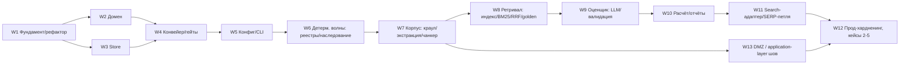

# coHound — стратегия реализации production-grade и статус

> **Статус реализации на 2026-10-28** (HEAD `f6100c7`): PARTIAL — из 27 верхнеуровневых пунктов
> закрыто 21, открыто 6 (M0, M1, M2, M3, W12, W14). Сверх того открыто 6 подпунктов: паритет
> `split`, durable-аттестация профиля, замер W8, `evaluator-benchmark`, живой SERP-раунд вместе с
> append-only раунд-циклом, приёмка отчёта M0.5. Снято 4 решения (T9.6, строка `llama-cpp-python`,
> `extract_workers` как ось контракта, «прогонов до `report` ноль»), не проверено 1. Ниже у каждого
> пункта стоит маркер ✅/⬜/➖/❔ с доказательством (`путь:строка`).
>
> **Главная поправка против текста ниже: прогон до `report` состоялся** — `runs/ru-pg-dbms-3edf2b06097c`
> (2026-10-26). Утверждения §0 и §4 о «нуле прогонов до `report`» оставлены как история и помечены.

**Документ:** `docs/architecture/06-implementation-strategy.md`
**Статус:** актуализировано as-built (план реализации итерации 6, сверен с кодом)
**Опирается на:** `00`–`05`; источник истины — `cohound-spec-v2.md` (регламент v2.1).
**Назначение:** зафиксировать, **что уже построено** (с указанием кода-носителя), и **что
остаётся**, не выдавая желаемое за сделанное.

> Этот документ не вводит новой методологии. Он упорядочивает **как** строить систему, не меняя
> **что** она делает. При расхождении с регламентом — регламент главнее.
>
> **Историческое примечание.** Разделы 2–5 выросли из плана (потоки W1–W13, майлстоуны M0–M3).
> После того как почти все потоки приземлились, документ переписан **as-built**: там, где раньше
> стояли сроки и критерии, теперь стоит фактический статус и путь к коду. Оценки в разработческих
> днях при переписывании опущены — они были плановыми, а не фактическими.

---

## 0. Текущее состояние (as-built)

Проект **не greenfield с нуля**: фундамент, домен, хранилище, конвейер Ш1–Ш9, корпус, ретривал,
оценщик, детерминированные волны, DMZ-шов, планировщик краула и подсистема авторства пакета
**реализованы**. Ниже — карта «артефакт → где живёт сегодня». Пост-хок-фазы P1–P4b (самодостаточность
прогона, словарь фаз, целостность авторства/линт, харнесс фиксации ретривала) уже влиты; см. §5.

| Артефакт | Состояние | Роль в плане |
|---|---|---|
| `core/schemas.py` (был) | ✅ расщеплён в W1/T1.2 → `core/domain/`; монолит **удалён** | источник доменных моделей/инвариантов |
| `core/db.py` (был) | ✅ переехал в W1/T1.3 → `core/store/sqlite.py`; монолит **удалён** | DDL §4.4 + триггеры |
| `core/util/text_utils.py` | готово (W1/W2/W8) | RU/EN-нормализация |
| `core/util/security.py` | готово (W2/W7) | SSRF-защита URL, `sanitize_slug` |
| `core/util/fusion.py` | мёртвый дубль: не подключён ни одним прод-путём (живое RRF — `pipeline/retrieve.py`); докстринг модуля и эта строка врали о W8 | RRF-слияние (реализация — в `retrieve.py`) |
| `core/util/retrieval_eval.py` | готово; основа W8/T8.6 | retrieval-метрики |
| `core/adapters/chunker_markdown.py` | готово; за портом W7/T7.3 | чанкер с `heading_path` |
| `core/adapters/extract_document.py` | готово (PDF+Office); за портом W7/T7.2 | docling-экстрактор |
| `core/adapters/lexical_bm25.py` | готово; прототип/базлайн W8 | BM25 |
| `tests/selfcheck.py` | готово, автономный (без pytest) | словарь/схемы/DDL/инварианты/матрица слоёв |
| `tests/smoke_scrapy_playwright.py` | пройден (V5) | браузерный smoke |
| `docs/status-dictionary.yaml` | источник истины перечислений (§4.1) | словарь |
| `pyproject.toml` + `uv.lock` | готово (Python 3.14 базлайн) | пины/extras/резолв |

**Следствия:** поток W1–W13 (код) практически завершён; незакрытое — это **измерительные прогоны**
и **доменная работа** (кейсы 2–5, golden-full, baseline §11.5), а не отсутствующие подсистемы.
Полный статус — §4/§5.

> ⚠️ **Главный факт о зрелости: до `report` не дошёл ни один прогон.** Самая дальняя durable-фаза
> в `runs/*/cohound.db` (`runs.phase_state`) — `evaluate`, и достиг её единственный прогон
> (`live-inc-f`: 9 документов, 386 чанков, 476 ячеек, 163 evidence), у которого при этом
> **ноль** строк в `llm_scenarios` — то есть живого оценщика в прогоне не было ни разу.
> Ни один прогон не имеет durable-состояния `review`, `g3`, `compute`, `g4` или `report`.
> Каталог `outputs/` существует ровно у одного прогона и содержит только `diff.md`
> — ни `battle_card`, ни `nda_questions` не эмитились ни разу. Следствие по A3: **до первого
> полного прогона все методологические числа — гипотезы, а не измерения**, и версия системы
> по существу «0.1.0». Всё, что ниже помечено ✅, означает «код приземлён и покрыт тестами»,
> а не «проверено на реальных данных».
> DoD первого полного прогона — §4 (M0.5).

➖ снято на 2026-10-28 — главный факт этого блока больше не верен: прогон `ru-pg-dbms-3edf2b06097c`
дошёл до `report` (2026-10-26), `outputs/` у него полный (5 артефактов, включая `battle_card.xlsx` и
`nda_questions.csv`), живой оценщик участвовал (§5.W9). Оговорка «✅ = код покрыт тестами, а не
проверено на данных» сохраняется только для замера ретривала (§5.W8) и `evaluator-benchmark` (§5.W9).

*Категорийная нейтральность `core/` проверяется грепп-тестом и матрицей слоёв в selfcheck на каждом коммите.*

---

## 1. Что значит «production-grade» для coHound

«Production-grade» здесь определяется **аксиомами A1–A3**, а не индустриальными шаблонами.
Продакшн-качество = воспроизводимость, аудируемость и доказуемость — *при минимальных средствах*.

**Продакшн-мы считаем систему, которая:**

| # | Свойство | Проверяемый критерий |
|---|---|---|
| P1 | **Воспроизводима** | `hound run` дважды на идентичных входах+кэше → ≥95% совпадений `status` (R7); всё влияющее — в манифесте прогона (строка БД, `report` выгружает `run_manifest.yaml`); плановые входы в `run_inputs` (самодостаточность прогона) |
| P2 | **Аудируема** | у каждой ячейки прослеживается `evidence → source_id → source_url → content_hash → build_id`; промпт сохранён по hash |
| P3 | **Инвариантна** | I1–I23 — это код (Pydantic + SQL-триггеры + чистые функции), а не комментарии; нарушение ловится тестом/триггером |
| P4 | **Восстанавливаема** | прерывание прогона не теряет прогресс (resume); ошибка одного продукта/документа не роняет остальные; сеанс краула durable (`crawl_sessions`) |
| P5 | **Наблюдаема** | структурные логи по фазам; метрики прогона (`cells_by_state`, `failure_rate`, `coverage`, `tokens`) в манифесте/БД |
| P6 | **Проверена** | тест-пирамида: чистое ядро (property-based) → контрактные тесты портов → фейки → golden |
| P7 | **Упакована и портируема** | `pyproject.toml` + extras + `uv.lock`; изолированные окружения для тяжёлых контуров; `python3 tests/selfcheck.py` без pytest |
| P8 | **Безопасна и в контуре** | SSRF-защита, санитайзинг, robots-энфорсмент (свойство **Scrapy-пути**; для прямого/браузерного пути — ответственность egress-слоя, 07 §5); корпус не покидает РФ-контур; оценщик без веб-поиска (I18); веб-контур изолируем в DMZ за L7 (07) |
| P9 | **Эксплуатируема** | CLI с явными гейтами G1–G4, понятными ошибками (код инварианта), `--dry-run`/`--json` |

**Антипаттерны, которые для coHound — дефект, а не «упрощение» (A1/A2):**

- вводить фреймворк-оркестратор (LangChain/LlamaIndex/LangGraph) — дублирует порты, ломает I18 (§05);
- поднимать сервисы «на вырост» (Qdrant, PostgreSQL, отдельная корпусная БД) без триггера §14;
- прятать предметную специфику в `core/` — нарушает §1.3;
- автоматизировать гейты/статусы `N/A` — нарушает I6/I7;
- тянуть внешние SaaS-парсеры/инференс **вне** корпоративного контура — нарушает контур данных (§10).

**Вывод:** каждое продвижение было обратимым, измеримым и изолированным за портом. Тяжёлое и внешнее
подключалось последним.

---

## 2. Стратегия: как строим

### 2.1. Принципы (обязательные к соблюдению)

1. **Seam-first (сначала швы).** Порты и домен фиксируются и тестируются до адаптеров. Адаптер —
   заменяемая деталь (A2); контракт — актив.
2. **Вертикальный срез, а не горизонтальный слой.** «Walking skeleton» проходит сквозь все фазы
   на заглушках (00 §8.1), затем заглушки заменяются по одной. Система интегрируется непрерывно.
3. **Один адаптер — один порт — один контрактный тест — один фейк.** Никакой адаптер не входит
   в ядро напрямую; все внешние системы (LLM, SERP, краул, индексы, реестры) — за портами.
4. **Детерминированное раньше вероятностного.** Сначала Ш1/Ш3/Ш4 (реестры+наследование, без LLM),
   потом Ш5 (корпус), потом Ш6 (LLM). Оценщик подключается последним — он самое дорогое и рискованное.
5. **Golden с первого дня.** Регрессионная сеть создаётся в M0 (каркас) и наполняется по мере
   появления компонентов; смена версии/профиля прогоняется против неё (§13).
6. **Измерение, а не предвидение (A3).** Дефолты (профиль ретривала, K, модель, чанкер) фиксируются
   экспериментом R0/R1/R2/R9/R10, не решением заранее.
7. **Контур данных — с первого коммита.** SSRF/санитайзинг/robots и запрет исходящего контента
   закладываются в адаптеры Ш5/Ш6, а не добавляются «потом».
8. **Два окружения.** Лёгкое CLI-ядро (Python 3.14 базлайн, 05 §1) и тяжёлые контуры (PDF-torch,
   индекс-torch) — изолированы. Ядро не тянет torch; LLM-инференс — внешний (корп. облако,
   [OI]-совместимый API).
9. **Непрерывная зелёность.** `tests/selfcheck.py` + грепп-нейтральность + импорт-граф проходят на
   каждом коммите; рефакторинги идут с transitional re-export-шимами (шимы `core.schemas`/`core.db`
   уже удалены; публичный контракт — `core.domain`/`core.store.sqlite`).
10. **Непрерывная интеграция документов.** Изменение контракта/инварианта — правка `00`–`06` в том
    же коммите (документация = часть DoD).

### 2.2. Форма поставки (definition of «готово к использованию»)

Система поставляется как **один CLI-пакет** (`cohound`) с extras по контурам. Сквозной прогон
`resolve → plan → [G1] → registry → inheritance → corpus → evaluate → review → [G3] → compute
→ [G4] → report` реализован с возобновляемым состоянием и артефактами. «Продакшн» для первого
пользователя (один аналитик) достигается на M1–M2; масштаб на 5 кейсов — на M3.

✅ «Реализован» здесь означает: фазы существуют, соединяются и проходят на тестах с фейками.
Цепочка **прошла целиком на реальных данных** 2026-10-26 (`runs/ru-pg-dbms-3edf2b06097c`, §4 M0.5):
`outputs/` + `run_manifest.yaml`, `report` в `metrics.json:duration_by_phase`. Ограничением на
2026-10-28 остаётся не проходимость, а качество отчёта (Coverage 0.208) и приёмка (M2).

### 2.3. Порядок работ (историческая карта зависимостей)



Карта отражает **порядок зависимостей**; фактический статус каждого потока — §5.

**W13 (DMZ/шов)** — **входит в MVP (M1)**: профиль `split` нужен как опция уже в MVP (решение
владельца, 2026-10-08), а не как поздняя прод-надстройка. W13 идёт параллельно корпусу/ретривалу;
он не блокирует `local`-профиль (дефолт), но оба профиля должны проходить один и тот же прогон.
Дополнительно W13 обеспечивает **прозрачность контрактов шва для корпоративных IDP/DLP/IDS** (07 §8):
L7-инспектируемый JSON, публикуемые схемы, атрибуция запросов, отсутствие пиннинга сертификатов,
блокирующего TLS-инспекцию. *Аттестация конкретных корпоративных средств — вне рамок этой работы.*

⚠️ **Паритета `local` и `split` по корпусу нет.** «Один и тот же прогон» сегодня не проходит под
`split` эквивалентно: (1) члены контейнеров не извлекаются — `RemoteExtractor.supports_source_path
= False` даёт видимый пропуск `extract_unavailable`; (2) сырьё пересекает шов только
inline-base64 в странице `collect` (бюджет 8 MiB/страница, клиент отвергает страницу > 50 MiB) —
staging крупных артефактов отсутствует; (3) ось `crawl.document_level` под `split` не действует
(конвертеры строит edge). Поэтому `split` — **функционально уже `local`** по артефактам и
контейнерам; это известное ограничение MVP, а не достигнутый паритет.

⬜ не сделано — паритет `split` не изменился на `f6100c7`: (1) члены контейнеров не
извлекаются — `core/adapters/remote_extractor.py:42` (`supports_source_path = False`);
(2) страница `collect` ограничена 8 MiB — `core/edge/scheduler.py:163` (`_COLLECT_MAX_BYTES`),
файлового staging крупных артефактов через шов нет; (3) ось `crawl.document_level` под `split`
принимается и игнорируется — `core/cli/wiring.py:2215`.

---

## 3. Рабочие потоки (workstreams): статус

| W | Поток | Ключевые артефакты (код-носитель) | Статус |
|---|---|---|---|
| **W1** | Фундамент и рефактор | `core/ports/*.py`, `core/domain/*`, `core/store/sqlite.py`, `uv.lock`, selfcheck-гейты | ✅ done |
| **W2** | Домен | `core/domain/{models,enums,invariants,scoring,r2,anchors,dictionary}.py`, property-тесты | ✅ done |
| **W3** | Store | `core/ports/store.py`, `core/ports/gate_store.py`, `core/store/{sqlite,sqlite_store,backup}.py` | ✅ done |
| **W4** | Конвейер и гейты | `core/pipeline/{runner,phases,gates,observability,metrics,idempotency}.py` | ✅ done |
| **W5** | Конфиг и CLI | `core/config/run_config.py`, `core/pipeline/{normalize,lint,plan}.py`, `core/cli/` | ✅ done |
| **W6** | Детерм. волны | `core/adapters/registry_generic.py`, `core/pipeline/{registry,inheritance}.py`, package-scoped `registries/` | ✅ done (спецификации — package-scoped, P3) |
| **W7** | Корпус | `core/ports/{crawler,extractor,chunker,container}.py` + `crawl_*`/`extract_*`/`chunker_*`, `core/pipeline/{corpus,fetch_plan,crawl_frontier,crawl_session,crawl_sources,archive_descent,artifact_probe}.py`, `core/util/{cache,sanitize,feed,rate_limit,memory}.py` | ✅ done по коду (+ source routing, контейнеры, текстовые форматы) — **но под `split` паритета по артефактам/контейнерам нет** (§2.3) |
| **W8** | Ретривал и индекс | `core/adapters/{embed_local,embed_model2vec,index_npy,index_format,vector_npy,lexical_tantivy,lexical_bm25}.py`, `core/pipeline/{retrieve,experiments,extraction_eval,evaluator_benchmark}.py` | ✅ код done; ⏳ **измерение не воспроизведено**: харнесс (`hound experiment retrieval`) есть, артефактов замера (KS-sweep + `index_build_id`) в дереве нет — профиль/K остаются `default` |
| **W9** | Оценщик | `core/ports/llm.py`, `core/adapters/llm_local.py`, `core/pipeline/{prompt,evaluate,validate}.py` | ✅ код done; ⏳ живой прогон оценщика не выполнялся; T9.6 снят (§5.W9) |
| **W10** | Расчёт и отчёты | `core/pipeline/{compute,report}.py`, `run_manifest.yaml` | ✅ done |
| **W11** | Search-адаптер | `core/adapters/{search_yandex,search_glm}.py`, `core/pipeline/{serp_loop,search_log,discovery}.py` | ✅ код done; ⏳ живой SERP-раунд в прогоне кейса не выполнялся |
| **W12** | Прод-хардненинг | `core/pipeline/{observability,metrics,adversarial,golden}.py`, `core/store/backup.py`, `tests/e2e/` | 🟡 partial: код done; ⏳ golden-full, §11.5-baseline, кейсы 2–5 не выполнены |
| **W13** | DMZ / шов | `core/ports/gateway.py`, `core/adapters/remote_*.py`, `core/edge/*`, `core/config/deploy.py`, `contracts/seam/*` | ✅ done (+ планировщик краула, Phase 3) |
| **W14** | Стадийная архитектура извлечения | проект: `10-extraction-pipeline-architecture.md`; порядок — `11-production-architecture-strategy.md` | ⛔ не начат (проект на ревью; группа A — память/запись, группа B — шов `extract` и lease). Ставить **после** M0.5: `11` §4 (F1 → F2 ‖ F3) |

> Пунктовый маркер с доказательством — в §5 (по одному на поток); эта таблица — карта, не аудит.

**Cross-cutting (сквозные, ведутся постоянно):** нейтральность `core/` (§1.3), контур данных (§10),
воспроизводимость/R7, документация-в-коммите.

---

## 4. Майлстоуны: статус

Объём и уровни (A1). Портфель — 5 кейсов (якорь + 6–10 аналогов, 100–300 параметров). Уровни:
**PoV** = M0 (мини-карта на 3 продуктах из детерминированных волн, без LLM/SERP); **MVP** = M1+M2
(strict-карта кейса 1 + приёмка); **портфель** = 5 кейсов (переносимость).

### M0 — Каркас (вертикальный срез) — 🟡 частично

Код потоков W1–W6 приземлён; сквозной прогон на детерминированных волнах (реестры + наследование)
покрыт `tests/e2e/test_walking_skeleton.py`. `hound resolve`/`hound plan` + линт блокируют
некорректные пакеты; детерминированная мини-карта строится.

⏳ **Открытый блокер M0:** приёмочного теста экстракции нет — в репозитории нет PDF/Office-фикстур
(`find tests -name '*.pdf'` пусто), поэтому docling-путь не проверяется в CI
(`cohound-spec-v2.md` §3.2/§15, `05-dependency-stack.md` §7). Блокер именно **отсутствие фикстур и
приёмки**, а не отсутствие контура: docling работает на реальных данных — `corpus_docs.extractor_version`
в живых прогонах показывает `docling-doc-3:layout_tables` для сотен документов наряду с
`trafilatura-html-2` и `text-plain-1`. Поэтому M0 не закрыт целиком: каркас и детерминированные
волны готовы, воспроизводимой приёмки экстракции нет.

⬜ не сделано — приёмка экстракции: PDF/Office-фикстур в дереве нет (`find tests -name '*.pdf'` →
0 файлов на `f6100c7`), docling-путь в CI не проверяется. Блокер именно фикстуры, а не контур.

### M0.5 — Первый полный прогон до `report` — ✅ достигнут (2026-10-26, `ru-pg-dbms-3edf2b06097c`)

**DoD.** Один прогон кейса 1 на реальных данных проходит все 15 фаз
(`normalize … report`), пишет `outputs/` (и выгружает `run_manifest.yaml`), и его отчёт
разбирается без необъяснённых аномалий. Гейты G1/G2 проходятся человеком (per-run), G3/G4 —
решением извне или явным `waived`.

**Факт (состояние до 2026-10-26).** Такого прогона не было **ни одного**: самая дальняя durable-фаза — `evaluate`
(единственный прогон, `live-inc-f`), и он же имеет **ноль** строк в `llm_scenarios`, то есть
`evaluate` прошёл без живого оценщика. Ни один прогон не дошёл до `review`/`compute`/`report`.
До закрытия M0.5 все числа методологии (Coverage, Capability, κ, пороги golden) — гипотезы (§0).
Это гейт **перед** любым разговором о M2/M3: приёмку нельзя провести на системе, которая ни
разу не дошла до отчёта.

✅ сделано (поправка на 2026-10-28) — прогон `ru-pg-dbms-3edf2b06097c` дошёл до `report`:
`runs/ru-pg-dbms-3edf2b06097c/outputs/{battle_card.xlsx,preliminary_findings.xlsx,nda_questions.csv,diff.md,artifacts_gap.yaml}`,
`run_manifest.yaml`, `gates/{G1,G3,G4}-request.json`; `metrics.json` пишет
`duration_by_phase.report = 0.279 s`, `cells_by_state = {evaluated: 153, failed: 319, pending: 4}`.
Живой оценщик в прогоне участвовал (`docs/reports/measurements/2026-10-26-verdict-reproducibility.md`:
`deepseek-v4.1-flash:purple`). Механическая часть DoD выполнена.
⬜ остаётся качественная часть DoD — «отчёт разбирается без необъяснённых аномалий»:
аномалии (Coverage 0.208 при Capability 0.922, 119 `failed` у pangolin, 63 `❓`) разобраны в
`docs/reports/measurements/2026-10-2*.md`, но их принятие — решение человека, не код.

### M1 — Конвейер (strict-карта кейса 1 + preliminary + профиль `split`) — 🟡 код готов, прогон не завершён

- ✅ W7 (корпус), W8 (ретривал/индекс), W9 (оценщик), W10 (расчёт/отчёты), **W13 (DMZ/шов)** — код.
- ✅ Оба профиля развёртывания (`local`/`split`) поддержаны; шов публикует `/v1/*`-схемы (07 §8).
  ⚠️ «Поддержаны» ≠ «эквивалентны»: под `split` члены контейнеров не извлекаются
  (`extract_unavailable`), крупный артефакт не пересекает шов (только inline-base64 ≤ 8 MiB на
  страницу `collect`), `crawl.document_level` не действует. `split` — функционально уже `local`
  по артефактам и контейнерам (§2.3).
- ⏳ **Не выполнено:** первый полный прогон до `report` (M0.5) — ни одного; живой прогон оценщика
  против внутреннего [OI]-endpoint. ⏳ Фиксация ретривала (R0/R1/R2+K) **не воспроизведена**:
  харнесс `hound experiment retrieval` есть, артефактов замера (KS-sweep + `index_build_id`) в
  дереве нет — см. §5.W8 и §12.

⬜ не сделано — M1 не закрыт: паритет `split` (§2.3) и фиксация ретривала (§5.W8). Прогон до
`report` состоялся (M0.5), поэтому оговорка «прогон не завершён» к конвейеру больше не относится.

### M2 — Приёмка кейса 1 — 🟡 частично (код-инструменты готовы, приёмка не проведена)

- ✅ W11 (SERP-петля) — код; golden-харнесс и adversarial-набор — код.
- ✅ NDA-вопросник, `diff`, `run_manifest` — код (`report.py`).
- ⏳ **Не проведено:** полный golden (со стратой ❌) и adversarial как приёмочный прогон; ручной
  baseline-эксперимент (2 аннотатора, §11.5); полная метрика приёмки (R6/R7/R11/R12, critical=0,
  preliminary-yield) на реальных данных; калибровка порогов. Приёмка кейса 1 **не заявлена**.

⬜ не сделано — и формулировка «полный golden не проведён» неточна: он **проведён и провален**.
`hound golden --tier full` на `3edf2b06097c` даёт `agreement: 6.8 %` (16 из 236), `false_ok: 3`
(`docs/reports/measurements/2026-10-27-golden-reference-set-unusable.md`). Причина — состав
эталона (`missing: 217`, разметка не на тех продуктах), а не оценщик: нужна пере-разметка.

### M3 — Кейсы 2–5 (portability) — ⛔ не начат

Авторство пакетов категорий 2–5 не выполнялось; в репозитории есть один доменный пакет кейса 1
(`packages/ru-pg-dbms/`) и нейтральный `packages/_template/`. Portability gate ×5 не проводился.

⬜ не сделано — проверено на `f6100c7`: `ls packages/` → `ru-pg-dbms`, `_template`; кейсов 2–5 нет.

> **Реалистичность.** Самое дорогое — **калибровка методологии (§11.5) и авторство категорий**,
> а не код. W1–W13 (код) практически завершены; незакрытое — измерительные прогоны и домен.

---

## 5. Детальный статус: потоки W1–W13 (as-built)

Формат: краткий статус · **что приземлилось (с кодом)** · **что остаётся**. Оценки ТЗ из исходного
плана (в дд) в этой редакции опущены как исторические; где критерий приёмки (DoD) уже проверяется
тестом — это отмечено.

### W1 — Фундамент и рефактор — ✅ done

✅ сделано (проверено на `f6100c7`) — монолиты отсутствуют (`ls core/schemas.py core/db.py` → No such
file); порты без наследников (`core/ports/llm.py:4` — «без `tools`/`web_search`»); грепп-гейт трёх
слоёв — `tests/selfcheck.py::_neutrality`, тот же набор в `scripts/ci.sh`.

- `core/ports/*.py` — `typing.Protocol`-контракты без наследования (llm, vector_index,
  lexical_index, search, crawler, extractor, chunker, embedder, index_builder, registry, store,
  gate_store, gateway, crawl_executor, poller, discovery_llm, types).
- `core/domain/{models,enums,invariants,scoring,r2,anchors,dictionary}.py` — расщепление прежнего
  монолита; transitional re-export-шимы `core.schemas`/`core.db` **удалены**.
- CI-гейты: `tests/selfcheck.py` включает матрицу слоёв/импорт-граф и грепп-нейтральность
  `core/domain|ports|pipeline` (§1.3).
- `pytest`+`hypothesis` в extra `dev`; `uv.lock` — воспроизводимый резолв.

### W2 — Домен — ✅ done

✅ сделано (проверено) — `core/domain/models.py:71` (`ConfigDict(extra="forbid", …)` — база всех моделей),
`core/domain/scoring.py:444` (знаменатель `scope_universe`), property-тесты — `tests/domain/`.

- Модели Pydantic с `extra="forbid"`, `StrEnum`-перечисления, чистые `check_*`-инварианты,
  `scoring` (capability/coverage/failure_rate/comparability/sensitivity/modules), `r2`, `anchors`
  (`SourceResolver`), `dictionary`.
- Property-тесты домена — `tests/domain/`.

### W3 — Store — ✅ done

✅ сделано (проверено) — `core/store/sqlite.py:15` (`SCHEMA_VERSION = "3.13.0"`; на `f6100c7` в схеме
21 таблица, из них 20 предметных + `sqlite_sequence` — текст ниже говорит «19», это устарело),
`core/store/state_sqlite.py:41` (`STATE_SCHEMA_VERSION = "5"`, в тексте ниже `"4"`),
`core/store/state_store.py:875` (`save_profile_attestation` — писателя в прогоне нет, см. §5.W4).

- `core/store/sqlite.py` — DDL §4.4 + триггеры I4/I6/I7/I13/I18, `SCHEMA_VERSION = "3.13.0"`
  (19 таблиц, включая `schema_meta`; гейт версии схемы — файл другой версии отвергается,
  `11` §2.6; свидетельство живости сеанса краула — F1).
- `core/pipeline/liveness.py` — `owner`/`heartbeat_at`, recovery-on-open (`running` → `interrupted`),
  `Heartbeat` (F1/Д-6).
- `core/store/state_sqlite.py` — durable per-product состояние (`state/{package_id}/state.db`,
  `STATE_SCHEMA_VERSION = "4"`): lineage, `previous_run_id`, `profile_attestation`. Источник
  `--since-run`/класса изменения (09 §4.1).
- `core/store/sqlite_store.py` — реализация `StorePort`/`GateStore`; батчевые транзакции, WAL.
- `core/store/backup.py` — backup/restore прогона + GC иммутабельных индексных сборок (T12.2).
- `run_inputs` — снимок плановых входов (самодостаточность `runs/{run_id}`, P1).

### W4 — Конвейер и гейты — ✅ done

✅ сделано (проверено) — `core/pipeline/runner.py:167` (`PhaseResult` c
`ok|skipped|blocked|failed`), `core/pipeline/gates.py`, `core/pipeline/gate_subject.py`,
`core/cli/context.py:1214` (`make_profile_gate` подключён в CLI).
⬜ не сделано — durable-аттестация профиля: `save_profile_attestation` не вызывается ни из
одного прод-пути (`grep -rn save_profile_attestation core` → только определение), строку пишут тесты.

- `core/pipeline/runner.py` — фазы, `PhaseResult`, resume; `core/pipeline/phases.py` — сборка фаз
  Ш1–Ш9; `gates.py` G1–G4 (только через `gate_decisions`); `observability.py`/`metrics.py`;
  `idempotency.py` (`evidence_id`, `stale_reason`, upsert).
- **Гейты как точки интеграции** (решение владельца 2026-10-23, срез `48c6627`; реестр ADR —
  `04` §E). G1/G2 — **внутренняя аттестация** содержимого профиля пакета-якоря (когорта, роли,
  объём, паспорта) и матрицы роль×продукт. Рабочий путь сегодня один — **per-run строка
  `gate_decisions`** (аудит-след и override). Второй путь, durable-аттестация профиля
  (`profile_attestation` в `state/{package_id}/state.db`), **объявлен и проверяется** гейтом
  (`make_profile_gate` подключён в CLI), но **производителя в прогоне нет** — строку пишут
  только тесты; это design-only, а не работающий механизм. G3/G4 — **не внутренние решения**:
  coHound не решает ревью/публикацию, а получает решение и записывает его; на блоке пишется
  `runs/{run_id}/gates/{gate}-request.json` (детерминированный предмет + `subject_digest`,
  `core/pipeline/gate_subject.py`). `gate_decisions` несёт `subject_digest`, `source`
  (`internal|external`), `external_ref`, `verdict` (`approved|rejected`); устаревшее одобрение
  (предмет изменился) гейт не проходит. `run.yaml: gates.{g3,g4}: external|waived` (дефолт
  `external`): `waived` → фаза `skipped` с `skip_reason=gate_delegated_external`, waiver-строка
  и `gate_waivers` в манифесте — невидимый waiver запрещён. Политика гейтов — процесс, не условие
  измерения: в `EXECUTION_CONTRACT_FIELDS` её нет.
- **Словарь фаз (P2a/P2b):** `PhaseResult(status: ok|skipped|blocked|failed, …)`; `skipped` несёт
  машинную `skip_reason` (`SkipReason`, зеркало `docs/status-dictionary.yaml`) и `pending` (advisory,
  I6/I7 не затронуты). Прогон продолжают только `blocked`/`failed`; **echo-заглушка удалена** —
  незарегистрированная фаза даёт `failed`, а не фиктивный `ok`. Resume-короткое-замыкание —
  ключ `resumed_skipped` (отличать от `PhaseStatus.skipped`). Ш7 (review) присоединяет очередь
  ревью как advisory-`pending` и **ничего не решает** за человека.

### W5 — Конфиг и CLI — ✅ done

✅ сделано (проверено) — `core/pipeline/lint.py:105` (`LintReport.ready`); сборка парсера даёт
21 верхнеуровневую команду (`core/cli/parser.py`, проба на `f6100c7`) и 27 подкоманд
`hound package` (`core/cli/package/parser.py`, перемер 29.10.2026: +`seeds`, +`state`).

- `core/config/run_config.py` + загрузчики пакета (`core/pipeline/normalize.py`), `lint.py`,
  `plan.py`; `core/config/paths.py` (раскладка операционных каталогов).
- `core/cli/` — composition root Z0: `main.py`, `parser.py`, `context.py`, `errors.py`, `output.py`,
  `wiring.py`, `doctor.py`, команды `commands/*` (реестр `COMMANDS`), подкоманды `hound package` —
  `package/*`.
- **Линт (P3):** `LintReport(blocking, warnings, incomplete)`; `Severity = blocking|warning|incomplete`;
  `ready` (= нет blocking и нет incomplete) гейтит `run`/`plan`/`crawl` и `package validate`,
  а `incomplete` **не** блокирует авторство. Незаполненные авторские поля — `None` (никогда не
  литеральный `TODO:`).

### W6 — Детерминированные волны — ✅ done

✅ сделано (проверено) — `core/adapters/registry_generic.py:106` (`headers_env`), `core/pipeline/registry.py`,
`core/pipeline/inheritance.py`; корневого `registries/` нет (`ls packages/*/registries` → no such file),
шаблоны — `docs/templates/registries/`.

- `core/adapters/registry_generic.py` (config-driven json/html + маппинг), `core/pipeline/registry.py`
  (R-ячейки), `core/pipeline/inheritance.py` (direct/conditional/blocked + derived-evidence).
- **Реестры (P3):** спецификации **package-scoped** — `packages/{case_id}/registries/{registry_id}.yaml`,
  перечислены в `package.yaml` (`PackageManifest.registries`); корневого `registries/` нет, нейтральные
  шаблоны — `docs/templates/registries/`. Секретные заголовки — через `headers_env`
  (значение из env, не из файла). Операционный knob `paths.registries`/`COHOUND_REGISTRIES_DIR` удалён.

### W7 — Корпус — ✅ done по коду; ⚠️ под `split` — с расхождениями

✅ сделано (код, проверено) — `core/pipeline/crawl_frontier.py:830` (`host_in_scope`), `:821`/`:826`
(`out_of_scope_subdomains`/`accepted_foreign_hosts`), `core/pipeline/archive_descent.py:110-112`
(`archive_cycle`/`archive_budget_exhausted` — исчерпание видимо), цепочка 5000 архивов —
`tests/pipeline/test_corpus_descent.py`.
⬜ остаётся паритет `split` (§2.3).

- Порты: `core/ports/{crawler,extractor,chunker,container}.py`. Адаптеры: `crawl_scrapy.py`
  (robots=obey — **Scrapy-путь**), `crawl_http.py`, `crawl_browser.py` (прямой Playwright/CDP,
  honest/hybrid), `extract_html.py` (trafilatura), `extract_document.py` (docling PDF+Office),
  `extract_text.py` (plain text/markdown), `extract_epub.py` (stdlib OCF), `chunker_markdown.py`,
  `chunker_text.py` (абзацы), `chunker_family.py` (диспетчер по семейству документов;
  композитная версия чанкера — `md-heading-2+text-para-1`, `composite_chunker_version`).
- `core/pipeline/corpus.py` (raw retention → extract → dedup(hash) → chunk → `index_manifest`, I19),
  `fetch_plan.py` (резолв `fetch × extract × strategy`), `crawl_frontier.py` (scope объявленных
  хостов: `out_of_scope_subdomains`/`accepted_foreign_hosts` — отказ видим),
  `core/util/{cache,sanitize,feed,rate_limit,document_formats,document_probe}.py`.
- **Контейнеры и архивы (as-built; таблицы добавлены в схеме 3.10.0).** `core/ports/container.py`
  (порт чтения контейнера), `core/pipeline/archive_descent.py` (спуск), `artifact_probe.py`
  (допуск артефакта до скачивания), `core/util/container_policy.py` (бюджеты и прогноз), адаптеры
  `container_{zip,7z,rar,any}.py`. Таблицы `corpus_members` (PK `(archive_content_hash,
  member_path, product_id)`; байты членов отдельно не ретейнятся — член ре-выводится из архива;
  `product_id` в ключе с 3.13.0 — один архив в двух продуктах даёт две строки провенанса) и
  `archive_observations` (прогноз **до** извлечения + исход; запись есть для каждого контейнера,
  включая пустой и нечитаемый). Ось `CrawlLimits.archive_descent` (`plan|full`) плюс
  `archive_max_*` (один контейнер) и кумулятивный `archive_max_total_uncompressed_bytes`
  (дефолт 1 GiB, `execution_change`). Потолка **глубины** нет: конечность дают цикл по хешу
  содержимого (`archive_cycle`) и бюджет корня (`archive_budget_exhausted` — видимая запись).
  Требуется читатель контейнера: `zip` — stdlib, `7z`/`rar` — extra **`extract-archives`**
  (`py7zr`/`rarfile`; сжатые члены `rar` требуют внешнего `bsdtar`/`unrar`/`7z`, AES-zip —
  `pyzipper`). Без бэкенда контейнер **не разворачивается видимо** (`available() = False`,
  `backend_unavailable` / `container_reader_unavailable`), а не «тихо пусто». Члены извлекаются
  в фазовом пуле
  (`ExtractionPool`) с окном `extract_window` и строгой FIFO-доводкой (порядок вставки входит в
  `_content_digest` сборки).
- **Память экстракции (`core/util/memory.py`).** `release_free_arenas()` / `malloc_trim(0)`
  возвращает ОС свободные арены glibc после документа; без этого RSS воркера растёт храповиком
  до OOM (замеры — в докстринге модуля: 1679 → 1084 MB, 1480 → 1122 MB). Это **операционный
  рычаг**, не условие измерения: не входит в `EXECUTION_CONTRACT_FIELDS`, `run_id` не меняет.
- **Source routing (Phase 5):** `core/pipeline/crawl_sources.py` + `core/config/crawl_sources.py`
  (`crawl_sources.yaml`), директорные источники `feed`/`channel`/`sitemap` разворачиваются через
  `PollPort` (`core/ports/poller.py`, `core/adapters/feed_poller.py`; split — op шва `crawl/poll`).
- **Сеанс краула:** `core/pipeline/crawl_session.py` + `crawl_sessions`/`crawl_session_items` —
  durable-очередь/resume без сетевого ре-фетча; CLI `hound crawl {run,status,list,resume,restart,cancel}`.
- **Наблюдаемость продукта (as-built).** Структурные события фазы `corpus`: `product_start` (до
  первого корня, с `roots`/`seeds_declared`; нужен живьём и в `results[].notes` **не**
  дублируется), `product_end` (после доводки хвостов, с `roots`/`seeds_enqueued`/`seeds_declared`/
  `session_items`/`fetched`/`failed`/`elapsed_seconds`/`reason`; пишется и при нулевом выходе),
  `product_skipped` (единственный след продукта плана, вообще не попавшего в цикл:
  `--only-product`/`--only-failed`/пустой seed-набор). В `results[].notes` (`--json` прогона)
  попадают строки `product_end`/`product_skipped` — именно они отличают «продукт съел весь
  бюджет» от «продукт почти ничего не дал»; живой прогресс — `--follow`: он печатает
  `crawl_progress` (агрегат сеанса) и `crawl_product` (границы продукта — агрегат не отличает
  «ещё в очереди» от «потерян»), опрашивая сеанс до терминального статуса. «Не начат» ≠
  «потерян» различимо по `product_skipped`.

### W8 — Ретривал и индекс — ✅ код done; ⬜ замер не воспроизведён (артефактов нет)

✅ сделано (код, проверено) — `core/pipeline/retrieve.py:98` (`rrf_fuse_chunks`),
`core/cli/commands/experiment.py:101-170` (персист `retrieval_profile`/`K`/`rrf_k` + `settings_provenance`,
и только при полном сравнении).
⬜ не сделано — замер R0/R1/R2 + K-свип: KS-sweep в дереве отсутствует (`grep -rln "KS-sweep"
docs/reports/measurements/` → пусто). В дереве есть только пере-оценка 63 `❓` на копии БД
(`docs/reports/measurements/2026-10-26-retrieval-profile-r0-vs-r2.md`), а не фиксация профиля.

- Порты: `embedder`/`index_builder`/`vector_index`/`lexical_index`. Адаптеры: `embed_local.py`
  (bge-m3, extra `embed`), **`embed_model2vec.py`** (лёгкий офлайн-путь, extra `embed-lite` без torch;
  дефолт `minishlab/potion-multilingual-128M`, dim=256), `index_npy.py`/`index_format.py`,
  `vector_npy.py`, `lexical_tantivy.py`, `lexical_bm25.py`.
- `core/pipeline/retrieve.py` (RRF-фьюжн, `RetrievedChunk` с провенансом), `core/util/{fusion,retrieval_eval}.py`,
  `core/pipeline/extraction_eval.py` (extraction-golden / A-B экстракторов).
- **Фиксация (P4a/P4b):** `vector_index`/`chunk_lookup` и seeded-лексический индекс конструируются
  из персистентной сборки; команда **`hound experiment retrieval`** прогоняет R0/R1/R2 и персистит
  измеренные `retrieval_profile`/`retrieval_cutoff_K`/`embed_model_id`/`rrf_k` как `settings_provenance`
  со `source: measured` — **и только профиль, и только при полном сравнении** (иначе `source: default`).
- ⏳ **Фиксация не воспроизведена; артефакты отсутствуют.** Процедура определена и харнесс
  существует: `hound experiment retrieval` прогоняет R0/R1/R2 на retrieval-golden и персистит
  измеренные значения со `source: measured` только при полном сравнении. Однако **замер не
  приложен к дереву**: каталога прогона и индексной сборки, на которых он якобы выполнен, в
  дереве нет (и быть не может — `runs/` и `index_store/` в `.gitignore`), KS-sweep-файла тоже
  нет. Правило проекта (`docs/reports/measurements/README.md`, после аудита документации
  2026-10-23): архитектурный документ не ссылается на `runs/*` как на доказательство; поэтому
  здесь фиксируется не результат, а **состояние**: профиль ретривала и `retrieval_cutoff_K`
  остаются `source: default` (K из конфигурации прогона), пока замер не положен в
  `docs/reports/measurements/` с командой, параметрами и выводом.
- ⏳ **Осталось:** выполнить замер (R0/R1/R2 + K-свип) и приложить его артефакт в
  `docs/reports/measurements/`; заменить авторский golden (18 пар) на полноценный
  retrieval-golden кейса; живой прогон оценщика; вендорного снапшота модели в репозитории нет
  (снапшот лежит вне репо).

### W9 — Оценщик — ✅ код done; ✅ живой прогон состоялся (2026-10-26)

✅ сделано (проверено) — живой оценщик участвовал в прогоне `ru-pg-dbms-3edf2b06097c`:
`docs/reports/measurements/2026-10-26-verdict-reproducibility.md` называет модель
`deepseek-v4.1-flash:purple`, `temperature=0`, `seed=0`, тот же `prompt_hash`; `metrics.json`
пишет `cells_by_state.evaluated = 153`.  ⚠️ `metrics.json.llm_calls: 0` — счётчик фиксирует
только последнюю инвокацию, поэтому факт живого прогона доказывается замером, а не им.
⬜ не сделано — `evaluator-benchmark` не прогонялся: харнесс есть
(`core/pipeline/evaluator_benchmark.py`), артефакта измерения в `docs/reports/measurements/` нет.

- `core/ports/llm.py` (без `tools`, I18 структурно), `core/adapters/llm_local.py` — клиент
  [OI]-совместимого endpoint корп. облака (constrained decoding, seed/greedy);
  `core/pipeline/{prompt,evaluate,validate}.py`; `CellEvidence`/детерминированный `evidence_id`.
- **T9.6 — снят (retracted).** ➖ снято — superseded: контур оценщика замкнут на [OI]-совместимый API (см. ниже).
  ✅ проверено на `f6100c7`: `grep -rn "llama_cpp" core` → пусто; рабочая зависимость отсутствует в
  конвейере, строка реестра `05:135` помечена «снято». Офлайн-fallback `llama-cpp-python` (CPU/GGUF) для тестов порта
  **не реализован и снят с плана как superseded**: контур оценщика замкнут на [OI]-совместимый API
  **внутри корпоративного периметра** (`core/adapters/llm_local.py`), и отдельный локальный
  GGUF-инференс дублировал бы адаптер вне принятой архитектуры. Реестр стека (`05`) всё ещё несёт
  строку `llama-cpp-python` как «опц. CPU-инференс» — это **не** часть конвейера; см. §5.13 (реестр).
- ⏳ **Осталось:** живой прогон оценщика против внутреннего endpoint (требует доступного
  `COHOUND_LLM_BASE_URL`/`COHOUND_LLM_API_KEY`). Харнесс выбора модели **есть**:
  `hound experiment evaluator-benchmark` (`core/pipeline/evaluator_benchmark.py`) измеряет
  валидность JSON, согласие с golden (κ), abstention, `fabricated_support`, bootstrap-CI и
  детерминизм при фиксированном всем прочем; `model_id` берётся только из флага. Ждёт прогона.

### W10 — Расчёт и отчёты — ✅ done

✅ сделано (проверено) — `core/pipeline/report.py:123-126` (`render_battle_card`,
`render_nda_questions`, `render_preliminary_findings`); живой вывод —
`runs/ru-pg-dbms-3edf2b06097c/outputs/` (5 артефактов, включая `battle_card.xlsx` и `diff.md`).

- `core/pipeline/compute.py` → `core/domain/scoring.py`; `requested` vs `computed` ranking (K6).
- `core/pipeline/report.py` — `battle_card.xlsx`/`preliminary_findings.xlsx`/`nda_questions.csv`/`diff.md`
  (в `runs/{run_id}/outputs/`), `run_manifest.yaml` (все версии/модели/build/профиль+K/бюджет, R7;
  манифест хранится строкой БД, `report` выгружает YAML отдельно).
- CLI `run/review/report/golden/sensitivity/diff/promote` + `gate` (S9) реализованы.

### W11 — Search-адаптер и SERP-петля — ✅ код done; ⬜ живой раунд не выполнялся

✅ сделано (код) — контур исполняется: `core/pipeline/corpus.py:3925` вызывает `_run_serp_contour`
(поиск → допуск → расширение seed-набора **до** дренажа, одна сборка), `core/pipeline/search_log.py`
(бюджет, I23).
⬜ не сделано — (а) append-only раунд-цикл `run_serp_loop` (`core/pipeline/serp_loop.py:1549`)
**не вызывается ни из одного прод-пути**: ссылки только в `core/pipeline/__init__.py` и
`tests/pipeline/test_serp_loop.py` ⇒ механизм объявлен и покрыт тестом, но в прогоне не работает;
(б) живой SERP-раунд: `runs/ru-pg-dbms-3edf2b06097c/metrics.json` даёт `search_calls_by_phase = {}`,
а `nda_questions.csv` всех `❓` пишет `i3_anomaly: не пройдены контуры: serp, registry`.

- `core/ports/search.py`; адаптеры `core/adapters/search_yandex.py` (дефолт) и `search_glm.py`
  (список поддержанных — `SUPPORTED_SEARCH_ADAPTERS` в `core/cli/wiring.py`).
- `core/pipeline/search_log.py` (бюджет, `termination_reason`, `kind=external`, I23) и
  `core/pipeline/serp_loop.py` (append-only раунды сборок `R0-base`/`R1-serp`/…, инвалидация
  затронутых ячеек `stale_reason='new_build'`, K2).
- `core/pipeline/discovery.py` / concept scout: выход — кандидаты/гипотезы (G2), не evidence.
- ⏳ **Осталось:** живой SERP-раунд в реальном прогоне кейса.

### W12 — Прод-хардненинг и кейсы — 🟡 partial

⬜ не сделано — код есть (`core/store/backup.py:139/211/300` — `backup_run`/`restore_run`/
`gc_index_builds`; `core/pipeline/adversarial.py:497` исполняется в `tests/selfcheck.py:2932`),
но приёмочный контур не пройден: golden-full дал 6.8 % (`2026-10-27-golden-reference-set-unusable.md`),
§11.5-baseline и кейсы 2–5 не делались.

- Наблюдаемость (`observability.py`/`metrics.py`), backup/restore + GC (`store/backup.py`),
  adversarial-набор (`adversarial.py`, R8), golden-харнесс (`golden.py`), e2e-регрессии
  (`tests/e2e/{test_walking_skeleton,test_reproducibility}.py`) — ✅ код.
- ⏳ **Осталось (приёмочный контур):** golden-full (100–200, страта ❌) как реальный прогон;
  adversarial как регрессионный gate на реальных данных; ручной baseline-эксперимент §11.5;
  авторство и прогон кейсов 2–5.

### W13 — DMZ / application-layer шов — ✅ done

✅ сделано (проверено) — `core/edge/{server,auth,audit,scheduler}.py`, публикуемые схемы
`contracts/seam/*` (`openapi.json`, `crawl.schema.json`, `search.schema.json`, …),
`hound deploy-check` — `core/cli/commands/deploy.py:1`.
⬜ паритет с `local` — §2.3.

- `core/ports/gateway.py` (`ContentGateway`), `core/adapters/remote_{gateway,crawler,search,registry,extractor}.py`
  (httpx, TLS без пиннинга, retry ≤2, лимит ответа, клиентская валидация).
- `core/edge/*` — composition root Z1: `server.py`, `auth.py`, `audit.py`, `seam_schema.py`,
  `config.py` (`EdgeRuntimeConfig`), `__main__.py` (launcher `python -m core.edge serve`).
- `core/config/deploy.py` + `config/deploy.yaml`; wiring профилей `local`/`split`;
  `deploy_profile`/edge-версии в манифест (R7). Публикуемые схемы — `contracts/seam/*` (`/v1/*`,
  `schema_version`). `hound deploy-check` — диагностика достижимости и версий.
- **Phase 3 — долгоиграющий краул за швом:** `core/edge/scheduler.py` (`EdgeScheduler`): SQLite-очередь
  (`edge_jobs.db`, WAL) + content-addressed блоб-хранилище; воркеры (потоки `http`, процессы
  `scrapy`/`browser`); back-pressure; идемпотентный `submit`; recovery-on-start. Порт-исполнитель
  `core/ports/crawl_executor.py` + `core/adapters/remote_crawl_executor.py`; ветка `executor` в
  `core/pipeline/corpus.py` (split → шов, local → in-process). Операции `crawl/{submit,status,cancel,collect}`
  + `crawl/poll` — аддитивны (`schema_version` остаётся `"1"`, scope `crawl`).

### W14 — Стадийная архитектура извлечения и пост-извлечения — ⛔ не начат (проект)

⬜ не сделано — кода нет: `grep -rn "F3\b" core` → пусто на `f6100c7`. Гейт F3 — «после F1»;
F1 (первый прогон до `report`) уже выполнен 2026-10-26 (§4 M0.5), значит F3 разблокирован.

- **Проект:** `10-extraction-pipeline-architecture.md`. §1–§4 — as-built и дефекты (Д-1…Д-8);
  §5 — целевая форма, **не реализовано**; §8 — принятые решения с обоснованием; §9 —
  независимая критика (в т.ч. признанные ошибки автора).
- **Порядок и гейты:** `11-production-architecture-strategy.md`. W14 = фазы F3 (декомпозиция
  стадий и память) + F4 (шов v2), причём F3 стартует **только после** F1 (первый прогон до
  `report`) и идёт параллельно F2; F4 гейтится наличием реального контура, которому нужен
  `split`. Там же — что освобождает отказ от обратной совместимости (документный `pb` вместо
  `(chunk_id, content_hash)`, отмена двухфазного чанкинга с `NULL`).
- **Зачем:** разные размещения стадий и горизонтальное масштабирование. Сейчас `split` не
  паритетен по извлечению (пере-фетч, провенанс текста не привязан к ретененному артефакту,
  члены контейнеров недоступны, ось `document_level` принимается и игнорируется), а время
  жизни части артефактов привязано к процессу, а не к стадии.
- **Чего это НЕ делает:** не устраняет измеренную RAM-стену. Пик фазы — docling
  (2 × 1953 MB; на реальном 2763-страничном документе `layout_tables` берёт **3679 MB**
  в одиночку — `2026-10-24-docling-peaks-real-corpus.md`), группа A снимает 6–12 % от него;
  стену двигают только «воркеры из замера» и
  выбор уровня. См. `10` §9 К-1.
- **Группа 0 (идентичность):** сборка движка в ключе `extract_cache` (Д-8) — предпосылка
  любого переиспользования: иначе апгрейд docling внутри диапазона даёт прогон, который
  объявляет новый движок и переиспользует текст старого.
- **Группа A (нейтрально к `run_id`, DDL не трогает):** гидртация top-k лексического индекса
  без зеркала корпуса в RAM; `argpartition` + `mmap` в плотном поиске; освобождение
  `ingest.chunks` после персистенции; `IndexBuild.docs` вне `PhaseResult`; провенанс спуска
  по контейнеру; число воркеров из замера с публикацией чисел.
- **Группа B (меняет форму):** шов `extract` чанками с идентичностью экстрактора, ось уровня
  в запросе, `heartbeat_at`/`owner` + `interrupted` (liveness, **не** распределённый lease),
  `chunk_window` с зачисткой `NULL`-строк, общий носитель артефактов для `pooled`.
- **Версии:** `methodology_version` не меняется. `SCHEMA_VERSION` не меняется в группе A;
  B4 добавляет колонки через аддитивную миграцию ⇒ бамп `SCHEMA_VERSION` (прецедент
  v3.5/v3.7/v3.8/v3.11). `STATE_SCHEMA_VERSION` не меняется.

### 5.13. Реестр стека: устаревшая строка `llama-cpp-python`

Строка о `llama-cpp-python` в `docs/architecture/05-dependency-stack.md` (§решения/§опц. инференс)
описывает **отклонённый** путь и не является зависимостью конвейера. Оценщик работает через
[OI]-совместимый API внутри периметра (§W9). Реестр `05` не переписывается в этой фазе (вне задачи
P5), но строка помечена здесь как неактуальная — **residual doc debt**, см. §12.

➖ снято — долг уже закрыт: строка `docs/architecture/05-dependency-stack.md:190` несёт
«**снято (2026-10, см. `06` §5.W9/§5.13)**» и «конвейер путь не использует».

---

## 5.1. Подсистемы без отдельного W-потока (as-built)

Эти подсистемы приземлились вне исходной карты W1–W13 и не имеют собственной строки в §3:

- **Source routing краула** (`crawl_sources` + `crawl_sources.yaml`). `core/config/crawl_sources.py`
  (загрузка/валидация `CrawlSourcesConfig`, слои defaults/products/sites), `core/pipeline/crawl_sources.py`
  (`resolve_crawl_target`, `crawl_sources_digest`). Директорные источники `feed`/`channel`/`sitemap`
  разворачиваются в записи через `PollPort`; документ каталога не ретейнится (I19).
  См. `02 §B.1`, `03 §D.2.1`.
- **Scope краула — только объявленные хосты.** Предикат `Frontier.host_in_scope`
  (`core/pipeline/crawl_frontier.py`): URL ставится в очередь, если проходит SSRF-валидацию,
  принадлежит объявленному хосту (хост корня; поддомен — только если объявлен seed-корнем
  продукта или ключом `domain_profiles.yaml`; `www.` эквивалентен), укладывается в path-prefix
  корня по границе сегмента и не в блэклисте. Отказ **видим**: `out_of_scope_subdomains`
  (счётчик по хостам + примеры) и `accepted_foreign_hosts` (сколько бюджета корня ушло на
  объявленный чужой хост). Это **другая** семантика, чем `fetch_plan._host_matches`: там
  поддомен наследует оси профиля (`fetch`/`extract`/лимиты) — наследование осей ≠ право
  тратить бюджет чужого корня. Терминальный артефакт (документ/контейнер) — исключение только
  из path-prefix: SSRF/host-scope/блэклист остаются обязательными.
- **`serp_loop` / `search_log`.** `core/pipeline/serp_loop.py` (append-only раунды сборок, K2) и
  `core/pipeline/search_log.py` (бюджет, `kind=external`, `termination_reason`, I23). `search_log` —
  единственное место логирования поисковых вызовов (§4.4).
- **Авторство пакета** (`package_*` и смежные). `core/pipeline/package_io.py` (чтение/запись
  артефактов), `package_admin.py` (CRUD модулей/ролей/параметров/baselines/cohort/scope,
  перенормировка, `validate_package`), `package_discovery.py`/`package_candidates.py` (план и
  применение кандидатов), `package_scout.py` (веб-заземлённая разведка пакета),
  `package_add_product.py` (добавление продукта в когорту: SERP+scout+ключи доменов, plan-only
  с `--apply`), `passport_scout.py` (черновик паспорта), `scout_common.py` (общие хелперы),
  `crawl_probe.py`/`crawl_probe_driver.py` (**`hound package crawl-probe`** — автоподбор осей
  краула по измерению, proposal, `--write` правит файл). Смежные подсистемы инкрементальности и
  идентичности: `onboarding.py` (вход в прогон из seeds), `incremental.py` (план дообхода),
  `state_sync.py` (синхронизация durable-состояния продукта), `composition.py` (композиция
  индексных сборок), `digests.py` (дайджесты идентичности), `run_identity.py`; кэши —
  `eval_cache.py` (вердикты оценщика) и `extract_cache.py` (результаты экстракции).
  CLI-фасад — `core/cli/package/*`, **27 подкоманд** `hound package` (`new`, `show`, `validate`,
  `list`, `set-archetype`, `bump-version`, `module`, `role`, `param`, `infer-archetype`,
  `compose-baselines`, `baseline`, `cohort`, `scope`, `golden`, `seeds`, `state`, `run`,
  `artifact`, `suggest`, `candidates`, `apply`, `scout`, `crawl-probe`, `add-product`,
  `index-gc`, `builds-gc`).
  Выход авторских команд — кандидаты/черновики (`needs_human=True`), не evidence (I18/I19/A3).
- **`edge/scheduler`.** `core/edge/scheduler.py` (`EdgeScheduler`) + `edge/crawler_factory.py`/
  `edge/poller.py` — durable-очередь краула/опроса за швом (§W13, Phase 3/5).
- **`config/{paths,domain_profiles,passports,crawl_sources}`.** `core/config/paths.py` (раскладка
  операционных каталогов, `COHOUND_HOME`/`COHOUND_*_DIR`), `domain_profiles.py` (три оси получения
  контента `fetch`/`extract`/`strategy`), `passports.py` (загрузка `passports/{product_id}/{date}.yaml`),
  `crawl_sources.py` (см. выше).
- **Параллельная экстракция (P4, as-built).** Ось `crawl.extract_workers` (app < run < site,
  `CrawlLimits.extract_workers`, `crawl_config_digest`/манифест-поле `crawl_extract_workers`) —
  пул экстракции в `core/pipeline/corpus.py` (`ExtractionPool`: фабрика исполнителя + воркер
  от composition root). `local` — процессы (`ProcessPoolExecutor`/forkserver, экстрактор на
  воркер через `core/cli/wiring.py`), `split` — потоки поверх `RemoteExtractor`; шов
  (`/v1/*`, `SEAM_SCHEMA_VERSION`) **не** менялся. Воркер читает retained-`raw_path` (I19;
  байты не пиклятся), «в полёте» ≤ `W` экстракций, доводка FIFO, `note_fetched` остаётся в
  `_commit_outcome`. Дефолт `None`/`1` ⇒ inline, байт-в-байт. Класс версий — `execution_change`
  (дайджест/поле; `golden-full` из-за контента не требуется — измерена байт-идентичность
  docling между процессами).
  **Память (замер, не оценка).** «Пол» docling-воркера ≈ **1.1 GB** резидентных после
  `malloc_trim` (`core/util/memory.py`: 1679 → 1084 MB, 1480 → 1122 MB), плюс веса и страница
  в полёте. Воркер, которому PDF **не** достался, docling не платит вовсе: замеренный
  `import core.cli.wiring` — **77 MB** вместо 426 MB (ленивый импорт docling), это и есть
  его «пол» без данных в полёте. Цифра «≈110 MB на HTML-воркер» — **оценка** (77 MB импорта
  + служебное сверху), отдельным замером не подтверждена. Формула `W × 2 GiB` из
  `03` §D.5 — **плановая оценка**, а не замер: она осталась в проектном документе как
  консервативный расчёт, фактические числа — из замеров выше (`extract_workers: 2` в
  `packages/ru-pg-dbms/run.yaml`).

  ➖ снято — утверждение выше, что `extract_workers` входит в `crawl_config_digest` и класс
  `execution_change`, **неверно на `f6100c7`** (F0): параллелизм извлечения в `as_dict()` не входит,
  иначе `run_id` стал бы функцией хоста — `core/pipeline/crawl_frontier.py:141-160`.

- **Уровни извлечения документов (P5, as-built).** Ось `crawl.document_level`
  (`off`|`text`|`layout`|`layout_tables`|`full`; app < run < site, per seed-root,
  `CrawlLimits.document_level`, манифест-поле `crawl_document_level`, `crawl_config_digest`)
  — единая лестница качества PDF-экстракции, где **дефолт `full` = сегодняшнее эффективное
  поведение** (layout Heron + таблицы TableFormer `ACCURATE` + cell-matching + **авто-OCR**;
  мёртвый `use_ocr`/дока-«ложь» исправлены). `off` — документы не извлекаются (pre-fetch по
  суффиксу / post-fetch по `Content-Type`; видимые `document_skips` + канал аномалии усечения;
  сессионный статус не перезаписывается, skip ≠ `FAILED`). Уровень входит в
  `extractor_version` (`docling-doc-3:<level>`) ⇒ `index_build_id` (сборки иммутабельны).
  Класс — `execution_change`: `crawl_document_level` входит и в `EXECUTION_FIELDS`
  (`core/pipeline/report.py`), и в `CrawlLimits.as_dict()` → `crawl_config_digest`; дефолт
  контент не меняет. Байт-идентичность якоря
  (`tests/pipeline/test_document_levels.py::test_docling_explicit_full_equals_bare_default`,
  `full` ≡ bare `DocumentConverter()`) **реализована**, но её прогон — **офлайн/gated**
  (opt-in по `COHOUND_RUN_DOCLING_LEVELS=1`, в обычном CI не выполняется);
  churn `index_build_id`/дайджеста при дефолте — принят (R1). Пул — свойство корня
  (`pool_factory(W, level)`); память = `W × footprint(level)`. Под `split` ось **не** действует
  (R-S: edge строит конвертеры сам). Новых зависимостей нет.
- **Текстовые форматы и EPUB (as-built).** `core/adapters/extract_text.py` (plain text/markdown,
  все расширенные варианты) и `extract_epub.py` (stdlib OCF) — **первый класс** наравне с HTML,
  не docling: свой читатель и свой чанкер. Диспетчер семейств — `core/adapters/chunker_family.py`
  (выбор `chunker_markdown` ‖ `chunker_text` по семейству документа); композитная версия чанкера
  — `md-heading-2+text-para-1` (`composite_chunker_version`), то есть смена семейства входит в
  наблюдаемый `chunker_version` и меняет `index_build_id`, а не `methodology_version`.
- **`hound experiment evaluator-benchmark`.** `core/pipeline/evaluator_benchmark.py` +
  `core/cli/commands/experiment.py`: измерение моделей оценщика при **фиксированном прочем**
  (одна сборка, один `prompt_hash`, `seed=0`/`temperature=0`), метрики — валидность JSON, κ с
  golden, abstention, `fabricated_support`, bootstrap-CI и доля недетерминированных ячеек.
  Харнесс есть; живого прогона нет (§8, риск «оценщик не достигает порогов»).
- **Память экстракции** — `core/util/memory.py` (см. §5.W7): операционный рычаг, вне
  `EXECUTION_CONTRACT_FIELDS`.

### Сводка статуса (вместо дневных оценок)

| Поток | Статус | Незакрытое |
|---|---|---|
| W1–W6 | ✅ done | — |
| W7 | ✅ done по коду | паритет `split` по артефактам/контейнерам; приёмка docling (M0) |
| W8 | ✅ код | замер R0/R1/R2+K не воспроизведён (артефактов нет); полный retrieval-golden кейса (сейчас — авторский, 18 пар, малый корпус); вендорный снапшот эмбеддера |
| W9 | ✅ код | живой прогон оценщика (внутренний endpoint); benchmark ждёт прогона |
| W10 | ✅ done | — |
| W11 | ✅ код | живой SERP-раунд в прогоне кейса |
| W12 | 🟡 partial | golden-full, §11.5-baseline, кейсы 2–5 |
| W13 | ✅ done | паритет `split` с `local` (см. §2.3) |
| Подсистемы §5.1 | ✅ done | — |

**Вывод:** код — не самое дорогое; основная стоимость — калибровка методологии и авторство категорий.
И первое, что нужно сделать, — **довести один прогон до `report`** (M0.5): пока этого не было,
все статусы «✅» означают «код есть и покрыт тестами», а не «проверено на данных».

---

## 6. Тест-стратегия (пирамида)

```
        ▲ golden-full (M2, релиз/смена версий) — 100–200, страта ❌, adversarial
       ▲▲ retrieval-golden / extraction-golden — recall@K, A/B экстракторов
      ▲▲▲ контрактные тесты портов + tests/fakes — сквозной конвейер без внешних систем
     ▲▲▲▲ юнит/свойства домена (invariants, scoring, r2, anchors) — hypothesis
    ▲▲▲▲▲ selfcheck (stdlib+pydantic, без pytest) + грепп-нейтральность + импорт-граф + DDL
```

**Правила:**
- **Ни один адаптер** не считается готовым без: (a) контрактного теста против порта, (b) фейка,
  (c) интеграционного smoke (сеть/браузер/модель — где применимо).
- **Домен** покрывается property-тестами на инварианты и scoring (граничные значения, мутации).
- **selfcheck** остаётся автономным (без pytest/сети) и всегда зелёным; pytest-пирамида — рядом.
- **Сети нет в CI ядра**: внешнее — только в smoke/full-CI (`smoke_scrapy_playwright.py`, LLM-порт).
- **Регрессия версий**: любая смена модели/профиля/K/чанкера/шаблона → golden (§13).

**Статус:** нижние слои (selfcheck, property-тесты домена, контрактные тесты/фейки, e2e
walking skeleton + reproducibility) — **заполнены и зелёные**. Верхние слои (retrieval-/extraction-golden,
golden-full, adversarial как приёмочный прогон) — **харнессы реализованы, реальные прогоны M2 не
проведены**.

⬜ уточнение — golden-full **прогонялся** и провалился (6.8 % согласия), а не «не проводился»;
`packages/ru-pg-dbms/golden.csv` содержит 236 строк (144 ✅ / 66 ⚠️ / 26 ❌), но размечен не на тех
продуктах (`2026-10-27-golden-reference-set-unusable.md`).

---

## 7. Окружения и воспроизводимость

| Окружение | Содержимое | Где |
|---|---|---|
| **cli-light** | ядро + `retrieval`(numpy/tantivy) + `crawl` + `extract` + `safety` + `ops` (+ `extract-archives`, если нужен спуск в контейнеры) | везде, py3.14 |
| **pdf** | `docling-slim[standard]` (+torch/torchvision: `cu130` на Linux, CPU на macOS; устройство объявляет `crawl.pdf_device`) | отдельно (PDF-layout) |
| **index** | `sentence-transformers` (+torch) — bge-m3; либо `embed-lite` (model2vec, без torch) | отдельно |
| **edge** | те же `crawl`+`extract` extras (веб-адаптеры) | DMZ/Z1 (профиль `split`, 07) |
| **test** | `pytest`/`hypothesis`/`respx` | dev/CI |

**Пины:** `pyproject.toml` + `uv.lock`. Всё, что влияет на результат, пинится в
`run_manifest.yaml` (§13, R7). Офлайн-бандл docling-весов (V4). Браузерные бинари — зеркало
(`PLAYWRIGHT_DOWNLOAD_HOST`). `HF_HUB_OFFLINE=1` в контуре.

> **Про `uv sync --frozen`.** `uv.lock` синхронен с `pyproject.toml` (`uv lock --check` проходит),
> поэтому `uv sync --frozen --extra …` — воспроизводимый путь. Рабочая установка для прогона кейса
> (фазы `corpus`/`evaluate`): `uv pip install -e '.[dev,retrieval,crawl,extract]'` плюс
> `extract-archives`, если нужен спуск в архивы. Состав extras проверяется командой `hound doctor`.

**Установка (extras из `pyproject.toml`).** Базлайн — Python 3.14; воспроизводимость — `uv.lock`
(`uv sync --frozen --extra <name>`; `uv lock --check` проходит). Тяжёлые контуры (`pdf`/`index`) —
в изолированных venv/образах, ядро их не тянет (P7/A1). Полный список extras:
`retrieval`, `crawl`, `extract`, **`extract-archives`**, `extract-pdf`, `safety`, `ops`, `embed`,
`embed-lite`, `ann`, `fallback`, `dev`.

```bash
# cli-light — рабочее окружение: ядро + retrieval + crawl + extract(office/html/text/epub) + safety + ops
uv sync --frozen --extra retrieval --extra crawl --extra extract --extra safety --extra ops

# контейнеры/архивы: zip читается stdlib; 7z/rar — extra extract-archives
# (py7zr/rarfile; сжатые члены rar требуют внешнего bsdtar/unrar/7z, AES-zip — pyzipper).
# Без бэкенда контейнер не разворачивается видимо: backend_unavailable /
# container_reader_unavailable, а не «тихо пусто».
uv sync --frozen --extra extract --extra extract-archives

# edge (DMZ/Z1) — только веб-экстракторы (профиль split, 07)
uv sync --frozen --extra crawl --extra extract

# pdf — отдельное окружение с layout-моделями (torch/torchvision, CPU); блокер M0, §3.2/§15
uv sync --frozen --extra extract-pdf

# index — локальные эмбеддинги bge-m3 (torch, CPU); изолированно от ядра
uv sync --frozen --extra embed        # bge-m3 (sentence-transformers); или --extra embed-lite (model2vec, без torch)

# ann — подмена NpyVectorIndex при росте (триггер §14)
uv sync --frozen --extra ann

# test/dev — pytest + hypothesis + respx + coverage
uv sync --frozen --extra dev

# LLM-инференс — вне uv.lock: модели корп. облака по [OI]-совместимому API (05 §2.3)
```

Браузерные бинари (crawl): `playwright install chromium firefox` (зеркало — `PLAYWRIGHT_DOWNLOAD_HOST`).

---

## 8. Риски и меры

| Риск | Вероятн. | Влияние | Мера | Триггер пересмотра |
|---|---|---|---|---|
| **Первый полный прогон не выполнен** (прогонов до `report`: 0) — ➖ снято 2026-10-26: прогон `ru-pg-dbms-3edf2b06097c` дошёл до `report` (`outputs/`, `run_manifest.yaml`) | выс. | критич. | DoD M0.5 (§4): довести один прогон кейса 1 до `report` до любой работы по M2/M3; до этого все методологические числа — гипотезы | прогон дошёл до `report` |
| Качество экстракции PDF-таблиц (фич-матрицы) | ср. | высокое | тест на реальных мануалах (блокер M0 — нет фикстур/приёмки); extraction-golden; fallback markitdown/pdfplumber | расхождение таблиц > допустимого |
| Оценщик не достигает golden-порогов | ср. | высокое | **харнесс измерения есть**: `hound experiment evaluator-benchmark` (валидность, κ, `fabricated_support`, CI, детерминизм); ждёт прогона. По его результату — смена слота `cheap → flagship` (граница `execution_change`, §13) | R6/R12 ниже порога |
| Стоимость `evaluate` — длинный полюс (≈149k LLM-вызовов по замеру) | выс. | высокое | батчинг вызовов, кэш вердиктов (`eval_cache.py`), бюджет прогона; измерять до масштабирования на 5 кейсов | прогон `evaluate` не укладывается в окно |
| RAM-стена `corpus` (продукты строго последовательны) | ср. | высокое | **durability закрыта**, RAM — нет: чанки персистятся на границе продукта (падение не теряет работу завершённых), но `ingests` по-прежнему держит `docs`+`chunks` **всех** продуктов до конца фазы. Для RAM: освобождать `ingest.chunks` сразу после их персистенции (пост-циклу нужны только `len`/`doc_id`-множество), держать `extract_workers` по фактическому «полу» воркера (§5.1), `malloc_trim` | OOM/своп на реальном корпусе |
| Стоимость авторства категорий | выс. | высокое | доменный аналитик 0.3–0.5 FTE; шаблоны пакетов | >4 нед на пакет |
| Python 3.14-совместимость тяжёлых колёс | низк. | среднее | V2 закрыт; изоляция окружений | отсутствие cp314-колёс |
| bus-factor scrapy-playwright | низк. | среднее | изоляция за портом `crawler`; прямой playwright как fallback | плагин застрял/архив |
| Утечка контента за контур | низк. | критич. | SaaS вне контура запрещён; LLM — endpoint корп. облака ([OI]); SSRF/санитайзинг; robots | любой исходящий контент-канал |
| Prompt-injection в корпусе | ср. | высокое | nh3/defusedxml; adversarial R8; оценщик без тулов | новая инъекция в adversarial |
| Масштаб SQLite/индекса | низк. | среднее | WAL+батчи; продукт-партиции; триггеры §14 (ANN/PG) | p95>300–500мс; >3–5М чанков |
| Дрейф контрактов портов | ср. | среднее | contract-tests + импорт-граф CI | расхождение адаптер/порт |
| Компрометация DMZ (edge) | ср. | высокое | edge считается подозрительным: ядро валидирует вход (схема/лимиты/re-hash/санитайзинг); секреты эгрессии только в edge; L7-allowlist | аномалия на шве; инъекция из edge |
| Шов ломает `local`-опыт | низк. | среднее | профиль `local` — дефолт без шва; `split` — опция | overhead в `local` |
| Расхождение `split` и `local` по корпусу | выс. | высокое | известно и видимо: члены контейнеров — `extract_unavailable`, артефакт >8 MiB не проходит `collect`, `document_level` не действует; staging крупных артефактов — roadmap (08) | прогон кейса под `split` даёт другой корпус |
| Несовместимость шва с корп. IDP/DLP/IDS | ср. | высокое | L7-JSON, публикуемые схемы, TLS без пиннинга, OIDC/mTLS-идентичность, SIEM-аудит (07 §8). *Аттестация у заказчика — вне рамок этой работы* | средство не инспектирует/ломает шов |

---

## 9. Definition of Done (по слоям)

- **Domain:** модели `extra="forbid"`; инварианты — чистые функции + property-тесты; нулевой I/O.
- **Ports:** `Protocol` без наследования; docstring-гарантии (в т.ч. I18 в `llm.py`); контракт-тест.
- **Store:** DDL+триггеры; батчи; идемпотентность; FK сохранены (единая БД).
- **Pipeline:** фаза возвращает `PhaseResult` (`ok|skipped|blocked|failed`); resume; гейты только
  через `gate_decisions`.
- **Adapters:** за портом; контракт-тест + фейк + smoke; секреты не логируются; SSRF/sanitize.
- **CLI:** команды из §3.1 (актуальный список — `docs/03 §E.1`/код `core/cli/`); `--dry-run`/`--json`;
  ошибки с кодом инварианта.
- **Docs:** правка контракта/инварианта — правка `00`–`06` в том же коммите.
- **Первый полный прогон (M0.5, сквозной DoD):** один прогон кейса 1 на реальных данных проходит
  все 15 фаз до `report`, пишет `outputs/` и манифест, и отчёт разбирается без необъяснённых
  аномалий. ✅ **Выполнено 2026-10-26** (`ru-pg-dbms-3edf2b06097c`: 15 фаз, `outputs/` из 5
  артефактов, `run_manifest.yaml`, `report` в `duration_by_phase`). Ограничением осталось качество
  отчёта (Coverage 0.208 ⇒ `battle_card` публикуется с оговоркой) и приёмка M2.

---

## 10. Открытые решения (влияют на порядок работ)

Статус по коду на момент актуализации; закрытые позиции помечены ✅.

1. **Формат импорт-графа CI** (T1.4) — ✅ закрыто: матрица слоёв + грепп-нейтральность в
   `tests/selfcheck.py` (без внешнего import-linter).
2. **`ProtocolExhaustion`/`AlignmentReport`** — ✅ структуры зафиксированы (`core/domain/models.py`).
3. **Версионирование prompt-шаблонов** (T9.1) — ✅ закрыто: `prompt_hash = H(template_version,
   rule, absence_rule, sorted(chunk_ids))` (`core/pipeline/prompt.py`).
4. **Retention/GC сборок** (T12.2) — ✅ реализовано: `core/store/backup.py::gc_index_builds`
   (keep/protect, dry-run по умолчанию); пороги лимита — калибруемы (§14).
5. **Backup/restore** (T12.2) — ✅ реализовано: `backup_run`/`restore_run` (детерминированный zip,
   снапшот БД через `sqlite3.backup`, секреты исключены).
6. **Публикация отчётов** (T10.3) — ✅ артефакты пишутся в `runs/{run_id}/outputs/`; признак
   «не публикация» — G4/I11 (`battle_card` не эмитится без Coverage). Адресация в отдельный
   `reports/` — не введена (не требуется).
7. **Детерминизм инференса** (T9.2) — ✅ `core/adapters/llm_local.py` (seed/greedy; constrained
   decoding — забота [OI]-серверa).
8. **Процедура/владелец `scope_attested_by`** для `exhaustive`-absence (W9) — ✅ реализовано:
   `scope_attestation.yaml` + линт-правило `absence-attestation`, плюс **канал до Ш6**.
   Подписи лежат в артефакте пакета (`attestations`: `product_id`/`attested_by`/`attested_at`/
   `snapshot_date`/`notes`), ставятся `hound package scope attest --package … --product … --actor …`,
   читаются прогоном и передаются в `evaluate_phase(scope_attested_by=…)` **per product**
   (покрытие per product, поэтому и подпись per product). Использованные подписи видны в
   манифесте (`scope_attestations`), то есть опубликованный ❌ прослеживается к человеку.
   Подпись **не** входит в `EXECUTION_CONTRACT_FIELDS` — это авторизация, не измерение
   (тот же класс, что `reviewed_by`), иначе смена подписанта рвала бы межцикловый diff.
   Продукт без подписи ведёт себя ровно как раньше: `❌` при неполном корпусе не публикуется.
   *Содержательное* владение (кто и на каком основании) — доменный процесс, вне кода.
   ✅ проверено на `f6100c7`: правило — `core/pipeline/lint.py:417` (`absence-attestation`),
   канал в Ш6 — `core/pipeline/phases.py:1180`. Имя параметра сменилось: `scope_acceptance`
   (принятие риска), `scope_attested_by` остался deprecated-алиасом — `core/pipeline/evaluate.py:1863-1895`.

**Вне рамок работы:** аттестация шва против конкретных корпоративных IDP/DLP/IDS (какой IDP, какой
DLP, набор IDS-правил) — design-требования зафиксированы в `07` §8, но проверка соответствия
конкретным средствам — ответственность заказчика/ИБ (контракты к ней готовы).

---

## 11. Traceability

| Артефакт | Покрытие |
|---|---|
| Регламент §3.2 стек | `05-dependency-stack.md` |
| Регламент §5 конвейер | W4, W6–W11; `02` A–E |
| Регламент §6 расчёт | W2 (scoring), W10 |
| Регламент §7 LLM-контуры | W9, W11 |
| Регламент §10 защита | W7 (T7.5), W9 (T9.4) |
| Регламент §11 golden/CI | W8 (T8.6/T8.7), W12; `04` C |
| Регламент §14 отложенное | `05` §2.3/§2.5, §8 (риски) |
| Развёртывание/DMZ (07) | W13; §7 (окружение edge), §8 (риск компрометации) |
| I1–I23 | `01` §6, `02`, W2/W3/W9; `04` §A/F |

---

## 12. Residual doc debt (зафиксировано, не закрыто этой фазой)

- **`05-dependency-stack.md`:** строка о `llama-cpp-python` (опц. CPU/GGUF-инференс) описывает
  отклонённый путь (см. §5.W9/§5.13); конвейер её не использует. Рядом со строкой стоит пометка
  «снято» — правка реестра стека остаётся отдельной задачей (не входила в объём P5).
  ➖ снято — правка состоялась: `05-dependency-stack.md:190` уже помечен «снято».
- **Риски Phase 5 (source routing/feed/channel):** прежний список остаточных рисков (каталожный GET
  не занимает слот планировщика, лимиты `defusedxml`, отсутствие capability-negotiation, потеря при
  усечении `max_feed_bytes`, элемент feed/channel без `raw_path`) при переписывании опущен; он не был
  перенесён в `02`/`03`. Считать зафиксированным здесь как известное остаточное, а не закрытое.
  ❔ не проверено — «не перенесён в `02`/`03`» я не сверял (проверка кода, не документации);
  статус остаётся «известное остаточное».
- **M2/M3:** приёмочные прогоны (golden-full, adversarial, §11.5-baseline) и авторство кейсов 2–5
  не выполнены; §4 помечает M2 как 🟡, M3 как ⛔ — это факт, а не план.
  ⬜ подтверждено на `f6100c7`: `ls packages/` → только `ru-pg-dbms` и `_template`.
- **Измерения:** ⏳ фиксация R0/R1/R2+K **не воспроизведена, артефакты отсутствуют** — харнесс
  `hound experiment retrieval` есть, но ни KS-sweep, ни `index_build_id` замера в дереве нет
  (`runs/`/`index_store/` в `.gitignore`). Правило проекта: доказательство замера кладётся в
  `docs/reports/measurements/` с командой и параметрами; до этого профиль/K — `source: default`.
  Полноценный retrieval-golden кейса и живой прогон оценщика/SERP остаются открытыми.
  ⬜ уточнение на `f6100c7`: живой прогон оценщика **состоялся** (§5.W9), открыт SERP-раунд;
  и формулировка «ни `index_build_id` замера в дереве нет» устарела — он есть в
  `docs/reports/measurements/2026-10-26-retrieval-profile-r0-vs-r2.md`
  (`cb_ecf3850d1bf7b0b2fdb08235` → `pb_72868f6b2a683d21bee7beb6`). Отсутствует KS-sweep.

---

## 13. Что дальше — порядок работ

Порядок не косметический: каждый следующий пункт дешевле предыдущего только после того, как
предыдущий дал измерение (A3).

1. **Первый сквозной прогон до `report` (M0.5) — ✅ выполнен 2026-10-26** (`ru-pg-dbms-3edf2b06097c`:
   `outputs/` + `run_manifest.yaml`, `report` исполнялся — §4). Пункт перестал быть «дойти» и стал
   «прочитать отчёт»: Coverage 0.208 при Capability 0.922, 319 `failed`, 63 `❓` — разбор в
   `docs/reports/measurements/`. Следующий гейт — пере-разметка golden (M2).
2. **Стоимость `evaluate` — длинный полюс.** По замеру — ~149k LLM-вызовов на прогон кейса.
   Прежде чем масштабировать на 5 кейсов: батчинг вызовов, кэш вердиктов (`eval_cache.py`),
   бюджет, и только затем — вопрос о слоте модели (`evaluator-benchmark`).
3. **Per-product Pass B и RAM-стена.** Продукты обрабатываются строго последовательно
   (`products = sorted(url_map)`), а «пол» docling-воркера ≈ 1.1 GB после trim. Это второй
   по стоимости ресурс; его рычаги — окно пула, `extract_workers`, `malloc_trim` — исчерпываются
   раньше, чем помогает «больше железа».
4. **Fleet control plane.** Горизонтальное масштабирование edge (общая очередь/leases/object
   storage, cluster scheduler) имеет смысл **после** того, как один узел измерен и упирается
   именно в кластерные ограничения. План и фазы — `08`; там же staging артефактов, без которого
   `split` не может нести крупный PDF/архив.
