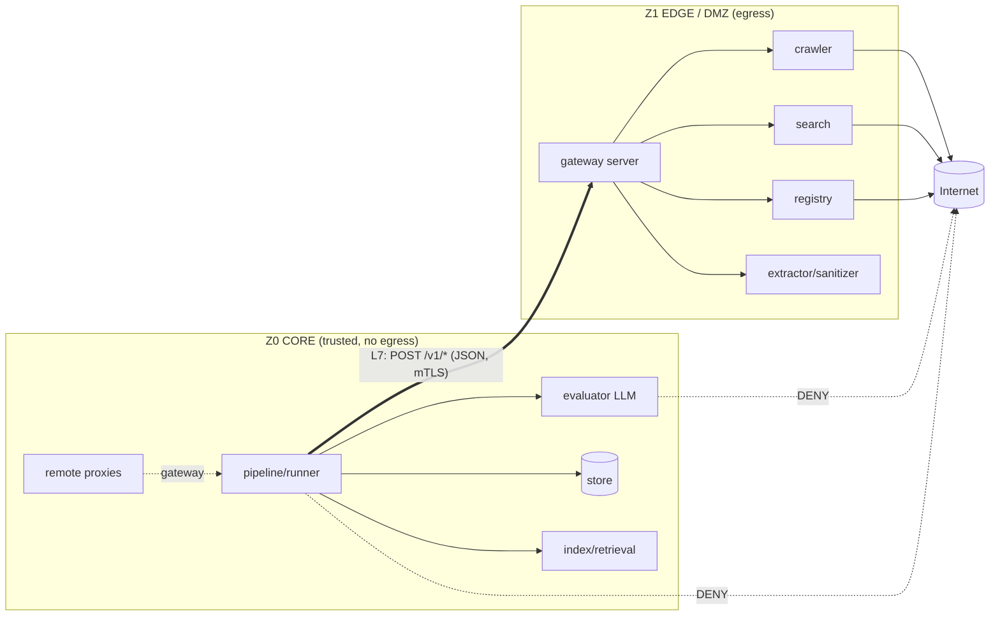

# coHound — архитектура: развёртывание и доверенные зоны (DMZ)

**Документ:** `docs/architecture/07-deployment-topology.md`
**Статус:** принято (проектирование; итерация 7)
**Опирается на:** `00`–`06`; источник истины — `cohound-spec-v2.md` (регламент v2.0).
**Назначение:** определить, как coHound разворачивается так, чтобы **веб-функции** (краул, внешний
поиск, реестровые фетчеры, обработка скачанного контента) были изолированы в **DMZ**, а
**не-веб-функции** (ядро, хранилище, оценщик, расчёт, отчёты) — в доверенной зоне, с
взаимодействием **только через application-layer firewall (L7)** по явному протоколу.

> Этот документ не меняет методологию. Он добавляет **измерение размещения** к уже принятой
> портово-адаптерной архитектуре и показывает, что изоляция зон **усиливает** инварианты I18/I19,
> а не только обслуживает требования ИБ (A2: методология первична).

---

## 1. Требование и принцип

**Требование.** Веб-контур и не-веб контур должны жить в разных сетевых зонах и общаться через
application-layer firewall (L7). Функционал, которому нужен интернет, должен быть вынесен в DMZ.

**Принцип решения (hexagonal уже даёт шов).** Порты/адаптеры (`01`) уже отделяют «что» (домен/
сценарии) от «как» (адаптеры). Всё, что ходит в интернет, — это **адаптеры за портами**. Значит,
изоляция зон — это не переписывание, а:

1. **классификация портов по доверенной зоне** (декларативно);
2. **размещение (locality)**: реальный адаптер может исполняться в другой зоне, а в ядре остаётся
   **remote-proxy** того же порта;
3. **application-layer boundary**: явный версионированный протокол ядро→edge (единственный канал);
4. **профили развёртывания**: дефолт — один процесс (`local`, A1); DMZ — опциональный профиль
   (`split`).

**Ключевое следствие для методологии:**
- **I18 усиливается до сетевого уровня.** Оценщик и его self-host LLM живут в доверенной зоне **без
  маршрута в интернет**. «Без веб-тула» становится не только свойством порта, но и физическим
  запретом маршрутизации.
- **I19 получает явную границу.** Внешний контент входит в ядро только как ответ edge на
  инициированный ядром запрос, и немедленно проходит `corpus_raw → hash → index`.
- **A2 сохраняется.** Методология/инварианты/оценщик — в доверенном ядре; веб — commodity в DMZ.

---

## 2. Зоны и классификация портов

| Зона | Свойства | Что размещается |
|---|---|---|
| **Z0 CORE** (доверенная) | **нет** веб-эгрессии; недоступна для входящих из DMZ; секретов эгрессии нет | `pipeline` (оркестратор, гейты), `domain`, `store`, индексы/ретривал, **evaluator LLM (I18)**, `compute`, `report` |
| **Z1 EDGE / DMZ** (условно-доверенная) | есть веб-эгрессия; **считается компрометируемой**; процесс только отвечает, не инициирует в Z0 | `crawler` (Scrapy+playwright), HTTP-fetch, `search`-адаптер (SERP), `registry`-фетчеры, `extractor`/санитайзер (обработка недоверенного контента), discovery/concept-scout (search-enabled) |
| **Z2 PARSE** (опц., позже) | hardening парсинга недоверенного контента | `extractor`/`sanitizer` отдельным процессом |
| **Z3 LLM-GPU** (опц.) | self-host веса | evaluator-LLM (только Z0-originated трафик), discovery-LLM (search-enabled, Z1) |

**Классификация портов (`Zone`):**

| Порт | Зона | Природа |
|---|---|---|
| `ports/crawler.py` | **edge** | веб-эгрессия |
| `ports/search.py` | **edge** | веб-эгрессия |
| `ports/registry.py` | **edge** | веб-эгрессия |
| `ports/extractor.py` | **edge** (по умолчанию) | обработка недоверенного контента |
| `ports/llm.py` (evaluator) | **core** | self-host, без веба (I18) |
| `ports/{vector_index,lexical_index,index_builder,embedder}.py` | **core** | локальные вычисления |
| `ports/{store,gate_store}.py` | **core** | доверенное хранилище |
| `ports/chunker.py` | **core** | чистая функция над очищенным текстом |
| `ports/gateway.py` (новый) | **core**→edge | транспорт к DMZ-сервису |

> **Почему extractor в edge.** Экстракция парсит **недоверенные байты** из интернета — это основная
> поверхность атаки (парсеры/шрифты/архивы). Размещение её в edge удерживает разбор недоверенного
> ввода вне доверенного ядра. Это осознанный выбор (defense-in-depth), а не «веб-функция» в строгом
> смысле; при желании выносится в отдельную зону Z2.

---

## 3. Application-layer boundary: протокол шва

**Единственный канал core↔edge** — версионированный HTTP/JSON-протокол (L7-inspectable). Ядро
**инициирует**; edge **отвечает**. Обратного инициирования из edge в core нет.

```
POST /v1/fetch    {url, render: "http"|"browser", lang, extract: bool}
   → {request_id, final_url, status_code, content_type, fetched_at,
      raw:  {hash, size, bytes_b64? | ref},                 # сырые байты (retention)
      text: {content, hash, extractor_version} | null,      # очищенный markdown (если extract)
      error: str | null}

POST /v1/search   {query, lang, limit, phase}
   → [{url, title, snippet, rank}]                          # кандидаты, НЕ evidence

POST /v1/registry {registry_id, product_ref, scope}
   → [{fact_json, source_url, fetched_at}]                  # R1: source_url обязателен

GET  /v1/capabilities → {extractor_version, crawler_version, search_engine, supported_formats}
GET  /v1/health       → {status}
```

**Оболочка:** `{schema_version, request_id, status, payload, error}`. `schema_version` — часть
контракта; несовместимое изменение → bump версии (версионная граница §13).

**Контрактные гарантии шва (усиление инвариантов):**
- edge возвращает **сырой контент/кандидатов**, а не «evidence» (I19) — превращение в evidence
  происходит только в ядре (chunk+hash+index).
- ядро **проверяет всё входящее** (см. §5): схема, размерные лимиты, **повторный `content_hash`**,
  санитайзинг. Edge не доверяется.
- `source_url` из реестровых/поисковых ответов резолвится в ядре (I10/I15).
- каждый вызов логируется вызывающим ядром в `search_log`/логах фаз (I23); edge ведёт свой аудит.

---

## 4. Порты и адаптеры: измерение локальности

Один и тот же `Protocol` реализуется **дважды** — для двух зон:

| Порт | Адаптер в edge (реальный) | Адаптер в core (remote-proxy) |
|---|---|---|
| `CrawlerPort` | `crawl_scrapy.py` (Scrapy+playwright) | `RemoteCrawler(gateway)` |
| `SearchAdapterPort` | `search_yandex.py` / `search_glm.py` | `RemoteSearch(gateway)` |
| `RegistryFetcherPort` | `registry_generic.py` | `RemoteRegistry(gateway)` |
| `ExtractorPort` | `extract_html.py` / `extract_document.py` | `RemoteExtractor(gateway)` |

**`ContentGateway`** (`ports/gateway.py`) — общий транспортный порт remote-прокси:
```python
class ContentGateway(Protocol):
    def call(self, op: str, payload: Mapping) -> Mapping: ...   # HTTP/JSON к edge
```
`core/adapters/remote_gateway.py` реализует `ContentGateway` поверх `httpx` (mTLS, таймауты,
retry/backoff, клиентская валидация ответа).

**Выбор реализации — wiring'ом** (`cli/` и `edge/` — два composition root):
- профиль `local`: ядро инстанцирует **реальные** адаптеры in-process (dev/один хост, A1);
- профиль `split`: ядро инстанцирует **remote-proxy**; отдельный процесс **`edge/`** инстанцирует
  реальные адаптеры и публикует их через gateway-сервер.

`edge/` — второй composition root, допустимо зависит от `ports`+`adapters` (как `cli/`, см. 01 §1).
Он **не содержит** доменной логики и не пишет в `store` — только исполняет контентные операции.

**Ответственность за обработку (кто что делает):**
```
core:  план → запрос к edge → приём сырья → corpus_raw (retention) → re-hash/валидация
       → chunk → embed → index → evaluate (LLM, без веба) → compute → report
edge:  fetch → extract → sanitize → вернуть (text, hashes, raw)   [без доступа к store/domain]
```

---

## 5. Модель угроз и принуждение (L7 firewall)

**Допущение:** edge **считается компрометируемой** (обрабатывает недоверенный контент, имеет
эгрессию). Ядро не доверяет edge и валидирует всё входящее.

**Политика потоков:**

| Поток | Направление | Политика L7 |
|---|---|---|
| core → edge | к DMZ app-порту (напр. 8443) | **ALLOW**: allowlist методов/путей (`/v1/fetch`, `/v1/search`, `/v1/registry`, `/v1/health`, `/v1/capabilities`), JSON-schema-валидация, лимиты размера |
| edge → internet | 80/443 | **ALLOW** (опц. allowlist доменов; robots-enforcement; rate-limit) |
| **core → internet** | любой | **DENY** (нет маршрута) — усиливает I18 |
| **edge → core** | инициирование | **DENY** (edge только отвечает; не может дозвониться до сервисов ядра) |
| core → self-host LLM | внутренняя сеть | **ALLOW** |
| **LLM → internet** | любой | **DENY** (оценщик без веба, I18) |
| edge → discovery-LLM (search-enabled) | внутренняя сеть | **ALLOW** (только discovery/concept-scout) |

**Принуждение инвариантов сетевым слоем:**
- **I18:** evaluator и его LLM — в Z0 **без default-route в интернет**; даже при попытке тул не
  получит сети. Порт без `tools` (01 §3.1) + отсутствие маршрута = двойное принуждение.
- **I19:** пересечение границы core↔edge — только ответы edge; они не становятся evidence, пока не
  пройдут `corpus_raw → hash → index` в ядре.
- **I23:** поисковый бюджет и вызовы фиксируются ядром (инициатор) в `search_log`; edge пишет
  собственный аудит для форензики.

**Секреты:** эгрессионные секреты (ключи SERP, прокси, egress-creds) хранятся **только в edge**.
Ядро секретов эгрессии не имеет (компрометация ядра не даёт выхода в интернет). Ключи self-host LLM —
только в Z0/Z3.

**Валидация входящего из edge (обязательно):** схема ответа; лимиты размера/глубины; **повторный
`content_hash`** (не верить хэшу edge); санитайзинг (nh3/defusedxml); никакого автозапуска
(контент — только данные). См. `04` §A и §10 регламента.

---

## 6. Профили развёртывания

| Профиль | Топология | Когда |
|---|---|---|
| **`local`** (дефолт) | один процесс/хост; все адаптеры in-process | разработка, MVP, малый объём; **A1** — не тянем DMZ без нужды |
| **`split`** | 2 зоны: Z0 CORE + Z1 EDGE (DMZ), L7 между ними | продуктив: требование ИБ/изоляции веб-контура |
| **`split-hardened`** (позже) | + Z2 PARSE, + egress-прокси, + mTLS/аудит | повышенные требования ИБ |

Профиль — **конфигурация подстановки адаптеров**, а не ветка в коде. Конвейер (`pipeline`) не
знает о зонах: он получает порты, как и раньше (00 §8.1). Это сохраняет A1: `local` не платит за DMZ.



---

## 7. Конфигурация

`config/deploy.yaml` (не в `run.yaml` — развёртывание отделено от методологического прогона):

```yaml
profile: split                      # local | split | split-hardened
edge:
  base_url: "https://edge.internal:8443"
  tls: { ca: certs/ca.pem, client_cert: certs/core.pem, client_key: secrets/core.key }
  timeout_s: 30
  max_retries: 2
  max_response_bytes: 52428800      # лимит ответа (защита ядра от edge)
registry_fetchers: edge             # список портов, исполняемых в edge (для split)
extractor_zone: edge                # edge | core | separate
search:
  budget: { ru: 5, en: 5 }          # симметрия I16
  adapter: yandex
```

Профиль `local` игнорирует `edge.*` (всё in-process). `deploy.yaml` версионируется отдельно от
`run_manifest.yaml`; связка — в манифест пишется `deploy_profile` (+ версии edge-компонентов из
`/v1/capabilities`) для воспроизводимости R7.

---

## 8. Отклонённые альтернативы

| Альтернатива | Почему отклонена |
|---|---|
| Два полных инстанса coHound (по одному на зону) | дублируют оркестратор/store/домен; ломают единую БД/provenance (S6) |
| Очередь сообщений (Kafka/RabbitMQ) вместо HTTP | усложняет L7-инспекцию и эксплуатацию; избыточно для MVP (A1) — опционально позже |
| gRPC | L7-фаерволу нужна gRPC-осведомлённость; JSON/HTTP универсально инспектируем; отклонено для MVP |
| Только in-process (код-уровневый I18) | не выполняет требование DMZ; слабее, чем сетевой запрет I18 |
| Общий доступ к БД/ФС между зонами | стирает границу; любое пересечение — только через протокол |

---

## 9. Влияние на существующие артефакты

| Артефакт | Изменение |
|---|---|
| `00` контекст/слои | добавляется измерение **зон**; `edge/` — второй composition root |
| `01` порты/матрица | колонка `Zone`; новый порт `gateway.py`; строка `edge` в матрице зависимостей; remote-адаптеры |
| `02` подсистемы | Ш5 (corpus) и SERP-петля идут через шов при `split` |
| `03` данные/CLI | `config/deploy.yaml`; каталог `edge/`; CLI-команда диагностики шва |
| `04` надёжность | ADR 0018; сетевой слой в модели угроз; CI-контракт шва |
| `05` стек | `httpx`/mTLS для шва; edge-окружение (тот же `crawl`+`extract`) |
| `06` план | поток **W13 (DMZ/шов)** и задачи; ADR 0018 |
| регламент §10 | ссылка: изоляция веб-контура сетевым слоем (доп. эшелон) |

---

## 10. Traceability

| Требование/инвариант | Где обеспечено |
|---|---|
| Веб vs не-веб в разных зонах | §2 (классификация), §6 (профиль `split`) |
| Взаимодействие через L7 | §3 (протокол), §5 (политика) |
| I18 (оценщик без веба) | §2, §5 — сетевой запрет + порт без `tools` |
| I19 (контент через корпус) | §3, §5 — граница = corpus ingest |
| I23 (логирование поиска) | §5 — ядро-инициатор пишет `search_log` |
| §10 (контур/защита) | §5 — эшелон + сетевой слой |
| R7 (воспроизводимость) | §7 — `deploy_profile`/версии edge в манифест |
| A1 (минимальные средства) | §6 — `local` дефолт, DMZ опционален |
| A2 (методология = moat) | §1 — ядро/инварианты/оценщик в Z0 |
