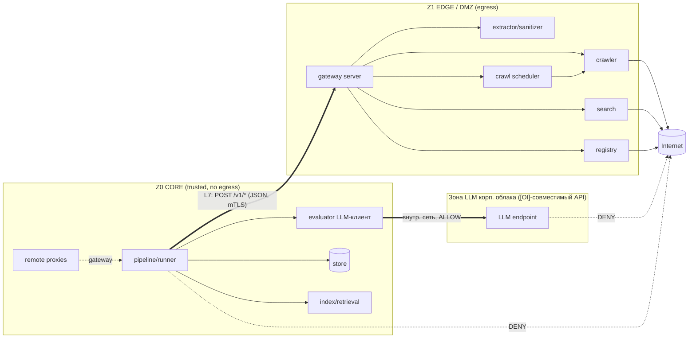

# coHound — архитектура: развёртывание и доверенные зоны (DMZ)

**Документ:** `docs/architecture/07-deployment-topology.md`
**Статус:** принято (проектирование; итерация 7)
**Опирается на:** `00`–`06`; источник истины — `cohound-spec-v2.md` (регламент v2.1).
**Назначение:** определить, как coHound разворачивается так, чтобы **веб-функции** (краул, внешний
поиск, реестровые фетчеры, обработка скачанного контента) были изолированы в **DMZ**, а
**не-веб-функции** (ядро, хранилище, оценщик, расчёт, отчёты) — в доверенной зоне, с
взаимодействием **только через application-layer firewall (L7)** по явному протоколу.

**Область.** Профиль `split` (DMZ) — **опция уже в MVP** (решение владельца, 2026-10-08): он входит
в M1 (`06` §4, поток W13). Профиль `local` (один процесс) остаётся дефолтом для разработки (A1).
Дополнительно проектируются **контракты, прозрачные для корпоративных IDP/DLP/IDS** (§8); аттестация
против конкретных средств — вне рамок этой работы.

> Этот документ не меняет методологию. Он добавляет **измерение размещения** к уже принятой
> портово-адаптерной архитектуре и показывает, что изоляция зон **усиливает** инварианты I18/I19,
> а не только обслуживает требования ИБ (A2: методология первична).

---

## 1. Требование и принцип

**Требование.** Веб-контур и не-веб контур должны жить в разных сетевых зонах и общаться через
application-layer firewall (L7). Функционал, которому нужен интернет, должен быть вынесен в DMZ.

**Принцип решения (hexagonal уже даёт шов).** Порты/адаптеры (`01`) уже отделяют «что» (домен/
сценарии) от «как» (адаптеры). Всё, что ходит в интернет, — это **адаптеры за портами**. Значит,
изоляция зон — это не переписывание, а:

1. **классификация портов по доверенной зоне** (декларативно);
2. **размещение (locality)**: реальный адаптер может исполняться в другой зоне, а в ядре остаётся
   **remote-proxy** того же порта;
3. **application-layer boundary**: явный версионированный протокол ядро→edge (единственный канал);
4. **профили развёртывания**: дефолт — один процесс (`local`, A1); DMZ — опциональный профиль
   (`split`).

**Ключевое следствие для методологии:**
- **I18 усиливается до сетевого уровня.** Оценщик обращается к LLM корпоративного облака
  ([OI]-совместимый API, внутренняя сеть) и живёт в доверенной зоне **без маршрута в интернет**.
  «Без веб-тула» становится не только свойством порта, но и физическим запретом маршрутизации.
- **I19 получает явную границу.** Внешний контент входит в ядро только как ответ edge на
  инициированный ядром запрос, и немедленно проходит `corpus_raw → hash → index`.
- **A2 сохраняется.** Методология/инварианты/оценщик — в доверенном ядре; веб — commodity в DMZ.

---

## 2. Зоны и классификация портов

| Зона | Свойства | Что размещается |
|---|---|---|
| **Z0 CORE** (доверенная) | **нет** веб-эгрессии; недоступна для входящих из DMZ; секретов эгрессии нет | `pipeline` (оркестратор, гейты), `domain`, `store`, индексы/ретривал, **клиент evaluator-LLM (I18)**, `compute`, `report` |
| **Z1 EDGE / DMZ** (условно-доверенная) | есть веб-эгрессия; **считается компрометируемой**; процесс только отвечает, не инициирует в Z0 | `crawler` (Scrapy+playwright · **прямой Playwright/CDP** — honest/hybrid, альтернатива Scrapy), HTTP-fetch, `search`-адаптер (SERP), `registry`-фетчеры, `extractor`/санитайзер (обработка недоверенного контента), discovery/concept-scout (search-enabled) |
| **Z2 PARSE** (опц., позже) | hardening парсинга недоверенного контента | `extractor`/`sanitizer` отдельным процессом |
| **Зона LLM корп. облака** (внешняя, внутр. сеть) | [OI]-совместимый API; веса/движок — забота облака | evaluator-LLM (только Z0-originated трафик), discovery-LLM (search-enabled, Z1) |

**Классификация портов (`Zone`):**

| Порт | Зона | Природа |
|---|---|---|
| `ports/crawler.py` | **edge** | веб-эгрессия |
| `ports/search.py` | **edge** | веб-эгрессия |
| `ports/registry.py` | **edge** | веб-эгрессия |
| `ports/extractor.py` | **edge** (по умолчанию) | обработка недоверенного контента |
| `ports/llm.py` (evaluator) | **core** | клиент корп. облака ([OI]-API), без веба (I18) |
| `ports/{vector_index,lexical_index,index_builder,embedder}.py` | **core** | локальные вычисления |
| `ports/{store,gate_store}.py` | **core** | доверенное хранилище |
| `ports/chunker.py` | **core** | чистая функция над очищенным текстом |
| `ports/gateway.py` (новый) | **core**→edge | транспорт к DMZ-сервису |

> **Почему extractor в edge.** Экстракция парсит **недоверенные байты** из интернета — это основная
> поверхность атаки (парсеры/шрифты/архивы). Размещение её в edge удерживает разбор недоверенного
> ввода вне доверенного ядра. Это осознанный выбор (defense-in-depth), а не «веб-функция» в строгом
> смысле; при желании выносится в отдельную зону Z2.

---

## 3. Application-layer boundary: протокол шва

**Единственный канал core↔edge** — версионированный HTTP/JSON-протокол (L7-inspectable). Ядро
**инициирует**; edge **отвечает**. Обратного инициирования из edge в core нет.

```
POST /v1/fetch    {url, fetch: "http"|"browser", strategy: "auto"|"honest"|"hybrid", lang, extract: "auto"|"html"|"document", wait_for: str|null}
   → {request_id, final_url, status_code, content_type, fetched_at,
      raw:  {hash, size, bytes_b64? | ref},                 # сырые байты (retention)
      text: {content, hash, extractor_version} | null,      # очищенный markdown (результат extract-оси)
      error: str | null}

POST /v1/search   {query, lang, limit, phase}
   → [{url, title, snippet, rank}]                          # кандидаты, НЕ evidence

POST /v1/registry {registry_id, product_ref, scope}
   → [{fact_json, source_url, fetched_at}]                  # R1: source_url обязателен

POST /v1/crawl/submit  {run_id, session_id, idempotency_key, profile, items:[{product_id, url, engine?, kind?, fetch?, extract?, strategy?, wait_for?, lang?}]}
   → {job_id, accepted, total, session_id}                  # постановка задания очереди краула
POST /v1/crawl/status  {job_id}
   → {job_id, status, total, pending, running, fetched, failed, cancelled, engines, kinds}
POST /v1/crawl/cancel  {job_id}
   → {job_id, status: "cancelled", cancelled}
POST /v1/crawl/collect {job_id, cursor?, limit?}
   → {items: [{product_id, url, status, engine, kind, http_status, content_type, fetched_at, content_hash, raw?, error}], next_cursor, done}

GET  /v1/capabilities → {extractor_version, crawler_version, search_engine, supported_formats}
GET  /v1/health       → {status}
```

**Аддитивное расширение `/v1/fetch` (совместимо).** Поле `strategy` (`auto`|`honest`|`hybrid`) добавлено
**аддитивно**: старые клиенты его опускают — edge трактует отсутствие как `auto`. Поле ортогонально
оси `fetch` (при `fetch: "http"` нормализуется в `auto`; `strategy != auto` ⇒ `fetch: "browser"`),
поэтому не ломает существующих клиентов и не требует bump `schema_version`.

**Очередь краула `crawl/*` (аддитивно, Phase 3.1–3.4).** Четыре POST-операции переносят
долгоиграющий краул корпуса за шов: `submit` ставит задание (идемпотентно по
`(run_id, session_id, idempotency_key)`), `status` сообщает счётчики, `cancel` снимает
незавершённые элементы, `collect` постранично отдаёт результаты (сырые байты/хэши — контент,
**не** evidence, I19; ядро пересчитывает `content_hash`). `collect` идемпотентен: непрозрачный
`cursor` (стабильный порядок `(product_id, url)`), `done` — все элементы терминальны. Транспорт —
тот же L7-JSON; авторизация — scope `crawl` (см. §8.2). Расширение **аддитивно** и не меняет
`schema_version` (остаётся `"1"`).

**Оболочка:** `{schema_version, request_id, status, payload, error}`. `schema_version` — часть
контракта; несовместимое изменение → bump версии (версионная граница §13).

**Контрактные гарантии шва (усиление инвариантов):**
- edge возвращает **сырой контент/кандидатов**, а не «evidence» (I19) — превращение в evidence
  происходит только в ядре (chunk+hash+index).
- ядро **проверяет всё входящее** (см. §5): схема, размерные лимиты, **повторный `content_hash`**,
  санитайзинг. Edge не доверяется.
- `source_url` из реестровых/поисковых ответов резолвится в ядре (I10/I15).
- каждый вызов логируется вызывающим ядром в `search_log`/логах фаз (I23); edge ведёт свой аудит.

---

## 4. Порты и адаптеры: измерение локальности

Один и тот же `Protocol` реализуется **дважды** — для двух зон:

| Порт | Адаптер в edge (реальный) | Адаптер в core (remote-proxy) |
|---|---|---|
| `CrawlerPort` | `crawl_scrapy.py` (Scrapy+playwright) · `crawl_browser.py` (`BrowserCrawler`, прямой Playwright/CDP, honest/hybrid) | `RemoteCrawler(gateway)` |
| `SearchAdapterPort` | `search_yandex.py` / `search_glm.py` | `RemoteSearch(gateway)` |
| `RegistryFetcherPort` | `registry_generic.py` | `RemoteRegistry(gateway)` |
| `ExtractorPort` | `extract_html.py` / `extract_document.py` | `RemoteExtractor(gateway)` |

**`ContentGateway`** (`ports/gateway.py`) — общий транспортный порт remote-прокси:
```python
class ContentGateway(Protocol):
    def call(self, op: str, payload: Mapping) -> Mapping: ...   # HTTP/JSON к edge
```
`core/adapters/remote_gateway.py` реализует `ContentGateway` поверх `httpx` (mTLS, таймауты,
retry/backoff, клиентская валидация ответа).

**Выбор реализации — wiring'ом** (`cli/` и `edge/` — два composition root):
- профиль `local`: ядро инстанцирует **реальные** адаптеры in-process (dev/один хост, A1);
- профиль `split`: ядро инстанцирует **remote-proxy**; отдельный процесс **`edge/`** инстанцирует
  реальные адаптеры и публикует их через gateway-сервер.

`edge/` — второй composition root, допустимо зависит от `ports`+`adapters` (как `cli/`, см. 01 §1).
Он **не содержит** доменной логики и не пишет в `store` — только исполняет контентные операции.

**Ответственность за обработку (кто что делает):**
```
core:  план → запрос к edge → приём сырья → corpus_raw (retention) → re-hash/валидация
       → chunk → embed → index → evaluate (LLM, без веба) → compute → report
edge:  fetch → extract → sanitize → вернуть (text, hashes, raw)   [без доступа к store/domain]
```

**Launcher edge-узла.** Второй composition root запускается как
`python -m core.edge serve [--config FILE] [--host H] [--port P] [--check]`. Конфигурация узла —
собственная (`config/edge.yaml` → `EdgeRuntimeConfig`; env `COHOUND_EDGE_STATE_DIR` переопределяет
`state_dir`): каталог состояния, адрес/порт прослушивания, карта `workers` (число слотов на движок),
`queue_limit`, `ttl_s`. Флаг `--check` собирает конфиг+адаптеры+gateway+планировщик и выходит без
привязки сокета и без старта воркеров (smoke: misconfig всплывает до запуска); ошибка конфигурации
→ код возврата `2`. Launcher остаётся в edge-слое: не импортирует `cli`/`store`/`pipeline`.

**Edge-локальный планировщик краула (`core/edge/scheduler.py`).** Исполняет операции `crawl/*`:
собственная SQLite-БД (`{state_dir}/edge_jobs.db`, WAL) хранит задания/элементы и счётчики;
content-addressed блоб-хранилище (`{resolved_blob_dir}/{job_id}/{hash}.bin`) хранит сырые байты
(retention, I19). Модель исполнения по движкам: `http` — **потоки** in-process; `scrapy`/`browser`
— **процессы** (`ProcessPoolExecutor`) через module-level `crawler_factory` (адаптеры не picklable,
Playwright не форк-безопасен — краулер строится внутри воркера, а запись блобов/БД делает родитель).
Back-pressure по `queue_limit`; `submit` идемпотентен по `(run_id, session_id, idempotency_key)`;
recovery-on-start возвращает застрявшие `running`-элементы в `pending` (зеркало
`store.recover_crawl_session`). SSRF-валидация каждого URL — на постановке (`util.security.validate_url`).
Диагностика числа воркеров не стартует: планировщик строится лениво.

---

## 5. Модель угроз и принуждение (L7 firewall)

**Допущение:** edge **считается компрометируемой** (обрабатывает недоверенный контент, имеет
эгрессию). Ядро не доверяет edge и валидирует всё входящее.

**Политика потоков:**

| Поток | Направление | Политика L7 |
|---|---|---|
| core → edge | к DMZ app-порту (напр. 8443) | **ALLOW**: allowlist методов/путей (`/v1/fetch`, `/v1/search`, `/v1/registry`, `/v1/crawl/submit`, `/v1/crawl/status`, `/v1/crawl/cancel`, `/v1/crawl/collect`, `/v1/health`, `/v1/capabilities`), JSON-schema-валидация, лимиты размера |
| edge → internet | 80/443 | **ALLOW** (опц. allowlist доменов; robots-enforcement; rate-limit) |
| **core → internet** | любой | **DENY** (нет маршрута) — усиливает I18 |
| **edge → core** | инициирование | **DENY** (edge только отвечает; не может дозвониться до сервисов ядра) |
| core → корпоративный LLM-endpoint ([OI]-совместимый API) | внутренняя сеть | **ALLOW** |
| **LLM-endpoint → internet** | любой | **DENY** (оценщик без веба, I18) |
| edge → discovery-LLM (search-enabled) | внутренняя сеть | **ALLOW** (только discovery/concept-scout) |

⚠️ **IP-репутация egress (deployment-условие anti-bot-класса).** Для сайтов с активной антибот-защитой
тип egress-адреса доминирует над техникой рендера: **datacenter-egress получает `401`/`429` даже при
реальном браузерном рендере**. Поэтому для anti-bot-класса требуется **доверенный/residential egress**
(прокси-исходящий контура edge) — это **условие развёртывания**, а не свойство honest/hybrid:
honest/hybrid исполняет штатный JS-challenge публичной страницы (§10), но при «загрязнённой» репутации
IP штатный механизм не проходит. Egress-креды (в т.ч. прокси) живут **только в edge** (см. «Секреты»).

**Установка браузера для `BrowserCrawler` (прямой Playwright, honest/hybrid).** Honest-режим требует
**полноценный браузерный бинарь** (headless-shell недостаточен для headed/honest-рендера): в
edge-окружении выполняется `playwright install chromium` (полный Chromium / Chrome for Testing).
В закрытом контуре браузеры тянутся через зеркало CDN — `PLAYWRIGHT_DOWNLOAD_HOST` (источник
загрузки) и `PLAYWRIGHT_BROWSERS_PATH` (каталог установки/изоляция контура); синхронно с реестром
`05` §2.5. Для anti-bot-класса honest/hybrid недостаточно без доверенного egress — действует
условие IP-репутации (абзац выше).

**Принуждение инвариантов сетевым слоем:**
- **I18:** evaluator и его LLM — в Z0 **без default-route в интернет**; даже при попытке тул не
  получит сети. Порт без `tools` (01 §3.1) + отсутствие маршрута = двойное принуждение.
- **I19:** пересечение границы core↔edge — только ответы edge; они не становятся evidence, пока не
  пройдут `corpus_raw → hash → index` в ядре.
- **I23:** поисковый бюджет и вызовы фиксируются ядром (инициатор) в `search_log`; edge пишет
  собственный аудит для форензики.

**Секреты:** эгрессионные секреты (ключи SERP, прокси, egress-creds) хранятся **только в edge**.
Ядро секретов эгрессии не имеет (компрометация ядра не даёт выхода в интернет). Ключи доступа к
LLM-endpoint корп. облака — только в Z0.

**Валидация входящего из edge (обязательно):** схема ответа; лимиты размера/глубины; **повторный
`content_hash`** (не верить хэшу edge); санитайзинг (nh3/defusedxml); никакого автозапуска
(контент — только данные). См. `04` §A и §10 регламента.

---

## 6. Профили развёртывания

| Профиль | Топология | Когда |
|---|---|---|
| **`local`** (дефолт) | один процесс/хост; все адаптеры in-process | разработка, малый объём; **A1** — не тянем DMZ без нужды |
| **`split`** (опция MVP) | 2 зоны: Z0 CORE + Z1 EDGE (DMZ), L7 между ними | ИБ/изоляция веб-контура; **доступен уже в M1 (W13)** |
| **`split-hardened`** (позже) | + Z2 PARSE, + egress-прокси, + TLS-инспекция/аудит-интеграция | повышенные требования ИБ |

Профиль — **конфигурация подстановки адаптеров**, а не ветка в коде. Конвейер (`pipeline`) не
знает о зонах: он получает порты, как и раньше (00 §8.1). Это сохраняет A1: `local` не платит за DMZ.

**Отображение профиля на транспорт краула.** `local` исполняет краул **in-process** (реальные
адаптеры прямо в ядре). `split`/`split-hardened` маршрутизируют краул через шов: ядро подаёт работы
исполнителю, edge-планировщик их исполняет, ядро забирает результаты операцией `crawl/collect`
(retention/re-hash/нарезка остаются в ядре — I19). Контракт портов при этом не меняется — меняется
подстановка адаптера (remote-прокси поверх `ContentGateway`).

**«Инсталляция» — deployment-политика, а не методологический вопрос.** Под «инсталляцией» проекта
понимается способ размещения контура, влияющий на §10 (применимость), 152-ФЗ и ops-бюджет, а не на
семантику измерений:
- **свой кластер** — развёртывание **нашего** конвейера, корпуса и индексов в собственном контуре
  (максимальный контроль R7/I18); LLM при этом всегда потребляется через [OI]-совместимый API
  корпоративного облака, а не хостится нами;
- **аренда РФ-облака** — хранение/вычисление конвейера и индексов в юрисдикции РФ (компромисс
  контроля/стоимости);
- **вендорский контур** — исполнение на стороне вендора/интегратора (минимальный контроль, требует
  юридического и ИБ-согласования).

Выбор — **решение развёртывания** (фиксируется вне регламента методологии, напр. в ops-журнале
решений / `deploy.yaml` к профилю), а не открытый вопрос к детальному проектированию. Профиль
`split-hardened` (Z2 PARSE, egress-прокси) — естественная ступень для вариантов с внешним контуром.



---

## 7. Конфигурация

`config/deploy.yaml` (не в `run.yaml` — развёртывание отделено от методологического прогона):

```yaml
profile: split                      # local | split | split-hardened
edge:
  base_url: "https://edge.internal:8443"
  tls:
    ca: certs/ca.pem                # корпоративный CA (в т.ч. TLS-инспекция; БЕЗ pinning, §8.1)
    client_cert: certs/core.pem     # workload-identity ядра
    client_key: secrets/core.key
  auth: mtls                        # mtls | oidc
  oidc: { issuer: "https://idp.corp/realms/…", audience: "cohound-edge" }   # если auth: oidc
  timeout_s: 30
  max_retries: 2
  max_response_bytes: 52428800      # лимит ответа (защита ядра от edge)
  audit: { sink: "file|syslog", target: "…" }   # экспорт аудита в SIEM (§8.4)
registry_fetchers: edge             # список портов, исполняемых в edge (для split)
extractor_zone: edge                # edge | core | separate
llm:                                # модели корпоративного облака ([OI]-совместимый API)
  slot: cheap                       # активный слот по умолчанию (cheap | flagship)
  cheap:    {model_id: "deepseek-v4.1-flash:cxbc"}   # дефолт обоих слотов
  flagship: {model_id: "deepseek-v4.1-flash:cxbc"}
  # выбор слота: --llm-slot > env COHOUND_LLM_SLOT > run.yaml: llm_slot > deploy.llm.slot > cheap
  # api_key: env COHOUND_LLM_API_KEY; endpoint — [OI]-совместимый API внутри корп. периметра
search:
  budget: { ru: 5, en: 5 }          # симметрия I16
  adapter: yandex                   # провайдер поиска по умолчанию (Yandex Search API)
  # режим async (дефолт) | sync — env YANDEX_SEARCH_MODE (03 §D.6)
```

Профиль `local` игнорирует `edge.*` (всё in-process). Секция `llm:` задаёт два слотовых идентификатора
модели корпоративного облака (`cheap`/`flagship`); активный слот резолвится детерминированно
(CLI > env `COHOUND_LLM_SLOT` > `run.yaml` > `deploy.llm.slot` > `cheap`, см. `03` §D.6).
`deploy.yaml` версионируется отдельно от
`run_manifest.yaml`; связка — в манифест пишется `deploy_profile`, версии edge-компонентов
(`/v1/capabilities`) и `edge_schema_version` для воспроизводимости R7.

Runtime-конфигурация **edge-узла** отделена от `deploy.yaml` ядра: `config/edge.yaml`
(`EdgeRuntimeConfig`) задаёт `state_dir`/`blob_dir`, `host`/`port`, карту `workers`
(`{http, scrapy, browser} → слоты`), `queue_limit`, `ttl_s`. Env `COHOUND_EDGE_STATE_DIR`
переопределяет `state_dir`. Файл читает launcher `python -m core.edge serve --config …`
(§4); отсутствие файла → безопасные дефолты.

---

## 8. Прозрачность контрактов для корпоративных IDP / DLP / IDS

**Требование.** Контракты между частями coHound (ядро ↔ edge, а также форма публикуемых спецификаций)
должны быть **прозрачны** для корпоративных средств безопасности: **IDP** (идентификация/
авторизация), **DLP** (контроль утечек — инспекция содержимого), **IDS** (обнаружение вторжений —
сетевой/L7-мониторинг). Шов — это **единственная** точка пересечения зон (core→internet DENY,
edge→core DENY, §5), поэтому одна точка инспекции покрывает всю веб/не-веб границу.

> **Границы работы.** Здесь фиксируются **design-требования**, делающие coHound пригодным для
> корпоративных IDP/DLP/IDS. **Аттестация против конкретных средств** (какой IDP, какой DLP, набор
> IDS-правил, сертификация) — **вне рамок** этой проектной работы; владелец — заказчик/ИБ.

### 8.1. Инспектируемость (DLP, IDS)

| Требование | Как обеспечено |
|---|---|
| Только L7 HTTP + JSON | никаких protobuf/gRPC, кастомного бинарного фрейминга или payload-сжатия, скрывающего содержимое |
| Явные поля контента | конверт несёт `raw.bytes_b64` (сырые байты), `text.content` (очищенный markdown), `classification`; DLP декодирует base64 |
| TLS-инспекция не блокируется | **никакого certificate pinning**; доверие к корпоративному CA (в т.ч. TLS break-and-inspect) настраивается через `deploy.yaml.tls.ca` |
| Inline-инспекция | шов может завершаться на корпоративном TLS-инспектирующем прокси/LB — coHound это поддерживает |
| Единая точка | весь cross-zone трафик — только через шов (§5), обходных каналов нет |
| Метаданные для IDS | `request_id`, `op`, identity, размеры, `schema_version` — видны на L7 и в аудите |

### 8.2. Идентичность и авторизация (IDP)

| Требование | Как обеспечено |
|---|---|
| Атрибуция запроса | mTLS **workload-identity** (клиентский сертификат от корп. PKI/IDP) **или** OIDC/JWT bearer (issuer = корп. IDP, claims: сервисный субъект, scopes) |
| Авторизация по операции | allowlist `identity → {fetch, search, registry, crawl}`; иные операции — deny |
| Корреляция | `request_id` в каждом запросе/ответе; сквозной в аудит-логе ядра и edge |
| Ротация/отзыв | средствами IDP; coHound не держит «долгоживущих» аутентификационных секретов (эгрессионные креды — в edge, за IDP) |

### 8.3. Публикуемые контракты (прозрачность)

- **OpenAPI + JSON-Schema** для всех `/v1/*` эндпоинтов, с явным `schema_version`; публикуются в
  репозиторий (`docs/contracts/` и/или `edge/openapi.yaml`).
- IDP/DLP/IDS-политики пишутся **по опубликованным схемам**; используемая версия фиксируется в
  `run_manifest.yaml` (`edge_schema_version`) для воспроизводимости R7.
- Любое **несовместимое** изменение контракта — **версионная граница** (bump `schema_version`), как
  в §13 регламента. **Аддитивные** расширения (новые операции/поля) совместимы и версию не меняют:
  так введены ось `strategy` в `/v1/fetch` и операции `crawl/*` — `schema_version` остаётся `"1"`.

### 8.4. Аудит и SIEM

- Структурные JSON-логи шва (ядро и edge): `ts`, `request_id`, `identity`, `op`, `direction`,
  `sizes`, `decision` (allow/deny/error), `content_hash`, `schema_version`.
- Поток логов пригоден для экспорта в SIEM (файл/syslog/агент — механизм на стороне заказчика);
  логи фаз ядра (`04` §B) используют тот же формат и коррелируются по `request_id`.

### 8.5. Классификация данных и целостность

- Конверт несёт `classification` (`untrusted-public` | `internal`), чтобы DLP-политики различали
  веб-контент и внутренние данные; инспекции подлежат и **исходящие** поисковые запросы (могут
  содержать чувствительные термины).
- **Инспекция ≠ мутация.** DLP/IDS могут читать/блокировать, но не изменять содержимое. Любое
  изменение поймает **ре-hash** в ядре (§5, I19): ядро пересчитывает `content_hash` входящего и
  отвергает несоответствие. Блокировка инспектором → ошибка шва → `source_unavailable`
  (не роняет прогон, `04` §A.1b).

---

## 9. Отклонённые альтернативы

| Альтернатива | Почему отклонена |
|---|---|
| Два полных инстанса coHound (по одному на зону) | дублируют оркестратор/store/домен; ломают единую БД/provenance (S6) |
| Очередь сообщений (Kafka/RabbitMQ) вместо HTTP | усложняет L7-инспекцию и эксплуатацию; избыточно для MVP (A1) — опционально позже |
| gRPC | L7-фаерволу/IDS/DLP нужна видимость; gRPC-фрейминг хуже инспектируется; JSON/HTTP универсально прозрачен — **отклонено, в т.ч. по требованию IDP/DLP/IDS** |
| Только in-process (код-уровневый I18) | не выполняет требование DMZ; слабее, чем сетевой запрет I18 |
| Общий доступ к БД/ФС между зонами | стирает границу; любое пересечение — только через протокол |
| Certificate pinning на шве | блокирует корпоративную TLS-инспекцию (DLP/IDS) — противоречит §8.1 |
| Шифрование/сжатие payload end-to-end | скрывает содержимое от DLP — противоречит §8.1 |

---

## 10. Влияние на существующие артефакты

| Артефакт | Изменение |
|---|---|
| `00` контекст/слои | добавляется измерение **зон**; `edge/` — второй composition root |
| `01` порты/матрица | колонка `Zone`; новый порт `gateway.py`; строка `edge` в матрице зависимостей; remote-адаптеры |
| `02` подсистемы | Ш5 (corpus) и SERP-петля идут через шов при `split` |
| `03` данные/CLI | `config/deploy.yaml` (в т.ч. identity/TLS/audit); каталог `edge/`; CLI-команда диагностики шва |
| `04` надёжность | ADR 0018/0019; сетевой слой в модели угроз; CI-контракт шва |
| `05` стек | `httpx`/TLS для шва; OIDC/JWT и JSON-Schema (опц.); edge-окружение (тот же `crawl`+`extract`) |
| `06` план | поток **W13 (DMZ/шов)** — входит в MVP; задачи прозрачности (T13.7–T13.9) |
| регламент §10 | ссылка: изоляция веб-контура сетевым слоем (доп. эшелон) |

---

## 11. Traceability

| Требование/инвариант | Где обеспечено |
|---|---|
| Веб vs не-веб в разных зонах | §2 (классификация), §6 (профиль `split`) |
| Взаимодействие через L7 | §3 (протокол), §5 (политика) |
| I18 (оценщик без веба) | §2, §5 — сетевой запрет + порт без `tools` |
| I19 (контент через корпус) | §3, §5 — граница = corpus ingest; §8.5 — ре-hash против мутации инспектором |
| I23 (логирование поиска) | §5 — ядро-инициатор пишет `search_log` |
| §10 (контур/защита) | §5 — эшелон + сетевой слой; §8 — IDP/DLP/IDS |
| R7 (воспроизводимость) | §7 — `deploy_profile`/версии edge/schema в манифест |
| A1 (минимальные средства) | §6 — `local` дефолт; `split` — опция MVP (§8.3 06) |
| A2 (методология = moat) | §1 — ядро/инварианты/оценщик в Z0 |
| IDP/DLP/IDS-прозрачность | §8 (design); *аттестация — вне рамок работы* |
