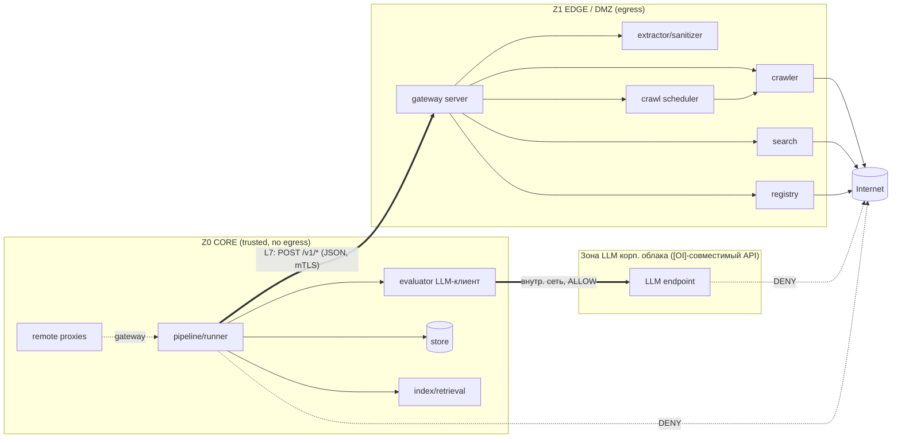

# coHound — архитектура: развёртывание и доверенные зоны (DMZ)

> **Статус открытых вопросов на 2026-11-08** (HEAD `f14f866`): **4 закрыто, 4 открыто**.
> У каждого пункта в §2, §6 и §11 маркер ✅/⬜/➖/❔ с доказательством.
>
> **Закрыто (решение принято или механизм есть):** `split-hardened` как алиас `split` (§6,
> решение D-8); классификация «инсталляции» — deployment-политика, не методология (§6);
> IDP/DLP/IDS-аттестация — границы работы зафиксированы владельцем (§8, §11); члены
> контейнеров извлекаются под `split` (§6 п.1, `ae0f933`).
>
> **Открыто:** **Z2 PARSE** — зоны в коде нет, `extractor_zone` объявлен и не потребляется
> (§2); **staging крупных артефактов** под `split` (§6 п.2); **паритет `pdf_pipeline`** под
> `split` (§6 п.3); **per-root слой** осей `document_level`/`pdf_device` под `split` не виден
> (§6 п.4). Все четыре — названные ограничения MVP, а не сбой прибора.
>
> **Конверт egress-запроса** (§8.6) — спецификация без кода: впитал `08` §4 при его удалении
> 08.11.2026. Это не пятый открытый вопрос, а то, что фаза `17` §9 Phase 2 должна произвести.

**Документ:** `docs/architecture/07-deployment-topology.md`
**Статус:** принято (проектирование; итерация 7)
**Опирается на:** `00`–`06`; источник истины — `cohound-spec-v2.md` (регламент v2.1).
**Назначение:** определить, как coHound разворачивается так, чтобы **веб-функции** (краул, внешний
поиск, реестровые фетчеры, обработка скачанного контента) были изолированы в **DMZ**, а
**не-веб-функции** (ядро, хранилище, оценщик, расчёт, отчёты) — в доверенной зоне, с
взаимодействием **только через application-layer firewall (L7)** по явному протоколу.

**Область.** Профиль `split` (DMZ) — **опция уже в MVP** (решение владельца, 2026-10-08): он входит
в M1 (`06` §4, поток W13). Профиль `local` (один процесс) остаётся дефолтом для разработки (A1).
Дополнительно проектируются **контракты, прозрачные для корпоративных IDP/DLP/IDS** (§8); аттестация
против конкретных средств — вне рамок этой работы.

> ⚠️ **Что здесь является свойством, а что — конфигурацией.** Шов **всегда** L7-инспектируем
> (JSON, публикуемые схемы, `request_id`). Но аутентификация, авторизация и аудит по умолчанию
> **выключены** (`auth.mode="none"`, `audit.sink="none"`), всегда действует только лимит тела
> (1 MiB). Включаются они конфигом `edge.yaml`; bind вне loopback без auth отвергается при старте.
> Честная таблица «механизм / когда действует / дефолт» — §8.

> Этот документ не меняет методологию. Он добавляет **измерение размещения** к уже принятой
> портово-адаптерной архитектуре и показывает, что изоляция зон **усиливает** инварианты I18/I19,
> а не только обслуживает требования ИБ (A2: методология первична).

---

## 1. Требование и принцип

**Требование.** Веб-контур и не-веб контур должны жить в разных сетевых зонах и общаться через
application-layer firewall (L7). Функционал, которому нужен интернет, должен быть вынесен в DMZ.

**Принцип решения (hexagonal уже даёт шов).** Порты/адаптеры (`01`) уже отделяют «что» (домен/
сценарии) от «как» (адаптеры). Всё, что ходит в интернет, — это **адаптеры за портами**. Значит,
изоляция зон — это не переписывание, а:

1. **классификация портов по доверенной зоне** (декларативно);
2. **размещение (locality)**: реальный адаптер может исполняться в другой зоне, а в ядре остаётся
   **remote-proxy** того же порта;
3. **application-layer boundary**: явный версионированный протокол ядро→edge (единственный канал);
4. **профили развёртывания**: дефолт — один процесс (`local`, A1); DMZ — опциональный профиль
   (`split`).

**Ключевое следствие для методологии:**
- **I18 усиливается до сетевого уровня.** Оценщик обращается к LLM корпоративного облака
  ([OI]-совместимый API, внутренняя сеть) и живёт в доверенной зоне **без маршрута в интернет**.
  «Без веб-тула» становится не только свойством порта, но и физическим запретом маршрутизации.
- **I19 получает явную границу.** Внешний контент входит в ядро только как ответ edge на
  инициированный ядром запрос, и немедленно проходит `corpus_raw → hash → index`.
- **A2 сохраняется.** Методология/инварианты/оценщик — в доверенном ядре; веб — commodity в DMZ.

---

## 2. Зоны и классификация портов

| Зона | Свойства | Что размещается |
|---|---|---|
| **Z0 CORE** (доверенная) | **нет** веб-эгрессии; недоступна для входящих из DMZ; секретов эгрессии нет | `pipeline` (оркестратор, гейты), `domain`, `store`, индексы/ретривал, **клиент evaluator-LLM (I18)**, `compute`, `report` |
| **Z1 EDGE / DMZ** (условно-доверенная) | есть веб-эгрессия; **считается компрометируемой**; процесс только отвечает, не инициирует в Z0 | `crawler` (Scrapy+playwright · **прямой Playwright/CDP** — honest/hybrid, альтернатива Scrapy), HTTP-fetch, `search`-адаптер (SERP), `registry`-фетчеры, `poller` (feed/channel/sitemap), discovery/concept-scout (search-enabled) |
| **Z2 PARSE** (roadmap; **не реализована**) | hardening парсинга недоверенного контента | *пока ничего: экстрактор исполняется в ядре (§2, `extractor_zone`); целевой контракт — §3 этого документа* — ⬜ не сделано: зоны Z2 в коде нет, `EXTRACTOR_ZONES` (`core/config/deploy.py:97`) — только объявление |
| **Зона LLM корп. облака** (внешняя, внутр. сеть) | [OI]-совместимый API; веса/движок — забота облака | evaluator-LLM (только Z0-originated трафик), discovery-LLM (search-enabled, Z1) |

**Классификация портов (`Zone`):**

| Порт | Зона | Природа |
|---|---|---|
| `ports/crawler.py` | **edge** | веб-эгрессия |
| `ports/search.py` | **edge** | веб-эгрессия |
| `ports/registry.py` | **edge** | веб-эгрессия |
| `ports/poller.py` | **edge** | веб-эгрессия (опрос ленты/канала/sitemap) |
| `ports/container.py` | **core** | спуск в контейнер: листинг/стриминг локального ретейленного файла, не веб |
| `ports/extractor.py` | **core** | обработка недоверенного контента; *декларативно может быть edge/Z2 — см. ниже* |
| `ports/llm.py` (evaluator) | **core** | клиент корп. облака ([OI]-API), без веба (I18) |
| `ports/{vector_index,lexical_index,index_builder,embedder}.py` | **core** | локальные вычисления |
| `ports/store.py` (`StorePort`, `GateStore`) | **core** | доверенное хранилище |
| `ports/state.py` | **core** | durable-состояние продукта |
| `ports/chunker.py` | **core** | чистая функция над очищенным текстом |
| `ports/gateway.py` | **core**→edge | транспорт к DMZ-сервису |
| `ports/{crawl_executor,discovery_llm}.py` | **core**→edge | исполнитель краула / discovery-LLM за швом |

> **`extractor_zone`: объявлено, не подключено.** `DeployConfig.extractor_zone` существует
> (`edge|core|separate`, **дефолт `core`**), но **не потребляется** ни одним путём wiring'а:
> экстрактор всегда собирается в ядре. Это декларация намерения, а не ручка — переключение
> поля не переносит экстракцию в edge. Подключение имеет смысл только вместе с доставкой
> крупных артефактов под `split` (§6 п.2), которой нет; до этого классификация портов ниже
> описывает **где код исполняется сегодня**, а не где он мог бы исполняться.
> Разбор разрывов `split` в извлечении (пере-фетч, провенанс, члены контейнеров, ось уровня) —
> §6 этого документа; целевой контракт шва — §3.
>
> ⬜ **не сделано (2026-10-28, перепроверено 2026-11-08):** `rg -n extractor_zone core/` даёт
> только `core/config/deploy.py:768` (поле модели), `core/config/deploy.py:786-792` (валидатор)
> и константу `EXTRACTOR_ZONES` (`core/config/deploy.py:97`); сборка экстрактора —
> `core/cli/wiring.py:2211` (`build_worker_extractor`) — на поле не смотрит.

> **Почему extractor в core, а не в edge.** Экстракция парсит **недоверенные байты** из
> интернета — это основная поверхность атаки (парсеры/шрифты/архивы). Идея «вынести её в edge»
> (defense-in-depth) остаётся в силе как **roadmap**: сегодня экстракция идёт через шов для
> страниц (`/v1/fetch` с осью `extract`) и **по байтам артефакта** (`/v1/extract/*`, `ae0f933`) —
> включая документы по `raw_path` и членов контейнеров (§6 п.1). Что не сделано — не «доставка»,
> а **зона**: экстрактор исполняется там, где его собрал composition root (в ядре), а не в
> отдельной Z2, и поле `extractor_zone` этого не меняет.

---

## 3. Application-layer boundary: протокол шва

**Единственный канал core↔edge** — версионированный HTTP/JSON-протокол (L7-inspectable). Ядро
**инициирует**; edge **отвечает**. Обратного инициирования из edge в core нет.

```
POST /v1/fetch    {url, fetch: "http"|"browser", strategy: "auto"|"honest"|"hybrid", lang, extract: "auto"|"html"|"document", wait_for: str|null,
                   if_none_match?: str|null, if_modified_since?: str|null}
   → {request_id, final_url, status_code, content_type, fetched_at, lang, etag, last_modified, not_modified,
      raw:  {hash, size, bytes_b64? | ref, content?},        # сырые байты (retention)
      text: {content, hash, extractor_version, page_count?} | null,  # очищенный markdown (результат extract-оси)
      error: str | null}

POST /v1/search   {query, lang, limit ≤ 10, phase}   # граница — в публикуемой схеме
                                                      # (contracts/seam/search.schema.json: maximum)
                                                      # и та же константа в сервере (SEAM_SEARCH_MAX_LIMIT)
   → [{url, title, snippet, rank}]                          # кандидаты, НЕ evidence

POST /v1/registry {registry_id, product_ref, scope}
   → [{fact_json, source_url, fetched_at}]                  # R1: source_url обязателен

POST /v1/crawl/submit  {run_id, session_id, idempotency_key, profile, items:[{product_id, url, engine?, kind?, fetch?, extract?, strategy?, wait_for?, lang?,
                            robots?, rate_limit?: {min_s, max_s}, if_none_match?, if_modified_since?}]}
   → {job_id, accepted, total, session_id}                  # постановка задания очереди краула
POST /v1/crawl/status  {job_id}
   → {job_id, status, total, pending, running, fetched, failed, cancelled, engines, kinds}
POST /v1/crawl/cancel  {job_id}
   → {job_id, status: "cancelled", cancelled}
POST /v1/crawl/collect {job_id, cursor?, limit?}
   → {items: [{product_id, url, status, engine, kind, http_status, content_type, fetched_at, content_hash,
               final_url, etag, last_modified, not_modified, raw?, error}], next_cursor, done}
POST /v1/crawl/poll    {url, kind: "feed"|"channel"|"sitemap", params?: {since?, limit?}, fetch?, extract?, strategy?, wait_for?}
   → {entries: [{url, guid?, published_at?, title?}], count, truncated}  # ссылки на записи, НЕ content/evidence (I19)

GET  /v1/capabilities → {extractor_version, crawler_version, search_engine, supported_formats}
GET  /v1/health       → {status}
```

**Условный GET и валидаторы (as-built, схемы `contracts/seam/*.schema.json`).** `/v1/fetch` и
элемент `crawl/submit` несут `if_none_match`/`if_modified_since` (запрос); ответ `fetch` несёт
`lang`, `etag`, `last_modified`, `not_modified` и `text.page_count`. `not_modified: true` — это
`304`: `raw` в ответе — **закэшированное** представление, а не свежие байты; потребитель обязан
различать эти случаи. Элемент `crawl/submit` дополнительно несёт `robots` (bool — политика
robots для элемента) и `rate_limit {min_s, max_s}` (пауза между запросами к origin);
`crawl/collect` отдаёт `final_url` (после редиректов), `etag`/`last_modified`/`not_modified`.

**Аддитивное расширение `/v1/fetch` (совместимо).** Поле `strategy` (`auto`|`honest`|`hybrid`) добавлено
**аддитивно**: старые клиенты его опускают — edge трактует отсутствие как `auto`. Поле ортогонально
оси `fetch` (при `fetch: "http"` нормализуется в `auto`; `strategy != auto` ⇒ `fetch: "browser"`),
поэтому не ломает существующих клиентов и не требует bump `schema_version`.

**Очередь краула `crawl/*` (аддитивно, Phase 3.1–3.4).** Четыре POST-операции переносят
долгоиграющий краул корпуса за шов: `submit` ставит задание (идемпотентно по
`(run_id, session_id, idempotency_key)`), `status` сообщает счётчики, `cancel` снимает
незавершённые элементы, `collect` постранично отдаёт результаты (сырые байты/хэши — контент,
**не** evidence, I19; ядро пересчитывает `content_hash`). `collect` идемпотентен: непрозрачный
`cursor` (стабильный порядок `(product_id, url)`), `done` — все элементы терминальны. Транспорт —
тот же L7-JSON; авторизация — scope `crawl` (см. §8.2). Расширение **аддитивно** и не меняет
`schema_version` (остаётся `"1"`).

**Опрос фидов/каналов/sitemap `crawl/poll` (аддитивно, Wave 5.1/D3).** Пятая POST-операция
семейства `crawl/*`: `url` + `kind` (`feed` — XML: RSS/Atom/RDF; `channel` — JSON/JSON-lines/
список URL; **`sitemap`** — `sitemap.xml`/`sitemap.xml.gz` с `urlset`/`sitemapindex`) опрос
каталогового документа. Edge фетчит **только сам каталог** и возвращает **ссылки**
на записи (`{url, guid?, published_at?, title?}`), а не их контент: `entries` — кандидаты, не
content и не evidence (I19). Контент записей добывается обычными `fetch`/`crawl/collect`.
`params` (`since?`, `limit?`) ограничивают выборку, `truncated` сигнализирует усечение; URL
ленты и каждой записи проходит SSRF-проверку. Sitemap разворачивается ровно **на один уровень**
(`sitemapindex` → дочерние sitemap'ы; глубже — отказ), `loc` вне scope корня отбрасывается с
классом отказа `host`. Авторизация — scope `crawl` (см. §8.2).
Расширение **аддитивно** и не меняет `schema_version` (остаётся `"1"`).

**Передача артефакта `extract/*` (аддитивно, B1/B3, `ae0f933`).** Четыре POST-операции
доставляют крупный артефакт (PDF/Office) и член контейнера в edge **по байтам**, а не по URL:
`extract/upload` (приём чанков), `extract/submit` (работа уходит в фон), `extract/collect`
(результат; `text` — контент, **не** evidence, I19), `extract/abort` (снять staging).
Публикуемая схема — `contracts/seam/extract.schema.json`; авторизация — scope `extract`
(§8.2). До 2026-11-08 перечень операций в этом разделе их не содержал — это был дефект
документа, а не контракта: сервер публикует их в `contracts/seam/openapi.json`.

**Оболочка:** `{schema_version, request_id, status, payload, error}`. `schema_version` — часть
контракта; несовместимое изменение → bump версии (версионная граница §13).

**Контрактные гарантии шва (усиление инвариантов):**
- edge возвращает **сырой контент/кандидатов**, а не «evidence» (I19) — превращение в evidence
  происходит только в ядре (chunk+hash+index).
- ядро **проверяет всё входящее** (см. §5): схема, размерные лимиты, **повторный `content_hash`**,
  санитайзинг. Edge не доверяется.
- `source_url` из реестровых/поисковых ответов резолвится в ядре (I10/I15).
- каждый вызов логируется вызывающим ядром в `search_log`/логах фаз (I23); edge ведёт свой аудит.

---

## 4. Порты и адаптеры: измерение локальности

Один и тот же `Protocol` реализуется **дважды** — для двух зон:

| Порт | Адаптер в edge (реальный) | Адаптер в core (remote-proxy) |
|---|---|---|
| `CrawlerPort` | `crawl_scrapy.py` (Scrapy+playwright) · `crawl_browser.py` (`BrowserCrawler`, прямой Playwright/CDP, honest/hybrid) | `RemoteCrawler(gateway)` |
| `SearchAdapterPort` | `search_yandex.py` / `search_glm.py` | `RemoteSearch(gateway)` |
| `RegistryFetcherPort` | `registry_generic.py` | `RemoteRegistry(gateway)` |
| `ExtractorPort` | `extract_html.py` / `extract_document.py` | `RemoteExtractor(gateway)` — **`supports_source_path = True`** (`core/adapters/remote_extractor.py:214`, `ae0f933`): принимает локальные байты, в том числе члена контейнера (§6 п.1) |
| `PollPort` | `feed_poller.py` | op шва `crawl/poll` (`RemoteFeedPoller`) |
| `CrawlExecutorPort` | `EdgeScheduler` + `crawler_factory`/`poller` | `remote_crawl_executor.py` (submit/status/cancel/collect) |
| `ContainerPort` | — (edge не читает контейнеры) | — (спуск исполняется **в ядре**: байты архива в `corpus_raw`) |

**`ContentGateway`** (`ports/gateway.py`) — общий транспортный порт remote-прокси:
```python
class ContentGateway(Protocol):
    def call(self, op: str, payload: Mapping) -> Mapping: ...   # HTTP/JSON к edge
```
`core/adapters/remote_gateway.py` реализует `ContentGateway` поверх `httpx` (mTLS, таймауты,
retry/backoff, клиентская валидация ответа).

**Выбор реализации — wiring'ом** (`cli/` и `edge/` — два composition root):
- профиль `local`: ядро инстанцирует **реальные** адаптеры in-process (dev/один хост, A1);
- профиль `split`: ядро инстанцирует **remote-proxy**; отдельный процесс **`edge/`** инстанцирует
  реальные адаптеры и публикует их через gateway-сервер.

`edge/` — второй composition root, допустимо зависит от `ports`+`adapters` (как `cli/`, см. 01 §1).
Он **не содержит** доменной логики и не пишет в `store` — только исполняет контентные операции.

**Локальный путь исполнения (as-built, `local`).** Три детали определяют, что означают
`workers`, `max_workers` и `host_concurrency`:
- **fetch-пул — per seed-root.** `CrawlLimits.max_workers` — размер волны сетевого фетча **одного
  корня**; `None`/`1` — прежний однопоточный путь, `> 1` — пул (процессы/forkserver при наличии
  фабрики, иначе потоки). Пул не общий на прогон: каждый seed-root получает свой.
- **число одновременных корней — отдельная ось узла.** `crawl.host_concurrency`
  (`core/config/deploy.py:470`) задаёт, сколько host'ов краул ведёт **одновременно** (полос):
  `None`/`1` — строго по одному (`core/pipeline/corpus_driver.py:245`,
  `lanes_limit = 1 if host_concurrency is None`). Per-site слоя у оси нет — это свойство узла,
  как `pdf_device` (2026-11-07: `host_concurrency: 5`, `max_workers: 10` в `config/deploy.yaml`).
  Два рычага разные: `max_workers` держит темп внутри одного хоста, `host_concurrency` режет
  **сумму** времён хостов.
- **браузерные элементы в пул не идут.** `BrowserCrawler` водит единственный браузер/контекст и
  **не потокобезопасен**, поэтому browser-элементы фетчатся **inline**, минуя пул; `max_workers`
  на них не действует. Параллелизм браузерного фетча задаётся числом процессов/контекстов, а не
  этой осью (в `split` — слотами движка `browser` в edge-планировщике).

Отсюда: `workers` (edge, `{http, scrapy, browser}`), `max_workers` (ядро, локальный пул) и
`host_concurrency` (ядро, число полос) — **разные оси разных путей**; обосновывать одну другой
нельзя.

**Ответственность за обработку (кто что делает):**
```
core:  план → запрос к edge → приём сырья → corpus_raw (retention) → re-hash/валидация
       → chunk → embed → index → evaluate (LLM, без веба) → compute → report
edge:  fetch → extract → sanitize → вернуть (text, hashes, raw)   [без доступа к store/domain]
```

**Launcher edge-узла.** Второй composition root запускается как
`python -m core.edge serve [--config FILE] [--host H] [--port P] [--check]`. Конфигурация узла —
собственная (`config/edge.yaml` → `EdgeRuntimeConfig`; это `DEFAULT_EDGE_RUNTIME_FILE`, самого
файла в репозитории **нет** — отсутствие файла/поля означает дефолт; env `COHOUND_EDGE_STATE_DIR`
переопределяет `state_dir`): полный набор ключей (включая `auth.*`/`audit.*`/`max_body_bytes`,
дефолты `host`/`port`) — §7. Флаг `--check` собирает конфиг+адаптеры+gateway+планировщик и выходит без
привязки сокета и без старта воркеров (smoke: misconfig всплывает до запуска); ошибка конфигурации
→ код возврата `2`. Launcher остаётся в edge-слое: не импортирует `cli`/`store`/`pipeline`.

**Edge-локальный планировщик краула (`core/edge/scheduler.py`).** Исполняет операции `crawl/*`:
собственная SQLite-БД (`{state_dir}/edge_jobs.db`, WAL) хранит задания/элементы и счётчики;
content-addressed блоб-хранилище (`{resolved_blob_dir}/{job_id}/{hash}.bin`) хранит сырые байты
(retention, I19). Модель исполнения по движкам: `http` — **потоки** in-process; `scrapy`/`browser`
— **процессы** (`ProcessPoolExecutor`) через module-level `crawler_factory` (адаптеры не picklable,
Playwright не форк-безопасен — краулер строится внутри воркера, а запись блобов/БД делает родитель).
Back-pressure по `queue_limit`; `submit` идемпотентен по `(run_id, session_id, idempotency_key)`;
recovery-on-start возвращает застрявшие `running`-элементы в `pending` (зеркало
`store.recover_crawl_session`). SSRF-валидация каждого URL — на постановке (`util.security.validate_url`).
Диагностика числа воркеров не стартует: планировщик строится лениво.

---

## 5. Модель угроз и принуждение (L7 firewall)

**Допущение:** edge **считается компрометируемой** (обрабатывает недоверенный контент, имеет
эгрессию). Ядро не доверяет edge и валидирует всё входящее.

**Политика потоков:**

| Поток | Направление | Политика L7 |
|---|---|---|
| core → edge | к DMZ app-порту (напр. 8443) | **ALLOW**: allowlist методов/путей (`/v1/fetch`, `/v1/search`, `/v1/registry`, `/v1/crawl/submit`, `/v1/crawl/status`, `/v1/crawl/cancel`, `/v1/crawl/collect`, `/v1/crawl/poll`, `/v1/extract/upload`, `/v1/extract/submit`, `/v1/extract/collect`, `/v1/extract/abort`, `/v1/health`, `/v1/capabilities`), JSON-schema-валидация, лимиты размера |
| edge → internet | 80/443 | **ALLOW** (опц. allowlist доменов; robots-enforcement; rate-limit) |
| **core → internet** | любой | **DENY** (нет маршрута) — усиливает I18 |
| **edge → core** | инициирование | **DENY** (edge только отвечает; не может дозвониться до сервисов ядра) |
| core → корпоративный LLM-endpoint ([OI]-совместимый API) | внутренняя сеть | **ALLOW** |
| **LLM-endpoint → internet** | любой | **DENY** (оценщик без веба, I18) |
| edge → discovery-LLM (search-enabled) | внутренняя сеть | **ALLOW** (только discovery/concept-scout) |

⚠️ **IP-репутация egress (deployment-условие anti-bot-класса).** Для сайтов с активной антибот-защитой
тип egress-адреса доминирует над техникой рендера: **datacenter-egress получает `401`/`429` даже при
реальном браузерном рендере**. Поэтому для anti-bot-класса требуется **доверенный/residential egress**
(прокси-исходящий контура edge) — это **условие развёртывания**, а не свойство honest/hybrid:
honest/hybrid исполняет штатный JS-challenge публичной страницы (§10), но при «загрязнённой» репутации
IP штатный механизм не проходит. Egress-креды (в т.ч. прокси) живут **только в edge** (см. «Секреты»).

**Установка браузера для `BrowserCrawler` (прямой Playwright, honest/hybrid).** Honest-режим требует
**полноценный браузерный бинарь** (headless-shell недостаточен для headed/honest-рендера): в
edge-окружении выполняется `playwright install chromium` (полный Chromium / Chrome for Testing).
В закрытом контуре браузеры тянутся через зеркало CDN — `PLAYWRIGHT_DOWNLOAD_HOST` (источник
загрузки) и `PLAYWRIGHT_BROWSERS_PATH` (каталог установки/изоляция контура); синхронно с реестром
`05` §2.5. Для anti-bot-класса honest/hybrid недостаточно без доверенного egress — действует
условие IP-репутации (абзац выше).

**Принуждение инвариантов сетевым слоем:**
- **I18:** evaluator и его LLM — в Z0 **без default-route в интернет**; даже при попытке тул не
  получит сети. Порт без `tools` (01 §3.1) + отсутствие маршрута = двойное принуждение.
- **I19:** пересечение границы core↔edge — только ответы edge; они не становятся evidence, пока не
  пройдут `corpus_raw → hash → index` в ядре.
- **I23:** поисковый бюджет и вызовы фиксируются ядром (инициатор) в `search_log`; edge пишет
  собственный аудит для форензики.

**Секреты:** эгрессионные секреты (ключи SERP, прокси, egress-creds) хранятся **только в edge**.
Ядро секретов эгрессии не имеет (компрометация ядра не даёт выхода в интернет). Ключи доступа к
LLM-endpoint корп. облака — только в Z0.

**Валидация входящего из edge (обязательно):** схема ответа; лимиты размера/глубины; **повторный
`content_hash`** (не верить хэшу edge); **репорт** активного HTML (`sanitize`-нарушение
предупреждает, но байты не мутирует — инспекция ≠ мутация, §8.5; сам санитайзинг исполняется на
границе экстракции, `strip_active_html`); никакого автозапуска (контент — только данные). См. `04`
§A и §10 регламента.

---

## 6. Профили развёртывания

| Профиль | Топология | Когда |
|---|---|---|
| **`local`** (дефолт) | один процесс/хост; все адаптеры in-process | разработка, малый объём; **A1** — не тянем DMZ без нужды |
| **`split`** (опция MVP) | 2 зоны: Z0 CORE + Z1 EDGE (DMZ), L7 между ними | ИБ/изоляция веб-контура; **доступен уже в M1 (W13)** |
| **`split-hardened`** | **алиас `split`** — принимается, ничего не добавляет | ⚠️ см. ниже: Z2/egress-прокси/TLS-инспекции **нет** |

Профиль — **конфигурация подстановки адаптеров**, а не ветка в коде. Конвейер (`pipeline`) не
знает о зонах: он получает порты, как и раньше (00 §8.1). Это сохраняет A1: `local` не платит за DMZ.

> ⚠️ **`split-hardened` — алиас, а не другой профиль (решение D-8).** Значение принимается
> конфигом (`PROFILES`/`SPLIT_PROFILES` в `core/config/deploy.py`) **сегодня** и ведёт себя
> ровно как `split`: нет ни зоны Z2 PARSE, ни egress-прокси, ни TLS-инспекции/аудит-интеграции.
> Отличие от `split` — только проверка `is_split` (одинаковая для обоих) и **громкое
> предупреждение** `profile_notices` (payload wiring'а и `hound deploy-check`): имя обещает
> хардненинг, которого нет, поэтому молчаливое принятие запрещено. `config/deploy.yaml` это
> значение не использует. Ступень «Z2 + egress-прокси» — **roadmap** (контракт — §8 ниже;
> порядок перехода — `24` §8), не текущая функциональность. ➖ снято как открытый вопрос — это **решение D-8**, а не недоделка:
> алиас принят, и предупреждение `profile_notices` о нём реализовано (`core/config/deploy.py:844`,
> вызовы `core/cli/commands/run.py:761`, `core/cli/commands/plan.py:249`).

**Локальный путь исполнения (as-built).** При `local` краул идёт in-process; как устроены пулы
(per-seed-root fetch-пул, число полос `host_concurrency`, browser-элементы вне пула) — §4.
Отсюда: `workers` в `edge.yaml`, `max_workers` и `host_concurrency` в `crawl` — **разные оси
разных путей**, а не одно и то же число.

**Отображение профиля на транспорт краула.** `local` исполняет краул **in-process** (реальные
адаптеры прямо в ядре). `split`/`split-hardened` маршрутизируют краул через шов: ядро подаёт работы
исполнителю, edge-планировщик их исполняет, ядро забирает результаты операцией `crawl/collect`
(retention/re-hash/нарезка остаются в ядре — I19). **Контракт портов** при этом не меняется —
меняется подстановка адаптера (remote-прокси поверх `ContentGateway`); но из неизменности
контракта **не** следует эквивалентность поведения — см. ниже.

⚠️ **Паритета по корпусу нет: `split` остаётся уже `local` — по доставке крупных артефактов,
по выбору механизма PDF и по per-root слою осей извлечения.** Сверено по коду 2026-11-08
(HEAD `f14f866`); прежняя редакция этого блока перечисляла три расхождения: одно закрыто
(`ae0f933`), два остаются, и добавляется третье остающееся — per-root слой, которого в ней
не было вовсе.

1. ✅ **Члены контейнеров извлекаются.** `RemoteExtractor.supports_source_path = True`
   (`core/adapters/remote_extractor.py:214`, `ae0f933`): ядро отдаёт **локальные байты**
   члена в `extract/submit`, а не URL. Проверка живёт в родителе —
   `core/pipeline/extract_consume.py:303`: экстрактор без этого признака даёт видимый
   пропуск `extract_unavailable` (капитуляция явная, не тихая), экстрактор шва — нет.
   Спуск по контейнеру и раньше исполнялся в ядре (байты архива живут в `corpus_raw` — это
   локальный файл, не веб-эгресс).
2. ⬜ **Артефакт пересекает шов только inline-base64.** `crawl/collect` отдаёт сырьё в странице
   с бюджетом **8 MiB** (`_COLLECT_MAX_BYTES`), а клиент отвергает страницу больше
   `max_batch_bytes` = **50 MiB** (`MAX_RESPONSE_BYTES`). Staging крупных артефактов (presigned
   объект/чанки) отсутствует: PDF/архив больше лимита под `split` не доставляется. — не
   сделано: `core/edge/scheduler.py:186` (`_COLLECT_MAX_BYTES = 8 MiB`),
   `core/adapters/gateway_validate.py:53` (`MAX_RESPONSE_BYTES = 52_428_800`). Staging для
   **входящего** `extract/submit` при этом есть (`staging_ttl_s`, B1) — речь только о
   `crawl/collect`.
3. ⚠️ **`crawl.document_level`/`pdf_device` под `split` действуют на уровне app+run;
   `pdf_pipeline` — не действует.** Оси уровня и устройства объявлены на собранном
   `RemoteExtractor` (`core/cli/wiring.py:3355-3356`) и едут в `extract/submit`; edge строит
   конвейер по ним (`core/edge/extract_service.py:172` — `artifact_extractor_factory`,
   `text_layer` → pdfium, остальные уровни → docling), поэтому текст под `split` совпадает с
   `local` при тех же осях. Не действует **механизм** PDF: его выбирает edge, а не объявивший
   его прогон (`core/cli/wiring.py:2437-2439` — комментарий «``pdf_pipeline`` под ``split`` не
   действует»). Поэтому `deploy_profile` и остаётся полем контракта.
4. ⚠️ **Per-root слой осей `document_level`/`pdf_device` под `split` не виден** (расхождение,
   которого в прежней редакции этого блока не было). Под `local` оси разрешаются на каждом
   корне цепочкой app < run < site (`core/pipeline/corpus.py:1429`,
   `profiles=domain_profiles`), поэтому `domain_profiles.yaml` переопределяет уровень для
   конкретного хоста. Под `split` порты собираются **до** per-root резолва:
   `resolve_crawl_limits("", app=…, run=…, profiles=None)` (`core/cli/wiring.py:3300`) отдаёт
   только app+run — и это сказано в самом коде: «per-root слой здесь не виден — порты
   собираются до per-root резолва (то же ограничение, что у ``pdf_pipeline`` выше)»
   (`core/cli/wiring.py:3352-3354`). Итог: под `split` действуют app+run, per-root
   переопределение — нет; под `local` действует вся цепочка. Это не «тихий успех» (непринятое
   значение нигде не выдаётся за применённое), но и не сообщается — поэтому пункт открыт, а не
   выдан за сделанный.
5. ⬜ **`extract_cache` под `split` остаётся write-only** (перенесено из
   `10-extraction-pipeline-architecture.md` §6 при его удалении 08.11.2026). Проба ключа берёт
   идентичность **прокси**: у `RemoteExtractor` нет `extractor_version_for`, поэтому
   `_cache_extractor_version` возвращает `.version` = `remote-extractor-1`
   (`core/pipeline/extraction_runtime.py:331-334`, `core/adapters/remote_extractor.py:220`), а
   запись кладёт `ExtractedDoc.extractor_version` — штамп docling, названный **edge**
   (`core/pipeline/extract_cache.py:375-380`). Ключи не совпадают никогда ⇒ под `split` кэш не
   даёт попаданий, и каждый цикл пере-извлекает весь корпус. Это не регресс, а названная
   асимметрия (она же в docstring помощника), но цена реальная: под `local` тот же корпус
   попадает в кэш. Починка — резолв идентичности через `capabilities.extract` один раз на
   прокси, а не «догадка» из `.version`.

Поэтому `split` — не «та же функциональность за швом»: по корпусу он **уже** `local` в части
доставки крупных артефактов, выбора механизма PDF, per-root осей извлечения и кэша извлечения. Это известное
ограничение MVP; staging крупных артефактов — `24` §3.2; паритет `pdf_pipeline` и per-root резолв — §6 выше.

**«Инсталляция» — deployment-политика, а не методологический вопрос.** Под «инсталляцией» проекта
понимается способ размещения контура, влияющий на §10 (применимость), 152-ФЗ и ops-бюджет, а не на
семантику измерений:
- **свой кластер** — развёртывание **нашего** конвейера, корпуса и индексов в собственном контуре
  (максимальный контроль R7/I18); LLM при этом всегда потребляется через [OI]-совместимый API
  корпоративного облака, а не хостится нами;
- **аренда РФ-облака** — хранение/вычисление конвейера и индексов в юрисдикции РФ (компромисс
  контроля/стоимости);
- **вендорский контур** — исполнение на стороне вендора/интегратора (минимальный контроль, требует
  юридического и ИБ-согласования).

Выбор — **решение развёртывания** (фиксируется вне регламента методологии, напр. в ops-журнале
решений / `deploy.yaml` к профилю), а не открытый вопрос к детальному проектированию. Профиль
`split-hardened` (Z2 PARSE, egress-прокси) — естественная ступень для вариантов с внешним контуром.
➖ снято — решение владельца: классификация инсталляции — deployment-политика, методологию не
меняет; в коде ей соответствует поле `profile` (`core/config/deploy.py:766`).



---

## 7. Конфигурация

`config/deploy.yaml` (не в `run.yaml` — развёртывание отделено от методологического прогона).
Пример ниже **проверен** `DeployConfig.model_validate` (Pydantic, `extra="forbid"`): любое поле,
которого нет в модели, отвергается — не дописывайте «на глаз»:

```yaml
profile: split                      # local | split | split-hardened (алиас split, см. §6)
edge:
  base_url: "https://edge.internal:8443"
  tls:
    ca: certs/ca.pem                # корпоративный CA (в т.ч. TLS-инспекция; БЕЗ pinning, §8.1)
    client_cert: certs/core.pem     # workload-identity ядра
    client_key: secrets/core.key    # путь к ключу; сам ключ не коммитится
  auth: mtls                        # mtls | oidc (скаляр = {kind: …})
  oidc: { issuer: "https://idp.corp/realms/…", audience: "cohound-edge" }   # если auth: oidc
  timeout_s: 30
  max_retries: 2
  max_response_bytes: 52428800      # лимит ответа (защита ядра от edge)
  audit: { sink: file, target: /var/log/cohound/audit.jsonl }   # sink ∈ {file, syslog} (§8.4)
extractor_zone: core                # edge | core | separate — объявлено, НЕ подключено (D-9, §2)
llm:                                # модели корпоративного облака ([OI]-совместимый API)
  slot: cheap                       # активный слот по умолчанию (cheap | flagship)
  cheap:    {model_id: "deepseek-v4.1-flash-1017:yellow"}   # провизорно: финальный выбор — измерение
  flagship: {model_id: "deepseek-v4.1-flash-1017:yellow"}   # (hound experiment evaluator-benchmark, A3)
  # выбор слота: --llm-slot > env COHOUND_LLM_SLOT > run.yaml: llm_slot > deploy.llm.slot > cheap
  # модель оценщика: --llm-model > deploy.llm.<slot>.model_id (env COHOUND_LLM_MODEL — только
  # для LLM-разведки: идентичность оценщика входит в execution_contract_digest, 03 §D.6)
  # api_key: env COHOUND_LLM_API_KEY; endpoint — [OI]-совместимый API внутри корп. периметра
search:
  adapter: yandex                   # провайдер поиска по умолчанию (Yandex Search API)
  serp: { rounds: 0 }               # SERP-контур: 0 — выключен (низший уровень переключения)
  # by_language: { ru: yandex, en: glm }   # дифференциация по языку (I16)
  # Бюджета здесь нет намеренно: единственный бюджет — объявленный вход прогона
  # (`run.yaml: serp.budget`), потому что он определяет число запросов, то есть состав
  # корпуса и `run_id`. Прежний `search.budget: {ru: 5, en: 5}` удалён (ключевался по
  # языку, тогда как потребитель `SearchBudget` ключуется по фазе, и не ограничивал
  # ничего); `extra="forbid"` отвергает его — проверено 2026-11-08 (`DeployConfig`).
  # режим запроса (sync | async) объявляется НЕ здесь и не в env, а во входе прогона
  # (`run.yaml: serp.mode` → ось контракта `serp_mode`): он определяет бэкенд провайдера,
  # значит состав находок и корпус. Env YANDEX_SEARCH_MODE — настройка разведки (03 §D.6)
```

**Трёх полей здесь сознательно нет.** `registry_fetchers` в модели отсутствует (реестровые
фетчеры выбираются wiring'ом по профилю, не конфигом), `audit.sink` — перечисление
`AUDIT_SINKS = ("file", "syslog")`, не строка-шаблон: писать `"file|syslog"` нельзя (падает
валидацией), а `search.budget` удалён — бюджет объявляется только во входе прогона
(`run.yaml: serp.budget`). Секция `crawl:` (операционная политика HTTP-краулинга) действует в
обоих профилях.

Профиль `local` игнорирует `edge.*` (всё in-process). Секция `llm:` задаёт два слотовых идентификатора
модели корпоративного облака (`cheap`/`flagship`); активный слот резолвится детерминированно
(CLI > env `COHOUND_LLM_SLOT` > `run.yaml` > `deploy.llm.slot` > `cheap`, см. `03` §D.6).
`deploy.yaml` версионируется отдельно от
`run_manifest.yaml`; связка — в манифест пишется `deploy_profile`, версии edge-компонентов
(`/v1/capabilities`) и `edge_schema_version` для воспроизводимости R7.

Runtime-конфигурация **edge-узла** отделена от `deploy.yaml` ядра: `config/edge.yaml`
(`EdgeRuntimeConfig`, схема `extra="forbid"`). Это путь по умолчанию
(`DEFAULT_EDGE_RUNTIME_FILE`); самого файла в репозитории **нет** — все поля опциональны,
отсутствие файла или поля означает дефолт (в отличие от `deploy.yaml`, который поставляется
заполненным). Полный набор ключей:

| Ключ | Дефолт | Что делает |
|---|---|---|
| `state_dir` | `./edge_state` | каталог состояния edge (SQLite очереди/метаданные); env `COHOUND_EDGE_STATE_DIR` переопределяет |
| `blob_dir` | `{state_dir}/blobs` | content-addressed блобы (`resolved_blob_dir`) |
| `host` | **`127.0.0.1`** | адрес прослушивания; не-loopback без auth **отвергается при старте** |
| `port` | **`0`** (эфемерный) | ОС выбирает свободный порт — фактический берётся из сокета, не из конфига |
| `workers` | `{http: 4, scrapy: 2, browser: 1}` | карта `движок → слоты`; определяет, какие движки собирает composition root |
| `queue_limit` | `256` | back-pressure: потолок одновременно принятых задач |
| `ttl_s` | `86400` | TTL блобов (сутки) |
| `extract_dir` | `{state_dir}/extract` | staging извлечения **по артефакту** (принятые чанки и результат разбора); рядом с остальным состоянием, а не в `/tmp` |
| `extract_ttl_s` | `3600` | TTL брошенной загрузки артефакта (час, а не сутки: передача занимает минуты) |
| `extract_workers` | `1` | одновременных извлечений по артефакту; ограничение **по памяти** (пик docling), не по числу ядер |
| `max_body_bytes` | **1 MiB** (`DEFAULT_MAX_BODY_BYTES`) | потолок тела запроса; **действует всегда** (413) |
| `schema_version` | `"1"` | версия конверта шва (совпадает с `EDGE_SCHEMA_VERSION`) |
| `auth.mode` | **`none`** | `none` \| `mtls` \| `oidc` — без auth допустим только на петле |
| `auth.issuer` | `null` | для `mtls` — CA (атрибуция), для `oidc` — ожидаемый `iss` |
| `auth.audience` | `null` | ожидаемый `aud` OIDC-токена (обязателен при `oidc`) |
| `auth.subjects` | `{}` | mTLS: реестр `субъект сертификата → [scopes]` (обязателен при `mtls`) |
| `auth.subject_header` | `X-Client-Cert-Subject` | заголовок с уже проверенным субъектом (от терминирующего прокси) |
| `auth.token_header` | `Authorization` | заголовок с bearer-токеном |
| `audit.sink` | **`none`** | `none` \| `file`; `file` требует `audit.path` |
| `audit.path` | `null` | файл аудита (JSON-lines, одна строка на вызов) |

Файл читает launcher `python -m core.edge serve --config …` (§4); отсутствие файла → безопасные
дефолты (без auth, без аудита, петля, эфемерный порт). Без `auth.mode` и `audit.sink` шов
**не аутентифицирует и не аудирует** — это дефолт локального профиля, а не забытая настройка (§8).

---

## 8. Прозрачность контрактов для корпоративных IDP / DLP / IDS

**Требование.** Контракты между частями coHound (ядро ↔ edge, а также форма публикуемых спецификаций)
должны быть **прозрачны** для корпоративных средств безопасности: **IDP** (идентификация/
авторизация), **DLP** (контроль утечек — инспекция содержимого), **IDS** (обнаружение вторжений —
сетевой/L7-мониторинг). Шов — это **единственная** точка пересечения зон (core→internet DENY,
edge→core DENY, §5), поэтому одна точка инспекции покрывает всю веб/не-веб границу.

> **Границы работы.** Здесь фиксируются **design-требования**, делающие coHound пригодным для
> корпоративных IDP/DLP/IDS. **Аттестация против конкретных средств** (какой IDP, какой DLP, набор
> IDS-правил, сертификация) — **вне рамок** этой проектной работы; владелец — заказчик/ИБ.

> ⚠️ **Прозрачность — свойство контракта; enforcement — свойство конфигурации.** Шов
> L7-инспектируем **всегда** (JSON, публикуемые схемы, `request_id`), но аутентификация,
> авторизация и аудит **включены по умолчанию выключенными**. Таблица ниже — контракт, а не
> намерение; читать её как «шов всё это делает» нельзя.
>
> | Механизм | Когда действует | Дефолт |
> |---|---|---|
> | Аутентификация | `auth.mode: mtls` или `auth.mode: oidc` | **`none`** |
> | Авторизация по операции | там же (allowlist `core.edge.auth`) | нет |
> | Аудит | `audit.sink: file` | **`none`** |
> | Лимит тела | **всегда** (`max_body_bytes`) | **1 MiB** |
>
> **Порядок в пути запроса** (`route_request`): маршрут/метод (404/405) → **аутентификация**
> (401) → **авторизация по op** (403) → **лимит тела** (413) → разбор JSON (400) → диспетчеризация
> → **аудит** ровно одного события с финальным статусом (`allow`/`deny`/`error`). Отказы
> 401/403/413 тоже аудируются — трейл не «теряет» именно отклонённые вызовы.
> **Fail-fast:** bind вне loopback при `auth.mode: none` **отвергается при старте**
> (`ensure_safe_binding`, `EdgeSecurityError` до создания сокета): «забыли auth» не превращается
> в открытый endpoint. Тесты — `tests/edge/test_edge_middleware.py`.
>
> *Историческая справка: раньше auth/audit существовали как библиотеки, но не вызывались из
> обработчика. Этот дефект **закрыт**; нынешнее состояние — «реализовано, включается конфигом».*

### 8.1. Инспектируемость (DLP, IDS)

| Требование | Как обеспечено |
|---|---|
| Только L7 HTTP + JSON | никаких protobuf/gRPC, кастомного бинарного фрейминга или payload-сжатия, скрывающего содержимое |
| Явные поля контента | конверт несёт `raw.bytes_b64` (сырые байты) и `text.content` (очищенный markdown); DLP декодирует base64. **Метки класса данных в конверте нет** — см. §8.5 |
| TLS-инспекция не блокируется | **никакого certificate pinning**; доверие к корпоративному CA (в т.ч. TLS break-and-inspect) настраивается через `edge.tls.ca` в `deploy.yaml` |
| Inline-инспекция | шов может завершаться на корпоративном TLS-инспектирующем прокси/LB — coHound это поддерживает |
| Единая точка | весь cross-zone трафик — только через шов (§5), обходных каналов нет |
| Метаданные для IDS | `request_id`, `op` (путь), `schema_version`, размеры — видны на L7 и в аудит-событии (§8.4) |

### 8.2. Идентичность и авторизация (IDP) — с делегированием

**Что делает сам coHound, а что — инфраструктура.** Сервер шва **не выполняет TLS-handshake и не
валидирует цепочку сертификатов**. Границы честно такие:

| Требование | Как обеспечено (и кем) |
|---|---|
| Атрибуция запроса (mTLS) | **Терминирующий прокси** (корп. PKI/IDP) проверяет клиентский сертификат и передаёт субъект в заголовке `auth.subject_header` (**дефолт `X-Client-Cert-Subject`**). coHound **доверяет этому заголовку** и сверяет субъект с реестром `auth.subjects: subject → [scopes]`. Отсюда жёсткое требование к развёртыванию: шов не должен быть достижим в обход прокси, иначе заголовок подделывается |
| Атрибуция запроса (OIDC) | Bearer-JWT в `auth.token_header` (`Authorization`). Проверяются `iss` (`auth.issuer`), `aud` (`auth.audience`), `exp` и scopes; **подпись — через инъектируемый `verifier`** (composition root). Без `pyjwt` — **fail-closed**, а не «пропускаем» |
| Авторизация по операции | allowlist `principal → scopes` по операции: `fetch`→`fetch`, `search`→`search`, `registry`→`registry`, `capabilities`→`capabilities`, все `crawl/*`→`crawl`, все `extract/*`→`extract`; `health` — публичная диагностика. Отказ: **401** (не аутентифицирован) / **403** (scope нет), конверт `status="error"` |
| Корреляция | `request_id` в каждом запросе/ответе; тот же id попадает в аудит-событие (второго идентификатора для вызова не существует) |
| Ротация/отзыв | средствами IDP; coHound не держит «долгоживущих» аутентификационных секретов (эгрессионные креды — в edge, за IDP) |

> **Следствие для владельца IDP.** «Шов поддерживает mTLS» означает: он **принимает атрибуцию от
> mTLS-терминирующего прокси**, а не то, что он сам валидирует сертификаты. Проверка цепочки,
> OCSP/CRL и ревокация — зона прокси/IDP; coHound отвечает за сверку субъекта со scopes и за
> fail-closed на отсутствии идентичности.

### 8.3. Публикуемые контракты (прозрачность)

- **OpenAPI + JSON-Schema** для всех `/v1/*` эндпоинтов, с явным `schema_version`. Публикуются в
  репозиторий — каталог **`contracts/seam/`**: `openapi.json` + `envelope/fetch/search/registry/
  crawl/extract/capabilities/health.schema.json` + `README.md` (таблица «механизм / когда
  действует / дефолт», §8). Каталогов `docs/contracts/` и `edge/openapi.yaml` **нет**.
- IDP/DLP/IDS-политики пишутся **по опубликованным схемам**; используемая версия фиксируется в
  `run_manifest.yaml` (`edge_schema_version`) для воспроизводимости R7.
- Любое **несовместимое** изменение контракта — **версионная граница** (bump `schema_version`), как
  в §13 регламента. **Аддитивные** расширения (новые операции/поля) совместимы и версию не меняют:
  так введены ось `strategy` в `/v1/fetch` и операции `crawl/*` — `schema_version` остаётся `"1"`.

### 8.4. Аудит и SIEM

- Аудит-событие шва (`core/edge/audit.py::AuditEvent`) — **ровно эти семь полей**:
  `ts`, `request_id`, `principal`, `op`, `status` (`allow`|`deny`|`error`), `classification`,
  `remote`. Полей `direction`, `sizes`, `content_hash`, `schema_version` в событии **нет** —
  SIEM-правила надо писать по фактическому набору, а размеры/хэши брать из конверта и логов ядра.
- Одна JSON-строка на вызов при `audit.sink: file` (JSON-lines; `audit.path` обязателен).
  Токены, тела и креденшелы в события не попадают.
- Поток логов пригоден для экспорта в SIEM (файл/syslog/агент — механизм на стороне заказчика);
  логи фаз ядра (`04` §B) коррелируются по `request_id`.

### 8.5. Классификация данных и целостность

- **Метки класса данных в конверте нет** (решение D-10). `classification` существует только в
  аудит-событии: edge сам её проставляет (`Classification`, `internal` по умолчанию либо
  операторский `override`). Честный носитель метки для DLP — **аудит-событие при
  `audit.sink: file`**, коррелируемое с конвертом по `request_id`; в схемах `contracts/seam/*.json`
  (`additionalProperties: false`) такого поля нет, и никто его не производит.
  Если DLP нужна метка именно в конверте — это аддитивное изменение схемы **вместе с
  производителем**, отдельным решением.
- Инспекции подлежат и **исходящие** поисковые запросы (могут содержать чувствительные термины).
- **Инспекция ≠ мутация.** DLP/IDS могут читать/блокировать, но не изменять содержимое. Любое
  изменение поймает **ре-hash** в ядре (§5, I19): ядро пересчитывает `content_hash` входящего и
  отвергает несоответствие. Блокировка инспектором → ошибка шва → `source_unavailable`
  (не роняет прогон, `04` §A.1b).

### 8.6. Конверт egress-запроса — спецификация, которой в коде нет

> Перенесено из `08-crawl-platform-evolution-plan.md` §4 (файл удалён 08.11.2026). Это
> **единственный** кусок того плана, у которого нет и не было второго адреса: шов (§3) описывает
> транспорт, но не конверт решения о выпуске. В коде его нет: `EgressRequest`/`EgressDecision`
> греппом по `core/` и `contracts/` не находятся. Фаза, которая его вводит, — `17` §9 Phase 2.

Шов §3 отвечает «как передать», но не отвечает «кто и на каком основании решил, что запрос в
интернет допустим». Для IDS/DLP нужен ровно этот второй предмет: структурированный запрос на
выпуск и структурированное решение, а не только L7-JSON полезной нагрузки.

**Минимум полей запроса** — две группы:

- идентификаторы: `request_id`, `parent_request_id`, `run_id`, `session_id`, `profile_id`,
  `product_id`, `site_id`, `task_id`;
- собственно запрос: `url`, `method`, `transport`, `classification`, `policy_hash`, `scope`,
  `limits`.

**Ответ несёт**: `decision` (`allowed`|`blocked`|`unavailable`|`failed`), версию политики,
идентификатор аудит-события, requested и final URL с **полной цепочкой redirect'ов**,
resolved-адреса и egress identity, `content_hash`, manifest либо structured refusal.

Два следствия, которые нельзя потерять при реализации:

1. **Нет silent fallback на прямой fetch.** `decision=unavailable` — это отказ, а не разрешение
   обойти контур; в §8.1 такой обход запрещён по существу (иначе инспекция бессмысленна).
2. **`policy_hash` — это не `crawl_policy_digest`.** Первый — отпечаток политики выпуска
   (egress/DLP), второй — условие измерения (`AGENTS` §9). Смешать их значило бы дать
   инфраструктурной политике менять `run_id`.

---

## 9. Отклонённые альтернативы

| Альтернатива | Почему отклонена |
|---|---|
| Два полных инстанса coHound (по одному на зону) | дублируют оркестратор/store/домен; ломают единую БД/provenance (S6) |
| Очередь сообщений (Kafka/RabbitMQ) вместо HTTP | усложняет L7-инспекцию и эксплуатацию; избыточно для MVP (A1) — опционально позже |
| gRPC | L7-фаерволу/IDS/DLP нужна видимость; gRPC-фрейминг хуже инспектируется; JSON/HTTP универсально прозрачен — **отклонено, в т.ч. по требованию IDP/DLP/IDS** |
| Только in-process (код-уровневый I18) | не выполняет требование DMZ; слабее, чем сетевой запрет I18 |
| Общий доступ к БД/ФС между зонами | стирает границу; любое пересечение — только через протокол |
| Certificate pinning на шве | блокирует корпоративную TLS-инспекцию (DLP/IDS) — противоречит §8.1 |
| Шифрование/сжатие payload end-to-end | скрывает содержимое от DLP — противоречит §8.1 |

---

## 10. Влияние на существующие артефакты

| Артефакт | Изменение |
|---|---|
| `00` контекст/слои | добавляется измерение **зон**; `edge/` — второй composition root |
| `01` порты/матрица | колонка `Zone`; новый порт `gateway.py`; строка `edge` в матрице зависимостей; remote-адаптеры |
| `02` подсистемы | Ш5 (corpus) и SERP-петля идут через шов при `split` |
| `03` данные/CLI | `config/deploy.yaml` (в т.ч. identity/TLS/audit); каталог `edge/`; CLI-команда диагностики шва |
| `04` надёжность | ADR 0018/0019; сетевой слой в модели угроз; CI-контракт шва |
| `05` стек | `httpx`/TLS для шва; OIDC/JWT и JSON-Schema (опц.); edge-окружение (тот же `crawl`+`extract`) |
| `06` план | поток **W13 (DMZ/шов)** — входит в MVP; задачи прозрачности (T13.7–T13.9); гейты G3/G4 — **точки интеграции** (решение приходит извне, `runs/{run_id}/gates/{gate}-request.json`) |
| регламент §10 | ссылка: изоляция веб-контура сетевым слоем (доп. эшелон) |

**Гейты и зоны.** Гейты G1–G4 исполняются **в ядре** (`pipeline`), не на шве: G1/G2 —
внутренняя аттестация профиля пакета-якоря, G3/G4 — точки интеграции, где coHound не решает
ревью/публикацию, а получает решение и записывает его (`gate_decisions` с `subject_digest`,
`source`, `external_ref`, `verdict`; устаревшее одобрение не проходит). Для топологии это
значит, что гейты **не создают cross-zone трафика**: единственный канал между зонами остаётся
`/v1/*` (§3).

**Что это меняет для эксплуатации.** G3/G4 — граница **процесса**, а не экран внутри coHound:
на блоке пишется `runs/{run_id}/gates/{gate}-request.json` (детерминированный предмет +
`subject_digest`), решение приходит командой `hound gate --subject-digest …` от внешней
системы/роли. Молчание внешней системы не трактуется ни как отказ, ни как одобрение; явный
отказ блокирует отдельным сообщением. Если процесс ревью/публикации делегирован целиком,
`run.yaml` объявляет `gates.{g3,g4}: waived` — видимая запись (`skip_reason=
gate_delegated_external`, waiver-строка, `gate_waivers` в манифесте), а не «тихо пропущено».
Политика гейтов — процесс, не условие измерения: в `EXECUTION_CONTRACT_FIELDS` её нет.

---

## 11. Traceability

| Требование/инвариант | Где обеспечено |
|---|---|
| Веб vs не-веб в разных зонах | §2 (классификация), §6 (профиль `split`) |
| Взаимодействие через L7 | §3 (протокол), §5 (политика) |
| I18 (оценщик без веба) | §2, §5 — сетевой запрет + порт без `tools` |
| I19 (контент через корпус) | §3, §5 — граница = corpus ingest; §8.5 — ре-hash против мутации инспектором |
| I23 (логирование поиска) | §5 — ядро-инициатор пишет `search_log` |
| §10 (контур/защита) | §5 — эшелон + сетевой слой; §8 — IDP/DLP/IDS |
| R7 (воспроизводимость) | §7 — `deploy_profile`/версии edge/schema в манифест |
| A1 (минимальные средства) | §6 — `local` дефолт; `split` — опция MVP (§8.3 06) |
| A2 (методология = moat) | §1 — ядро/инварианты/оценщик в Z0 |
| IDP/DLP/IDS-прозрачность | §8 (design); *аттестация — вне рамок работы* — ➖ снято: границы работы зафиксированы владельцем (§8 «Границы работы») |
