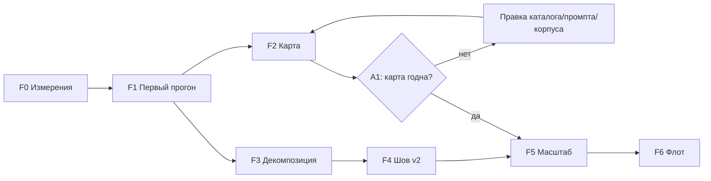

# coHound — стратегия реализации production-grade архитектуры

> **Статус реализации на 2026-10-28** (HEAD `f6100c7`): PARTIAL — сделано 1 из 7 фаз (F0),
> открыто 5 (F1–F5; F1 закрыт по Exit, но не по содержанию), снято 1 (F6 — вне рамок
> документа по его же формулировке). Ниже у каждого пункта маркер ✅/⬜/➖/❔
> с доказательством `путь:строка`.

**Документ:** `docs/architecture/11-production-architecture-strategy.md`
**Статус:** план (2026-10-23). Ничего из него не реализовано.
*На 2026-10-28 формулировка устарела: F0 закрыт, F1 закрыт по Exit (прогон дошёл до `report`),
часть содержания F1 и F2 сделана — см. баннер выше и маркеры в §4.*
**Предмет:** как привести систему к целевой форме `10-extraction-pipeline-architecture.md` §5
и довести до production-grade. Обратная совместимость **не требуется** (решение владельца),
поэтому часть §5 пересматривается — см. §2 и §3.
**Смежное:** `10` (целевая форма, дефекты Д-1…Д-8, §9 — её независимая критика),
`06` §1 (определение production-grade, P1–P9), §2.1 (принципы), §4 (M0.5),
`07` (зоны и шов), `09` (durability, инкрементальность), `05` (стек).

---

## 0. Что решается этим документом и чего не решается

**Решается:** порядок работ, границы между ними, критерии выхода, что считается
доказательством, где стоят гейты и что делать, если фаза провалилась.

**Не решается:** методология (инварианты I1–I23 не пересматриваются), выбор моделей
(это измерение, `§7.4`), содержание ADR, схема CLI-флагов.

**Главный факт, который определяет весь план.** Ни один прогон не дошёл до `report`
(`06` §4, M0.5). Самая дальняя durable-фаза — `evaluate`, и она пройдена без живого
оценщика (`llm_scenarios = 0`). Значит: система ни разу не произвела свой продукт —
сравнительную карту возможностей. Любая инфраструктура, построенная до этого, оплачена
без доказательства ценности (A1).

Отсюда порядок: **сначала один прогон, который доходит до отчёта, потом качество карты,
потом масштаб.** Архитектурная работа (декомпозиция стадий, память) идёт параллельно
второму шагу, потому что она не зависит от качества карты и не блокирует его.

---

## 1. Production-grade для этого масштаба

`06` §1 задаёт P1–P9. Здесь они превращаются в проверяемые факты с текущим состоянием,
потому что «production-grade» без факта — лозунг.

| # | Критерий | Проверка | Факт на 2026-10-23 |
|---|---|---|---|
| G1 | Прогон доходит до `report` | `outputs/` + `run_manifest.yaml` на реальном корпусе | ⛔ не было ни разу |
| G2 | Карта пригодна человеку | аналитик разбирает отчёт; каждая аномалия названа причиной | ⛔ нет данных |
| G3 | Оценщик объявлен и измерен | `llm_scenarios` непуста; κ и abstention посчитаны | ⛔ непустых нет |
| G4 | Стоимость предсказуема | `peak_rss_mb`, `workers`, время по стадиям — в `metrics.json` | ⛔ не пишется |
| G5 | Прерывание не теряет прогресс | убить на любой фазе → resume без пересчёта | 🟡 чанки/документы да, хвост фазы нет |
| G6 | Гибель видна | убитый процесс → терминальный статус, не `running` | 🟡 только Python-размотка |
| G7 | Ограничения объявлены | окна и бюджеты в манифесте; молчаливых потолков нет | 🟡 частично |
| G8 | Размещение — данные | `local`/`split` дают равный `pb` на одном корпусе | ⛔ `split` не паритетен (Д-1) |
| G9 | Масштаб вычислений | продукт-стадия на другой ноде, результат байт-идентичен | ⛔ нет |
| G10 | Воспроизводимость | два прогона на идентичных входах → ≥95 % совпадений статусов | ⛔ нет данных |

**Целевое состояние production-grade = G1–G8.** G9–G10 — следующий продуктовый инкремент,
и он гейтится отдельно (§4, F5), потому что A1 запрещает строить масштаб до доказанной
ценности. G8 (паритет `local`/`split`) входит в целевое состояние **не по ценности, а потому
что `split` объявлен требованием развёртывания** (решение владельца, §10): это условие
эксплуатации, а не запас мощности.

---

## 2. Что даёт отказ от обратной совместимости

Это не косметика: четыре пункта §5 существуют **только** из-за совместимости. Без неё они
удаляются, а не упрощаются.

| # | Что было | Почему держалось | Что теперь |
|---|---|---|---|
| 2.1 | `product_content_token` = хеш пар `(chunk_id, content_hash)` по **всем чанкам** | смена формулы инвалидирует все партиции | хеш пар `(doc_id, content_hash)` по **документам** — тот же различающий смысл, O(доков) вместо O(чанков) |
| 2.2 | Две фазы чанкинга: `build_id = NULL` → `UPDATE` → зачистка | `pb` неизвестен до полноты набора чанков | `pb` известен из документов **до** чанкинга ⇒ одна запись с финальным `pb`, без `NULL`, без `UPDATE`, без зачистки |
| 2.3 | `_PARTITION_SCHEMA` не трогать | инвалидация сборок | бамп формулы; все партиции пересобираются один раз — это и есть корректное поведение |
| 2.4 | Схемы шва — только аддитивно (`schema_version: "1"`) | совместимость с уже развёрнутым edge | шов проектируется заново как v2: передача артефакта, `submit`/`collect`/`abort` |
| 2.5 | `extractor_version` = `docling-doc-3:<level>` (Д-8) | смена ломала ключ кэша и `pb` | `docling-doc-3:<level>/docling-<build>` — движок назван, кэш не может соврать, `digests.py` перестаёт утверждать неверное |
| 2.6 | DDL только аддитивно | старые БД | схема пересоздаётся, совместимость не сохраняется (решение владельца 01.11.2026). **Реализовано (волна S плана 17):** аддитивные шимы снесены (`_ensure_columns` в `cohound.db`, `_migrate`/`_ADDITIVE_COLUMNS` в `state.db`, `_migrate` в `edge_jobs.db`), все колонки/индексы объявлены в `CREATE TABLE`; версия читается **до** DDL, несовпадение → `SchemaVersionMismatch` с путём файла → `EXIT_USAGE` с `schema_version: …`. Все три БД гейтятся одинаково. Цена названа прямо: файл прежней версии отвергается и пересоздаётся оператором, а не догоняется молча |
| 2.7 | `IndexBuild.docs` в `PhaseResult` | публичное поле | удаляется; `serp_loop` читает документы из store |
| 2.8 | `corpus.py` — монолит ~7200 строк | правки на месте дешевле | пакет `core/pipeline/corpus/{fetch,extract,chunk,index,manifest,phase}.py` без re-export-шимов |
| 2.9 | `extract_cache` — «best-effort кэш» | осторожность | **durable в пределах цикла**; GC только на границе цикла. Промах ⇒ переизвлечение (видно в метриках), не ошибка |
| 2.10 | `extract_workers` входит в `crawl_config_digest` | совместимость `run_id` | **выходит из контракта**: параллелизм извлечения не может изменить состав корпуса (в отличие от `max_workers`, который взаимодействует с усечением `max_documents`). Резолвнутое значение публикуется как наблюдённый факт — `metrics.json.resources.scheduling`. Иначе «воркеры из бюджета» (F0) сделали бы `run_id` функцией хоста: та же ошибка, что env-модель у оценщика |

**Что НЕ освобождается.** Инварианты I1–I23, категорийная нейтральность `core/`,
иммутабельность сборок (K2), «сначала диск, потом БД», `methodology_version`.
Совместимость — про форматы, не про смысл.

---

## 3. Форма: стадии, владение, где проходит граница

### 3.1. Пересмотр §5.7: две фазы не нужны

В `10` §5.7 чанки писались с `build_id = NULL`, потом `UPDATE`, потом зачистка мусора.
Этот обход существовал ровно потому, что `pb` хешировал **чанки**. С документным токеном
(§2.1) `pb` вычислим сразу после экстракции продукта, до первой нарезки. Значит:

```
продукт:
  1. fetch → retain → extract  (окно воркеров; текст → extract_cache; строка → corpus_docs)
  2. pb := f(doc-пары, chunker, extractor_build, level, embed, lexical, vector_store)
  3. для каждого документа: текст из extract_cache → chunk → corpus_chunks(build_id = pb)
  4. embed батчами → партиция через memmap → commit
```

Память: один документ + батч эмбеддинга + страницы memmap. Ни `NULL`-строк, ни `UPDATE`,
ни аккумулятора пар. Шаг 3 при промахе кэша переизвлекает документ — это видимая запись
`re_extracted_at_commit`, а не тихая деградация.

**Обязательный инвариант, который делает это корректным:** нарезка — чистая функция от
(текст документа, `chunker_version`, поля, которые чанкер читает). Формулировка проверяемая:
для каждого поля `CorpusDoc`, которое чанкер читает, мутация поля либо меняет токен, либо не
меняет выход чанкера. Это property-тест, а не комментарий.

### 3.2. Контракт стадии

Единица работы — **`(run, product, stage)`**. Стадия:

- **вход** — durable-ссылки (`content_hash`, `doc_id`, `partition_build_id`), не объекты Python;
- **выход** — артефакты на диске + строки в БД, записанные до объявления завершения;
- **память** — ограничена объявленным окном (§3.3);
- **перезапуск** — либо находит выход зафиксированным, либо пересчитывает; «половина в памяти»
  не существует.

Владение артефактом (кто пишет — тот и отвечает):

| артефакт | владелец | читатели |
|---|---|---|
| `corpus_raw/{product}/{hash}.bin` | retention | extract, audit |
| `extract_cache/{hash}.json` | extract | chunk, audit |
| `corpus_docs` | extract | chunk, index, report |
| `corpus_chunks` | index | retrieve, evaluate, report |
| `index_store/{package}/{pb}/{product}` | index (иммутабельно) | retrieve |
| `index_manifest` + `_compositions/{cb}.json` | manifest (когортная граница) | retrieve, report |

### 3.3. Окна

| окно | ограничивает | носитель |
|---|---|---|
| `extract_window` | одновременных извлечений | `crawl.extract_workers`; при незаданной оси — `min(по бюджету памяти, по CPU)` |
| `pending_window` | страниц в очереди извлечения | `extract_queue` (durable; окно «в полёте» — `crawl.extract_workers` у потребителя) |
| `chunk_window` | чанков одного документа в памяти | размер документа (естественная граница) |
| `embed_batch` | текстов в одном вызове эмбеддера | новая ось, дефолт по замеру |
| `vector_write` | строк в памяти при записи `.npy` | `memmap`, окно фиксировано |
| `retrieval_window` | чанков, гидрируемых на запрос | `top_k` (после `argpartition`) |

**Бюджет памяти — объявленный вход, а не догадка.** `COHOUND_MEM_BUDGET_MB` (дефолт —
`MemAvailable` минус резерв). Preflight считает `workers = min(floor((budget − parent_floor)
/ peak(level)), cpu_count)`; если выходит 0 — отказ с названными числами. Два слагаемых
потолка отвечают на два разных вопроса: память — «сколько поместится», CPU — «сколько
успеет». Без второго хост с запасом RAM получил бы 148 процессов docling на 12 ядрах
(`text` 855 MB на 128 GB), то есть чистую потерю на переключениях и на инициализации
конвертера в каждом воркере. Это не потолок на работу (R6), а отказ начинать заведомо
невозможную конфигурацию; объём работы по-прежнему не ограничен.

**Третье слагаемое — видеопамять (2026-10-28, P9).** Под объявленным
`crawl.pdf_device: cuda` preflight берёт минимум ещё и по VRAM:
`floor(usable_vram / vram_peak(level))` (`usable = total − 512 MB` резерва; `vram_peak` —
замер, `817 MB` для `layout_tables`, `full` не измерен и потому не ограничивает). Без него
формула по host-памяти вывела бы воркеров, которых карта не держит (CUDA OOM вместо
видимого отказа). На измеренной карте (RTX 3050, 4 GB) связывает host, а не VRAM —
параллель на одной карте даёт 1.10×, поэтому правильная конфигурация — один GPU-воркер
(`10` §3.4–3.6, §5.5).

---

## 4. Фазы

Каждая фаза заканчивается **проверяемым** состоянием. Гейт — решение, которое нельзя
принять по инерции.

### F0 — Измерительная база

**Зачем.** Всё дальнейшее — измерение, а не предвидение (A3). Сейчас система не публикует
ни одного числа о себе, поэтому «стало лучше» недоказуемо.

**Статус: ✅ сделано (2026-10-24).** `core/pipeline/resources.py` (пики по фазам, бюджет,
`workers_from_budget`), блок `resources` в `metrics.json` (`04` §B.2), вывод окна экстракции
из бюджета вместо константы, preflight с `EXIT_USAGE`, пик воркера через файл-сток,
`COHOUND_MEM_BUDGET_MB` (`03` §D.6). Закрывает Д-7.
*Доказательство исполнения (HEAD `f6100c7`):* блок собирается в прогоне
(`core/cli/commands/run.py:1297` — `build_resources_block`) и пишется в `metrics.json`
(`core/pipeline/metrics.py:459`); живой прогон его несёт — `runs/ru-pg-dbms-3edf2b06097c/metrics.json`
(`resources.budget.source = "available"`, `resources.phases.discovery.peak_rss_mb`).
Распределение чанков по семействам наполняется фазой корпуса
(`core/pipeline/corpus.py:3245` — `summarize_chunks_per_doc`), поэтому в прогоне без
переисполнения корпуса блок пуст — это наблюдение, а не дефект.

**Содержание.**
- `peak_rss_mb` родителя по фазам (`VmHWM`), пик воркера (максимум по пулу), время по стадиям.
  *Не сделано:* байты скачано/ретенировано — они уже есть в провенансе сеанса краула
  (`crawl_truncation`, счётчики `crawl`), дублировать их в `resources` незачем.
- Распределение чанков на документ **по семействам** (HTML/PDF/text/epub/office) — вместо
  оценки «20–43» из `10` §9.1, которая была догадкой по двум крайним точкам.
- `metrics.json` получает блок `resources`.
- Бюджет памяти + preflight (§3.3).
- `extract_workers`/`extract_max_tasks_per_child` выходят из `crawl_config_digest` (§2.10):
  иначе выведенное из бюджета число воркеров меняло бы `run_id` от хоста к хосту и ломало
  и G8, и G10.

**Куда именно попадают числа (и почему не в манифест).** `metrics.json` — носитель
наблюдённых фактов исполнения: пики, разрешённое окно, чанки на документ, бюджет. В
`run_manifest.yaml` они **не** дублируются намеренно: манифест несёт **объявленные** входы
(включая `crawl_extract_workers` — ось, как её задал оператор), а выведенное из памяти хоста
окно — наблюдение, а не вход. Смешать их значило бы вернуть в манифест ту самую зависимость
от машины, ради устранения которой сделан §2.10. `metrics.json` durable: пишется и при
остановке на гейте, потому что отражает то, что реально отработало.

**Exit.** Файл в `docs/reports/measurements/` с реальными числами (пусть даже с прогона,
который упал); `metrics.json` содержит `resources`; preflight отказывает на конфигурации
`full × 2` на 6.9 GiB с внятным сообщением.

**Факт закрытия Exit.** preflight проверен вручную: `COHOUND_MEM_BUDGET_MB=500` + `--document-level
layout` → `memory: extraction does not fit memory budget: budget=500 MB, level=layout, level
peak=1563 MB, parent floor=500 MB → workers=0`, отказ **до** фаз. Файл с реальными числами
пика фазы появится в F1 (на стоящем прогоне его взять неоткуда — систему надо запустить).

**Гейт.** Нет. Это инфраструктура.

### F1 — Первый полный прогон (M0.5)

> ⬜ не сделано как фаза (5 из 6 пунктов закрыты, Exit достигнут; открыт один пункт).
> - ✅ Д-8 `extractor_version` называет сборку движка: `core/adapters/extract_document.py:252`
>   (`docling_extractor_version`), вид значения в манифесте —
>   `docling-doc-3:layout_tables/cpu/docling-2.135.0/md-plain-underscore/finalize-1`, стек в
>   контракте — `trafilatura-html-5+text-plain-2+epub-2+pdfium-text-2+docling-office-1+docling-doc-3/cpu/docling-2.135.0/md-plain-underscore/finalize-1`
>   (сегмент `cpu`/`cuda` — ось `crawl.pdf_device`, P9).
> - ✅ воркеры из бюджета + уровень из профиля: `core/cli/wiring.py:2511` (`workers_from_budget`),
>   preflight `core/cli/wiring.py:2453` (`preflight_extraction_budget`, `EXIT_USAGE`).
> - ✅ durable хвост спуска (write-through): синки `persist_observation`/`persist_member`
>   (`core/pipeline/archive_descent.py:337,473,1031`), подключены в
>   `core/pipeline/corpus.py:3245`; видимая строка пропуска по бюджету —
>   `core/pipeline/archive_descent.py:1050` (`SKIP_BUDGET`).
> - ✅ PK `corpus_members` = `(archive_content_hash, member_path, product_id)` —
>   `core/store/sqlite.py:406`.
> - ✅ liveness: `heartbeat_at`/`owner`, `interrupted` в словаре —
>   `core/pipeline/liveness.py:54,66`, порог 600 s / интервал 60 s.
> - ⬜ изоляция прогона от соседей по памяти (cgroup/unit) — **не сделана**: cgroup только
>   упомянут в комментарии о том, что `MemAvailable` врёт (`core/pipeline/resources.py:441`),
>   изоляции запуска нет.
>
> **Exit ✅ достигнут (2026-10-27):** прогон `ru-pg-dbms-3edf2b06097c` дошёл до `report` —
> `runs/ru-pg-dbms-3edf2b06097c/outputs/` и `runs/ru-pg-dbms-3edf2b06097c/run_manifest.yaml`;
> прогон назван «единственным, дошедшим до `report`» в
> `docs/reports/measurements/2026-10-27-golden-reference-set-unusable.md:4`. Оговорка: Exit —
> «дошёл и артефакты на месте», а не «каждая аномалия названа причиной»: 63 `❓` остались
> аномалией I3 (SERP тогда не исполнялся).

**Зачем.** Без этого нет продукта, и все прочие числа — гипотезы (`06` §4).

**Содержание.**
- Д-8: `extractor_version` называет сборку движка (§2.5).
- Число воркеров из бюджета; уровень из профиля домена; **гарантированно помещающийся
  baseline** — `layout_tables × 1` (0.5 + 1.95 ≈ 2.45 GB) либо `text × 2` (0.5 + 1.7 ≈ 2.2 GB).
  Выбор — по замеру F0 достоверности таблиц, не по вкусу.
- Хвост фазы durable: провенанс спуска по контейнеру, а не в конце. **Дизайн согласован
  (совет 2026-10-24, три полосы независимо + синтез).** `archive_observations`/
  `corpus_members` копятся в памяти (`core/pipeline/corpus.py:2211-2212`) и пишутся пачкой в
  `core/pipeline/corpus.py:3245` ⇒ SIGKILL теряет всё. Лечение — write-through: `ArchiveDescentWalker`
  получает два необязательных колбэка (`persist_observation`, `persist_member`), `None` —
  прежнее поведение байт-в-байт. Точки: наблюдение — `_record` (`archive_descent.py:332`,
  вызовы `409`/`445`/`467`/`741`), член — `_settle` (`:530`), где уже есть `doc_id`/
  `extracted_content_hash`; вложенные — `:634`/`:652`. Финальную пачку сохранить как
  идемпотентный reconciliation-pass (дешёвый повторный upsert). Сбой записи изолируется в
  `errors` по образцу `_persist_docs` (`core/pipeline/corpus_index.py:80-111`) — отказ store не должен убивать спуск.
  Идемпотентность уже обеспечена: `observation_id` детерминирован (`run|product|root|hash|depth`),
  `corpus_members` — UPSERT. **Не делать в первом патче:** предварительное observation «контейнер
  начат» (нужна отдельная семантика промежуточного состояния) и micro-batch (сначала измерить
  стоимость записи на горячем пути). **Per-member `SKIP_BUDGET` делать:** семантика таблицы уже
  включает пропущенные члены — `SKIP_CYCLE`/`SKIP_NESTED` пишутся через `_member_row` с
  `skip_reason` и `doc_id=None` (`archive_descent.py:630-660`); сейчас члены, срезанные бюджетом
  (`:571-580`, `:597-604`), не дают строки вообще, и `archive_budget_exhausted` виден только
  в `errors`.
  **Реализовано (2026-10-24):** синки `persist_observation`/`persist_member` в
  `ArchiveDescentWalker`, единая точка строки — `_emit_member`/`_emit_skipped_member`;
  `SKIP_BUDGET`/`SKIP_STREAM_TOO_LARGE` теперь дают строку члена (видимый пропуск); синки
  подключаются в `corpus.py` (`_persist_observation_sync`/`_persist_member_sync`, отказ стора
  → `errors`), финальная пачка осталась reconciliation-pass'ом.
- **Дефект схемы — исправлен (2026-10-24, `SCHEMA_VERSION = 3.13.0`):** PK `corpus_members` =
  `(archive_content_hash, member_path, product_id)` (`core/store/sqlite.py`). `run_id` в ключе
  избыточен (БД прогона per-run — `runs/{run_id}/cohound.db`), а `product_id` был недостающим
  измерением: один и тот же архив в двух продуктах одного прогона перезаписывал
  `run_id`/`root_url`/`doc_id`, то есть провенанс члена врал молча (с write-through это стало
  бы заметнее). Миграции нет: старый `cohound.db` отвергается гейтом версии (§2.6).
- Liveness: `heartbeat_at`/`owner`, `interrupted` в словарь, гейт версии схемы (§2.6).
  **Реализовано (2026-10-24):** `core/pipeline/liveness.py` (порог `SESSION_STALE_AFTER_S` = 600 s,
  интервал `HEARTBEAT_INTERVAL_S` = 60 s), recovery-on-open в `open_session`,
  `interrupted` в `docs/status-dictionary.yaml` + `CrawlSessionStatus`, `SCHEMA_VERSION = 3.12.0`.
  Словарь **не** бампается: секция операционная, `status_dict_version` — литерал (§13, шапка словаря).
- Изоляция прогона от соседей по памяти (cgroup/unit) — иначе «прогон упал» неотличимо от
  «сосед съел память».

**Exit.** Прогон `ru-pg-dbms` доходит до `report`; `outputs/` и `run_manifest.yaml` на месте;
каждая аномалия отчёта названа причиной; ни одного `running`-фантома.

**Гейт.** G1, G5, G6, G7.

**Чего не делаем.** Не трогаем `split`, не переписываем `corpus.py`, не оптимизируем ретривал.
Цель — дойти, а не улучшить.

### F2 — Карта, которой можно верить

> ⬜ не сделано — инфраструктура обоих полос готова, ни одна измерительная задача не закрыта.
> - **Оценщик:** `hound experiment evaluator-benchmark` реализован
>   (`core/cli/commands/experiment.py:530`, метрики κ/abstention/`fabricated_support`/bootstrap —
>   `core/pipeline/evaluator_benchmark.py:621-704`), но замера на трёх моделях нет: в
>   `docs/reports/measurements/` нет файла с результатами benchmark'а, а обе слоты `deploy.yaml`
>   несут одну и ту же модель (`config/deploy.yaml:88-89` и `:94`). Выбор модели по κ
>   **не сделан** — модель объявлена, а не измерена (A3).
> - **`base_url` в слот:** ✅ сделано — `config/deploy.yaml:107`
>   (`base_url: "https://plusvibeapi.ru"`), пустой слот теперь означает «оценщик не
>   поднимается», а не «endpoint берётся из env»; место исполнения объявлено флагом
>   `rnd_endpoint` (`config/deploy.yaml:99`).
> - **SERP-контур:** ✅ сделано, но **не** через `run_serp_loop`. Производитель запросов —
>   `_run_serp_contour` (`core/pipeline/corpus.py:835-963`), вызов внутри фазы корпуса **до**
>   дренажа — `core/pipeline/corpus.py:835-963`; `run_serp_loop` сам остаётся невызываемым
>   (единственные вхождения — определение `core/pipeline/serp_loop.py:1549` и реэкспорт).
>   Ось в контракте — `serp_rounds` (`core/pipeline/digests.py:117`), значение из
>   `--serp-rounds`/`run.yaml:serp.rounds`/`COHOUND_SERP` (`core/cli/wiring.py:1095`).
>   Оговорка: контур исполняется только при объявленных `rounds > 0` **и** бюджете
>   (`core/pipeline/corpus.py:835-963`); на прогоне `ru-pg-dbms-3edf2b06097c` он не исполнялся.
> - **Exit:** прогон с непустой `llm_scenarios` и живыми вердиктами есть
>   (`runs/ru-pg-dbms-3edf2b06097c/run_manifest.yaml` — сценарий `evaluator`,
>   `web_tool: False`), а «посчитанный κ» — **нет**: golden-набор оказался непригоден
>   (6.8 % согласия, `docs/reports/measurements/2026-10-27-golden-reference-set-unusable.md`).
> - **Гейт A1:** критерий реализован как число (`core/domain/scoring.py:781` —
>   `DEFAULT_UNKNOWN_SHARE_THRESHOLD = 0.30`, используется в профиле публикуемости) и
>   сформулирован в §8.6/§10.2, но **решение не принято**. Факт по прогону
>   `ru-pg-dbms-3edf2b06097c` (`cells` в `runs/ru-pg-dbms-3edf2b06097c/cohound.db`): всего
>   476 ячеек — `✅` 70, `⚠️` 24, `❓` 63, `status IS NULL` (failed) 319, `❌` 0. По буквальной
>   формулировке §8.6 («>30 % **ячеек** в `❓`») доля = 63/476 = **13.2 %** — порог не
>   превышен, `❌` без absence-evidence нет, то есть карта **проходит**; при знаменателе
>   «оценённые ячейки» (и это то, что предлагает §8.6 как смягчение — считать по форме)
>   доля = 63/157 = **40.1 %** — не проходит. Знаменатель в документе не закреплён ⇒
>   исход гейта ❔, и это дефект формулировки, а не измерения.

**Зачем.** Это A1-гейт. Если карта негодна, всё дальнейшее — оплаченная инфраструктура без
продукта.

**Содержание (две независимые полосы).**
- **Оценщик.** `hound experiment evaluator-benchmark` на трёх моделях одного endpoint
  (`qwen3.8-omni-flash:cxa`, `gpt-6-luna:purple`, `deepseek-v4.1-flash-1017:cxb`), `--repeats 2`;
  выбор по κ/abstention/`fabricated_support`, запись в `deploy.yaml`. Плюс `base_url` в слот —
  сейчас он пуст, а `.env` задаёт адрес, то есть оценщик поднимается вне контракта.
- **SERP-контур.** `run_serp_loop` не вызывается, `SearchPhase.SERP` не излучается ⇒ каждый
  `❓` навсегда остаётся аномалией I3. Нужен производитель запросов и ось `search_rounds`
  в контракте. Без этого «честность» отчёта декоративна: механизм исчерпания есть, но
  ни разу не исполнялся.

**Exit.** Прогон с непустой `llm_scenarios`, живыми вердиктами и посчитанным κ; `❓` либо
исчерпаны протоколом, либо отревьюены человеком; аналитик разбирает отчёт и говорит, годится
ли карта.

**Гейт — A1.** «Карта годится» / «не годится» по проверяемому критерию, зафиксированному
**до** начала фазы (§8.6). При «не годится» масштабирование не начинается: сначала правится
то, что делает карту негодной (каталог, промпт, ретривал, корпус), потому что масштабировать
неверное измерение бессмысленно. Гейт останавливает **F5**, но не F4: F4 — требование
развёртывания, она не масштабирует измерение и не зависит от его качества.

### F3 — Декомпозиция стадий и память

> ⬜ не сделано — `corpus.py` остаётся монолитом: 9461 строка, ни одной стадии-модуля
> (`core/pipeline/corpus.py`, `build_corpus` — closure внутри файла); `memmap`-записи партиции
> и `embed_batch` в коде нет (грепп по `core/` — 0); `IndexBuild.docs` на месте
> (`core/pipeline/extraction_runtime.py:522-527` — поле `docs` в контракте сборки). Сделано из
> смежного: бюджетирование памяти и ширина пула (F0), write-through спуска (F1).

**Зачем.** Это и есть архитектурная работа `10` §5. Она не зависит от качества карты,
поэтому идёт параллельно F2 (другие файлы) — но её результат нужен F4.

**Содержание.**
- `corpus.py` → пакет стадий (§2.8). Тесты (1556 в `tests/pipeline`) — страховка; часть из них
  кодирует форму монолита и будет переписана осознанно.
- Документный `pb` (§2.1) + одна запись чанков (§3.1).
- `memmap`-запись партиции; `embed_batch`.
- Ретривал: `mmap` + `argpartition` до гидртации; снятие зеркала `_records_by_id`.
- Удаление `IndexBuild.docs`.

**Exit.** Property-тест «ни один объект не переживает свою стадию»; пик стадии не зависит от
числа продуктов; `pb` различает изменение документа и не различает порядок обработки;
retrieval-тесты байт-идентичны прежним при том же top-k.

**Гейт.** G4, G7.

### F4 — Размещение как данные (шов v2)

> ⬜ не сделано — шов v2 отсутствует: в allowlist операций нет `extract/submit`/`collect`/`abort`
> (`core/edge/server.py:103` — `_POST_OPS`: `fetch`, `search`, `registry`,
> `crawl/{submit,status,cancel,collect,poll}`), передача артефакта чанками не реализована
> (только inline-base64, `core/edge/server.py:591`), ось уровня в запросе edge игнорирует.
> Текущий `split` работает, но **не паритетен** `local`: игнор `document_level`/`pdf_pipeline`,
> двойной фетч, потеря членов контейнеров (`core/pipeline/digests.py:129-132`;
> `core/adapters/remote_extractor.py:42` — `supports_source_path = False`). Зависимость от F3
> соблюдена: F3 не начата ⇒ F4 законно не начата.

**Гейт входа:** нет. `split` объявлен требованием развёртывания (решение владельца, §10.3),
поэтому запрет `06` §1 на инфраструктуру «на вырост» не применяется: это условие
эксплуатации, а не запас мощности. Зависимость остаётся только технической — **F3**:
переносить на шов можно лишь то, что уже оформлено стадией с durable-входом и выходом.

**Содержание.** Шов v2: `extract/submit`/`collect`/`abort` по артефакту, передача чанками,
идентичность экстрактора в том же пространстве имён, ось уровня в запросе. Стадия извлекается
в edge без изменения `pipeline`.

**Exit.** `pb` совпадает под `local` и `split` на одном корпусе; член контейнера извлекается
под `split`; артефакт 250 MB проходит; брошенная загрузка убирается.

**Гейт.** G8.

### F5 — Масштаб вычислений

> ⬜ не сделано (и не начато законно: гейт входа требует пройденного A1 и реальной нужды во
> флоте — ни того, ни другого нет). Продукт-стадия как единица работы на другой ноде
> отсутствует: прогон исполняется в одном процессе, `PHASES` линейны
> (`core/pipeline/runner.py:132`), общего носителя артефактов и централизованной
> персистенции вне локальной ФС нет.

**Гейт входа:** флот действительно нужен (недельный цикл на 100 якорях) **и** A1-гейт F2
пройден. Это единственное место, где A1 останавливает работу.

**Содержание.** Продукт-стадия как единица работы на другой ноде; общий носитель артефактов;
централизованная персистенция.

**Явно НЕ делаем: не шардируем store.** `06` §1 называет отдельную корпусную БД антипаттерном
без триггера §14. Бутылочное горлышко — docling (CPU/RAM), а не запись в SQLite: 100 прогонов ×
15 продуктов × тысячи строк — это не нагрузка на писателя. Масштабируем вычисление,
персистенцию оставляем централизованной.

**Exit.** 3 продукта на 2 нодах дают результат, байт-идентичный однопроцессному.

**Гейт.** G9.

### F6 — Флот

> ➖ снято — вне рамок этого документа по его же формулировке («Вне рамок этого документа;
> назван, чтобы F5 не проектировался в вакууме»). Проверять нечего: пункт не имеет
> собственного содержания, которое можно закрыть или оставить открытым.

Недельный цикл: планирование 100 прогонов, учёт стоимости, межцикловый diff, отказ одного
прогона не влияет на остальные. Вне рамок этого документа; назван, чтобы F5 не проектировался
в вакууме.

---

## 5. Зависимости и порядок



Параллельность: **F2 ‖ F3** (разные файлы: `evaluate`/`serp_loop`/`deploy` против `corpus`/
`adapters`). Всё остальное последовательно.

Критический путь: **`F0 → F1 → F3 → F4 → F5`**. F2 висит сбоку и ограничивает только F5 —
это прямое следствие того, что `split` объявлен приоритетным требованием: календарь теперь
определяется декомпозицией, а не качеством карты. Цена названа в R7.

> ⬜ состояние на 2026-10-28: порядок соблюдён (F4 не начата, пока F3 не сделана), но
> критический путь **стоит на F3** — закрыта одна фаза (F0), F1 закрыт по Exit.
> F2 и F3 не начаты, то есть F4/F5 недостижимы по плану, а не по ресурсам.

---

## 6. Риски и что делаем, если сработало

| # | Риск | Признак | Ответ |
|---|---|---|---|
| R1 | Прогон не помещается в память ни в одной конфигурации | preflight отказывает даже на `text × 1` | корпус дробится по продуктам на отдельные прогоны; `document_level: text` как baseline; эскалация к владельцу — это меняет постановку |
| R2 | Прогон длится десятки часов | F0 показывает wall time | узкое место — краул (сеть), а не CPU: параллелить прогоны, не ускорять один; при необходимости — сузить корпус объявленным усечением |
| R3 | Карта негодна (A1-гейт провален) | критерий §8.6 не выполнен | F5 заморожен; F4 идёт (требование развёртывания); правка каталога/промпта/ретривала |
| R4 | Декомпозиция `corpus.py` дестабилизирует | падение тестов вне затронутых зон | режем по одной стадии за коммит, CI 50 с даёт быстрый цикл; при развале — откат коммита, не «доделывание» |
| R5 | Документный `pb` теряет различающую способность | property-тест «мутация поля чанкера» | токен расширяется полями, которые чанкер читает; формула — данные, не константа |
| R6 | `extract_cache` как durable не выдерживает | промахи на коммите массово | вернуть staging-таблицу `chunk_staging` (durable, две записи) — замена в пределах одной стадии |
| R7 | Приоритет F4 оплачен календарём F2 | F3 затягивается, карта остаётся непроверенной | F2 ‖ F3 идут параллельно, F4 стартует по завершении **F3**, а не F2; если F3 встала — F4 не начинается, и это эскалация, а не тихая задержка |
| R8 | Сосед по хосту съедает память | OOM при заведомо помещающейся конфигурации | изоляция cgroup/unit (F1); бюджет из `MemAvailable`, а не из `MemTotal` |

---

## 7. Оценки

Разделены по природе работы: код и текст — на скорости AI, решения и живые прогоны — на
скорости мира. Диапазоны, не точки.

| Фаза | Работа AI | Человек / внешний мир | Доминирует |
|---|---|---|---|
| F0 | 0.5–1 день | 1 прогон (8–12 ч ожидания) + решение о бюджете | ожидание прогона |
| F1 | 1–2 дня | 1 полный прогон (8–12 ч) + гейты G1/G2 + чтение отчёта (часы) | ожидание + вкус |
| F2 | 2–4 дня (оценщик + SERP) | benchmark-прогоны (~1 ч × 3 модели × 2 повтора) + **суждение о годности карты** | человеческое суждение |
| F3 | 4–7 дней | ревью контракта стадий | AI-объём, но с ревью-петлями |
| F4 | 4–6 дней | ревью протокола шва; проверка на реальном edge | AI-объём |
| F5 | 4–6 дней | доступ к нескольким нодам | инфраструктура |
| F6 | 5+ дней | планирование цикла | не оценено |

**Итого до production-grade (F0–F4, G1–G8):** порядка **3–4 недель календарно**, из которых
работа AI — 12–19 дней, остальное — живые прогоны (по 8–12 ч каждый), гейты и суждение о карте.
F5 добавляет ещё 4–6 дней работы AI и **не начинается** до A1-гейта.

**Допущения.** Прогон на реальном корпусе остаётся 8–12 ч; хост 6.9 GiB доступен и изолирован;
внешний LLM-endpoint доступен; входные данные пакета не меняются по ходу работ. Если прогон
окажется вдвое дольше (R2), календарь едет в первую очередь — не оценка кода.

**Чего в оценке нет.** Времени на «разобраться, почему опять упало» — а по истории проекта
именно это съедало больше всего. Резерв: +30 % на F1 и F3.

---

## 8. Где этот план ломается

Раздел написан так, будто его автор обязан его опровергнуть.

**8.1. Порядок F1 → F2 → F3 может оказаться неверным.** Я поставил F1 первым, потому что
система ни разу не произвела продукт. Но F1 включает правки, которые F3 всё равно перепишет
(хвост фазы, провенанс спуска). Это осознанная двойная работа: лучше дважды тронуть 200 строк,
чем три недели строить архитектуру для пайплайна, который не доходит до отчёта. Если владелец
считает иначе — F3 можно поднять перед F1, но тогда A1-гейт отодвигается, и это надо назвать
вслух.

**8.2. F2 может быть недостижим по внешним причинам.** Оценщик требует внутреннего
[OI]-endpoint и объявленной модели; SERP требует поискового адаптера и ключей. Если доступа
нет, G2/G3 не закрываются, а без них «production-grade» — только G1/G5/G6/G7. Это ограничение
среды, а не плана, и его нельзя замазать.

**8.3. F3 — единственная фаза, где я оцениваю риск недостоверно.** 7200 строк с 1556 тестами
режутся, но тесты кодируют форму монолита: часть придётся переписать, и объём этой переписки
я не знаю. Оценка 4–7 дней может оказаться вдвое больше. Смягчение — по одной стадии за коммит.

**8.4. Документный `pb` — самое красивое и самое опасное место.** Он опирается на
предположение «нарезка детерминирована по документу». Если чанкер читает что-то ещё
(например, глобальный контекст, соседние документы, `snapshot_date`), токен станет слабее
фактического входа, и переиспользование партиции вернёт неверный индекс. Защита — property-тест
из §3.1; без него изменение делать нельзя. Это не формальность: цена ошибки — тихо неверная
карта.

**8.5. «Не шардировать store» может не выдержать.** Я опираюсь на то, что узкое место —
docling, а не писатель. При 100 параллельных прогонах на общей ФС SQLite-локи станут проблемой
раньше, чем запись. Тогда понадобится либо серверная СУБД (триггер §14), либо per-run изоляция
каталогов. Второе дешевле и, вероятно, достаточно — но это не проверено.

**8.6. Гейт «карта годна» стал числом — и это его слабость.** Критерий зафиксирован (§10.2):
карта негодна, если **>30 % ячеек в `❓`** или есть **`❌` без absence-evidence**. Оба условия
машинно проверяемы, и это лучше переговоров. Плохо то, что 30 % — не замер, а назначенная
величина: она пропустит карту с 29 % невыразительных ячеек и заблокирует карту, где `❓`
сконцентрированы в одном неинтересном параметре. Смягчение: гейт считается **по параметрам**,
а не только в сумме, и отчёт печатает распределение `❓` — решение опирается на форму, а не на
одну цифру. Порог меняется решением владельца, но не задним числом.

**8.7. Оценки оптимистичны там, где проект исторически буксовал.** История: четыре прогона
умерли, ни один не дошёл до `report`. Значит наиболее вероятный сценарий — не «F3 займёт
неделю», а «F1 упрётся в пятую причину смерти, которую мы ещё не видели». Резерв +30 %
заложен, но, вероятно, недостаточен.

*На 2026-10-28 первая половина утверждения устарела: прогон `ru-pg-dbms-3edf2b06097c` дошёл до
`report` (см. F1), то есть «пятая причина смерти» — уже пройденная точка, а не гипотеза. Вторая
половина (оценки оптимистичны) остаётся верной: F1 занял больше названного, а F2/F3 не начаты.*

---

## 9. Что сознательно не строим

- **Очередь/брокер сообщений** для координации стадий. Пока стадии вызываются в процессе и
  на другой ноде уезжает только продукт, достаточно прямого вызова и файлового носителя.
  Триггер для пересмотра — F5.
- **Серверную СУБД.** Против `06` §1 без триггера §14. Пересмотр — если R8.5 сработает.
- **Отдельный сервис извлечения с собственной очередью.** Шов v2 даёт перенос стадии; очередь
  внутри пула не нужна, пока единица работы — продукт.
- **Кэш векторов в RAM.** Нарушает R2 (`10` §1). Единственный вариант — `mmap`.
- **Потолки на документы/байты** как средство от OOM. Против правила владельца; ограничение —
  по бюджету памяти (R6 в `10` §1).
- **Авто-выбор уровня извлечения по пробе.** Делает `run_id` ложным по построению (`10` §8.3).

---

## 10. Решения владельца, полученные до старта

| # | Вопрос | Решение | Следствие в плане |
|---|---|---|---|
| 10.1 | Порядок F1 vs F3 | **F1 первым**, как в плане | §5: критический путь идёт через F3; F2 параллельна |
| 10.2 | Критерий «карта годна» | **>30 % `❓` или `❌` без absence-evidence** | §8.6; гейт стал проверяемым и блокирует только F5 |
| 10.3 | Нужен ли `split` | **нужен и приоритетен** | G8 входит в целевое состояние (§1); F4 теряет гейт входа и встаёт перед F5; A1-гейт остаётся только на F5 |

> Статус решений на 2026-10-28:
> - **10.1 ✅ сделано** — F1 исполнялся первым и закрыт по Exit (`runs/ru-pg-dbms-3edf2b06097c/`),
>   F3 не начата; критический путь соблюдён.
> - **10.2 ❔ не проверено** — критерий записан и число считается
>   (`core/domain/scoring.py:781`), но **знаменатель доли не закреплён**: §8.6 говорит
>   «>30 % **ячеек** в `❓`», а смягчение там же предлагает считать по параметрам. По прогону
>   `ru-pg-dbms-3edf2b06097c` (476 ячеек: 70 `✅`, 24 `⚠️`, 63 `❓`, 319 `null`) получается
>   13.2 % от всех ячеек (гейт пройден) или 40.1 % от оценённых (гейт провален). Пока
>   знаменатель не назван, гейт не является «проверяемым», как утверждает следствие.
> - **10.3 ✅ сделано** — `split` объявлен и работает (`profile: local` по умолчанию,
>   `core/config/deploy.py`), но паритетом с `local` не обладает (F4), поэтому следствие
>   «G8 входит в целевое состояние» достигнуто не полностью.

**Открыто (не блокирует F0/F1):**
- **Изолированный бюджет памяти** (§6 R8). Сейчас 6.9 GiB с соседом, умеющим занять 5.5 GB.
  F1 можно начинать, но до изоляции вывод «прогон упал» неотличим от «сосед съел память»,
  а значит F1 не может закрыть G6 честно.
  → ⬜ не сделано: изоляции прогона (cgroup/unit) в коде нет — cgroup упомянут только как
  источник вранья `MemAvailable` (`core/pipeline/resources.py:441`); бюджет выводится из
  `MemAvailable` (✅, `core/pipeline/resources.py:436-458`), а изоляция — нет.
- **Нужен ли F5 (флот).** Если недельный цикл на 100 якорях — цель, G9 закрывается; если нет,
  F5 не начинается и план заканчивается на F4.
  → ❔ не проверено: решения владельца в документе нет, а F5 всё равно заблокирована A1-гейтом
  F2 и незакрытой F3.
